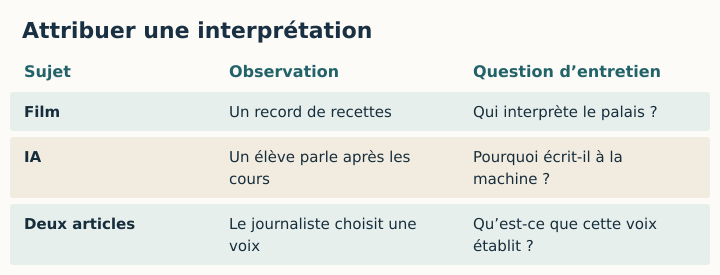

# ENS de Lyon · Séries A/L · Chinois (oral) 2026 — Corrigé brut

*Corrigé rédigé par IA, non officiel. Signalez toute erreur.*

**Rédaction** · GPT-6.2 Astra Ultra · vitesse non renseignée

Deux textes hors programme ont été proposés en LV2 dans la série Langues vivantes. Pour le premier, sur *Ne Zha 2*, le titre et le chapeau ont pu être vérifiés sur le canal de RFI. La dépêche de l’AFP fournit un contexte distinct. Le commentaire de ce premier sujet est donc partiel. Pour le second, sur l’IA comme confidente, le journal publie l’article intégral mais le fascicule de l’ENS n’indique pas les bornes de l’extrait distribué.

## 第一个题目 · 一部动画片的成功由谁解释

**根据可以核实的标题和导语所作的发言。** 法广在二〇二五年二月十二日介绍了《哪吒２》的票房成绩。导语把两件事联系起来：一部取材于传统传说的动画片打破纪录，这项成绩又使不少观众产生了自豪感。标题接着问，片中的天宫是否还暗指现实政治中的白宫。我想讨论的是，为什么一条关于电影票房的新闻，会同时成为一场关于观众如何理解图像的讨论。

先看能够核实的事实。票房纪录说明有人愿意买票，影片也因此获得了远远超出影评版面的注意。传统故事能够以当代动画的形式进入大众生活，这本身就有文化意义。一个家长或许因为童年的哪吒故事带孩子进影院，孩子则可能第一次通过动画接触这个人物。两个人购买了同样的票，喜欢电影的理由却可以不同。因此，即使一部作品激起了民族自豪感，也不能从总票房算出每位观众的动机。观众既可能关心本国动画工业，也可能只是被一个叛逆人物吸引。

再看标题的写法。一边是神话里的空间，一边是国际新闻里人人熟悉的政治符号，放在一起就会激起好奇心。提问把读者引进了某些观众的解读，却仍然留下疑问。可以拿同期的法新社报道作参照：它把对宫殿象征意义的猜测归给部分影迷，也提到创作者当时没有就这些猜测作出回应。在这里，说「有人这样看」和说「导演就是这个意思」，需要完全不同的证据。至于法广全文怎样排列各方意见，仅凭已核实的导语不能判断。

在我看来，电影的社会生命不止由导演决定。观众的联想也值得研究，因为它告诉我们，他们把怎样的现实经验带进了电影院。但是，尊重观众的解释，并不要求把它推广成唯一的解释。如果采访者有机会向一位刚看完电影的人提问，我希望他先问对方最难忘的是哪个人物、哪一幕，然后再问是否联想到现实政治。提问的顺序不同，得到的答案也可能不同。这个看似简单的新闻标题，因此也能让我们反过来思考媒体如何组织公众的注意力。

## 第二个题目 · 一个会回答的「树洞」

**根据《中国青年报》原文所作的发言。** 这篇二〇二五年五月二十七日的报道，先把读者带到一个普通的晚上。学生杜嘉鸣觉得模拟考试没考好，打开手机说出失望，对方很快给予安慰。读者起初容易以为那是一个体贴的朋友，随后才知道对面是人工智能。这样的开头把技术问题变成了一个日常选择：当我需要人听我说话时，究竟是什么让我觉得自己得到了回应？

第一，文章中的孩子并不只是追求新鲜。有人很晚才回到家，有人不愿听长辈说教，还有人曾经把秘密告诉同学，结果并没有被保密。陆小辰在班上总能逗同学笑，正因为如此，他怕承认自己也会难过就破坏了那个形象。对这些人来说，能够立刻开口，又不用担心看见对方失望的表情，是一种很具体的吸引力。「树洞」的比喻原来强调的是把话说出去，如今的变化在于，这个树洞还会回答。报道中的学生说的是他们感受到的安全感；这种感受本身不能证明软件如何保管对话。

第二，随时回答也可能改变对真人的期待。研究者曾祥龙提到，有人在习惯了机器之后，开始对需要等待的真人对话感到不耐烦。我们不妨想一想，一个朋友没有马上回消息，可能是正在上课，也可能是自己遇到了困难。正因为朋友有自己的时间和需要，我才必须学会问他现在方不方便。机器总是顺着我说话，会让我暂时放松；同伴偶尔不同意，却可能让我发现原先没有看到的一面。另一位受访专家黄薛冰还指出，人与人之间的眼神、距离和动作，都是在实际交往中学习的。

最后值得注意的是报道的收束方式。陆小辰并没有决定从此不用人工智能。他只是想到，也许有一天可以向身边的人承认自己不开心。这给读者留下了一个比「使用还是禁止」更细的问题：孩子能否把在屏幕上练习说出的第一句话，带回到一段真正的关系里？我认为，学校或家长要是只要求孩子关掉手机，却不给他们留下能够安心开口的时间，就遗漏了报道所揭示的原因。能听而不急于下判断的真人，才能使孩子确实多一种选择。

## Questions d’entretien

**票房能证明一部电影的思想吗？** 票房可以说明销售情况。要讨论作品表达了什么，还要看叙事和图像；要讨论观众接受了什么，就应当听取不同观众的看法。三类问题需要三类材料。

**为什么要保留标题的问号？** 问号让一种解释进入讨论，又没有把它确认为作者的意图。口头转述时如果把疑问句变成肯定句，发言就改变了消息的性质。

**人工智能的安慰没有价值吗？** 报道中的学生确实感到有人回应。值得追问的是，得到安慰之后，他是否还有机会面对不同意见，以及能否在需要时得到真人的实际帮助。

**两篇报道可以怎样比较？** 一篇从大众观看同一部电影出发，另一篇写一个孩子深夜独自看屏幕。前者容易让人把许多观众想成一个集体，后者却逐个写出孩子为什么愿意开口。两种写法都提醒我们问一句：现在听见的是谁的声音？

## Documents

[Fascicule officiel de l’ENS de Lyon](https://www.ens-lyon.fr/sites/default/files/2026-11/Chinois%202026.pdf#page=3). [Présentation de l’article par RFI](https://t.me/RFI_Cn/26040). [Dépêche AFP publiée par *Fortune*](https://fortune.com/asia/2025/02/11/ne-zha-2-first-movie-break-billion-single-market-china/). [Article du *Zhongguo Qingnian Bao*](https://zqb.cyol.com/pc/content/202505/27/content_411475.html).
