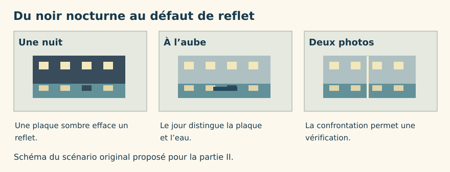

# ENS de Lyon · Séries A/L — Cinéma (oral 1) 2026 · Corrigé guidé

*Corrigé rédigé par IA, non officiel. Signalez toute erreur.*

**Lecture du rapport du jury** · GPT-6.2 Astra Ultra · vitesse non renseignée

**Rédaction** · GPT-6.2 Astra Ultra · vitesse non renseignée

**Autocontrôle** · GPT-6.2 Astra Ultra · vitesse non renseignée

**Couverture partielle.** La continuité séquencée « Les Reflets » traite toute la partie II. L’analyse de Baisers volés porte sur les photogrammes et les indications du concours. La copie audiovisuelle intégrale de l’extrait reste à vérifier.

## Préparer les deux prises de parole

Pour ouvrir l’analyse, dessinez le rectangle de l’enveloppe puis le contour du vase sur son fond. Demandez à chaque fois ce qui rend l’objet lisible. Sur le papier, noms, timbre et mains font circuler une information. Dans la seconde vue, le reflet donne à deviner une matière. Le jury attend aussi le ton et la voix de l’interprète. Les photographies établissent une composition visuelle, insuffisante pour restituer ces éléments sonores.

Pour la création, montrez la case nocturne puis la dernière case claire avant de lire la continuité entière. La fenêtre manquante du film joue le rôle du noir à double sens de la planche. Une même anomalie, à deux heures différentes, conduit à un constat partageable. Après la lecture, expliquez pourquoi la réplique du préposé devient un rendez-vous du lendemain et pourquoi la dernière photo reste à faire.

**Question d’entretien. Pourquoi ne pas montrer un responsable de la pollution ?** Parce que la découverte repose sur un décalage visuel dont la cause précise demeure inconnue. La grille, l’avis et les deux clichés montrent des conséquences et des vérifications possibles. Une attribution personnelle engagerait une autre intrigue et demanderait d’autres indices.

## I. Baisers volés — l’adresse et le soliflore

Le premier photogramme place une enveloppe au centre de l’image. Les doigts aux ongles rouges de Fabienne Tabard la tiennent par deux bords. Le nom de la destinataire, le timbre et la mention d’urgence font de cette surface claire un objet à lire. Le cadre coupe le visage de la lectrice. On rencontre donc Fabienne d’abord par le geste singulier de ses mains et par la manière dont un tiers s’adresse à elle. L’objet traverse la frontière entre un personnage conçu par celui qui écrit et une personne qui peut effectivement recevoir la lettre et lui répondre.

La dernière image resserre à nouveau le regard sur un objet. Un soliflore bleu sombre, posé sur une surface brune, se détache à peine de la paroi bleue. Une traînée de lumière en révèle le verre et sa courbure. Dans la première image, l’écriture et le contraste des ongles guidaient immédiatement la lecture. Ici, une silhouette et un reflet demandent du temps au regard. Ces deux gros plans donnent à l’objet des fonctions distinctes, rendre manifeste une adresse puis laisser une présence à interpréter. Le premier et le dernier plans sont attestés par la feuille pour le passage situé approximativement entre 1 h 10 min 23 s et 1 h 14 min 39 s. La nature des raccords, des réactions et des sons intermédiaires reste à vérifier sur la copie projetée. Le rapprochement proposé ici porte sur les bornes effectivement reproduites.

## II. De la planche au scénario

Sur la planche d’André Franquin réalisée avec Gotlib, le croissant de lune et les fonds noirs se répètent. Un personnage clair au bord d’un à-pic disparaît dans le noir. La dernière case inverse le partage des valeurs. Au matin, une silhouette noire dégoutte sur une page blanche. Le gag fait passer le noir de l’espace nocturne à la matière qui colle au personnage. Ce retournement acquiert une portée écologique dès que l’obscurité se révèle une substance qui souille. Le court métrage proposé transpose le ressort graphique dans une enquête de proximité.

### Continuité séquencée — Les Reflets, 5 minutes

**1. Extérieur, quai, nuit.** Lina, apprentie d’un atelier photographique, installe un trépied devant un bassin. Dans l’écran de l’appareil, les fenêtres éclairées dessinent une file régulière. Une fenêtre manque au milieu. Lina lève les yeux. Toutes sont allumées. Une cloche sonne l’heure, puis le bourdonnement d’un lampadaire occupe le silence.

**2. Même quai.** Lina se décale. La fenêtre absente revient, une autre s’efface. Un préposé ferme la grille de la promenade et lui propose de refaire sa photo le lendemain. Lina lui montre l’écran. Il se place exactement sur la marque de ses chaussures. Le manque est toujours là.

**3. Extérieur, bassin, aube.** En plan fixe, le rose du ciel gagne l’eau depuis le fond de l’image. Une plaque sombre, lentement rabattue contre le bord, interrompt les reflets. Une feuille colorée dérive jusqu’à cette limite et s’y arrête. Lina photographie les deux surfaces côte à côte. Le préposé prend son téléphone et désigne le numéro du bassin au service municipal.

**4. Intérieur, atelier, jour.** Sur une table lumineuse, Lina juxtapose le cliché de nuit et celui de l’aube. Un collègue tend une photographie retouchée où aucune fenêtre ne manque. Lina l’écarte doucement. Elle glisse les deux images non retouchées dans la même enveloppe et inscrit sur celle-ci le lieu et les deux heures.

**5. Extérieur, promenade, soir.** De retour devant le bassin, Lina voit la grille fermée et l’avis d’inspection. Dans la vitre de la petite guérite, toutes les fenêtres d’en face se reflètent. Elle baisse son appareil. Le cliquetis d’une chaîne de grille se prolonge sur le noir.

### Commentaire des intentions

Le film dure une nuit, une aube et un second soir, condensés en cinq minutes. La personne qui sait regarder une image et celle qui connaît le lieu ont chacune un moyen de vérifier l’anomalie. La bascule se produit au matin, comme dans la planche. Le cadre reste fixe assez longtemps pour que le spectateur découvre la plaque avec eux. Les moteurs lointains, le lampadaire et la chaîne appartiennent au lieu. Il n’y a pas de musique ajoutée ni d’identification chimique supposée à partir de la couleur.

[Fascicule officiel, p. 2–4](https://www.ens-lyon.fr/sites/default/files/2026-11/Arts%202026.pdf#page=2) · [Rapport de l’oral, p. 6–8](https://www.ens-lyon.fr/sites/default/files/2026-10/Arts%20-%20Cin%C3%A9ma%202026.pdf#page=6)

[Cinémathèque française, Baisers volés](https://www.cinematheque.fr/film/51551.html)
