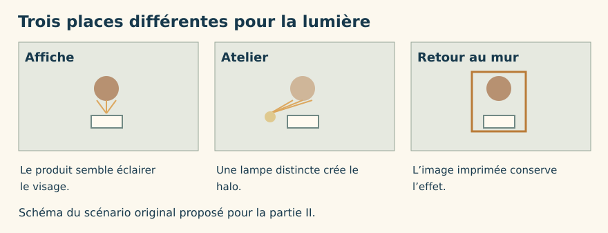

# ENS de Lyon · Séries A/L — Cinéma (oral 2) 2026 · Corrigé brut

*Corrigé rédigé par IA, non officiel. Signalez toute erreur.*

**Lecture du rapport du jury** · GPT-6.2 Astra Ultra · vitesse non renseignée

**Rédaction** · GPT-6.2 Astra Ultra · vitesse non renseignée

**Autocontrôle** · GPT-6.2 Astra Ultra · vitesse non renseignée

**Couverture partielle.** La continuité séquencée « La Source » traite toute la partie II. L’analyse de Mister Freedom porte sur les photogrammes et les indications du concours. La copie audiovisuelle intégrale de l’extrait reste à vérifier.

## I. Mister Freedom — entrer dans le cadre, s’y exposer

Dans le photogramme de départ, le dos de Mister Freedom occupe une grande partie du champ, à droite. Le costume sombre forme une masse qui obstrue ce vers quoi il avance. On distingue encore les verticales métalliques et les parois de l’ascenseur. Le plan rapproché, pris de dos, fait donc entrer le héros à l’écran par un effet assez comique de bouchon visuel. Celui qui est censé agir et se montrer empêche momentanément de voir le lieu où il va.

Dans un entretien donné à la revue *Aperture*, William Klein associe l’ascenseur du Freedom Building à un univers de sociétés multinationales dont on peut parcourir les étages. Le réalisateur éclaire ainsi l’une des fonctions de ce motif dans la satire. Sur la photographie du concours, aucun nom d’entreprise n’est lisible. À cette borne, c’est la veste qui commande l’attention.

Au terme indiqué, le cadre rapproché donne au contraire un visage à lire. La coiffure rousse très construite de Marie-Madeleine, la bouche ouverte sur un sourire et la main près de la joue font de ce visage un lieu de spectacle. Le jury précise le jeu de la langue, geste fugitif qu’un photogramme ne saurait suffire à restituer. Le contraste formel est net entre la masse compacte du dos et la mobilité expressive que suppose ce gros plan. On peut y voir deux façons de fabriquer la visibilité d’un personnage, l’occupation de l’espace par le héros et l’exhibition d’une expression par Delphine Seyrig. Les articulations de l’entrée dans l’ascenseur au sourire final, ainsi que l’intonation et le rythme, demandent l’extrait projeté, situé entre environ 10 min 14 s et 14 min 41 s. Ce développement commente les deux vues publiées.

## II. Du document publicitaire au scénario

L’affiche de 1934 pour Tho-Radia place au premier plan un pot blanc sous un grand visage. Le cou, la bouche et les yeux reçoivent une lumière montante, comme si le pot rayonnait. Les couleurs chaudes de la chevelure et de la peau se détachent du fond sombre. Les caractères massifs du nom et la référence à un docteur transforment cette apparence lumineuse en promesse d’efficacité. Le film suivant prend pour sujet la fabrication de cette apparence et l’autorité qu’une légende lui prête.

### Continuité séquencée — La Source, 4 minutes 30

**1. Intérieur, petite salle d’exposition, matin.** Nora fixe au mur le tirage de l’affiche. Malik, régisseur du musée, ouvre les stores. Une bande de soleil glisse du visage à la légende. Nora demande de la retirer. Le visiteur qui pousse déjà la porte voit seulement la bande lumineuse disparaître.

**2. Intérieur, atelier pédagogique, jour.** Sur une table, le même portrait est reproduit en carton. Un pot vide est placé devant. Malik allume une lampe sous une plaque translucide. Le cou s’éclaire. Une enfant, venue avec sa classe, avance le pot de quelques centimètres. Le halo reste sur le carton. Le son sec du pot contre la table fait se retourner les autres.

**3. Même atelier.** En silence, l’enfant glisse un morceau de papier opaque sous le pot, puis le fait passer devant la lampe. Seul le second déplacement éteint le halo. Une camarade dessine le trajet de la lumière. Nora ajoute sous son propre croquis deux mots, « dans l’image », et sous le dessin de l’élève, « dans l’atelier ».

**4. Intérieur, salle d’exposition, après-midi.** Un visiteur regarde l’affiche, puis les deux dessins présentés à côté. Il cherche en dessous du cadre la lumière qu’il vient de voir dessinée. Le cadre est plat. Il recule pour que sa fille puisse observer à son tour. Au loin, la sonnerie annonce la fin de l’atelier.

**5. Intérieur, fermeture.** Malik éteint les plafonniers. Pendant une seconde, le visage reste lisible dans la lumière du couloir, puis la porte se ferme. Le spectateur entend le clic de l’interrupteur après la disparition du visage.

### Commentaire des intentions

La démonstration utilise un pot vide et des sources lumineuses ordinaires. La force persuasive de l’affiche apparaît dans un geste reproductible par les visiteurs. L’enfant déplace une chose, regarde ce qui change puis rectifie son hypothèse. Les deux dessins occupent à la fin la place qu’aurait pu prendre un long discours. Une lumière du lieu, le frottement et le bruit de l’interrupteur donnent un rythme aux essais. L’objet de la publicité garde son statut de document historique.

[Fascicule officiel, p. 4–6](https://www.ens-lyon.fr/sites/default/files/2026-11/Arts%202026.pdf#page=4) · [Rapport de l’oral, p. 6–8](https://www.ens-lyon.fr/sites/default/files/2026-10/Arts%20-%20Cin%C3%A9ma%202026.pdf#page=6)

[William Klein, entretien sur l’ascenseur du Freedom Building](https://aperture.org/editorial/magazine-interview-william-klein/) · [Criterion Collection, Mr. Freedom](https://www.criterion.com/films/903-mr-freedom)
