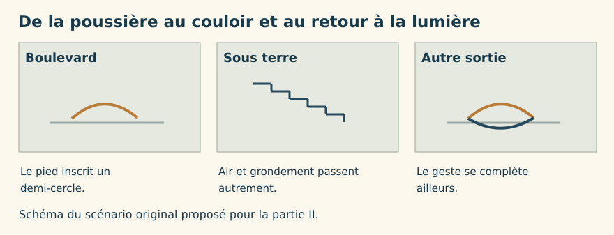

# ENS de Lyon · Séries A/L — Cinéma (oral 3) 2026 · Corrigé guidé

*Corrigé rédigé par IA, non officiel. Signalez toute erreur.*

**Lecture du rapport du jury** · GPT-6.2 Astra Ultra · vitesse non renseignée

**Rédaction** · GPT-6.2 Astra Ultra · vitesse non renseignée

**Autocontrôle** · GPT-6.2 Astra Ultra · vitesse non renseignée

**Couverture partielle.** La continuité séquencée « Sous les platanes » traite toute la partie II. L’analyse de India Song porte sur les photogrammes et les indications du concours. La copie audiovisuelle intégrale de l’extrait reste à vérifier.

## De la composition au commentaire de la voix

Sur la première vue, dessinez d’abord l’encadrement sombre, puis seulement le piano. Cette opération simple rappelle que le salon nous parvient à travers une ouverture. Sur la seconde, comparez la place occupée par le tapis et les corps au volume sombre du fond. Le dernier énoncé sonore identifié par le sujet peut alors être mis en rapport avec une disposition précise du visible.

**Que peut-on établir sur les mouvements ?** Le rapport identifie des travellings lents sur les vêtements. C’est une indication concernant l’extrait et qui mérite attribution. Un photogramme seul ne permet pas de retrouver la trajectoire exacte, le nombre des mouvements ou les voix auxquelles correspond chaque plan.

Pour le scénario, lisez les cinq séquences dans leur ordre puis expliquez le relais du geste et du son. La gare souterraine serait un simple décor si l’on ne retrouvait pas, dans son souffle, une expérience de l’allée. Inversement, le dernier cercle fait exister la mémoire sans qu’un commentaire ait à la nommer. Une équipe légère peut tourner depuis trois hauteurs concrètes, celles du pied, de la rampe et du regard à la sortie.

## I. India Song — voir un lieu, entendre une mémoire

Le premier plan publié regarde un salon depuis un autre espace. Des montants verticaux sombres encadrent une ouverture où le piano et son tabouret occupent le centre. D’autres cadres se dessinent au fond, autour des portes, des glaces et des lumières. Les appliques allumées signalées par le sujet ne dissipent pas l’obscurité générale. Ce surcadrage donne de la profondeur au décor en tenant à distance la pièce où l’on s’attend à rencontrer les personnages. Un piano présent à l’image ne prouve pas, à cet instant, que l’on entend quelqu’un en jouer.

La dernière vue dispose deux corps très bas dans le cadre. L’un, vêtu de noir, s’étend sur le tapis, l’autre, vêtu de clair, s’appuie derrière lui, en léger oblique. Le reste du salon paraît les dominer. La phrase finale donnée par la feuille, « elle dort », appartient à une voix hors champ. Le corps visible et la parole entendue peuvent ainsi évoquer des temps ou des points de vue distincts. La composition initiale faisait attendre des présences, la dernière soumet leur état à une parole qui vient d’ailleurs.

Pour ce passage de 16 min 53 s à 21 min 46 s environ, le rapport du jury permet d’aller un peu plus loin. Il relève la lenteur de travellings sur les vêtements, l’organisation des couleurs et la désynchronisation des voix et des corps. On peut donc expliquer comment le mouvement fait du tissu un objet d’attention et comment la distance entre voix et figures contribue à la présence spectrale d’Anne-Marie Stretter. Le rapport décrit ces procédés sans donner le relevé intégral de leur succession. L’ordre détaillé des plans, les inflexions sonores et les durées internes restent tributaires du film.

## II. Du texte de Colette Thomas au scénario

La page de *Cette fois-ci la forêt était vierge* fait éprouver Paris à Roberte par les pieds, la poussière, l’ombre et une feuille sur l’épaule. La descente au métro transforme une proximité presque tactile en disparition dans le sol de la ville. La voix narrative finit pourtant par rester attachée au quartier et au personnage. Le court métrage transpose ce passage d’un milieu à l’autre grâce à un son que deux personnes entendent depuis des hauteurs différentes.

### Continuité séquencée — Sous les platanes, 6 minutes

**1. Extérieur, allée, midi.** Une enfant et sa grand-mère marchent à l’ombre. La grand-mère traîne un pied sur la poussière pour y dessiner un demi-cercle. Un grondement court sous leurs semelles. L’enfant lui montre la terre qui tremble sous une feuille immobile.

**2. Extérieur, entrée du métro.** La grand-mère s’installe sur un banc. L’enfant, accompagnée de son père arrivé à vélo, descend quelques marches. Les voix du boulevard se rétrécissent. Le père s’arrête au palier, le temps que la grand-mère fasse un geste de la main depuis le haut.

**3. Intérieur, couloir.** Devant une affiche de feuillage en papier, l’enfant pose sa main sur un garde-corps. Le grondement se rapproche. Un courant d’air soulève un coin de l’affiche et l’enfant reconnaît le bruit sec d’une feuille. Le père voit la main tenir le coin, attend qu’elle le laisse retomber, puis ils repartent.

**4. Extérieur et intérieur, même moment.** En surface, la grand-mère poursuit le demi-cercle du bout de son pied. Sous terre, un train s’arrête et l’enfant, dans la vitre, tourne la tête comme pour retrouver l’allée. Un montage alterne les deux regards. L’annonce du quai couvre le boulevard un bref instant.

**5. Extérieur, autre sortie, jour.** L’enfant et son père remontent dans une rue sans arbre. Elle ouvre la main. Elle n’a rien emporté. Au passage d’un nouveau train sous une grille, son pied dessine spontanément dans la poussière l’autre moitié du cercle. Son père, sorti du cadre, revient attendre à côté d’elle.

### Commentaire des intentions

Le film dure six minutes et relie des gestes de trois générations sans recourir à un souvenir joué en costume. L’enfant conserve une manière de faire avec son pied. Les bruits de feuille, d’air et de rame changent de source ou de distance entre la surface et le quai. Le dernier plan rend visible ce qu’elle transporte, un geste qui revient à la faveur d’un lieu différent. Le cercle amorcé et achevé assure la continuité de la narration.

[Fascicule officiel, p. 7–8](https://www.ens-lyon.fr/sites/default/files/2026-11/Arts%202026.pdf#page=7) · [Rapport de l’oral, p. 6–8](https://www.ens-lyon.fr/sites/default/files/2026-10/Arts%20-%20Cin%C3%A9ma%202026.pdf#page=6)

[Cinémathèque française, India Song](https://www.cinematheque.fr/film/48298.html)
