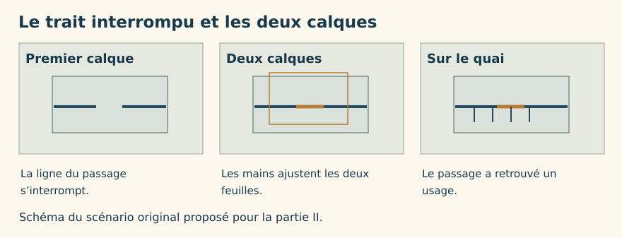

# ENS de Lyon · Séries A/L — Cinéma (oral 4) 2026 · Corrigé guidé

*Corrigé rédigé par IA, non officiel. Signalez toute erreur.*

**Lecture du rapport du jury** · GPT-6.2 Astra Ultra · vitesse non renseignée

**Rédaction** · GPT-6.2 Astra Ultra · vitesse non renseignée

**Autocontrôle** · GPT-6.2 Astra Ultra · vitesse non renseignée

**Couverture partielle.** La continuité séquencée « Les Deux Rives » traite toute la partie II. L’analyse de Sois belle et tais-toi porte sur les photogrammes et les indications du concours. La copie audiovisuelle intégrale de l’extrait reste à vérifier.

## Écouter quelqu’un qui a l’habitude d’être regardé

Le contraste initial se décrit concrètement. Le mur offre un grain sans visage. À la borne finale, les lèvres et le regard de Viva portent une parole que le sujet situe avec précision. On peut alors examiner l’écart entre montrer une comédienne et donner à entendre son analyse du métier. Le programme 1959–1989 invite à rapprocher plusieurs positions de Seyrig, ici l’initiative d’interroger d’autres actrices. Évitez d’attribuer sans crédit documenté chaque geste de prise de vues à la réalisatrice.

Présentez les paumes du photogramme de Man Ray indépendamment du film inventé. On observe plusieurs réseaux de traits. Le scénario les transpose en calques matériels. Lisez la continuité avant d’expliquer le choix d’un atelier et d’un pont. On peut vérifier la cohérence du récit avec une question pratique. Pourquoi Luc quitte-t-il la table ? Le premier essai devant la fenêtre lui a montré que le trait dépendait d’un second tracé.

**Question d’entretien. Pourquoi sortir de l’atelier à la fin ?** La vérification du plan pourrait déjà clore une petite énigme technique. La traversée de la poussette ajoute un usage commun à la ligne retrouvée. Le raccord sonore avec le joint du pont garde la solution à l’échelle des matières et des gestes.

## I. Sois belle et tais-toi — où se tient la parole ?

Le premier plan reproduit isole une surface de crépi blanc. Le noir et blanc et la lumière latérale y font paraître des aspérités et des petites ombres. Les larges bandes sombres de part et d’autre appartiennent à la présentation de l’image sur la feuille. Aucun visage ne vient d’emblée occuper le centre. Cette surface banale donne une première mesure du visible. Un mur peut retenir le regard avant qu’une vedette de cinéma lui fournisse le spectacle attendu.

À la seconde borne, le gros plan de Viva détache un visage entouré de cheveux sur un fond plus sombre. Le regard est légèrement déporté, la bouche entrouverte. La feuille indique la fin de son propos sur le sentiment d’être « coincée dans un autre siècle ». Ce plan a un double enjeu. Un dispositif de cinéma pourrait réduire l’actrice à une apparence offerte aux regards. Le dispositif d’entretien lui laisse aussi le temps de juger l’ordre historique et professionnel qui assigne de telles places. La direction de ses yeux et sa parole rendent perceptible une relation entre l’actrice et quelqu’un qui l’écoute. Le titre du film prend dès lors un sens critique précis.

Delphine Seyrig, passée ici derrière la caméra au sens de l’autrice du projet, conduit des entretiens avec des actrices sur les rôles et les conditions de travail qu’on leur propose. La vidéo permet une organisation de tournage plus légère, un rapport différent à la durée d’une réponse et à la circulation de la parole. Le rapport du concours invite à considérer ces propriétés du médium. Pour le passage donné de 1 min 12 s à 8 min 06 s environ, les deux bornes ne suffisent pas à identifier tous les locuteurs, les relances, les déplacements du cadre ou l’ordre des coupes. On réservera leur commentaire à une consultation de l’extrait audiovisuel.

## II. Du photogramme de Man Ray au scénario

Dans la vue de *L’Étoile de mer* de Man Ray, datée de 1928, deux paumes s’ouvrent vers nous sur un fond noir. Des traits noirs courbes et obliques se poursuivent sur les mains et, au-delà, dans une autre zone de l’image. Les mains semblent à la fois recevoir et porter un dessin qui ne suit pas seulement les plis naturels de la peau. La photographie seule laisse ouverte la cause matérielle de cette superposition. Le court métrage invente un geste collectif où deux paumes doivent ajuster leurs tracés pour que quelque chose devienne lisible.

### Continuité séquencée — Les Deux Rives, 5 minutes

**1. Intérieur, atelier de sérigraphie, matin.** Mina, conductrice de presse, retourne une feuille transparente. De son poste à l’autre bout de la table, Luc, apprenti, lui signale une ligne qui semble coupée en son milieu. Ils étendent le premier tirage d’un plan de quartier. Une passerelle s’interrompt au milieu du fleuve blanc.

**2. Même lieu.** Luc lève la feuille devant la fenêtre. La lumière traverse les rues imprimées et les projette sur ses doigts. Mina passe de l’autre côté de la table et tend sa paume. Un trait finit dans l’une des mains et reprend dans l’autre. Tous deux reculent ensemble pour suivre son trajet, qui manque encore le bord.

**3. Intérieur, réserve.** Luc ouvre deux tiroirs marqués du même nom de quartier. Il en tire un second calque dont l’angle est coupé. Le bruit des tiroirs cesse. De l’atelier, on entend le roulement régulier de la presse puis son arrêt.

**4. Intérieur, table lumineuse.** Les deux calques se recouvrent. Mina pose sa main gauche sur l’un et laisse à Luc le déplacement de l’autre. À chaque déplacement, la passerelle se dédouble ou disparaît. Ils tournent enfin la seconde feuille d’un demi-tour. La ligne du pont se rejoint et les deux rues qui l’entourent apparaissent. On entend leurs paumes quitter la table l’une après l’autre.

**5. Extérieur, quai, fin d’après-midi.** Mina et Luc comparent le tirage avec la passerelle réelle. Une femme pousse une poussette de l’autre rive vers eux. Elle suit le trajet que figurait le blanc de la feuille. Luc replie le plan en laissant cette jointure au bord du pli. La roue de la poussette franchit le joint métallique dans un son bref.

### Commentaire des intentions

Le dessin ne prédit pas l’avenir des personnages. Il résulte à vue d’une manipulation de plans et d’une rencontre entre des mains qui travaillent. Les deux interprètes ont des compétences différentes, l’expérience du repérage et la disponibilité à regarder le problème à l’envers. Les bruits de la presse, des tiroirs et du pont relient ces gestes à la ville. L’ultime joint sonore déplace sur un passage réel la ligne qui faisait difficulté à l’image.

[Fascicule officiel, p. 8–10](https://www.ens-lyon.fr/sites/default/files/2026-11/Arts%202026.pdf#page=8) · [Rapport de l’oral, p. 6–8](https://www.ens-lyon.fr/sites/default/files/2026-10/Arts%20-%20Cin%C3%A9ma%202026.pdf#page=6)

[Splendor Films, le documentaire et ses interprètes](https://www.splendor-films.com/films/sois-belle-et-tais-toi)
