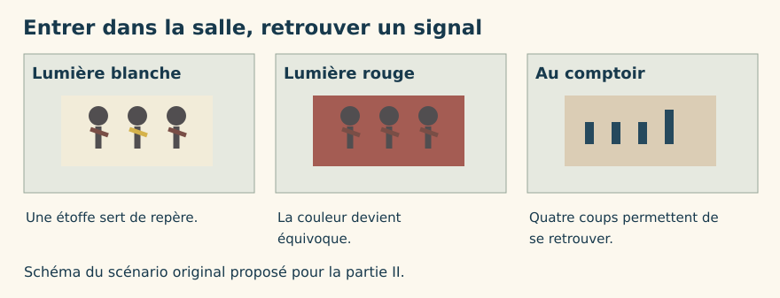

# ENS de Lyon · Séries A/L — Cinéma (oral 5) 2026 · Corrigé brut

*Corrigé rédigé par IA, non officiel. Signalez toute erreur.*

**Lecture du rapport du jury** · GPT-6.2 Astra Ultra · vitesse non renseignée

**Rédaction** · GPT-6.2 Astra Ultra · vitesse non renseignée

**Autocontrôle** · GPT-6.2 Astra Ultra · vitesse non renseignée

**Couverture partielle.** La continuité séquencée « La Consigne » traite toute la partie II. L’analyse de Maso et Miso vont en bateau porte sur les photogrammes et les indications du concours. La copie audiovisuelle intégrale de l’extrait reste à vérifier.

## I. Maso et Miso vont en bateau — le droit de répondre à l’image

La première vue reconduit un espace de télévision. Au milieu de plusieurs silhouettes qui encombrent les bords et le premier plan, Bernard Pivot se penche vers Françoise Giroud. Celle-ci se détache au centre. Le sujet identifie le moment où le présentateur demande à revenir sur terre. Le présentateur dispose, dans l’émission, d’un pouvoir très concret, donner la parole et choisir quand on change de sujet. La disposition du plateau présente cette direction de la conversation comme allant de soi.

La dernière vue donne tout le champ à une inscription manuscrite sur deux lignes. La seconde personne et le point d’exclamation retournent une qualification vers celui qui l’emploie. Aucun visage au centre, aucune personne invitée à prendre la parole à son tour. Celles qui remontent la bande ont produit après coup une place d’où interrompre la conversation. Le contraste entre la distribution policée des places sur le plateau et cette adresse tracée à la main porte une idée du montage comme droit de réponse. Une ardoise modeste peut changer le sens d’une image issue d’un dispositif télévisuel beaucoup plus important.

La vidéo de 1976 détourne une émission diffusée en décembre 1975, à la fin de l’Année internationale de la femme. Le Centre audiovisuel Simone de Beauvoir crédite Carole Roussopoulos, Delphine Seyrig, Ioana Wieder et Nadja Ringart. Le rapport du jury relève dans le travail de détournement les cartons, les répétitions et les interventions sonores. Ces procédés interrompent et réorientent l’autorité d’une image existante. Il faut en revanche distinguer l’index du film conservé au Centre des temps de lecture de la copie du jury. L’extrémité finale est imprimée « 23’17’’11’’’ » et illustrée par le carton. On s’appuie donc sur l’identification visuelle des bornes. La position de chacun des inserts et l’ordre exact des prises de parole entre elles restent à relever sur cette copie.

## II. De l’extrait de Sphinx au scénario

La voix de *Sphinx* d’Anne F. Garréta décrit une descente vers une salle nocturne. Arrivées et portes, lumière vive puis pénombre rouge, projecteurs et pulsation font de l’entrée une suite de seuils. L’identité qui se racontait à la première personne semble se réduire au corps entraîné par le rythme. Le film proposé donne un enjeu concret au phénomène, retrouver une personne dans un lieu où la lumière retire puis rend leurs différences aux silhouettes.

### Continuité séquencée — La Consigne, 5 minutes 30

**1. Extérieur, rue, nuit.** Camille arrive à pied devant une ancienne salle de bal. Des taxis repartent un à un. Sur l’écran du téléphone, un message de Lou donne rendez-vous au vestiaire avec un foulard jaune pour se reconnaître. La batterie s’éteint. Camille serre le téléphone inutile dans la main.

**2. Intérieur, sas.** Sous un tube blanc, une tache jaune apparaît au cou d’une personne qui descend déjà les marches. Camille la suit. La porte se referme et une lampe rouge envahit le couloir. Les vêtements changent d’aspect. Le foulard se perd parmi des dizaines de taches sombres.

**3. Intérieur, escalier.** Des bandes de lumière mobile balaient des épaules à intervalles réguliers. À chaque balayage Camille cherche le même cou. Dans les temps noirs, la main passe d’une portion de rampe à la suivante. Le rythme de la salle devient plus net à mesure que les voix du dehors disparaissent.

**4. Intérieur, vestiaire.** Devant le comptoir, trois personnes dénouent chacune une étoffe sous la lumière rouge. Camille pose sur le rebord le téléphone éteint. Quelqu’un frappe du doigt trois notes rapides puis une longue. Camille répond de même sur le bois. Lou tend la main depuis l’autre côté de la file. Le foulard paraît brun.

**5. Intérieur, salle.** Les deux mains lâchent le comptoir et disparaissent dans la foule. La personne du vestiaire reprend les quatre coups sur le tiroir pour demander un peu de place à la file suivante. Le motif privé s’est propagé. La musique de la salle continue sur l’image du sas maintenant vide.

### Commentaire des intentions

Un foulard apparaît au jour blanc comme un signe sûr. Le passage au rouge le rend peu fiable. La reconnaissance se déplace vers une cadence qui peut voyager de main en main. Le prénom Camille, la voix du message et le cadrage fragmentaire laissent le public regarder un geste avant de chercher une identité dans les costumes. La musique provient de la salle et change de volume selon les portes. L’histoire ne demande ni flash-back ni explication du code privé. Les deux réponses rythmiques suffisent à l’établir.

[Fascicule officiel, p. 10–12](https://www.ens-lyon.fr/sites/default/files/2026-11/Arts%202026.pdf#page=10) · [Rapport de l’oral, p. 6–8](https://www.ens-lyon.fr/sites/default/files/2026-10/Arts%20-%20Cin%C3%A9ma%202026.pdf#page=6)

[Centre Simone de Beauvoir, présentation du film](https://www.centre-simone-de-beauvoir.com/produit/maso-et-miso-vont-en-bateau/) · [Centre Simone de Beauvoir, index de la bande conservée](https://base.centre-simone-de-beauvoir.com/diaz-510-148-0-0.html)
