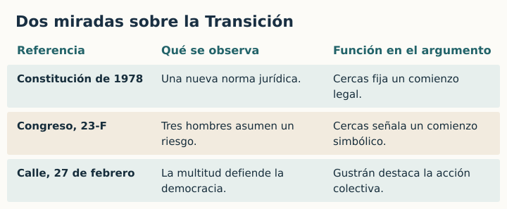
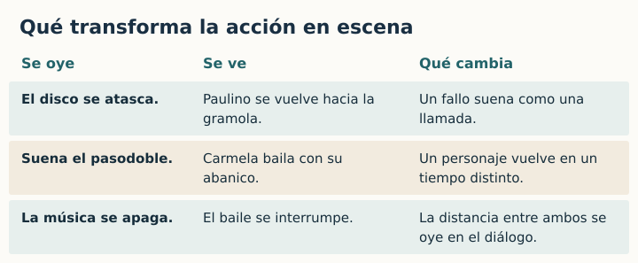
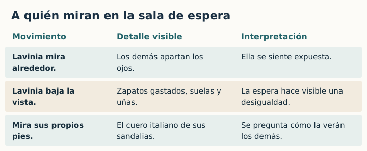
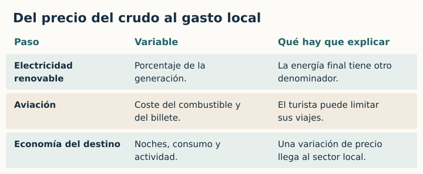

# ENS de Lyon · Séries A/L · Espagnol oral 2026 — Corrigé guidé partiel

*Corrigé rédigé par IA, non officiel. Signalez toute erreur.*

**Rédaction** · GPT-6.2 Astra Ultra · vitesse non renseignée

L’ENS recense 45 articles de presse et sept passages littéraires. Les 23 textes de presse reproduits dans son annexe et les sept extraits littéraires aux bornes du répertoire sont commentés. Pour 17 autres références de presse, la version publiée ou sa reproduction est disponible, sans coupe de concours vérifiable. P22 repose sur l’ouverture diffusée par l’auteur, P45 sur la version anglaise de l’article et P16, P20, P23 sur les seuls titres. Les notices précisent ce qui peut être établi pour chaque billet.

[Répertoire officiel, p. 2–5](https://www.ens-lyon.fr/sites/default/files/2026-11/Espagnol%202026.pdf#page=2) · [Annexe de presse, 44 pages](https://www.ens-lyon.fr/sites/default/files/2026-11/Annexe%20Espagnol%20-%20toutes%20s%C3%A9ries%202026.pdf) · [Rapport du jury, p. 26–40](https://www.ens-lyon.fr/sites/default/files/2026-10/Espagnol%202026.pdf#page=26)

La numérotation P1 à P45 suit le répertoire de l’ENS, imprimé p. 2–5. L’annexe classe matériellement l’article de Parra Iglesias en LV2, le répertoire l’inscrit en LV1 et le rapport LV1 évoque son propos. Pour Stefanoni, décembre 2025 au répertoire devient décembre 2026 dans l’annexe. Le contenu situe l’analyse à la fin de 2025. Le titre imprimé dans El Mundo pour P26 diffère de celui du répertoire.

## Préparer la lecture et l’entretien

Pour les textes de presse, inscrivez le nom du signataire ou la mention *editorial* en tête de votre brouillon. Relevez ensuite une formulation que cette personne prend à son compte et une autre qu’elle attribue à une source. Dans P6, par exemple, c’est l’organisation du prix qui défend le caractère littéraire de la cérémonie. Le journaliste place cette défense à côté des propos des finalistes et rappelle la fonction politique de l’Assemblée nationale. Cette opération très simple suffit à construire une question de commentaire sur le cadre de l’hommage. Lire le passage au cours de l’exposé permet au jury d’entendre exactement où naît le problème.

En LV2, le jury décrit deux organisations possibles pour les vingt minutes de prise de parole. Une lecture linéaire suit le mouvement de l’article en articulant langue, procédés et civilisation. L’autre formule prévoit une introduction, un résumé d’environ huit minutes puis un commentaire de civilisation d’environ douze minutes. Le jury souligne les difficultés fréquentes d’un résumé qui omet le point de vue et d’un commentaire détaché du texte. Pour tester votre plan, nommez un détail du texte qui vous oblige à modifier une phrase de votre fiche de civilisation. En LV1 également, la progression thématique et la progression linéaire sont recevables. En Lettres et arts, le débit de l’annonce du plan doit laisser le temps d’en saisir les étapes. En Sciences humaines, une question du jury est l’occasion de préciser une première lecture, notamment en distinguant une voix citée et la voix du journal.

### Deux lectures proches, deux interprétations distinctes

Entraînez-vous d’abord sur P1 et P2. Représentez sur une ligne le décès de Franco en 1975, la Constitution de 1978, le 23 février 1981 et la manifestation du 27 février. Faites ensuite deux présentations de quarante secondes. Pour Cercas, partez des trois hommes dans l’hémicycle et expliquez le mot « symbolique ». Pour Gustrán Loscos, repartez quatre jours plus tard et faites entendre l’insistance sur les milliers de personnes anonymes. Les deux auteurs peuvent s’accorder sur les dates tout en déplaçant le lieu où ils choisissent d’observer la démocratie. Une simple chronologie du changement de régime effacerait leur désaccord.

Pour P15, dessinez deux cercles sur votre brouillon et indiquez l’unité qui leur donne un sens. Si l’on suppose, pour le seul exercice, que l’électricité compte pour un quart de l’énergie finale, 55,5 % de ce quart représente environ 14 % de l’ensemble. Ce produit illustre un changement de dénominateur. Il ne mesure pas toutes les énergies renouvelables consommées en Espagne. Des sources renouvelables peuvent aussi être utilisées en dehors de l’électricité. Revenez ensuite au texte. Pourquoi l’auteur fait-il intervenir le billet d’avion pour un commentaire qui commence par un baril et évoque une prise de courant ?

### Faire entendre les sept explications littéraires

Pour S1 à S4, prévoyez sur votre brouillon trois colonnes, ce qui s’entend, ce qui se voit, ce que sait chaque personnage. Dans S2, le public voit le morceau de papier avant de connaître le contenu difficilement déchiffré par Paulino. Dans S3, il reçoit la musique et le changement de lumière avant que Carmela et Paulino partagent le même moment narratif. Dans S4, les voix proviennent d’une zone que la pièce laisse indéterminée. Pour chacune de ces situations, remplacez un commentaire général sur la mémoire par une observation précise sur le travail du spectateur. Le jury recommande le terme espagnol *acotación escénica* et invite à rendre compte de l’humour autant que de la portée mémorielle.

Pour Q1, essayez une première lecture qui suive strictement la ponctuation, puis reformulez la phrase en rapprochant les sujets et les verbes. Écoutez ce que le rétablissement de l’ordre courant fait perdre. Pour Q2, suivez les changements d’agent et de matière de la première blessure jusqu’au « royaume » final. Chaque fois que vous nommez une figure, ajoutez le raisonnement qu’elle rend possible. Pour B1, tracez avec le doigt le parcours des regards. Qui voit partir Flor ? Qui croit être observée ? Qui formule l’hypothèse d’une méfiance ? Le roman permet d’entendre les craintes de Lavinia sans donner accès aux pensées de tous les autres patients.

### S’appuyer sur une relance

Si l’on vous demande « ¿Quién lo afirma? », répondez d’abord par un nom, puis par un indice grammatical ou typographique. « La columnista emplea el condicional » et « La organización lo declara en una cita directa » ne produisent pas le même degré de certitude. Si le jury relève une erreur de lecture, reprenez la phrase exacte puis modifiez votre conclusion. Pour P44, par exemple, vous pouvez corriger *el gasto ha bajado un trece por ciento* en *la deuda absorbe el trece por ciento del gasto ejecutado*. La nouvelle phrase met fin à la confusion entre variation et proportion. Enfin, soignez des formes fréquentes de cette épreuve, *un análisis*, *los límites*, *dijeron* et *permitir que* suivi du subjonctif lorsque la construction l’exige.

## Lettres et arts · Presse

## P1 · Nada que celebrar

El País · Javier Cercas (16/11/2025)

Cercas empieza por una experiencia que un aniversario suele ocultar. Una parte de quienes vivieron la muerte de Franco no sabía cómo responder a un país sin el dictador. El chiste de Julio Cerón hace pensable esa incertidumbre mediante el lenguaje de la costumbre. El artículo niega después que la democracia estuviese asegurada y hace nacer el compromiso de una doble impotencia política. El último giro propone dos comienzos. El jurídico corresponde a la Constitución de 1978. El simbólico, a la actitud de Suárez, Gutiérrez Mellado y Carrillo en el Congreso el 23 de febrero de 1981. Distinguir ambas fechas permite entender la valoración del autor sin elevarla a cronología indiscutible. Su cierre nos devuelve al presente, donde entender el pasado puede impedir que nos gobierne.

**À travailler à voix haute.** Définissez à voix haute les deux sens du verbe « commencer » à propos de la démocratie. À quelle date correspond chacun ?

**Source.** [Version publiée](https://elpais.com/espana/2025-11-16/nada-que-celebrar.html)

## P2 · ¿Y después del 20-N, qué?

El País · Carmina Gustrán Loscos (29/11/2025)

Gustrán Loscos escribe desde la responsabilidad de quien coordina una conmemoración. La pregunta del título abre un tiempo posterior al aniversario. El recorrido por silencios familiares, escolares y políticos permite distribuir responsabilidades que las anáforas convierten en obligaciones personales. La autora nos invita a imaginar tanto una investigación como una conversación cotidiana en un banco. Su ejemplo decisivo desplaza la cámara del Congreso a la calle. Recuerda a quienes se manifestaron el 27 de febrero de 1981 y discute la concentración del mérito democrático en unas pocas personas el día 23. La comparación con el artículo de Cercas permite distinguir una discrepancia interpretativa de una discrepancia sobre fechas. La desafección juvenil exige además respuestas sobre vivienda y trabajo que ninguna ceremonia proporciona por sí sola.

**À travailler à voix haute.** Marquez les reprises qui distribuent l’obligation d’agir aux citoyens, aux chercheurs et aux institutions. Quel public la fin rend-elle visible ?

**Source.** [Annexe officielle, p. 8–9](https://www.ens-lyon.fr/sites/default/files/2026-11/Annexe%20Espagnol%20-%20toutes%20s%C3%A9ries%202026.pdf#page=8)

## P3 · Claudia Sheinbaum no es ‘presirvienta’, es tu patrona

El País · Dahlia de la Cerda (06/02/2026)

De la Cerda empieza reconociendo la legitimidad de juzgar con severidad las decisiones de una presidenta. Esa concesión permite aislar con precisión el objeto de la columna, un insulto que funde el título de presidenta con una posición de servicio. La sucesión de verbos de decisión y de obediencia reconstruye el reparto de autoridad que propone quien emplea la palabra. Intervienen a la vez el género y la jerarquía social asociada al trabajo doméstico. Conviene explicar que la autora cuestiona la utilización clasista del nombre de ese trabajo. Los ejemplos de otras presidentas amplían la comparación sin decir que hayan recibido el mismo insulto. El giro hacia un «nosotras» expone la función ejemplarizante del ataque para quienes lo oyen.

**À travailler à voix haute.** Comparez une phrase évaluant une décision et une phrase retirant à la présidente la capacité de décider. Où s’exerce la violence que l’auteure dénonce ?

**Source.** [Annexe officielle, p. 2–3](https://www.ens-lyon.fr/sites/default/files/2026-11/Annexe%20Espagnol%20-%20toutes%20s%C3%A9ries%202026.pdf#page=2)

## P4 · Seguimos aquí: antes y después de Bad Bunny

El País · Cristina Rivera Garza (14/02/2026)

Rivera Garza comienza por las fiestas de fin de semana en los patios de las casas. Desde allí cobra otra escala la actuación en español de Bad Bunny. Lo que un espectáculo televisado hace visible existía ya en la conversación, la escritura y la música cotidianas. De ahí la importancia del «antes» del título. Los nombres de escritores, traductores, investigadores y editoriales proporcionan ejemplos de las mediaciones necesarias para llegar a públicos diversos. Estados Unidos aparece como lugar de producción en español además de espacio de circulación de libros llegados de fuera. El «aquí» de la conclusión sitúa en un mismo territorio la celebración, la persecución de migrantes y el desacuerdo entre quienes comparten una lengua. La primera persona del plural adquiere así historia y heterogeneidad.

**À travailler à voix haute.** Faites de la fête familiale et de l’édition de livres deux preuves différentes de la continuité suggérée par le titre.

**Source.** [Version publiée](https://elpais.com/babelia/2026-02-14/seguimos-aqui-antes-y-despues-de-bad-bunny.html)

## P5 · Los indultos, un límite a la batalla cultural de Milei

El País · Martín Sivak (24/03/2026)

Sivak examina la distancia entre la fuerza pública de un discurso y su traducción en una decisión de gobierno. El aniversario de la dictadura argentina permite a Milei disputar términos como «memoria completa». La comparación con Carlos Menem precisa lo que supondría atravesar otro umbral, el de los indultos efectivamente decretados bajo aquella presidencia. Reutilizar el prestigio económico o internacional que Milei atribuye a Menem no implica disponer de las mismas condiciones políticas para una medida semejante. El periodista contrasta la difusión de vídeos con las limitaciones jurídicas y sociales, entre ellas la historia de las organizaciones de derechos humanos. Hay una dimensión temporal en esa oposición. Una pieza puede publicarse en un día, mientras que una conquista colectiva condiciona lo políticamente posible durante décadas.

**À travailler à voix haute.** Nommez le président qui a signé les grâces évoquées. Que permet d’établir la comparaison avec la pratique audiovisuelle de Milei ?

**Source.** [Version publiée](https://elpais.com/opinion/2026-03-24/los-indultos-un-limite-a-la-batalla-cultural-de-milei.html)

## P6 · Juan Carlos I en la Asamblea Nacional de Francia: “Nadie es profeta en su país”

El País · Daniel Verdú (11/04/2026)

Verdú abre la crónica sobre un rey español premiado en Francia recordando el destino de la monarquía francesa. Esa ironía prepara la doble lectura del lugar. Para los organizadores se premian unas memorias cuyo autor acude como cualquier otro. Para algunos finalistas, que tome la palabra en la Asamblea Nacional, en presencia de su presidenta, concede al acto un significado político. Las voces se citan por separado y la pequeña rectificación con que el periodista comenta el supuesto carácter apolítico orienta nuestra lectura. La fama de salvador de la democracia, las discusiones sobre el 23-F y las condiciones de un posible regreso a España no tienen el mismo peso a ambos lados de la frontera. Una sala y un premio hacen palpable esa asimetría.

**À travailler à voix haute.** Dans le même lieu, que pensent célébrer les organisateurs et que voient certains finalistes ? Répondez avec deux verbes introducteurs différents.

**Source.** [Annexe officielle, p. 4–5](https://www.ens-lyon.fr/sites/default/files/2026-11/Annexe%20Espagnol%20-%20toutes%20s%C3%A9ries%202026.pdf#page=4)

## P7 · Hernán Cortés o la “concordia” según el PP y Vox

El País · Ángel Munárriz (16/05/2026)

Munárriz emplea el homenaje de Ayuso a Cortés en México para preguntar quién utiliza hoy al conquistador y con qué fin. Empieza por la paradoja de que también el pasado tenga un porvenir incierto. Las diferencias en la valoración del conquistador no son una novedad histórica. El interés del artículo está en la selección de un personaje y en la oportunidad política de hacerlo viajar. Las comillas de «concordia» preparan una inversión irónica. El cierre imagina una estatua y asigna a los mexicanos la tarea de limpiarla. Presentar esa idea como propuesta del autor sin explicar la ironía convertiría el sentido de la frase en su contrario. El argumento se refiere al uso público de la conquista y a las relaciones que sigue poniendo en escena.

**À travailler à voix haute.** Lisez la chute en imaginant un auditeur qui ne perçoit pas l’ironie. Quel détail lui indiquerait le sens de la proposition de statue ?

**Source.** [Version publiée](https://elpais.com/babelia/2026-05-16/hernan-cortes-o-la-concordia-segun-el-pp-y-vox.html)

## P8 · El miedo del régimen cubano a su juventud

Latinoamérica21 · Michael Lima Cuadra (22/05/2026)

Lima Cuadra abre con la pregunta de un adolescente a su madre desde prisión. La falta de respuesta sobre la duración del encierro da al caso una dimensión temporal que las cifras posteriores no transmiten por sí solas. El artículo cita organizaciones y testigos para pasar de una historia a una pauta de represión. Conviene atribuir cada estimación y distinguir las edades de los grupos comparados. El recurso a un discurso de Fidel Castro de 1962 produce una reversión histórica. Si el poder revolucionario veía en la juventud un indicador moral de su legitimidad, ¿qué lo lleva ahora a temer su protesta? El final enlaza dos futuros, el que unos jóvenes se atreven a imaginar y el que, según el autor, las sanciones ejemplares intentan clausurar.

**À travailler à voix haute.** Distinguez avec précision un nombre de jeunes arrêtés, un nombre de personnes qui encourent des poursuites et une estimation attribuée à des témoins.

**Source.** [Annexe officielle, p. 6–7](https://www.ens-lyon.fr/sites/default/files/2026-11/Annexe%20Espagnol%20-%20toutes%20s%C3%A9ries%202026.pdf#page=6)

## Langues vivantes LV1 · Explication littéraire

## S1 · Sanchis Sinisterra, ¡Ay, Carmela!, pp. 210–214

¿Cómo consigue el teatro que creamos en la presencia de una muerta y sintamos al mismo tiempo la distancia que la separa del vivo? Un saludo familiar abre la escena. Paulino responde primero con alivio, después se sobresalta, y mira la garrafa. El público ve a una actriz allí donde el personaje se pregunta si está viendo el resultado de la bebida. De ese desfase nace la comicidad. También de él depende la pena de un hombre que quiere fiarse de lo que ve.

Las preguntas de Paulino aspiran a dibujar el más allá como quien pide indicaciones de un pueblo. ¿Hay tierras secas, casas, gente? Carmela corrige lo que acaba de decir, duda y ofrece pormenores decepcionantes. La alternancia rápida de las réplicas da consistencia cotidiana al diálogo de dos personas que ya no comparten el mismo mundo. Cuando Paulino se pone celoso, el espectador reconoce una costumbre de la pareja. El celoso acaba preguntando algo que le cuesta formular, si el cuerpo le duele. Carmela responde con la comparación de una pierna dormida. Él le toca la cara. Conviene imaginar la pausa que ese gesto exige. La escena convierte una duda metafísica en una prueba muy pequeña, que tiene éxito sólo a medias. Ella percibe el contacto amortiguado. La negativa final al beso nombra la muerte como quien recuerda una norma de urbanidad. La gracia de su formulación permite prolongar la intimidad de la conversación y hace sentir el límite que impone el gesto.

**Pregunta del tribunal.** ¿Quién hace aparecer a quién? Carmela dice que ha recordado a Paulino. Es significativo que el retorno dependa, en su relato, de la memoria de la muerta. También importa lo que hace el teatro, donde el recuerdo toma cuerpo ante un espectador.

**À travailler à voix haute.** Jouez l’arrêt de Paulino au milieu de sa salutation. Pourquoi la pause du geste sur la joue du personnage devient-elle ensuite nécessaire ?

**Source.** [Texte de la pièce](https://pdfcoffee.com/jose-sanchis-sinisterra-ay-carmela-5-pdf-free.html) · [Extrait pédagogique de la Junta de Andalucía](https://edea.juntadeandalucia.es/bancorecursos/file/2392ed16-3f2b-4b1c-b4d1-8163be3d0bf9/1/es-an_2017022312_9101257.zip/Ay_Carmela.pdf)

## S2 · Sanchis Sinisterra, ¡Ay, Carmela!, pp. 233–236

Paulino pregunta si Carmela volvió a ver a un desconocido. La respuesta introduce una amenaza más inquietante que aquel encuentro. Algunos muertos se vuelven borrosos. Al oírlo, Paulino pasa de la segunda persona del plural a la tercera, como si cambiando de pronombre pudiera apartar a Carmela del peligro. Le toca la cara. Ella sonríe y, antes de terminar la frase que había empezado para tranquilizarlo, propone una adivinanza. El público ha visto la inquietud que sigue actuando debajo de la diversión.

La adivinanza obliga a reconstruir un nombre borrado por la guerra a partir de señales compartidas, poeta célebre, Granada, comienzos de la guerra. Una vez reconocido García Lorca, llega a escena un trozo de papel que Carmela saca y que Paulino intenta leer. La escritura a lápiz, la dificultad para descifrar la letra y los tropiezos al interpretar las imágenes hacen del poeta una presencia material y frágil. Paulino anuncia que va a explicar los versos. Pronto se queda sin palabras. Carmela entiende especialmente bien la agonía. Esa diferencia entre su seguridad sobre el dolor y la perplejidad de ambos ante las hormigas resulta más precisa que un juicio sobre la cultura de los personajes.

Paulino le devuelve el papel y le pide que lo guarde. Luego recuerda unos versos y corrige el título que Carmela mezcla con el flamenco. El acto de conservar la voz ajena admite así dos formas, proteger un rastro escrito y repetir un poema que se sabe de memoria. Hasta alguien que yerra un título participa en esa transmisión. Lorca aparece ya algo borroso en el relato de Carmela. Lo hacen presente dos intérpretes populares que no dominan su lenguaje.

**Pregunta del tribunal.** ¿Por qué importa que un actor lea mal? Porque vacilar hace audible el paso de la escritura a la voz. El silencio de quien se había ofrecido a explicarlo todo preserva la extrañeza del poema.

**À travailler à voix haute.** Lisez le changement de personne grammaticale de Paulino, puis la scène du papier. Par quoi les deux comédiens tentent-ils, chacun, de préserver une présence ?

**Source.** [Texte de la pièce](https://pdfcoffee.com/jose-sanchis-sinisterra-ay-carmela-5-pdf-free.html) · [Extrait apparenté dans les annales Ulm de 2008](https://www.ens.psl.eu/IMG/file/concours/2008/AL/sujet_epreuve_commune_oral_espagnol.pdf)

## S3 · Sanchis Sinisterra, ¡Ay, Carmela!, pp. 244–246

Un enfado produce un accidente técnico. Con los saltos de Paulino se raya un disco y la gramola empieza a repetir el nombre de Carmela. La comedia transforma un ruido mecánico en una especie de llamada. Paulino se detiene, escucha y procura averiguar quién le gasta esa broma. Se dirige a un interlocutor invisible y protesta contra las libertades que parece tomarse un teatro vacío. Para el público real, esa queja tiene una ironía especial. La sala está llena precisamente de personas que han aceptado que en ese lugar una muerta pueda regresar.

Los refranes le prestan una filosofía de supervivencia. Parecen ofrecerle maneras sensatas de aceptar lo sucedido y adaptarse al presente. Pero, apenas termina de denunciar la magia de pacotilla, Paulino pide a gritos que vuelva Carmela, aunque sea un truco teatral. La luz, el pasodoble, el abanico y el vestido andaluz responden con todo un número. Su enfado cambia de objeto. Quería que volviera ella y recibe una entrada de espectáculo que le parece de mal gusto. Mientras él le da la espalda, la música y la iluminación se debilitan. El baile va perdiendo impulso y deja a la actriz casi inmóvil. Se puede describir la memoria en esta obra como el paso entre dos tiempos, pero aquí ese paso tiene, literalmente, una velocidad, una intensidad sonora y una posición del cuerpo.

Cuando por fin se hablan, Carmela interpreta el malestar como nervios antes de la función o consecuencia de una comida poco prudente. Cada uno sitúa al otro en un momento distinto. La broma sobre la cara de un actor de cine devuelve la conversación al cuidado más sencillo, que su compañero recobre el color. La entrada espectacular ha conducido a un instante doméstico cuya ternura depende de ese desacuerdo entre los tiempos.

**Pregunta del tribunal.** ¿Qué haría perder una lectura exclusivamente verbal? El espectador contempla la espalda de Paulino y el baile de Carmela simultáneamente. El conflicto entre los dos deseos ya es perceptible antes de que se expliquen.

**À travailler à voix haute.** Imaginez une mise en scène qui conserve le dialogue mais retire le disque et le ralentissement de la danse. Quels rapports entre les temps deviendraient invisibles ?

**Source.** [Texte de la pièce](https://pdfcoffee.com/jose-sanchis-sinisterra-ay-carmela-5-pdf-free.html)

## S4 · Sanchis Sinisterra, ¡Ay, Carmela!, pp. 272–275

Paulino y Carmela interpretan a un médico y una paciente. El número debe divertir mediante alusiones que terminan convirtiendo la República en blanco de la burla. La distribución inicial de las réplicas promete una rutina ensayada. El atasco de la actuación la transforma desde dentro. Carmela vacila, mira hacia donde se supone que están los prisioneros y contesta cada vez menos. Paulino intenta sostener ambos papeles. Al preguntar y casi contestarse a sí mismo, vuelve audible el trabajo que hace falta para mantener en marcha una representación impuesta.

El abrigo ocultaba una bandera republicana. En el número impuesto, los colores han de interpretarse como signos de enfermedad. Una canción entonada por varias voces les devuelve, en cambio, su sentido compartido de emblema. Su procedencia escénica queda abierta, quizá la propia sala. De pronto el teatro ya no ofrece una sola respuesta a la cuestión de quién es el público y quién tiene derecho a hacerse escuchar. Carmela despliega la bandera y se une a las voces. Su decisión, preparada por las anteriores negativas a hablar, convierte el silencio del malestar en una intervención pública. El gesto popular no pierde su fragilidad ni se convierte en una estatua solemne.

Paulino extrema la bufonada alrededor de su compañera. La acotación aclara el propósito angustiado de la degradación cómica, hacer pasar el desafío por parte del número e intentar salvarla. La luz vacila y se concentra en la figura de Carmela, mientras los sonidos del espectáculo dan paso a los de su muerte. Al final el espectador oye lo que la escena deja de mostrar. El oscuro corta cualquier posibilidad de aplauso inocente.

**Pregunta del tribunal.** ¿Por qué conviene atender a los silencios de Carmela antes de hablar de heroísmo? Permiten observar una decisión en curso. Su desacuerdo empieza por el reparto de las réplicas y por la dirección de la mirada.

**À travailler à voix haute.** Suivez les répliques que Paulino finit par assumer pour deux, puis l’origine incertaine du chant. À quel instant l’autorité sur le spectacle change-t-elle de camp ?

**Source.** [Texte de la pièce](https://pdfcoffee.com/jose-sanchis-sinisterra-ay-carmela-5-pdf-free.html)

## Q1 · Quevedo, Amor constante más allá de la muerte, poema 78

El primer verbo concede a la muerte un poder. Podrá cerrar los ojos y separar el alma del cuerpo. El orden de las palabras aplaza el reconocimiento de los sujetos, la última sombra y la hora de la muerte. Se empieza así por las acciones que sufriría el amante, antes de poder fijar quién las ejecuta. El segundo cuarteto recupera esa concesión para imponerle un límite. La llama sabe nadar en agua fría. La oposición elemental entre fuego y agua se convierte en una acción que el fuego ha aprendido a realizar. El amor tiene la destreza que necesita para conservar la memoria incluso al cruzar la frontera del olvido.

Los tercetos cambian el modo de representar la persona. Un verso nombra el alma, otro las venas y otro las médulas. Los tres quedan a la espera de una resolución que llega con el último terceto. El oyente ha de conservar esos sujetos en la memoria para entender la serie de futuros. Con el alma aparece la separación del cuerpo, con las venas y las médulas la reducción a ceniza y a polvo. Sin embargo, las rectificaciones impiden que la historia del cuerpo se agote con su destrucción. Afirmar que el polvo seguirá enamorado traslada a la materia una propiedad de la persona. No hace falta decidir que el amante espera recuperar su cuerpo. Lo que exige la conclusión es pensar una materia deshecha capaz aún de la relación amorosa.

El procedimiento es conceptista porque liga una dificultad metafísica a operaciones verbales que el oyente puede seguir. El hipérbaton demora los sujetos, la antítesis convierte una imposibilidad física en prueba de constancia y la disposición de los tercetos obliga a mantener el vínculo entre los términos. La fuerza de la última fórmula depende de ese recorrido entero.

**Pregunta del tribunal.** ¿Por qué el poema insiste en las partes del cuerpo si su conclusión parece espiritual? Porque es precisamente en lo que parece más sujeto a la destrucción donde se verifica la afirmación más audaz.

**À travailler à voix haute.** Dans les tercets, associez les trois groupes nominaux à leurs prolongements verbaux. Quel lien le lecteur doit-il maintenir lui-même ?

**Source.** [Poème vérifié dans la publication de l’Academia Ecuatoriana de la Lengua](https://www.academiaecuatorianadelalengua.org/amor-constante-mas-alla-de-la-muerte-francisco-de-quevedo/)

## Q2 · Quevedo, Persevera en la exageración de su afecto amoroso…, poema 82

Una herida está encerrada en el alma. El silencio con que yace resulta engañoso, porque inmediatamente aparece un hambre que consume la vida. Los primeros versos enlazan la herida, la llama y la materia de las venas y médulas. Es difícil fijar el punto exacto en que la persona sufre la pasión y aquel en que la pasión parece alimentarse por sí sola. El encierro interior se convierte en una actividad que el hablante ya no controla.

En el segundo cuarteto cobra importancia la paradoja de la sed. La vida bebe ardor y así prolonga aquello mismo que la consume. El incendio llega a exhibir su luz en humo y noche. Encadenar estas imágenes hasta la ceniza permite que la pasión se presente como una fuerza que sobrevive incluso en las señales de su agotamiento. En los tercetos se oye por fin con claridad el comportamiento del yo. Evita a la gente, teme la luz del día, extiende su llanto en voces largas y encuentra un mar incapaz de escucharlas. La herida callada ha producido una voz. La posibilidad de emitirla no garantiza un destinatario.

La última estrofa vuelve sobre la paradoja del canto. Los suspiros han recibido una voz y el poema existe ante nosotros, pero ese logro expresivo no ordena el mundo interior de quien canta. Tras las imágenes de inundación, el último verso presenta al corazón como un reino gobernado por el espanto. La exageración anunciada por el título editorial no consiste sólo en añadir adjetivos intensos. Va trastocando relaciones, de alimento y consumidor, luz y humo, sonido y sordera, hasta dar una jurisdicción entera al miedo.

**Pregunta del tribunal.** ¿En qué difiere esta ceniza de la del poema 78? En el 78 participa en la declaración final de constancia. Aquí aparece pronto, en el segundo cuarteto, y alimenta el desarrollo de una experiencia de sufrimiento que todavía sigue hablando.

**À travailler à voix haute.** En partant du qualificatif de la blessure, suivez ce qui se tait, ce qui parle et ce qui reste sourd. À qui les sons parviennent-ils ?

**Source.** [Poème et commentaire dans la Biblioteca Virtual Miguel de Cervantes](https://www.cervantesvirtual.com/obra-visor/en-los-claustros-de-lalma-apuntaciones-sobre-la-lengua-potica-de-quevedo-0/html/021a5e74-82b2-11df-acc7-002185ce6064_3.html)

## B1 · Gioconda Belli, La mujer habitada, pp. 170–172

Una puerta de urgencias separa a Lavinia de Flor y de Lucrecia. A partir de ese momento lo que importa es qué se puede aprender desde un banco de la sala de espera. La iluminación escasa, el olor y la semejanza de las hileras de bancos con una iglesia hacen percibir el lugar a través del cansancio de Lavinia. Flor ha tomado la situación en sus manos. A Lavinia le toca esperar. Esa diferencia prepara una prueba de su compromiso político en la que nadie le pide que haga un discurso.

Al abrir los ojos siente que la observaban. Se imagina en un teatro, iluminada desde arriba. Para librarse de la incomodidad mira al suelo, y la prosa recorre los pies de quienes esperan. Una mujer lleva un zapato recortado para que le quepan los dedos. Hay sandalias gastadas y también unas uñas con esmalte deteriorado. Detenerse en este último detalle impide reducir la escena a una oposición simplista entre quienes cuidan su apariencia y quien no necesita hacerlo. La comparación pasa por el estado de los objetos, por lo que el uso y la falta de recursos han hecho con ellos. Al final entran en foco los pies de Lavinia, su calzado de cuero italiano y sus uñas pintadas. El lenguaje visual devuelve la mirada a quien creía haber encontrado una posición discreta de observadora.

En su pensamiento reaparece el «pueblo» del programa político. Compartir un banco con personas concretas hace perceptible la distancia que la abstracción permitía ignorar. La técnica narrativa importa especialmente en la conclusión. Lavinia interpreta las miradas como desconfianza y se pregunta cómo podrían aceptarla. Nadie en la sala ha expresado ese juicio en voz alta. La pregunta final nos deja dentro de la conciencia que se examina. Su solidaridad es una decisión genuina, pero no puede decidir unilateralmente qué ven los demás en ella.

**Pregunta del tribunal.** ¿Qué cambia entre la primera y la última descripción de los pies? Al entrar, Lavinia arrastra los suyos casi sin prestarles atención. Al final descubre que también ellos pueden leerse como una historia social.

**À travailler à voix haute.** Faites un schéma du regard de Lavinia, des pieds des autres jusqu’aux siens. Où se situe la frontière entre observation et interprétation d’autrui ?

**Source.** [Texte du chapitre, passage de la salle d’attente](https://maestrosdelsaber.com/wp-content/uploads/ftp-files/Novela%2C%20Cuentos%20y%20Teatro/Nov%20Erotica/Belli%2C%20Gioconda/Nov%20Belli%2C%20Gioconda%20-%20La%20Mujer%20Habitada.pdf#page=77) · [Étude de l’Universidad de El Salvador citant la fin du passage](https://repositorio.ues.edu.sv/server/api/core/bitstreams/8f066387-f551-46ef-b177-cf32471ccf71/content)

## Langues vivantes LV1 · Presse

## P9 · Liderazgos de izquierda: en busca de autoridad moral

El País · Azahara Palomeque (28/05/2026)

Palomeque interpreta el caso de Zapatero desde el interior de la izquierda. El «nosotros» expresa una decepción compartida y también una exigencia hacia su propio campo. Su argumento depende de dos relojes. La justicia debe resolver la culpabilidad mediante su procedimiento. El desgaste de una autoridad moral puede empezar antes, en la experiencia política de quienes confiaban en ella. La autora recurre a Arendt y amplía el foco hasta la abstención, la crisis climática y la búsqueda de referencias colectivas. Conviene comentar el coste de ese ensanchamiento. El vínculo entre un caso concreto y la desafección general constituye la tesis de la columnista. Su existencia no equivale a una prueba judicial ni a una encuesta de opinión.

**À travailler à voix haute.** Formulez séparément le jugement moral de Palomeque et le jugement pénal dont l’article attend le terme.

**Source.** [Version publiée](https://elpais.com/opinion/2026-05-28/liderazgos-de-izquierda-en-busca-de-autoridad-moral.html)

## P10 · ¿Un Milei recargado por las “fuerzas del cielo”?

Nueva Sociedad · Pablo Stefanoni (12/2025)

Stefanoni parte de una victoria que contradice el pronóstico construido a partir de la derrota provincial bonaerense. Distingue las elecciones nacionales de medio mandato y las anteriores provinciales, y analiza el modo en que Milei personalizó las primeras. La alusión bíblica del título introduce el relato que el mandatario da de su impulso. El autor explora explicaciones políticas, entre ellas el temor económico inmediato, la garantía estadounidense condicionada y la absorción de sectores de la derecha tradicional. La comparación retrospectiva con Macri desaconseja transformar el triunfo electoral en promesa segura de reelección. Las interrogaciones finales devuelven las reformas y sus resultados al terreno de lo incierto. El repertorio fecha el artículo en diciembre de 2025, mientras que la cabecera del anexo imprime diciembre de 2026. El relato cierra 2025 y presenta 2026 como año que comienza.

**À travailler à voix haute.** Reconstituez le résultat provincial et le résultat national. Pourquoi le premier rend-il nécessaire une explication du second ?

**Source.** [Annexe officielle, p. 10–11](https://www.ens-lyon.fr/sites/default/files/2026-11/Annexe%20Espagnol%20-%20toutes%20s%C3%A9ries%202026.pdf#page=10)

## P11 · Venezuela, la hora de la perplejidad

Nueva Sociedad · Omar Vázquez Heredia (01/2026)

Vázquez Heredia elige la perplejidad como punto de partida para investigar distintas expectativas frustradas. Unos no esperaban la intervención de Estados Unidos en Venezuela. Otros suponían que una actuación de esa magnitud entregaría el poder inmediatamente a la oposición. La permanencia del aparato gubernamental bajo Delcy Rodríguez obliga a distinguir captura de un dirigente, reconocimiento político y control efectivo de unas instituciones. Una secuencia sobre las compras de provisiones ofrece otro sentido de la palabra incertidumbre, la pregunta sobre el día siguiente de una familia. La columna registra explicaciones oficiales, rumores que explicita como tales y escenarios abiertos. Atribuir el condicional a la fuente evita convertir una negociación posible en una decisión consumada.

**À travailler à voix haute.** Citez un effet de l’incertitude pour les familles. En quoi leur échelle de temps diffère-t-elle de celle des négociations ?

**Source.** [Version publiée](https://nuso.org/articulo/venezuela-la-hora-de-la-perplejidad/)

## P12 · ¿Podrá evitar Colombia el giro hacia la extrema derecha?

Nueva Sociedad · Aaron Tauss (06/2026)

Tauss escribe entre dos vueltas presidenciales colombianas. El primer puesto de De la Espriella y la posición de Cepeda alteran la interpretación previa de las encuestas. La comparación con 2022 muestra que dos porcentajes parecidos pueden representar posiciones estratégicas muy diferentes según quién vaya delante. El artículo sigue tanto la concentración del voto de la derecha como los límites de la campaña progresista, entre ellos la escasa participación de Cepeda en debates. La oposición entre movilización territorial y presencia mediática permite examinar qué públicos consigue alcanzar cada candidato. Al final importan también quienes no votaron en primera vuelta. La interrogación del título cobra sentido como pregunta formulada en junio antes del desenlace, cuando la victoria de cualquiera de los dos sigue siendo una posibilidad.

**À travailler à voix haute.** Imaginez qu’un candidat annonce le vainqueur du second tour. Reformulez son propos au temps et au mode compatibles avec la date de l’article.

**Source.** [Version publiée](https://nuso.org/articulo/Colombia-elecciones-Cepeda-De-la-Espriella/)

## P13 · Cumbre Escudo de las Américas: Milei y la derecha regional profundizan la subordinación a Trump

Página/12 · Melisa Molián (07/03/2026)

Molián introduce la cumbre de Doral mediante una decisión que afecta al propio medio. Página/12 solicitó acreditación y quedó fuera, mientras que otros periodistas que la pidieron después pudieron entrar. La organización invoca la falta de espacio. La autora yuxtapone esa explicación y los hechos que conoce de primera mano. Quien puede entrar en la sala se convierte así en una pregunta sobre el derecho a describir lo que ocurre en ella. La lista de presidentes invitados y las ausencias de Brasil, México y Colombia sostienen una lectura ideológica de la convocatoria. El título formula como subordinación lo que otros podrían presentar como alianza. Conviene distinguir la fecha de la reunión, aún anunciada, del rechazo de la acreditación, ya experimentado por el periódico.

**À travailler à voix haute.** Isolez dans la phrase du journal le fait vécu par la rédaction, l’explication de l’organisateur et l’interprétation politique de la journaliste.

**Source.** [Annexe officielle, p. 12–13](https://www.ens-lyon.fr/sites/default/files/2026-11/Annexe%20Espagnol%20-%20toutes%20s%C3%A9ries%202026.pdf#page=12)

## P14 · ¿Por qué algunos jóvenes creen que “con Franco se vivía mejor”?

The Conversation · Maite Aurrekoetxea Casaus (26/11/2025)

Aurrekoetxea Casaus parte de jóvenes que corean el nombre de un dictador muerto antes de que nacieran. La pregunta sobre la nostalgia se desplaza al presente, que produce el criterio con que imaginan una vida mejor. La autora descompone *vivir bien* en salario, acceso a vivienda, derechos, descanso y posibilidades para las mujeres. No niega que haya dificultades materiales. Pregunta qué se borra cuando se convierten en argumento para idealizar un régimen. La serie de interrogaciones compromete particularmente al joven que deseara aquel orden para sí sin examinar qué implicaría para las mujeres a su alrededor. El artículo concluye que disputar el lema requiere proponer comparaciones más precisas y otras maneras de nombrar las aspiraciones contemporáneas.

**À travailler à voix haute.** Remplacez « vivre mieux » par deux critères mesurables et un droit. Le slogan garde-t-il la même simplicité ?

**Source.** [Annexe officielle, p. 14–15](https://www.ens-lyon.fr/sites/default/files/2026-11/Annexe%20Espagnol%20-%20toutes%20s%C3%A9ries%202026.pdf#page=14)

## P15 · El petróleo sigue mandando: la guerra en Irán y la vulnerabilidad energética de España

The Conversation · Enrique Parra Iglesias (08/04/2026)

Parra Iglesias parte del encarecimiento del petróleo para corregir un error de denominador. En 2025 las renovables produjeron, según los datos que recoge, el 55,5 % de la electricidad española. La electricidad representa sólo alrededor de una cuarta parte del consumo final de energía. El sector turístico hace tangible la diferencia. El precio del combustible incide en el billete de avión y puede terminar reduciendo el gasto en los destinos. La imagen del enchufe doméstico recoge ese recorrido al final. Lo que un hogar ve como avance en la generación eléctrica no abarca toda la dependencia de una economía. El fascículo sitúa el artículo en LV1, clasificación que conserva esta edición, aunque el encabezado de sus dos páginas en el anexo indique LV2.

**À travailler à voix haute.** Préparez une phrase espagnole qui distingue *generación eléctrica* et *consumo final de energía*. Puis suivez le pétrole jusqu’aux activités touristiques.

**Source.** [Annexe officielle, p. 16–17](https://www.ens-lyon.fr/sites/default/files/2026-11/Annexe%20Espagnol%20-%20toutes%20s%C3%A9ries%202026.pdf#page=16)

## Langues vivantes LV2 · Presse

## P16 · Un escaparate para la izquierda

ABC · Teodoro León Gross (02/05/2026)

El repertorio atribuye a Teodoro León Gross una columna titulada *Un escaparate para la izquierda*. El sustantivo sitúa al lector ante algo que se dispone para ser visto y valorado desde fuera. Falta la columna que permitiría identificar qué acto o institución funciona como escaparate, quién lo prepara y quién debería mirarlo. En una preparación con el texto delante, localizaría primero el sustantivo al que remite la metáfora y comprobaría si el autor elogia la visibilidad obtenida o denuncia una puesta en escena. La cabecera de ABC y la fecha del repertorio identifican la referencia. La tesis, los ejemplos y el final del artículo siguen sin documentar.

**À travailler à voix haute.** Le mot « vitrine » pose trois questions, qui expose, quelle chose est exposée et qui regarde. Indiquez lesquelles le seul titre laisse ouvertes.

**Source.** [Titre au répertoire officiel](https://www.ens-lyon.fr/sites/default/files/2026-11/Espagnol%202026.pdf#page=4)

## P17 · Un respeto a Vox

ABC · Alberto García Reyes (18/05/2026)

García Reyes termina con una cifra electoral andaluza que convierte el título en una exigencia dirigida al lector. Para él, la representación de Vox hace legítima su presencia en los acuerdos de gobierno. Abre mediante una acusación de doble criterio, comparando el rechazo de esos acuerdos con los pactos del PSOE con Bildu. Esa analogía cumple una función polémica y presupone que los casos pueden evaluarse con una regla común. El candidato puede preguntar qué datos harían falta para justificar también su equivalencia política. Hacia el final el columnista reivindica la libertad de criticar a Abascal. Distingue así el respeto al voto que reclama y la adhesión a todas las posiciones del partido. El imperativo final reúne ambos hilos.

**À travailler à voix haute.** Présentez la concession par laquelle le chroniqueur maintient la possibilité de critiquer Vox. Quel rapport conserve-t-elle avec son dernier impératif ?

**Source.** [Annexe officielle, p. 26](https://www.ens-lyon.fr/sites/default/files/2026-11/Annexe%20Espagnol%20-%20toutes%20s%C3%A9ries%202026.pdf#page=26)

## P18 · El muro de Kast y el monopolio moral de la izquierda

El Comercio Perú · Carlos Arias Suárez (19/03/2026)

Arias Suárez parte de la controversia por la política fronteriza de Kast entre Chile y Perú. Su primera maniobra es desplazar el criterio de evaluación. Si se exige que una barrera suprima todos los desplazamientos, cualquier medida fracasará. El autor propone examinar si permite gestionar las entradas en condiciones que juzga más ordenadas. Reconoce después obligaciones humanitarias, necesidades de integración y cooperación entre Estados. La columna pide una discusión práctica al tiempo que su título atribuye a la izquierda una pretensión de monopolio moral. Esta tensión merece comentario. ¿Quién define qué es un problema técnico y qué efectos sobre las personas deben entrar en la evaluación? La nota final del periódico recuerda que la posición pertenece al columnista.

**À travailler à voix haute.** Testez le raisonnement avec deux critères distincts, la disparition de toute migration et la gestion des entrées. Lequel l’auteur défend-il ?

**Source.** [Version publiée](https://elcomercio.pe/opinion/columnistas/el-muro-de-jose-antonio-kast-y-el-monopolio-moral-de-la-izquierda-por-carlos-arias-suarez-noticia/)

## P19 · Qué fue del espíritu del 8-M

El Mundo · Rafael Moyano (10/03/2026)

Moyano reabre la portada de 2018 y deja que los titulares restituyan el entusiasmo con que una movilización feminista se interpretó como punto de inflexión. Recuerda incluso el lazo que llevó Rajoy para mostrar cuánto desbordaba entonces la convocatoria ciertas fronteras partidistas. El lema de la huelga convierte una ausencia de trabajo en presencia pública. A partir de ahí, la columna cambia el tiempo verbal y el horizonte de expectativa. Ocho años más tarde el autor teme un retroceso. La imagen de marchas separadas cierra la distancia entre aquel impulso compartido y el panorama que percibe en 2026. La atribución de culpabilidades es una toma de posición del columnista. La portada constituye una prueba distinta, la de cómo el diario había narrado aquella jornada.

**À travailler à voix haute.** Faites entendre d’abord la voix des unes de 2018, puis celle du chroniqueur de 2026. À quel moment leurs temporalités se séparent-elles ?

**Source.** [Annexe officielle, p. 18](https://www.ens-lyon.fr/sites/default/files/2026-11/Annexe%20Espagnol%20-%20toutes%20s%C3%A9ries%202026.pdf#page=18)

## P20 · Para abusos, los aztecas

El Mundo · Federico Jiménez Losantos (17/03/2026)

Jiménez Losantos firma *Para abusos, los aztecas*. El título se construye como una réplica abreviada a una acusación anterior. Reutiliza el término «abusos» y desplaza su referente hacia los aztecas. Para identificar la intervención a la que contesta, o saber qué hechos selecciona para sostener el desplazamiento, haría falta la columna del 17 de marzo. El corpus de Lyon permite comparar ese gesto verbal con otras discusiones de la conquista, siempre conservando la procedencia de cada afirmación. Una pregunta que el título ya permite formular es qué cambia en un debate cuando se responde a una acusación señalando a otro actor. No se ha verificado el desarrollo que da el autor a esa réplica.

**À travailler à voix haute.** Reformulez la structure elliptique du titre sans ajouter de faits à la colonne absente. Quelle question sur la comparaison peut-on déjà poser ?

**Source.** [Titre au répertoire officiel](https://www.ens-lyon.fr/sites/default/files/2026-11/Espagnol%202026.pdf#page=4)

## P21 · El dinero de los padres y los hijos tontos: cómo es posible que la economía vaya bien y no llegue a final de mes

El Mundo · Jorge Benítez (01/05/2026)

Benítez empieza y termina con el diccionario satírico de Ambrose Bierce. La escena infantil en que el dinero parece poder crearse a voluntad prepara la distancia entre una cifra nominal y lo que efectivamente permite comprar. El relato de un profesional que compara ingresos de dos generaciones funciona como ejemplo. Después llega la comparación de la evolución del salario medio real en España y en la OCDE. No tienen idéntico alcance una nómina particular, una media de trabajadores y la renta disponible de una familia que reúne más de un salario. El efecto persuasivo de la columna se apoya en su tránsito entre esas escalas. La tarea crítica consiste en identificarlas antes de aceptar que la experiencia de una persona represente a toda una generación.

**À travailler à voix haute.** Décrivez la différence entre salaire réel d’un individu et revenu d’un foyer de deux actifs. À quel passage du récit le changement d’échelle intervient-il ?

**Source.** [Annexe officielle, p. 19–20](https://www.ens-lyon.fr/sites/default/files/2026-11/Annexe%20Espagnol%20-%20toutes%20s%C3%A9ries%202026.pdf#page=19)

## P22 · Instrucciones para dormir en un tren de alta velocidad

El Mundo · Jorge Bustos (09/05/2026)

Bustos da a una columna la forma prometida de un manual para dormir. El comienzo, disponible en el archivo del autor, se dirige de usted a un lector al que supone familiarizado con el trayecto Madrid–Zaragoza. La reiteración de «alta velocidad» introduce el contraste entre el nombre del servicio y la duración experimentada. Frente a las posibles protestas, el narrador finge descubrir en la demora una oportunidad de felicidad. Es la cortesía con que propone acomodarse a la pérdida de tiempo lo que vuelve audible la ironía. Esta lectura se ciñe a la apertura localizada. Los consejos que vendrían después sólo pueden atribuirse al autor al disponer del resto de su columna.

**À travailler à voix haute.** Repérez la fausse consolation introduite par l’adresse courtoise au voyageur. Comment le trajet Madrid–Saragosse prépare-t-il l’effet comique ?

**Source.** [Ouverture publiée par Jorge Bustos](https://jorgebustos.es/2026/05/09/instrucciones-para-dormir-en-un-tren-de-alta-velocidad/)

## P23 · La semana del Festival de Eurovisión y la hipocresía sanchista

El Mundo · Eduardo Alvarez (15/05/2026)

El registro de Lyon recoge una columna de Eduardo Álvarez que vincula la semana de Eurovisión con una acusación de hipocresía dirigida al entorno político de Pedro Sánchez. El paso de un festival a una valoración de política nacional está en el propio título. Para sostener esa acusación en un comentario haría falta identificar las dos conductas o declaraciones que el columnista considera incompatibles. Otros artículos sobre el mismo festival plantean controversias relacionadas, pero no establecen qué comparación eligió él el 15 de mayo. Con el título puede plantearse esa pregunta y examinar la carga del adjetivo «sanchista». Quedan pendientes la postura desarrollada, sus pruebas y el destinatario directo de la acusación.

**À travailler à voix haute.** Pour établir une accusation de conduite contradictoire, il faudrait deux prises de position observables. Le titre indique-t-il lesquelles ?

**Source.** [Titre au répertoire officiel](https://www.ens-lyon.fr/sites/default/files/2026-11/Espagnol%202026.pdf#page=4)

## P24 · Raúl Castro, el testigo protegido de su propia traición

El Mundo · Antonio Lucas (17/05/2026)

Lucas presenta la sucesión de Fidel por Raúl Castro con el vocabulario de la herencia y del mando familiar. La palabra revolución queda así enfrentada a un relevo dinástico. El título atribuye al propio protagonista conocimiento de la distancia entre lo prometido y lo sucedido. Un amigo que viaja a La Habana para visitar a su hermana enferma trae una maleta de medicamentos. Esa escena ofrece al lector una escala doméstica para interpretar la crítica política. La enumeración de carencias hace crecer el ritmo y desemboca en una imagen de hambre. La cercanía afectiva del relato acredita una experiencia. Las generalizaciones sobre toda la isla y el futuro de sus relaciones internacionales deben atribuirse al tono polémico de la columna.

**À travailler à voix haute.** Séparez l’histoire de la valise racontée par l’ami, les images du chroniqueur et sa conclusion sur la succession politique à Cuba.

**Source.** [Annexe officielle, p. 21–22](https://www.ens-lyon.fr/sites/default/files/2026-11/Annexe%20Espagnol%20-%20toutes%20s%C3%A9ries%202026.pdf#page=21)

## P25 · Y el zorro llegó para salvar a las gallinas

El Mundo · Pedro Simón (27/05/2026)

Simón abre con condicionales cuyas conclusiones resultan absurdas. El zorro protector pone en duda que la preocupación de Trump por la democracia cubana explique sus decisiones. Lo que sigue es la conversación con Jota, organizada en pequeñas secciones sobre luz, alimentación, escuela y espera. El entrevistado invierte incluso el nombre habitual de los apagones al describir la electricidad como una excepción. El procedimiento devuelve a un habitante el derecho a nombrar su experiencia. Sin embargo, la última preocupación la formula el periodista. Cree advertir que se pierde también la alegría que asociaba a Cuba. Conviene distinguir esa interpretación del testimonio de Jota y examinar cuánto revela sobre las expectativas del visitante español.

**À travailler à voix haute.** Expliquez l’inversion entre panne d’électricité et courte apparition de la lumière. À qui le journaliste attribue-t-il cette invention ?

**Source.** [Annexe officielle, p. 23](https://www.ens-lyon.fr/sites/default/files/2026-11/Annexe%20Espagnol%20-%20toutes%20s%C3%A9ries%202026.pdf#page=23)

## P26 · La derecha populista ganará en España con un candidato joven y sin las siglas de Vox

El Mundo · Jorge Benítez (29/05/2026)

Benítez parte de una paradoja sobre Vox. Un partido puede estabilizarse como fuerza de oposición y, según el periodista, mostrar al mismo tiempo un techo político. Los errores de sus rivales disimularían las debilidades propias. El caso francés ofrece el término de comparación. Bardella construye una imagen juvenil y nacional que el autor juzga capaz de ensanchar el electorado, incluso distanciándose de ciertas decisiones de Trump. La crítica a Abascal se aclara cuando se compara la lealtad internacional con los intereses de productores españoles. El cierre opone una marca nacional a una franquicia. La frase publicada en el repertorio anticipa una victoria posible de la derecha populista con otras siglas. Es la hipótesis de una columna personal. El número impreso del mismo día la titula «El fracaso de Vox y el futuro del populismo» y la firma Jorge Benítez en la página 22.

**À travailler à voix haute.** Relevez une comparaison France–Espagne et une comparaison France–États-Unis. Quelle conclusion sur Vox suppose le passage de l’une à l’autre ?

**Source.** [Numéro imprimé du 29 mai, p. 22, sous un autre titre](https://santaclara5.com/Lecturas/Documentos/Prensa/El%20Mundo/2026/05/2026-05-29-El%20Mundo.pdf#page=22)

## P27 · No es un árbol caído… todavía

El Mundo · Andrés Trapiello (29/05/2026)

Trapiello anuncia en el título un refrán y lo interrumpe con un adverbio de tiempo. En su interpretación, Zapatero sigue en pie porque el actual presidente y su partido lo sostienen. Las raíces, la copa y las ramas convierten relaciones entre personas, medios e instituciones en partes de un mismo árbol. Esa construcción retórica hace parecer inseparables responsabilidades que un análisis jurídico debería establecer individualmente. La columna recorre retrospectivamente cuestiones como ETA, la memoria histórica y Cataluña para proponer continuidad moral entre actuaciones distintas. Las acusaciones y las ironías pertenecen al columnista. También su pronóstico acerca del futuro del PSOE. La repetición de «todavía» mantiene abierta la distancia entre su deseo de desenlace y el momento de escritura.

**À travailler à voix haute.** Identifiez les équivalents politiques des racines, de la couronne et des branches. La métaphore suffit-elle à établir une responsabilité individuelle ?

**Source.** [Annexe officielle, p. 24–25](https://www.ens-lyon.fr/sites/default/files/2026-11/Annexe%20Espagnol%20-%20toutes%20s%C3%A9ries%202026.pdf#page=24)

## P28 · Que la izquierda no tenga hijos

El País · Nuria Labari (04/04/2026)

Labari comienza citando el vídeo en que Espinosa de los Monteros desearía que sus adversarios políticos no tuvieran hijos. La primera persona y el humor devuelven la palabra a alguien incluido entre los posibles excluidos. La articulista acepta que la familia transmite valores y utiliza esa premisa para preguntar cuáles se transmiten cuando se establece una jerarquía entre familias. El desplazamiento del debate a los hijos de migrantes muestra cómo el argumento sobre natalidad puede seleccionar qué nacimientos se consideran deseables. El lector debe distinguir las palabras citadas, las consecuencias que Labari extrae y su propia definición de la responsabilidad compartida. El imperativo de la última frase le impide al lector tomar la palabra familia como garantía de consenso.

**À travailler à voix haute.** Relisez les marques de discours cité et la première personne du commentaire. Comment Labari se place-t-elle à l’intérieur de la catégorie attaquée ?

**Source.** [Annexe officielle, p. 31–32](https://www.ens-lyon.fr/sites/default/files/2026-11/Annexe%20Espagnol%20-%20toutes%20s%C3%A9ries%202026.pdf#page=31)

## P29 · El peligro para la educación pública de blindar los conciertos educativos en pleno invierno demográfico

El País · Daniel Turienzo, Manuel Fernández Navas (21/05/2026)

Turienzo y Fernández Navas parten de un descenso de la población escolar para plantear una elección acerca de los recursos. Menos alumnos permiten reducir grupos si se sostiene el presupuesto. También pueden producir el cierre de centros públicos si las plazas concertadas quedan protegidas con independencia de la demanda. Los autores comparan decisiones autonómicas y se detienen en Navarra, donde importa la historia de redes educativas ligadas a identidades lingüísticas y culturales. Reconocer esa historia impide convertir la propuesta en una orden uniforme para todas las comunidades. La metáfora del invierno hace sentir la amenaza inicial, pero el desenlace no viene dictado por la demografía. Depende de qué capacidad pública se escoge preservar y con qué criterios pedagógicos y territoriales.

**À travailler à voix haute.** En partant d’un même nombre d’élèves en moins, décrivez deux politiques scolaires différentes. Quel intérêt présente le cas navarrais dans la démonstration ?

**Source.** [Version publiée](https://elpais.com/educacion/2026-05-21/el-peligro-para-la-educacion-publica-de-blindar-los-conciertos-educativos-en-pleno-invierno-demografico.html)

## P30 · Las expresiones de odio hacia las personas LGBTQ+ han aumentado en Chile

El País · Jaime Barrientos (22/05/2026)

Barrientos parte de un incidente en un vuelo internacional y pregunta si debe entenderse como episodio aislado. El informe de Movilh le permite pasar de la anécdota a una serie de denuncias. El autor considera una explicación alternativa que importa metodológicamente. Mejores vías de registro pueden hacer aumentar el número observado sin que idéntica proporción de aumento corresponda a hechos nuevos. Sostiene, sin embargo, que esa mejora no basta para explicar la evolución y examina qué discursos públicos legitiman determinadas conductas. La conmemoración del 17 de mayo adquiere así un cometido actual. La comparación con decisiones recientes del Estado chileno permite discutir responsabilidades políticas sin borrar la diferencia entre un acto individual, una denuncia registrada y una tendencia social.

**À travailler à voix haute.** Écrivez deux explications possibles d’une hausse des signalements. Où l’auteur passe-t-il de la question de mesure à l’interprétation politique ?

**Source.** [Version publiée](https://elpais.com/chile/2026-05-22/las-expresiones-de-odio-hacia-las-personas-lgbtq-han-aumentado-en-chile.html)

## P31 · Roberto Sánchez cambia su programa de gobierno a una semana de las presidenciales en Perú

El País · Renzo Gómez Vega (02/06/2026)

Gómez Vega compara los compromisos escritos de Roberto Sánchez antes de las dos vueltas presidenciales peruanas. La propuesta inicial de una Asamblea Constituyente y de revisar el modelo económico da paso a formulaciones que subrayan estabilidad y disciplina fiscal. El cambio puede documentarse en los textos. Explicar por qué se produce exige escuchar a fuentes que lo interpretan, incluida la periodista que subraya la contradicción y el analista que invoca el momento de máxima atención del electorado. La metáfora de cambiar de traje relaciona programa y presentación de sí. La interrogación final, acerca de la credibilidad del cambio, devuelve la decisión al votante. A la fecha de la crónica aún no puede contestarse con un resultado electoral.

**À travailler à voix haute.** Confrontez une promesse du programme initial et un engagement du second tour. Puis distinguez ce rapprochement de l’interprétation qu’en fait un analyste.

**Source.** [Annexe officielle, p. 27–28](https://www.ens-lyon.fr/sites/default/files/2026-11/Annexe%20Espagnol%20-%20toutes%20s%C3%A9ries%202026.pdf#page=27)

## P32 · La irrelevancia electoral de los programas de gobierno

El País (Colombia) · José Fernando Flórez Ruiz (18/05/2026)

Flórez Ruiz construye una paradoja profesional. Ha leído las propuestas presidenciales de los candidatos colombianos y, sin embargo, no aconseja a sus lectores que las lean. La ciencia política que cita ofrece una primera explicación sobre el peso de las identificaciones y los símbolos. Después, los ejemplos de promesas y organismos nuevos examinan la falta de prioridades y de costes explícitos. El presupuesto entendido como bufé es una imagen particularmente eficaz. Elegir varias porciones parece no obligar a renunciar a ninguna. Una política financiada por recursos limitados sí requiere renuncias. El cierre añade que los planes no vinculan de manera suficiente a quienes gobiernen. La tesis se refiere al escaso peso electoral de los programas publicados. Todavía cabe discutir para qué podría servir un programa mejor diseñado.

**À travailler à voix haute.** Pour commenter l’image du buffet, proposez une dépense qui obligerait à renoncer à une autre si les recettes restaient constantes.

**Source.** [Annexe officielle, p. 29–30](https://www.ens-lyon.fr/sites/default/files/2026-11/Annexe%20Espagnol%20-%20toutes%20s%C3%A9ries%202026.pdf#page=29)

## P33 · La historia falsa que Trump usó para justificar el bombardeo de Venezuela

Página/12 · Felipe Yapur (07/01/2026)

Yapur examina el recorrido de la denominación *Cártel de los Soles* desde una acusación estadounidense hasta un registro argentino. A su juicio, la reformulación de la acusación contra Maduro debilita el relato que había servido para justificar la intervención en Venezuela. Deben separarse dos cuestiones que el artículo vincula. Qué sostiene ahora un documento judicial estadounidense y por qué el Gobierno argentino mantiene una clasificación previa. La cronología permite medir esa divergencia sin deducir de ella una decisión de un tribunal sobre todas las acusaciones. El uso reiterado del vocabulario de la fábula revela la posición del cronista ante la versión de Washington. La comparación final con la comunicación del Gobierno argentino traslada el debate a la responsabilidad de quienes repiten una denominación oficial.

**À travailler à voix haute.** Tracez deux colonnes sur votre brouillon, accusation aux États-Unis et décision administrative en Argentine. Quelle divergence intéresse Yapur ?

**Source.** [Notice du journal](https://www.pagina12.com.ar/2026/01/07/la-historia-falsa-que-trump-uso-para-justificar-el-bombardeo-a-venezuela/) · [Texte publié reproduit](https://pabloraulfernandez.blogspot.com/2026/01/el-inexistente-cartel-de-los-soles-la.html)

## P34 · México resiste a la ofensiva de Trump

Página/12 · Daniel Kersffeld (27/01/2026)

Kersffeld interpreta la presión de la administración Trump sobre México desde una experiencia histórica de pérdida territorial. El recuerdo que cierra la columna modifica el sentido del adjetivo *colaborativa* cuando una iniciativa se decide fuera del país afectado. Entre el aviso contemporáneo y esa memoria, el autor reconstruye la circulación de una acusación sobre el Estado mexicano entre medios, asesores y dirigentes de Estados Unidos. Es importante atribuir esa acusación a quienes la formulan. La columna la considera parte del problema que denuncia. El paralelo con el lenguaje empleado sobre Venezuela aclara su inquietud por las consecuencias políticas de una fórmula repetida. La resistencia mexicana, en esta argumentación, plantea quién tiene autoridad para definir la relación entre cooperación y soberanía.

**À travailler à voix haute.** Expliquez le rôle du rappel historique final en revenant au sens que deux États peuvent donner au mot « coopération ».

**Source.** [Notice du journal](https://www.pagina12.com.ar/2026/01/26/mexico-resiste-a-la-ofensiva-de-trump/) · [Texte publié reproduit](https://connuestraamerica.blogspot.com/2026/01/mexico-resiste-la-ofensiva-de-trump.html)

## P35 · A 50 años del golpe, la Plaza volvió a gritar: “Que digan dónde están”

Página/12 · Luciana Bertoia (25/03/2026)

Bertoia hace oír un grito de la Plaza de Mayo antes de presentar a quienes asisten al cincuentenario del golpe argentino de 1976. Una multitud que parece una sola voz se descompone después en experiencias concretas. Buscarita Roa aparece como abuela y como persona que puede caminar junto a la nieta cuya identidad se recuperó. El gesto de alzar fotografías y dirigirlas hacia la Casa Rosada da un destinatario político a los rostros ausentes. Al mismo tiempo, el reportaje sitúa al Gobierno como productor de un relato audiovisual distinto sobre la memoria. La crónica cita las intervenciones y distingue las voces. Así muestra qué se discute cuando «reconciliación» circula como palabra aparentemente común. Sigue abierta la pregunta que da título al artículo, una demanda material de conocimiento y de justicia.

**À travailler à voix haute.** Comment fait-on « regarder » une photographie vers le siège du gouvernement ? Décrivez le geste avant de lui attribuer un sens politique.

**Source.** [Annexe officielle, p. 33–34](https://www.ens-lyon.fr/sites/default/files/2026-11/Annexe%20Espagnol%20-%20toutes%20s%C3%A9ries%202026.pdf#page=33)

## Sciences humaines · Presse

## P36 · Cuando la democracia retrocede

El Día · Tomás S. Marchetta (19/05/2026)

Marchetta empieza por la caída de Argentina en la clasificación de libertad de prensa. Una variación en un puesto relativo no explicaría por sí sola la situación política. La columna añade la puntuación, la descripción de presiones a periodistas y una segunda fuente sobre democracia liberal. Su argumento describe una erosión progresiva bajo gobiernos elegidos y pide atención al trato cotidiano del disenso. Distingue la existencia normal de divisiones partidistas del momento en que la discrepancia pasa a desacreditar moralmente al adversario. El vocabulario de la respiración de la última frase permite expresar una democracia todavía en pie cuyo funcionamiento se deteriora. Conviene preguntar qué aspectos documenta cada indicador y cuáles proceden del juicio del articulista.

**À travailler à voix haute.** Distinguez rang et score dans le classement sur la liberté de la presse. Lequel des deux dépend également de la situation d’autres États ?

**Source.** [Version publiée](https://www.eldia.com/nota/2026-5-19-2-11-0-cuando-la-democracia-retrocede-opinion)

## P37 · Los gestos del Rey de España aceleran el deshielo en la relación con México

El País · Elena San José (18/03/2026)

San José reconstruye el cambio que produjo el reconocimiento de abusos de la conquista por Felipe VI. La importancia política de la declaración depende de quién la pronuncia. La carta mexicana de 2019 se dirigía al rey, y la palabra del jefe de Estado llega a un destinatario distinto del de una simple declaración de un ministro. La crónica alterna explicaciones de especialistas e intereses comerciales y diplomáticos que favorecen el acercamiento. La imagen de deshielo permite hablar de un cambio gradual. Una herida de memoria puede seguir abierta aunque mejoren las relaciones entre gobiernos. El final refuerza esta cautela. Lo que algunos interlocutores españoles sitúan en un pasado remoto conserva efectos en la política interna mexicana.

**À travailler à voix haute.** Pourquoi le fait que la lettre de 2019 ait été adressée au roi change-t-il la portée des propos de Felipe VI ?

**Source.** [Annexe officielle, p. 41–42](https://www.ens-lyon.fr/sites/default/files/2026-11/Annexe%20Espagnol%20-%20toutes%20s%C3%A9ries%202026.pdf#page=41)

## P38 · El cataclismo con el que nació América

El País · Guillermo Altares (04/04/2026)

Altares empieza por la caída de población tras la conquista y menciona una hipótesis sobre las repercusiones climáticas del abandono de cultivos. La escala planetaria hace perceptible la magnitud de la ruptura. El paso posterior a un cómic histórico cambia el tipo de prueba y la distancia de lectura. Las figuras de Bernardino de Sahagún y Antonio Valeriano permiten describir la producción de un testimonio multilingüe sobre el mundo indígena. La historia se conserva mediante una colaboración que se produce bajo condiciones de dominación. El autor debate después el valor de palabras como perdón y reconocimiento. Al explicar su posición, conviene diferenciar las cifras que atribuye a historiadores, una hipótesis científica y el juicio histórico que él formula sobre las consecuencias de la conquista.

**À travailler à voix haute.** Distinguez un fait de mortalité, une hypothèse sur le climat et une prise de position sur la reconnaissance des violences. Qui avance chacun de ces éléments ?

**Source.** [Version publiée](https://elpais.com/babelia/2026-04-03/el-cataclismo-con-el-que-nacio-america.html)

## P39 · Los obispos rechazan la “prioridad nacional” del PP y Vox y critican que el fin es buscar “una polarización”

El País · Julio Núñez (24/04/2026)

Núñez parte de una discusión entre el obispo de Canarias y Abascal sobre la acogida de migrantes. Las palabras pronunciadas ante los medios reciben una réplica en una red social y reaparecen en una rueda de prensa de la Conferencia Episcopal. Este recorrido convierte un desacuerdo entre dos personas en una pregunta dirigida al portavoz de una institución. El periodista cita por separado a sus protagonistas. Así evita que el lector confunda la crítica de los obispos a la preferencia nacional, la interpretación que hace Vox y las posiciones de grupos ultracatólicos. La escena final, una protesta ante la sede episcopal por un asunto patrimonial, muestra hasta dónde llega la disputa por representar a los católicos. Una identidad religiosa compartida no basta para predecir una posición política.

**À travailler à voix haute.** Remontez de la conférence de presse au message sur le réseau social, puis au premier propos de l’évêque. Que change chacune des scènes de parole ?

**Source.** [Annexe officielle, p. 37–38](https://www.ens-lyon.fr/sites/default/files/2026-11/Annexe%20Espagnol%20-%20toutes%20s%C3%A9ries%202026.pdf#page=37)

## P40 · La politóloga Leonor como síntoma

El País · Estefanía Molina (08/05/2026)

Molina presenta el proyecto de estudios de Leonor como ocasión para comparar dos momentos de la imagen pública de la ciencia política. Tras el 15-M, la profesión de Pablo Iglesias se asoció a la impugnación de un sistema. Años después, la heredera de la Corona se acercará a ella en un contexto de desafección. El título convierte una elección individual en síntoma, lo cual obliga a preguntar de qué proceso sería indicio. La autora analiza el crédito que adquieren instituciones no electivas cuando se desgasta la confianza en quienes gobiernan. También señala el coste de esperar de ellas toda la estabilidad pública. El condicional que acompaña su interpretación del gesto de Leonor preserva la distancia entre la decisión comprobable y sus posibles sentidos.

**À travailler à voix haute.** Reformulez le dernier mouvement de la tribune en conservant le conditionnel. Quelle conclusion sur les intentions personnelles de Leonor dépasserait le texte ?

**Source.** [Version publiée](https://elpais.com/opinion/2026-05-08/la-politologa-leonor-como-sintoma.html)

## P41 · Las banderas ultras de Abelardo de la Espriella

El País · Camila Osorio (02/06/2026)

Osorio construye el retrato de De la Espriella en el intervalo entre vueltas en Colombia. El repertorio de «banderas» combina su presentación como empresario, sus referencias políticas internacionales, su lenguaje público y propuestas sobre el Estado y la seguridad. Agrupar estos aspectos permite preguntar qué hay de importado y qué recoge tradiciones colombianas, entre ellas la de la derecha uribista. La periodista cita denuncias y voces que se sienten amenazadas por una eventual revisión de derechos. Atribuir esas opiniones mantiene visible la pluralidad de fuentes del artículo. El resultado de primera vuelta proporciona el punto de partida. No confiere todavía al candidato una presidencia ni demuestra qué parte de su discurso atrajo a cada votante.

**À travailler à voix haute.** Qu’est-ce qui fait de la première place un événement et de la présidence une hypothèse ? Utilisez des temps verbaux différents pour le montrer.

**Source.** [Version publiée](https://elpais.com/america-colombia/elecciones-presidenciales/2026-06-02/las-banderas-ultras-de-abelardo-de-la-espriella.html)

## P42 · Cae el tercer hombre de Pedro Sánchez

El Mundo · Editorial (19/05/2026)

El editorial de El Mundo intenta trasladar al plano de la responsabilidad política del presidente en ejercicio las sospechas relativas al expresidente Zapatero. La metáfora del «tercer hombre» coloca el caso junto a otras controversias y presupone que existe un patrón. El texto insiste en la continuidad de la actividad pública de Zapatero, en las relaciones de su entorno y en la cronología de una sociedad y de una operación de rescate. Acumular indicios puede apoyar una pregunta política sin convertirlos en sentencia judicial. El recorrido hasta el daño que, según el editorial, sufre la confianza en las instituciones es precisamente el salto que el candidato debe explicar. Aquí habla la voz editorial del periódico, distinta de la que firma una crónica o una columna personal.

**À travailler à voix haute.** Rédigez une phrase qui attribue une accusation à l’éditorial et une autre qui constate un fait daté. Évitez de les fondre en un verdict.

**Source.** [Annexe officielle, p. 39–40](https://www.ens-lyon.fr/sites/default/files/2026-11/Annexe%20Espagnol%20-%20toutes%20s%C3%A9ries%202026.pdf#page=39)

## P43 · ¿Ordenará Trump un ataque contra Cuba?

El Siglo de Torréon · Andrés Oppenheimer (22/05/2026)

Oppenheimer formula el título como pregunta y distingue declaraciones oficiales, fuentes periodísticas y su propio cálculo. Las amenazas de Trump alimentan la impresión de un desenlace inmediato. El columnista observa también incentivos para un acuerdo, entre ellos la necesidad económica cubana y el interés de Washington por anunciar una victoria política. La comparación con crisis anteriores incorpora cambios económicos y diplomáticos que harían más incierta cualquier analogía automática. El efecto principal del cierre depende de dos movimientos. El autor juzga probable un acuerdo de conveniencia y enseguida ironiza sobre la escasez de sentido común en las dos capitales. Sería perder esa cautela presentar como noticia consumada lo que el texto de mayo examina como posibilidad.

**À travailler à voix haute.** Dans la conclusion d’Oppenheimer, à quel endroit une prévision relativement confiante se trouve-t-elle de nouveau fragilisée ?

**Source.** [Annexe officielle, p. 43–44](https://www.ens-lyon.fr/sites/default/files/2026-11/Annexe%20Espagnol%20-%20toutes%20s%C3%A9ries%202026.pdf#page=43)

## P44 · La motosierra de Caputo y Milei

Página12 · (13/04/2026)

La nota de Página/12 toma una metáfora que el Gobierno argentino había utilizado para sus propios recortes y la somete a una lectura presupuestaria. Lo decisivo es comparar el ajuste global con sus diferentes destinos. Frente a caídas en la asistencia alimentaria y en partidas educativas, el artículo señala un aumento real en inteligencia estatal y la parte que ocupan los servicios de la deuda. En el comentario debe mantenerse la base de cada comparación. Una variación respecto de un periodo anterior y una participación en el gasto total responden a preguntas distintas. La última frase cambia la perspectiva desde la que se juzga el superávit, de la contabilidad nacional a los servicios y hogares afectados. Es una interpretación distributiva de la política fiscal.

**À travailler à voix haute.** Distinguez les évolutions réelles des crédits et la part des services de la dette. Expliquez la portée argumentative du changement d’indicateur.

**Source.** [Annexe officielle, p. 35–36](https://www.ens-lyon.fr/sites/default/files/2026-11/Annexe%20Espagnol%20-%20toutes%20s%C3%A9ries%202026.pdf#page=35)

## P45 · La actitud desafiante de Pedro Sánchez hacia Trump viene dictada por la política interna, pero también supone una prueba de fuego para Europa

The Conversation · Waya Quiviger (23/03/2026)

Quiviger interpreta la negativa española a respaldar la posición de Trump sobre Irán en dos planos. Dentro del país, recuerda el coste político de la vinculación del Gobierno de Aznar con la guerra de Irak y examina si la postura de Sánchez puede recibir apoyo en un escenario electoral difícil. Un resultado autonómico aporta un indicio con alcance limitado. En Europa, el artículo contrapone respuestas de varios gobiernos que afrontan presiones internas distintas. La pregunta de fondo es si una iniciativa de un Estado puede cambiar el margen de decisión de otros. El condicional empleado en la conclusión importa tanto como la comparación histórica. Esta lectura se apoya en la versión inglesa de la autora. La redacción española y las posibles adaptaciones del texto de examen siguen sin verificarse.

**À travailler à voix haute.** Comparez les échelles nationale et européenne du raisonnement. L’issue d’un scrutin régional permet-elle à elle seule de conclure pour toute l’Espagne ?

**Source.** [Version anglaise de l’article de Waya Quiviger](https://elobrero.es/version-anterior/opinion/180276-spain-us-rift-pedro-sanchez-defiance-of-trump-is-dictated-by-domestic-politics-but-it-s-also-a-litmus-test-for-europe.html)
