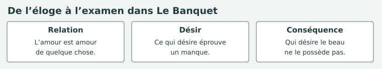
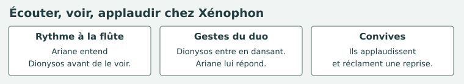

# ENS de Lyon · Grec oral · 2026 — Corrigé guidé

*Corrigé rédigé par IA, non officiel. Signalez toute erreur.*

**Rédaction** · GPT-6.2 Astra Ultra · vitesse non renseignée

Chaque candidat expliquait un seul passage. La liste des sujets et le rapport du jury identifient sept tirages de Médée et cinq du Banquet de Platon en spécialité. Hors programme, huit textes concernent les lettres et arts, quatre les langues vivantes et un les sciences humaines. Les extraits sont présentés dans l’ordre de la liste officielle. Les mots de début et de fin figurent avec les références dans le journal du corrigé.

## Préparer le tirage

Présenter brièvement l’œuvre et la place du passage. Lire à haute voix en rattachant les enclitiques à leur appui et en respectant les élisions. Reprendre des groupes syntaxiques assez courts pour que le jury puisse suivre le grec et son équivalent français. En spécialité, suivre les crochets de l’éditeur pour les vers que le jury demande de passer. Après la traduction, annoncer une question de lecture et appuyer chaque étape du commentaire sur une forme, un geste ou un mouvement précis du passage. Le rapport situe l’entretien après cet exposé continu.

## Lettres et arts · Spécialité

### Euripide, Médée, 1–23 — La nourrice remonte de Corinthe aux pins du Pélion

**Construire le passage.** Distinguer le souhait irréalisable de son développement conditionnel. Suivre la chaîne des sujets depuis le navire et le pin jusqu’à la main des rameurs, puis à Médée. Jason devient le sujet de la trahison au vers 17.

**Traduction.** Ah ! si le navire Argo n’avait jamais franchi les sombres Symplégades pour atteindre la terre de Colchide ! Si jamais, dans les vallons du Pélion, le pin n’était tombé sous la hache, si jamais des hommes de premier rang n’avaient armé leurs mains de rames pour aller chercher la toison toute d’or que voulait Pélias ! Ma maîtresse Médée, le cœur bouleversé d’amour pour Jason, n’aurait pas pris la mer jusqu’aux tours d’Iolcos. Elle n’aurait pas persuadé les filles de Pélias de tuer leur père et ne serait pas venue habiter cette terre de Corinthe avec son époux et ses enfants. Elle savait plaire aux citoyens du pays où elle s’était réfugiée et s’accordait en tout avec Jason. C’est pour le foyer la sauvegarde la plus sûre, lorsqu’une femme ne se trouve pas en désaccord avec son mari. À présent, tout est hostilité et ce qui était le plus cher est malade. Jason a trahi ses propres enfants et ma maîtresse. Il partage un lit royal, il a épousé la fille de Créon qui gouverne ce pays. Et la malheureuse Médée, déshonorée, crie les serments, rappelle les mains droites qu’on a jointes, ce gage suprême, et prend les dieux à témoin du prix que lui paie Jason.

**Commentaire.** Le premier mouvement souhaite annuler la cause matérielle du récit, jusqu’au bois dont on a fait le navire. La nourrice mesure l’expédition à ses effets sur une femme et sa maison. Le déictique qui désigne Corinthe ramène ensuite l’auditeur au lieu de la représentation. L’adverbe νῦν et l’opposition entre amitié et inimitié font basculer le récit dans le présent. La voix de Médée se fait entendre à travers celle de la nourrice avant l’entrée de l’héroïne.

### Euripide, Médée, 235–258 — Une voix collective, une étrangère sans cité

**Construire le passage.** Repérer le passage de la généralité du singulier à ἡμῖν, puis le contraste σοὶ μέν / ἐγώ δέ. Dans l’édition grecque consultée, le vers 246 sur l’ami et le contemporain porte une marque de discussion éditoriale. Le jury demande de passer les vers entre crochets, tant à la lecture qu’à la traduction. La proposition omise préciserait que l’homme va retrouver un ami ou un contemporain.

**Traduction.** Et là se livre le plus grand combat, selon qu’on reçoit un mauvais mari ou un bon. La séparation n’apporte aucune gloire aux femmes, et il leur est impossible de refuser un époux. Arrivée parmi des usages et des lois nouveaux, une femme doit se faire devineresse pour savoir, sans l’avoir appris chez elle, comment se conduire au mieux avec celui qui partage son lit. Si nous réussissons dans cette tâche et si notre époux vit avec nous sans porter le joug par contrainte, notre vie est enviable. Sinon, mieux vaut mourir. Un homme qui se lasse de sa vie au-dedans sort et apaise son dégoût. Pour nous, force est de tourner les yeux vers une seule personne. On prétend que nous menons au logis une vie sans danger, tandis qu’eux combattent la lance à la main. Mauvais calcul ! J’aimerais mieux trois fois tenir mon rang auprès d’un bouclier qu’enfanter une fois. Pourtant ton cas et le mien sont différents. Tu as ici ta cité et la maison de ton père, les ressources de la vie et la compagnie des tiens. Moi, seule, sans cité, mon mari m’outrage. On m’a arrachée à une terre étrangère et je n’ai ni mère, ni frère, ni parent auprès de qui chercher un autre mouillage dans mon malheur.

**Commentaire.** Le discours construit un « nous » féminin en donnant au mariage le vocabulaire du combat. La comparaison avec le service militaire retourne contre le jugement des hommes sa propre unité de mesure. Puis l’adresse distingue les Corinthiennes de Médée : toutes partagent des contraintes, mais l’étrangère manque des ressources du retour dans sa famille. La métaphore du mouillage fait saisir dans l’espace ce qui manque à celle qui avait traversé la mer.

### Euripide, Médée, 292–315 — Médée demande à Créon de la laisser rester

**Construire le passage.** Ne pas perdre le vers adressé à Créon placé juste après l’exclamation initiale. Expliquer le jeu entre réputation (δόξα) et savoir (σοφία). Au vers 314, le pluriel employé par Médée pour sa propre personne ne crée pas un nouveau locuteur.

**Traduction.** Hélas ! Ce n’est pas aujourd’hui pour la première fois, Créon, mais bien souvent que ma réputation m’a nui et m’a causé de grands maux. Jamais un homme doué de bon sens ne devrait faire instruire ses enfants au point d’en faire des esprits hors du commun. Outre l’inactivité qui leur échoit, ils récoltent la jalousie hostile de leurs concitoyens. Aux ignorants, si tu apportes un savoir nouveau, tu paraîtras naturellement inutile et dépourvu de sagesse. Et si l’on te croit supérieur à ceux qui passent pour détenir quelque science subtile, la cité verra en toi un importun. Je partage moi-même ce sort. Mon savoir me rend odieuse aux uns ; d’autres me trouvent trop effacée, d’autres tout le contraire, d’autres encore me trouvent contrariante. Et pourtant mon savoir est bien modeste. Toi donc, tu me redoutes. Crains-tu de subir quelque offense ? Je ne suis pas disposée, sois sans crainte, Créon, à faire du tort à des souverains. Quel tort m’as-tu fait ? Tu as donné ta fille à celui que ton cœur a choisi. Ma haine va à mon mari. Et toi, tu as agi, je pense, avec sagesse. Pour ma part, je n’envie pas ta prospérité. Célébrez vos noces et puissiez-vous réussir ! Seulement, laissez-moi habiter ce pays. Si lésée que je sois, je garderai le silence, vaincue par plus puissant que moi.

**Commentaire.** Créon veut éloigner celle dont il redoute l’intelligence. Médée explique cette crainte par les préjugés que suscite tout savoir hors du commun. En développant avec adresse une défense de sa propre modestie, elle donne simultanément la preuve de l’adresse qu’elle prétend minimiser. Le partage des torts réserve la haine à Jason et transforme la décision de Créon en geste paternel raisonnable. Les souhaits de bonheur et la promesse finale de silence prennent un autre sens pour le public de la tragédie.

### Euripide, Médée, 475–498 — La dette de Jason

**Construire le passage.** Les infinitifs du récit dépendent de l’envoi de Jason, tandis que les participes et les premières personnes font valoir l’action de Médée. Aux vers 492–495, rendre les deux possibilités introduites par ἦ et ἤ sans faire de l’une d’elles une croyance avérée de Jason.

**Traduction.** Je commencerai par dire d’abord ce qui vint en premier. Je t’ai sauvé ; le savent tous les Grecs montés sur le même navire Argo que toi. On t’envoyait atteler les taureaux au souffle de feu et ensemencer un champ mortel. Le serpent qui, sans dormir, gardait la toison toute d’or dans l’enchevêtrement de ses anneaux, je l’ai tué et j’ai fait lever pour toi la lumière du salut. Moi-même, après avoir trahi mon père et ma maison, j’ai gagné avec toi Iolcos, dans le pays du Pélion, plus ardente assurément que sage. J’ai fait mourir Pélias de la mort la plus douloureuse qui soit, par ses propres enfants, et j’ai anéanti toute sa maison. Après avoir reçu de moi de tels services, le pire des hommes, tu m’as trahie et t’es acquis une autre épouse, alors que des enfants nous étaient nés ! Si tu avais encore été sans enfant, ton désir de ce mariage aurait pu s’excuser. La foi des serments s’en est allée. Impossible de savoir si tu crois que les dieux d’alors ont cessé de régner ou que d’autres lois valent maintenant pour les hommes. Car tu as bien conscience d’avoir manqué à ton serment envers moi. Ah ! main droite que tu saisissais tant de fois ! Ah ! mes genoux ! Comme il fut vain de vous laisser toucher par un homme sans valeur et comme nous avons été trompées dans nos espérances !

**Commentaire.** L’ordre annoncé donne au plaidoyer une apparence méthodique. Ce catalogue réattribue à Médée la part active des exploits dont Jason tire sa gloire. La survie du héros a coûté à la femme sa propre appartenance familiale. La symétrie du verbe trahir aiguise donc le grief : elle avait trahi pour lui, il l’a trahie après en avoir recueilli le bénéfice. Au terme de l’argument sur les lois et les dieux, la parole passe au corps. Une main et des genoux avaient reçu la prière de Jason ; Médée les interpelle aujourd’hui comme des témoins.

### Euripide, Médée, 869–893 — La réconciliation jouée devant Jason

**Construire le passage.** Identifier le duel νῷν et l’adresse à soi du vers 873. Les questions sur l’exil et les enfants représentent, selon le discours de Médée, des objections qu’elle s’est elle-même faites. Au vers 893, la réplique se prolonge au-delà de la coupe donnée.

**Traduction.** Jason, je te demande ton indulgence pour mes paroles. Tu dois pouvoir supporter mes accès de colère, car beaucoup de marques d’affection nous unissent. J’ai engagé un débat avec moi-même et je me suis fait des reproches. « Malheureuse ! Pourquoi cet égarement, cette rancune contre ceux qui délibèrent sagement ? Pourquoi me faire une ennemie des maîtres du pays et de mon mari, qui sert au mieux nos intérêts en épousant une princesse et en donnant des frères à mes enfants ? Ne vais-je pas enfin, qu’ai-je donc, renoncer à ma colère, quand les dieux arrangent bien les choses ? N’ai-je pas des enfants ? N’ai-je pas conscience que nous allons être exilés et que les amis nous manquent ? » En y réfléchissant, je me suis rendu compte de ma grande imprudence et de la vanité de ma colère. À présent donc je t’approuve ; je te trouve bien avisé de nous avoir gagné cette alliance. C’était moi l’insensée, moi qui aurais dû concourir à ces projets, célébrer ton mariage avec toi, me tenir auprès de ton lit, accueillir ta jeune épouse et m’en réjouir. Mais nous sommes ce que nous sommes, je ne dirai pas du mal de nous, nous les femmes. Tu n’aurais donc pas dû imiter les travers des autres ni opposer des puérilités aux miennes. Je cède ; j’avoue qu’alors j’avais tort. Aujourd’hui j’ai mieux pesé tout cela…

**Commentaire.** La scène présente deux dialogues enchâssés. Médée parle à Jason et cite une prétendue discussion avec elle-même. Elle prête à sa conscience les raisons que Jason avait de son mariage, jusqu’à imaginer qu’elle aurait dû en conduire les cérémonies. L’aveu semble d’autant plus spontané que l’interlocuteur n’a rien à réfuter. Le public entend une reprise stratégique de la représentation de la femme impulsive. La formule finale signale un nouveau calcul au moment même où Jason croit entendre une conversion.

### Euripide, Médée, 1029–1052 — La mère suspend puis reprend son projet

**Construire le passage.** Distinguer les apostrophes aux enfants et au chœur des femmes. La répétition de χαιρέτω donne le rythme de la renonciation. Lire à haute voix la coupure καίτοι, point de départ d’une objection à cette renonciation.

**Traduction.** Ce serait donc en vain, mes enfants, que je vous ai élevés, en vain que j’ai eu tant de peine et me suis consumée à la tâche, que j’ai supporté les dures souffrances de l’enfantement ! Ah ! malheureuse que je suis, quelles espérances jadis je mettais en vous ! Vous me nourririez dans ma vieillesse et, après ma mort, vos mains prendraient soin de ma dépouille, bonheur enviable aux yeux des hommes. À présent, finie cette douce pensée. Privée de vous deux, je mènerai une vie de chagrin et de souffrance. Et vous, vous ne verrez plus votre mère de vos yeux aimants, partis vers une autre forme de vie.

Hélas ! pourquoi me regardez-vous ainsi, mes enfants ? Pourquoi me souriez-vous de ce dernier sourire ? Ah ! que vais-je faire ? Mon cœur s’en va, femmes, quand je vois le regard lumineux de mes enfants. Je ne le pourrais pas. Adieu mes projets de tout à l’heure ! J’emmènerai mes enfants hors de ce pays. À quoi bon, pour faire souffrir leur père par leur malheur, me procurer à moi-même un malheur deux fois plus grand ? Non, je ne le ferai pas. Adieu mes projets ! Pourtant, que m’arrive-t-il ? Vais-je m’exposer aux rires en laissant mes ennemis impunis ? Il faut l’oser. Quelle lâcheté est la mienne d’avoir seulement accueilli dans mon esprit ces paroles de tendresse !

**Commentaire.** Le futur que Médée avait imaginé aux mains de ses fils dessine une famille réciproque, où les enfants devenus grands prennent soin de la mère. Leur sourire réel agit sur le discours comme une réponse qu’ils n’ont pas prononcée. Les deux adieux au projet semblent fixer une décision avant que la crainte du rire ennemi ne renverse sa valeur. La scène ne donne pas un portrait immobile de la colère. Elle fait entendre comment Médée rebaptise faiblesse un mouvement maternel qui venait de la persuader.

### Euripide, Médée, 1197–1221 — Le messager et le deuil de Créon

**Construire le passage.** L’infinitif θιγεῖν dépend de la peur de tous les témoins. Le récit passe au présent pour l’arrivée du père. Aux vers 1215–1216, partager l’alternance entre le geste du père et la résistance attribuée à la jeune femme déjà morte et au vêtement.

**Traduction.** Car on ne distinguait plus ni l’expression de ses yeux ni la beauté de son visage. Depuis le sommet de sa tête le sang tombait, mêlé au feu. Comme la résine d’un pin, sa chair se détachait sous l’action invisible du poison. Spectacle terrible ! Chacun craignait de toucher la morte ; son sort nous avait instruits. Mais son malheureux père, ignorant le désastre, entre soudain dans la demeure et se jette sur son corps. Aussitôt il gémit, l’entoure de ses bras, l’embrasse et lui parle : « Malheureuse enfant, qui parmi les dieux t’a fait périr ainsi, sans honneur ? Qui fait de moi, un vieillard, un tombeau privé de toi ? Hélas, puissé-je mourir avec toi, mon enfant ! »

Quand il mit fin aux lamentations et aux sanglots, il voulut redresser son vieux corps. Mais il restait attaché au tissu léger, comme le lierre aux jeunes pousses du laurier. Ce fut une lutte terrible. Lui cherchait à relever le genou, elle le retenait en retour. S’il tirait de force, il se blessait jusqu’à l’os. Avec le temps, sa vie s’éteignit ; le malheureux rendit l’âme, incapable désormais de prendre le dessus sur le mal. Ils gisent morts, la fille et le vieux père, tout proches, désastre qui appelle nos larmes.

**Commentaire.** Le récit du messager commence par les limites de la reconnaissance du visage, puis oppose ceux qui savent à celui qui ignore. La venue de Créon rend à la jeune morte un nom de relation, « mon enfant ». Le père demande à mourir avec elle avant de découvrir le danger de son étreinte. Les comparaisons végétales encadrent sa défaite, de la résine au lierre qui tient au laurier. L’image finale remplace le mouvement de lutte par la proximité silencieuse des deux corps.

### Platon, Le Banquet, 198a–d — Socrate après l’éloge d’Agathon

**Construire le passage.** Faire entendre la double prédiction dont Éryximaque n’accepte que la moitié. Garder les degrés de narration, Aristodème rapporte les paroles, Socrate s’adresse à Éryximaque. Expliquer le jeu entre le nom du sophiste Gorgias et la tête de la Gorgone.

**Traduction.** Quand Agathon eut fini, tous les assistants, disait Aristodème, manifestèrent bruyamment leur approbation. Le jeune homme avait parlé d’une manière digne de lui et du dieu. Alors Socrate tourna les yeux vers Éryximaque. « Fils d’Acouménos, dit-il, crois-tu que je tremblais tout à l’heure devant un danger imaginaire ? N’ai-je pas prédit ce qui arrive, en disant qu’Agathon parlerait à merveille et que moi je resterais à court ? — Sur le premier point, répondit Éryximaque, tu as été bon prophète : Agathon devait bien parler. Mais que toi, tu restes à court, je n’en crois rien. — Et comment, mon cher, reprit Socrate, pourrions-nous, moi ou qui que ce soit, ne pas être embarrassés s’il faut prendre la parole après un discours aussi beau, aussi varié ? Tout n’y suscitait peut-être pas une admiration égale. Mais qui, en entendant la fin, ne serait frappé par la beauté des noms et des verbes ? Quant à moi, à la pensée que je serais incapable de rien dire qui approche seulement de cette beauté, j’ai bien failli, tant j’avais honte, prendre la fuite si j’en avais trouvé le moyen. Ce discours me rappelait en effet Gorgias, au point de me faire éprouver à la lettre ce que raconte Homère. Je craignais qu’au moment de finir Agathon n’envoyât, dans son discours, contre le mien, la tête de Gorgias, l’orateur terrible, et ne me pétrifiât, moi-même réduit au silence. J’ai compris alors à quel point j’étais ridicule quand j’ai accepté de louer l’Amour à mon tour avec vous, en me disant savant en la matière. En réalité, j’ignorais complètement comment on devait s’y prendre pour louer quoi que ce soit. »

**Commentaire.** L’approbation collective place le dernier orateur sous l’autorité du spectacle. Socrate rend hommage à la beauté des mots et réserve discrètement son jugement sur le reste. Gorgias, rapproché de la Gorgone homérique, semble capable de changer l’orateur suivant en pierre. Or celui qui se prétend muet vient précisément d’inventer une image brillante. Cette ironie permet de déplacer la discussion de la performance vers la méthode de l’éloge.

### Platon, Le Banquet, 199b–e — Un nom de relation

**Construire le passage.** Traduire le génitif τινός sans le remplir d’emblée par un objet précis. L’image de la parenté fait apparaître le type de question posé. Le mot Ἔρως passe du dieu que l’on célèbre à la relation que son nom permet d’analyser.

**Traduction.** Phèdre et les autres, disait-il, lui demandèrent de parler comme il estimait devoir le faire. « Une chose encore, Phèdre, dit Socrate. Permets-moi de poser quelques petites questions à Agathon, afin de parler ensuite sur la base de ce dont il sera convenu avec moi. — Bien volontiers, dit Phèdre. Interroge-le. » Socrate commença alors à peu près ainsi, disait-il. « Mon cher Agathon, tu m’as paru ouvrir fort bien la voie en disant qu’il fallait montrer d’abord ce qu’est l’Amour lui-même, ensuite quelles sont ses œuvres. Voilà un départ que j’admire beaucoup. Puisque par ailleurs tu nous as magnifiquement exposé ses qualités, dis-moi encore ceci à son sujet : est-il de la nature de l’amour d’être amour de quelque chose, ou de rien ? Je ne demande pas s’il est amour d’une mère ou d’un père. La question serait risible si elle consistait à demander si l’Amour est l’amour d’une mère ou d’un père. C’est plutôt comme si, à propos du père, considéré en tant que tel, je demandais : le père est-il père de quelqu’un, ou non ? Tu me dirais, je suppose, pour bien répondre, que le père est père d’un fils ou d’une fille, n’est-ce pas ? — Tout à fait, dit Agathon. — Et n’en va-t-il pas de même de la mère ? » Il en convint aussi. « Réponds-moi donc encore un peu, reprit Socrate, pour mieux saisir ce que je cherche. Si je demandais : et le frère, en tant précisément qu’il est frère, est-il frère de quelqu’un ? » Agathon répondit que oui. « D’un frère ou d’une sœur, donc ? » Il l’accorda. « Essaie alors de me dire de même pour l’Amour : est-il amour de rien ou de quelque chose ? — Assurément, il est amour de quelque chose. »

**Commentaire.** Socrate reprend à son interlocuteur le bon partage entre la nature du dieu et ses œuvres. Son consentement sur ce départ ouvre un examen du langage. Nommer une mère comme objet possible de l’amour répondrait à une question trop particulière. Les mots de parenté servent à établir une propriété plus générale. On ne peut comprendre ce qu’est un frère sans comprendre le rapport dont le mot est porteur. Agathon accorde la structure de la relation, avant que le dialogue n’en tire une conclusion sur le manque.

### Platon, Le Banquet, 200e–201c — Le beau peut-il être ce que possède déjà Éros ?

**Construire le passage.** La première question introduite par ἄλλο τι appelle l’accord. Maintenir la distinction entre aimer la beauté et être beau. À la fin, le jeu entre καλῶς εἶπες et la vérité de l’éloge reprend la différence entre bien parler et savoir.

**Traduction.** « Allons, dit Socrate, récapitulons nos accords. D’abord l’Amour est bien amour de certaines choses, et ensuite de celles dont il éprouve le manque ? — Oui. — Rappelle-toi à présent de quelles choses tu as dit dans ton discours qu’il était amour. Si tu préfères, je vais te le rappeler. Tu as dit à peu près, je crois, que les affaires des dieux se sont réglées par l’amour des belles choses, puisqu’il ne saurait y avoir d’amour des choses laides. N’est-ce pas à peu près cela ? — Oui, dit Agathon. — Et tu t’exprimes convenablement, mon ami, reprit Socrate. S’il en est ainsi, l’Amour serait bien amour de la beauté et non de la laideur ? » Il en convint. « Or nous avons bien accordé que l’on aime ce dont on manque et que l’on ne possède pas ? — Oui. — L’Amour manque donc de beauté, il ne la possède pas. — C’est forcé, dit-il. — Et ce qui manque de beauté, qui ne la possède en aucune manière, appelles-tu cela beau ? — Bien sûr que non. — Si cela est ainsi, accordes-tu encore que l’Amour soit beau ? » Et Agathon répondit : « Je risque fort, Socrate, de ne rien savoir de ce que je disais alors. — Et pourtant, Agathon, tu as parlé avec beauté. Dis-moi encore une petite chose : les choses bonnes ne te semblent-elles pas belles, elles aussi ? — Si. — Alors, si l’Amour manque des belles choses et si les bonnes sont belles, il manquerait aussi des bonnes. — Moi, dit Agathon, je ne serais pas capable de te contredire, Socrate. Qu’il en soit comme tu le dis. — C’est la vérité, cher Agathon, que tu ne peux contredire. Socrate, cela ne présente aucune difficulté. »

**Commentaire.** Le raisonnement articule deux accords distincts, un premier sur la relation, un second sur le manque. L’éloge d’Agathon a fourni le troisième terme en assignant le beau comme objet de l’amour. Socrate n’a donc pas besoin d’introduire une thèse opposée de l’extérieur. Il fait apparaître la conséquence de paroles déjà prononcées. Le passage aux bonnes choses dépend encore d’un assentiment exprimé. La dernière repartie répond à l’aveu personnel d’impuissance en séparant l’autorité du raisonnement et le prestige de l’homme qui interroge.

### Platon, Le Banquet, 212d–213b — L’entrée d’Alcibiade

**Construire le passage.** Distinguer le récit à l’infinitif des questions prononcées par Alcibiade. Les trois places ne sont intelligibles que si l’on remarque que Socrate s’est déplacé volontairement ; Alcibiade n’a pas vu ce mouvement.

**Traduction.** Peu après, ils entendirent la voix d’Alcibiade dans la cour. Il avait beaucoup bu, criait très fort, demandait où était Agathon et ordonnait qu’on le menât à lui. La joueuse d’aulos le prit sous le bras et le conduisit auprès d’eux avec quelques personnes de sa suite. Il s’arrêta sur le seuil, couronné d’une épaisse guirlande de lierre et de violettes, portant quantité de bandelettes sur la tête. « Messieurs, bonsoir ! Accueillerez-vous comme convive un homme fort ivre ? Ou faut-il que nous repartions après avoir seulement couronné Agathon, puisque tel était l’objet de notre visite ? Hier, voyez-vous, je n’ai pas pu venir. Aujourd’hui j’arrive avec ces bandelettes sur la tête pour les ôter de mon front et en couronner la tête de l’homme le plus sage et le plus beau, si vous me permettez cette expression. Allez-vous me rire au nez parce que je suis ivre ? Même si vous riez, je sais très bien que je dis vrai. Mais dites-moi tout de suite : puis-je entrer à ces conditions, oui ou non ? Boirez-vous avec moi ou non ? » Alors tous s’exclamèrent, lui dirent d’entrer et de prendre place. Agathon l’appela. Alcibiade s’avança, conduit par les gens de sa suite. Comme il retirait ses bandelettes pour couronner Agathon, elles lui tombaient devant les yeux et il n’aperçut pas Socrate. Il s’assit auprès d’Agathon, entre lui et Socrate, qui s’était écarté en le voyant. Une fois assis auprès d’Agathon, il l’embrassa et le couronna. Agathon dit alors : « Enfants, déchaussez Alcibiade afin qu’il puisse prendre place à table en tiers avec nous. »

**Commentaire.** La voix est entendue avant que son propriétaire ne soit vu. L’entrée est organisée comme une petite scène, de la cour au seuil, puis du seuil au lit de banquet. L’arrivée des couronnes et du cortège fait revenir dans la réunion philosophique des signes de fête. Alcibiade revendique la vérité de son compliment tout en affichant son ivresse. Les bandelettes qui lui permettent d’honorer Agathon lui masquent Socrate ; le lecteur comprend matériellement un malentendu que le prochain extrait fera éclater.

### Platon, Le Banquet, 213b–e — Du rival au vainqueur des discours

**Construire le passage.** Respecter les changements d’allocutaire. Socrate appelle Agathon à l’aide ; Alcibiade s’adresse d’abord à Socrate puis réclame à Agathon les bandelettes qu’il vient de lui donner. Dans la réplique finale, le contraste porte sur la durée et sur l’objet de la victoire.

**Traduction.** « Bien sûr, dit Alcibiade. Mais qui est ici notre troisième convive ? » Au même instant, il se retourna et vit Socrate. À sa vue, il bondit. « Par Héraclès ! Qu’est-ce que c’est ? Socrate, ici ! Encore une embuscade ! Tu t’étais couché là, comme à ton habitude de surgir soudain là où je t’attendais le moins. Et maintenant, pourquoi es-tu venu ? Et pourquoi as-tu pris place précisément ici ? Ce n’est pas auprès d’Aristophane que tu es, ni de tel autre qui est ou veut être plaisant. Tu as tout arrangé pour être couché auprès du plus beau de la maison. » Socrate dit : « Agathon, vois si tu peux me venir en aide. L’amour de cet homme est devenu pour moi une affaire bien sérieuse. Depuis le temps où je me suis épris de lui, je ne peux plus tourner les yeux vers un seul bel homme ni m’entretenir avec lui sans que celui-ci, jaloux et plein de dépit, ne fasse des choses extraordinaires. Il m’injurie et c’est à peine s’il retient ses mains. Veille donc à ce qu’il ne nous joue pas un tour maintenant encore. Réconcilie-nous ou, s’il essaie de recourir à la violence, défends-moi. Sa folie et sa passion d’aimer m’inspirent une grande frayeur. — Il n’y a, dit Alcibiade, aucune réconciliation possible entre toi et moi ! Mais je te demanderai des comptes là-dessus une autre fois. Pour l’instant, Agathon, donne-moi quelques bandelettes pour que je couronne aussi la tête merveilleuse de cet homme. Il ne faudrait pas qu’il me reproche de t’avoir couronné, toi, et de ne pas l’avoir couronné, lui qui l’emporte sur tous les hommes dans les discours, et cela toujours, pas seulement avant-hier comme toi. » Il prit aussitôt quelques bandelettes, couronna Socrate et se coucha.

**Commentaire.** Le bond d’Alcibiade et son vocabulaire d’embuscade transforment la disposition des convives en comédie de jalousie. Socrate reprend le rôle de celui qu’il faut protéger, tout en indiquant qu’il s’était épris d’Alcibiade. Les mots de l’amour ne répartissent pas définitivement un sujet et un objet. L’acte de couronner répond à la querelle sans la résoudre : la victoire ponctuelle du poète Agathon et la victoire toujours recommencée du discours socratique méritent deux bandelettes prises au même ensemble.

## Lettres et arts · Hors programme

### Aristophane, L’Assemblée des femmes, 952–968 — Deux voix à la porte

**Construire le passage.** Attribuer d’abord les répliques. Rendre le mouvement vers soi de δεῦρο et le mouvement vers le bas de καταδραμοῦσα. Dans la dernière prière de chaque voix, le démonstratif est sujet de l’infinitif. Le passage du masculin au féminin rend sensible la réciprocité.

**Traduction.** La jeune femme. Viens donc, viens donc, mon cher, viens près de moi, avance. Tâche d’être mon compagnon pour la nuit. Quel amour m’agite à la vue de tes boucles ! Un désir étrange me presse et me tient tout entière en son pouvoir. Lâche-moi, je t’en supplie, Éros, et fais que ce garçon vienne partager mon lit !
Le jeune homme. Viens donc, viens donc, toi aussi, cours jusqu’en bas et ouvre-moi cette porte. Sinon, je vais tomber et rester étendu là. Ma chérie, c’est dans tes bras que je veux batailler avec ton derrière ! Déesse de Chypre, pourquoi me rends-tu fou de cette fille ? Lâche-moi, je t’en supplie, Éros, et fais que cette fille vienne partager mon lit !

**Commentaire.** Sur scène la porte reste fermée. Les déictiques et les impératifs rendent presque visible une distance que les deux voix voudraient abolir. Le garçon reprend le premier appel et la prière finale de la jeune femme, en changeant simplement de démonstratif. Entre les deux refrains, aux boucles de la chanson amoureuse répond une image de lutte toute corporelle. Le spectateur entend simultanément une sérénade et sa parodie.

### Julien, Épître 41 — Une invitation impériale et son laissez-passer

**Construire le passage.** Le participe futur συνησθησομένους donne le motif prêté aux invités. Relever le jeu des temps dans διατεθεῖσθαι et διακεῖσθαι. Le participe futur μεθέξων dit dans quel but il faut venir. Distinguer le transport public du dieu protecteur invoqué dans la dernière phrase.

**Traduction.** Le sage Hésiode estime qu’il faut inviter ses voisins aux fêtes, puisqu’ils y partageront notre joie, tout comme ils partagent nos peines et nos inquiétudes quand survient un trouble imprévu. Moi, je dis qu’il faut inviter ses amis et laisser là les voisins. En voici la raison. On peut avoir un voisin pour ennemi. Un ami ennemi, c’est aussi peu possible que du blanc qui soit noir ou du chaud qui soit froid. Tu es notre ami aujourd’hui, mais tu l’étais déjà depuis longtemps et ta bienveillance ne s’est jamais démentie. N’en aurions-nous aucun autre témoignage que nos propres dispositions, celles que nous avons eues et que nous avons encore envers toi, que ce serait déjà un grand signe de cette amitié. Viens donc en personne prendre part à notre consulat. La poste publique t’amènera, tu disposeras d’une voiture et d’un cheval de renfort. Et s’il convient d’ajouter encore quelque vœu, nous avons aussi prié le dieu des chemins de te faire bon accueil.

**Commentaire.** La citation d’Hésiode ouvre une petite controverse sur la définition de l’ami. Julien se sert ensuite d’un argument plus audacieux. Ses propres sentiments feraient preuve de ceux de son correspondant. Après la démonstration et l’impératif viennent un véhicule, un cheval, puis le dieu des routes. Le soin pratique donné au trajet fait de la lettre elle-même un acte d’amitié et aussi un acte de pouvoir.

### Lucien, Dialogues des hétaïres, II, 1 — Myrtion imagine la parole de l’enfant

**Construire le passage.** Suivre trois personnes et deux porteurs du même nom. Myrtion parle d’elle-même à la troisième personne lorsqu’elle se dit oubliée. À la fin, le démonstratif ἐκεῖνος désigne le fils encore hypothétique. Le parfait γεγένησαι place le manquement du père avant la future accusation.

**Traduction.** Tu épouses, Pamphile, la fille de l’armateur Phidon. On dit même que tu l’as déjà épousée ! Tous ces serments que tu as jurés, toutes ces larmes, tout a disparu en un instant. Tu as maintenant oublié Myrtion, et cela, Pamphile, alors que j’en suis déjà à mon huitième mois de grossesse. Voilà donc tout ce que j’ai acheté au prix de ton amour, ce ventre que tu m’as fait si gros, et bientôt un enfant que je vais devoir élever. Pour une courtisane, c’est une charge bien lourde. Car je n’abandonnerai pas le nouveau-né, surtout si c’est un garçon. Je lui donnerai le nom de Pamphile. J’y trouverai, moi, une consolation à mon amour. Quant à toi, un jour il viendra te reprocher lui-même d’avoir manqué à ta parole envers sa pauvre mère.

**Commentaire.** Le futur mariage est présenté au présent, puis comme déjà célébré, avec pour seule garantie un « on dit ». Le flot des reproches ne laisse aucune place à la réponse de Pamphile sur ce billet. L’image du marché renverse la relation entre la courtisane et son amant. Dans la dernière période, celle que les engagements du père semblent abandonner imagine un témoin capable un jour de parler en son nom.

### Lucien, La Double Accusation, 31 — Un plaideur transforme la rhétorique en scène de ménage

**Construire le passage.** Rattacher les participes féminins à ταύτην, objet de ὁρῶν. Le verbe personnel qui porte la première phrase est ὑπώπτευον. Dans la scène nocturne, repérer le changement de sujet entre la ruelle pleine de prétendants et la femme qui rit.

**Traduction.** Pour ma part, quand je vis qu’elle ne gardait plus sa réserve et ne conservait plus cette tenue décente dans laquelle l’illustre homme de Péanie l’avait jadis prise pour femme, quand je la vis se parer, arranger sa chevelure en courtisane, se frotter de fard rouge et se souligner les deux yeux, je conçus aussitôt des soupçons. J’épiai la direction de son regard. Je passe sur le reste. Chaque nuit, notre ruelle se remplissait de prétendants ivres qui venaient faire la fête devant chez elle et cogner à la porte. Certains osaient même tenter d’entrer de force, sans la moindre retenue. Elle riait et se réjouissait de ce qui se passait. Le plus souvent, ou bien elle se penchait du haut de la maison pour écouter leurs voix rauques chanter des chansons d’amour, ou bien elle entrouvrait les petites fenêtres et, se croyant à l’abri de mes regards, se livrait avec eux à des écarts et à l’adultère.

**Commentaire.** Le Syrien plaide contre Rhétorique en empruntant au procès pour adultère son vocabulaire de surveillance. Le précédent illustre est Démosthène, désigné par son dème de Péanie. La parure de la femme et les chansons des prétendants permettent de figurer un art oratoire soucieux d’effets faciles. Le plaideur raille pourtant cet art au moyen de ses propres procédés, dont la prétérition « je passe sur le reste » aussitôt suivie d’une scène très détaillée.

### Plutarque, Vie d’Alcibiade, 6, 1–2 — Les différentes prises que l’on a sur Alcibiade

**Construire le passage.** Repérer l’alternance exprimée par πῇ μέν et ἔστι δ’ ὅτε. Après ἔλεγε, κρατεῖσθαι est passif. Les « oreilles » de la formule de Cléanthe reprennent indirectement les paroles qui, au début, atteignaient le cœur du jeune homme.

**Traduction.** L’affection de Socrate avait de nombreux et puissants rivaux. Tantôt elle prenait le dessus chez Alcibiade. Grâce à son heureux naturel, les paroles de Socrate le touchaient, lui retournaient le cœur et faisaient couler ses larmes. Mais parfois il s’abandonnait aux flatteurs qui lui présentaient une foule de plaisirs, échappait à Socrate et se faisait littéralement pourchasser comme un fugitif. Cet homme seul lui inspirait du respect et de la crainte. Pour tous les autres, il n’avait que mépris. Cléanthe disait que, pour sa part, il tenait celui qu’il aimait par les oreilles, tandis que ses rivaux trouvaient sur lui bien des prises auxquelles lui-même ne touchait pas. Il entendait par là le ventre, les parties intimes et le gosier. Alcibiade, en tout cas, se laissait aussi aisément conduire par les plaisirs.

**Commentaire.** Les deux influences s’évaluent à leurs effets sur le même jeune homme. Les paroles de Socrate produisent un véritable bouleversement physique. L’image de la fuite et de la poursuite donne ensuite à voir son inconstance. Un mot attribué à Cléanthe, philosophe d’une autre époque, illustre enfin la concurrence entre l’écoute et la satisfaction immédiate des appétits. Cette comparaison du biographe ne fait pas de Cléanthe un contemporain d’Alcibiade.

### Xénophon, Banquet, IX, 3–5 — Un spectacle observé par les convives

**Construire le passage.** Suivre les verbes de perception. Ἀκούσασα décrit ce qu’entend Ariane, κατεῖδεν la vision de Dionysos, ὁρῶντες celle des convives. Le datif αἰδουμένῃ après ἐῴκει exprime une apparence. Distinguer la réaction représentée par la danseuse de ses sentiments personnels.

**Traduction.** Ariane entra la première, parée comme une jeune mariée, et s’assit sur le siège d’honneur. Dionysos n’était pas encore visible. On jouait à la flûte un rythme bachique. C’est alors que l’on admira le maître de danse. Car aussitôt, en entendant la musique, Ariane fit un geste tel que chacun aurait compris avec quelle joie elle l’avait entendue. Elle ne courut pas à sa rencontre et ne se leva même pas, mais on voyait bien qu’elle avait peine à rester tranquille. Dès que Dionysos l’aperçut, il s’avança vers elle en dansant, avec tous les signes du plus vif attachement, s’assit sur ses genoux, l’entoura de ses bras et l’embrassa. Elle paraissait intimidée, mais lui rendait tendrement son étreinte. Les convives, devant ce spectacle, applaudissaient et criaient en même temps « encore ! ». Quand Dionysos se leva et fit lever Ariane avec lui, on put alors contempler les figures qu’ils formaient en échangeant baisers et marques de tendresse.

**Commentaire.** Le premier effet théâtral vient d’un personnage encore invisible. La musique annonce Dionysos et le geste retenu d’Ariane fait connaître son émotion. L’éloge adressé au maître de danse avertit le lecteur qu’il assiste à une représentation. L’applaudissement et le rappel des convives constituent la dernière étape de ce trajet, qui part d’un son, passe par les corps des acteurs et gagne la salle.

### Xénophon, Cyropédie, VI, 4, 5–7 — Panthée engage sa parole auprès d’Abradatas

**Construire le passage.** Μεῖζον avec le génitif donne le second terme de la comparaison. Rattacher la construction infinitive βούλεσθαι ἄν au serment. Entendre à la fin le parallèle des statuts « esclave » et « femme libre ». Le tirage s’interrompt sur ἐν ἀτίμῳ ὀνόματι.

**Traduction.** Abradatas, si jamais une femme a tenu son mari pour plus précieux que sa propre vie, tu sais, je pense, que je suis de celles-là. Pourquoi donc devrais-je énumérer chaque chose une à une ? Les faits t’en ont donné, je crois, des preuves plus convaincantes que les paroles que je pourrais prononcer maintenant. Pourtant, toute disposée envers toi comme tu sais que je le suis, je te le jure par notre affection, la mienne et la tienne. Oui, je préférerais que nous descendions ensemble sous la terre, toi après avoir montré ta valeur, plutôt que de vivre couverte de honte avec toi couvert de honte. À ce point je nous ai jugés dignes, toi et moi, de ce qu’il y a de plus beau. Et à Cyrus aussi nous devons, il me semble, une grande reconnaissance. Prisonnière, mise à part pour lui, je n’ai pas été à ses yeux une esclave qu’il pût posséder, ni une femme libre qu’il pût placer dans une situation déshonorante.

**Commentaire.** La locutrice prépare le départ de son mari au combat. Après avoir opposé les mots aux preuves de sa conduite, elle accomplit précisément un acte de parole, le serment. La syntaxe associe les deux époux jusque dans la honte redoutée. Le dernier mouvement fait entrer Cyrus dans ce tête-à-tête. Le comportement du vainqueur envers sa captive fonde, aux yeux de Panthée, une dette de reconnaissance partagée par le couple.

### Xénophon, Mémorables, II, 4, 1–2 — Ce que disent et ce que font les hommes

**Construire le passage.** Identifier le possesseur de chaque point de vue. Dans ἤκουσα αὐτοῦ διαλεγομένου, le génitif et son participe dépendent du verbe de perception. Dans les phrases suivantes, ἔφη introduit successivement entendre et voir. Les deux propositions en ὅπως exposent ce dont les hommes devraient se préoccuper.

**Traduction.** Je l’ai aussi entendu un jour s’entretenir des amis. Ses paroles auraient, me semblait-il, la plus grande utilité pour qui veut acquérir des amis et entretenir des relations avec eux. Il disait entendre quantité de gens affirmer qu’un ami sûr et bon serait, de tous les biens, le meilleur. Et pourtant, à l’en croire, il voyait la plupart des hommes prendre plus de soin de n’importe quoi que de l’acquisition d’amis. Il les voyait, disait-il, acquérir avec soin des maisons, des terres, des esclaves, du bétail, du matériel et s’efforcer de conserver ce qu’ils possédaient. Mais un ami, ce qu’ils disent être le plus grand bien, il voyait la plupart des hommes, assurait-il, ne se soucier ni de la manière de se le procurer ni de la façon de conserver ceux qu’ils avaient déjà.

**Commentaire.** Le narrateur donne d’abord son témoignage d’auditeur. Au deuxième niveau, Socrate rapporte ce qu’il entend dire, puis ce qu’il voit faire. L’inventaire d’une propriété grecque place les esclaves parmi les biens du maître. Cette donnée sociale explique la violence de la comparaison. Le même couple de verbes, acquérir et conserver, permet de mesurer exactement l’écart entre la maxime admise et la pratique ordinaire.

## Langues vivantes · Hors programme

### Julien, Épître 78 — L’amitié avec un inconnu et avec les anciens

**Construire le passage.** Rétablir « amis » dans la deuxième question. Dans τό γε εἰς ἐμέ, entendre une restriction personnelle à la première personne du pluriel. Les deux εἴτε envisagent les deux attitudes possibles de l’invité et conduisent l’une et l’autre au même impératif.

**Traduction.** Quelqu’un soulèvera ici une difficulté. Comment sommes-nous amis sans nous être jamais vus ? Mais comment le sommes-nous de gens qui vivaient il y a mille ans et même, oui, par Zeus, deux mille ? Parce qu’ils étaient tous des hommes de valeur, nobles et bons de caractère. Nous aussi, nous désirons leur ressembler, même si, pour ce qui est de moi du moins, il s’en faut énormément que nous le soyons. Pourtant, ce désir nous range, d’une certaine façon, dans le même camp qu’eux. Pourquoi est-ce que je prolonge encore ce bavardage ? S’il faut se rendre chez un ami sans invitation, tu viendras certainement. Et si tu attends une invitation, en voici même une pressante qui t’arrive de chez nous. Rejoins-nous donc aux environs de Tyane, au nom de Zeus protecteur de l’amitié, et fais-nous voir, au milieu des Cappadociens, un homme authentiquement grec.

**Commentaire.** L’objection initiale pourrait compromettre la lettre adressée à quelqu’un que Julien n’a jamais rencontré. L’exemple des anciens montre comment l’admiration morale crée une communauté par-delà le temps. Le raisonnement finit en plaisanterie courtoise. L’invitation qu’attendrait le destinataire vient de lui parvenir pendant qu’il la lit. La mention de la Cappadoce rapporte enfin cette qualité de « grec » à un idéal culturel revendiqué par le locuteur.

### Lucien, Timon, 8 — Le repas des prétendus amis

**Construire le passage.** Après ᾤετο identifier l’accusatif sujet αὐτούς et les infinitifs sous-entendus ou exprimés. Le groupe ὑπ’ εὐνοίας appartient à l’interprétation prêtée à Timon. À la fin, le participe ἀπολιπόντες marque l’abandon, et les participes négatifs en déploient les conséquences.

**Traduction.** À le dire comme cela, c’est sa bonté qui l’a perdu, son amour des hommes et sa pitié pour tous ceux qui se trouvaient dans le besoin. Mais à parler vrai, c’est sa sottise, sa naïveté et son incapacité à juger ses amis. Il ne s’apercevait pas qu’il faisait du bien à des corbeaux et à des loups. Le malheureux, tandis que tant de vautours lui dévoraient le foie, les prenait pour des amis, des compagnons à qui leur attachement pour lui faisait apprécier le repas ! Eux, une fois les os soigneusement dénudés et rongés tout autour, s’il y restait quelque moelle, la suçaient elle aussi avec le plus grand soin. Puis ils s’en allaient, le laissant tout sec, coupé à la racine. Ils ne le reconnaissaient même plus, ne tournaient plus les yeux vers lui. Comment l’auraient-ils fait ? Plus de secours et plus de cadeaux en retour.

**Commentaire.** Deux séries de trois noms donnent deux diagnostics opposés de la ruine de Timon. La suite transforme ses protégés en animaux, puis développe une seule image jusqu’à l’épuisement de la victime. Au centre, la joie du mangeur est interprétée à contresens par celui qui sert de repas. La formule finale sur la réciprocité ramène l’image au monde social, dont les parasites n’avaient accepté qu’une moitié des obligations.

### Plutarque, Vie d’Alcibiade, 8, 4–6 — Hipparété réclame la séparation

**Construire le passage.** Le sujet sous-entendu de la démarche est Hipparété. Le génitif absolu τοῦ Ἀλκιβιάδου μὴ φροντίζοντος décrit l’attitude de son mari. Plus loin, μηδενός suivi du participe au génitif explique l’absence d’intervention. Conserver à βία son sens de violence jusque dans l’appréciation finale.

**Traduction.** Hipparété était une femme rangée et attachée à son mari. Mais elle souffrait de le voir, au mépris de leur mariage, fréquenter des courtisanes étrangères et athéniennes. Elle quitta la maison et se retira chez son frère. Comme Alcibiade n’y prêtait aucune attention et continuait sa vie de plaisirs, elle devait déposer auprès de l’archonte l’acte de séparation, en personne et sans passer par des tiers. Elle se présenta donc pour accomplir cette démarche conformément à la loi. Alcibiade survint, la saisit et s’en alla, la ramenant chez lui à travers l’agora. Personne n’osa s’opposer à lui ni la lui enlever. Elle demeura certes auprès de lui jusqu’à sa mort. Elle mourut peu de temps après, alors qu’Alcibiade avait pris la mer pour Éphèse. Cette violence ne parut donc pas tout à fait illégale ni inhumaine.

**Commentaire.** Le récit donne d’abord à Hipparété une raison d’agir, puis précise l’exigence juridique de présence personnelle. Cette disposition permet aussi au mari d’intercepter son épouse devant témoins. La traversée de l’agora et l’inaction des passants rendent la contrainte publiquement visible. La phrase finale porte un jugement rapporté et atténué. Le verbe « parut », la double négation et « tout à fait » invitent à préciser à quelle voix le commentaire appartient.

### Xénophon, Mémorables, II, 4, 5–6 — De quoi un bon ami se rend capable

**Construire le passage.** Le potentiel avec ἄν introduit un défi lancé à l’auditeur. Les deux membres en ἄν τε dépendent d’un verbe de nécessité puis d’un verbe de trouble. En fin de passage, organiser les participes en paires et rétablir les amis comme compléments de « réjouir » et de « remettre debout ».

**Traduction.** D’ailleurs, à quel autre bien comparer un bon ami sans voir que celui-ci l’emporte de beaucoup ? Quel cheval ou quel attelage est aussi utile qu’un ami de valeur ? Quel esclave est aussi dévoué et aussi fidèle ? Quel autre bien peut servir à tout de cette manière ? Car le bon ami se met lui-même à disposition pour tout ce qui manque à son ami, dans l’organisation des affaires de sa maison comme dans l’exercice des affaires publiques. S’il faut faire du bien à quelqu’un, il prête ses forces. Si quelque crainte vient troubler son ami, il vole à son secours. Tantôt il partage la dépense, tantôt il participe à l’action. Dans un cas il aide à persuader, dans un autre il fait usage de sa force. Aux amis qui réussissent, il donne les plus grandes joies. Lorsqu’ils trébuchent, il contribue plus que personne à les remettre debout.

**Commentaire.** Les quatre questions partent de la logique d’un inventaire de biens et finissent par en faire éclater les catégories. L’ami est précisément celui qui « se met lui-même » à disposition. La série des verbes composés avec la préposition signifiant « avec » fait entendre que l’aide se décide et s’exerce à deux. La dernière opposition élargit encore la définition. L’amitié s’éprouve dans la joie partagée aussi bien que dans la réparation d’un revers.

## Sciences humaines · Hors programme

### Plutarque, Vie d’Alcibiade, 7, 3–6 — Deux batailles, deux preuves d’amitié

**Construire le passage.** Suivre le changement de sujet après les deux combattants réunis. Τὸ ἀριστεῖον est la récompense, la πανοπλία en est l’objet matériel. À la dernière phrase, le génitif absolu place la retraite à pied de Socrate à l’arrière-plan, tandis que le cavalier reste sujet des trois verbes principaux.

**Traduction.** Tout jeune encore, Alcibiade prit part à l’expédition de Potidée. Il avait Socrate pour compagnon de tente et pour voisin de rang dans les combats. Une bataille acharnée s’engagea. Tous deux s’y distinguèrent, mais Alcibiade fut blessé. Socrate se posta devant lui, le défendit et, de façon incontestable, lui sauva la vie ainsi que ses armes. À juger au plus juste, le prix de la valeur revenait donc à Socrate. Mais les généraux tenaient manifestement à attribuer cet honneur à Alcibiade, à cause de son rang. Socrate, qui voulait voir grandir chez lui l’ambition de s’illustrer dans les belles actions, fut le premier à témoigner en sa faveur et à demander qu’on lui décerne la couronne et l’armure complète. Plus tard eut lieu la bataille de Délion. Les Athéniens prenaient la fuite. Alcibiade avait un cheval, tandis que Socrate se retirait à pied avec quelques autres. Quand il le vit, Alcibiade ne passa pas son chemin. Il l’accompagna et le protégea.

**Commentaire.** Les deux batailles encadrent une scène de distribution des honneurs. Le narrateur rend à Socrate le mérite de Potidée, tandis que Socrate lui-même demande de distinguer son compagnon. La phrase fait coexister deux motifs d’attribuer la récompense, le prestige social d’Alcibiade pour les généraux et son éducation pour le philosophe. À Délion, l’homme à cheval choisit de régler sa retraite sur celle du piéton. La réciprocité devient un acte qu’aucune couronne ne vient sanctionner.

## Deux relances d’entretien

**Quel geste donne à voir un changement de décision ?** Dans le grand monologue de Médée (1029–1052), le sourire des enfants interrompt le scénario qu’elle s’était imposé. Dans le Banquet de Platon (213b–e), Alcibiade modifie le destinataire de sa couronne quand il découvre son voisin. Dans chaque cas, montrer à quel moment précis le regard fait bifurquer la parole.

**Comment reconnaître les paroles d’un personnage rapportées par un autre ?** Au début de Mémorables II, 4, Xénophon dit avoir entendu Socrate. Socrate, lui, répète ce que les hommes déclarent, avant de rapporter ce qu’il les voit faire. Lire séparément les trois propositions suffit pour que l’apparente contradiction entre la valeur proclamée de l’ami et le peu de soin accordé à l’amitié devienne un argument.

## Sources

[Liste des tirages, p. 2–4](https://www.ens-lyon.fr/sites/default/files/2026-11/Grec%202026_0.pdf#page=2) · [Rapport du jury, spécialité, p. 5–8](https://www.ens-lyon.fr/sites/default/files/2026-11/Grec%202026.pdf#page=5) · [Rapport du jury, hors programme, p. 11–12](https://www.ens-lyon.fr/sites/default/files/2026-11/Grec%202026.pdf#page=11)

Les éditions grecques sont consultables dans la collection Perseus.

[Euripide, Médée](https://raw.githubusercontent.com/PerseusDL/canonical-greekLit/master/data/tlg0006/tlg003/tlg0006.tlg003.perseus-grc2.xml) · [Platon, Le Banquet](https://raw.githubusercontent.com/PerseusDL/canonical-greekLit/master/data/tlg0059/tlg011/tlg0059.tlg011.perseus-grc2.xml) · [Aristophane, L’Assemblée des femmes](https://raw.githubusercontent.com/PerseusDL/canonical-greekLit/master/data/tlg0019/tlg010/tlg0019.tlg010.perseus-grc2.xml) · [Julien, Lettres](https://raw.githubusercontent.com/PerseusDL/canonical-greekLit/master/data/tlg2003/tlg013/tlg2003.tlg013.perseus-grc2.xml)

[Lucien, Dialogues des hétaïres](https://raw.githubusercontent.com/PerseusDL/canonical-greekLit/master/data/tlg0062/tlg069/tlg0062.tlg069.perseus-grc2.xml) · [Lucien, La Double Accusation](https://raw.githubusercontent.com/PerseusDL/canonical-greekLit/master/data/tlg0062/tlg026/tlg0062.tlg026.perseus-grc2.xml) · [Lucien, Timon](https://raw.githubusercontent.com/PerseusDL/canonical-greekLit/master/data/tlg0062/tlg022/tlg0062.tlg022.perseus-grc2.xml) · [Plutarque, Vie d’Alcibiade](https://raw.githubusercontent.com/PerseusDL/canonical-greekLit/master/data/tlg0007/tlg015/tlg0007.tlg015.perseus-grc2.xml)

[Xénophon, Banquet](https://raw.githubusercontent.com/PerseusDL/canonical-greekLit/master/data/tlg0032/tlg004/tlg0032.tlg004.perseus-grc2.xml) · [Xénophon, Cyropédie](https://raw.githubusercontent.com/PerseusDL/canonical-greekLit/master/data/tlg0032/tlg007/tlg0032.tlg007.perseus-grc2.xml) · [Xénophon, Mémorables](https://raw.githubusercontent.com/PerseusDL/canonical-greekLit/master/data/tlg0032/tlg002/tlg0032.tlg002.perseus-grc2.xml)
