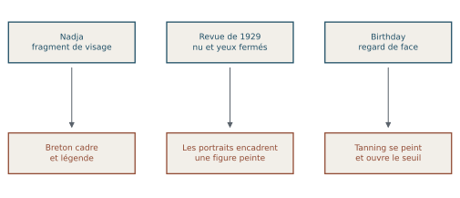
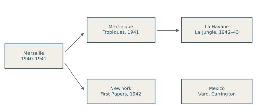

# ENS de Lyon · Histoire des arts · Oral 1 · 2026 · Corrigé guidé

*Corrigé rédigé par IA, non officiel. Signalez toute erreur.*

**Rédaction** · GPT-6.2 Astra Ultra · vitesse non renseignée · 24 novembre 2026

**Révision** · GPT-6.2 Astra Ultra · vitesse non renseignée · 26 novembre 2026

Ces deux exercices portent sur « Le surréalisme, cent ans après son premier manifeste ». Après tirage au sort d’un thème, les deux exercices se préparent ensemble pendant deux heures. Chaque exposé de vingt minutes est suivi de dix minutes d’entretien.

Les reproductions de collection permettent de retrouver les cinq œuvres. La figure 2 de *The Cinematograph* montre la page de *Nadja* dans l’édition révisée. La figure 7 de la revue *Déméter* reproduit la page 73 de *La Révolution surréaliste*.

## Sujet 1 · Les femmes : muses, épouses, artistes

### Les cinq documents du dossier

1. Meret Oppenheim, *Ma gouvernante*, 1936–1967. Métal, chaussures, ficelle et papier, 14 × 33 × 21 cm, Moderna Museet, Stockholm.
2. André Breton, *Ses yeux de fougère*, photomontage, sans date dans le sujet. La question de son édition dans *Nadja* est examinée ci-dessous.
3. Dorothea Tanning, *Birthday*, 1942. Huile sur toile, 101,6 × 64,8 cm, Philadelphia Museum of Art.
4. Dora Maar, *29, rue d’Astorg*, vers 1936. Tirage gélatino-argentique rehaussé de couleurs, 29,4 × 24,4 cm, Centre Pompidou, Paris.
5. René Magritte et Man Ray, *Je ne vois pas la [femme] cachée dans la forêt*, montage publié le 15 décembre 1929 dans *La Révolution surréaliste*, nº 12, p. 73.

> [!INDICATION]
> Consacrez environ quatre minutes aux deux pages imprimées, puis comparez les matériaux de Maar et d’Oppenheim. Revenez au regard frontal de Tanning pour la dernière articulation. À chaque étape, identifiez qui regarde, qui compose et où se trouve le spectateur.

> [!METHODE]
> Pour tenir les vingt minutes, comptez deux minutes pour l’ouverture, environ cinq pour chacun des trois développements et trois pour revenir à la question. Utilisez le temps d’observation pour situer les détails sur le document et expliciter les comparaisons.

### Proposition d’exposé

Une paire de chaussures est servie sur un plat. Personne ne les porte. Une femme nous regarde depuis un intérieur dont toutes les portes semblent s’ouvrir. Elle porte bien des vêtements, mais c’est elle qui signe le tableau. Entre *Ma gouvernante* de Meret Oppenheim et *Birthday* de Dorothea Tanning, la question change de sens. Il ne s’agit pas seulement de compter des images féminines dans le surréalisme. Qui a le pouvoir d’en faire une image, de la signer et de décider du regard qu’elle appelle ? « Muse », « épouse » et « artiste » désignent des places différentes, parfois occupées successivement ou simultanément. La première relève d’un récit d’inspiration, la deuxième d’un lien social, la troisième d’une activité dont ces œuvres gardent des preuves matérielles.

### Un groupe visible, une figure rendue anonyme

Ouvrons *La Révolution surréaliste* du 15 décembre 1929 à la page 73. Dans le montage de Magritte et Man Ray, seize portraits photographiques d’hommes aux yeux fermés bordent une figure féminine nue, peinte. Dans la phrase « Je ne vois pas la [femme] cachée dans la forêt », le corps occupe l’emplacement d’un mot. Pour lire, il faut nommer ce qui se donne à voir. C’est le ressort du rébus. Pour voir, il faut prendre la place que les hommes figurés semblent refuser, puisqu’ils ferment les yeux. Cette fermeture peut signifier le rêve ou la vision intérieure. Elle n’annule pas l’asymétrie. L’assemblage rend les hommes identifiables et solidaires, alors que la femme demeure une catégorie grammaticale et une figure imaginaire. L’enjeu porte autant sur l’espace imprimé que sur le nu : qui occupe les bords et s’y fait reconnaître comme membre du mouvement ?

Dans *Ses yeux de fougère*, un fragment est au contraire chargé de tenir lieu de portrait. Le photomontage répète les yeux, les dissocie de la bouche et du reste du visage. Sa légende nous invite à voir une forme végétale là où la photographie promettait la reconnaissance d’une personne. La lectrice peut recueillir un regard, mais n’entend pas une voix dans cette image. Devenue signe à interpréter, Nadja risque ainsi d’être confondue avec le récit qui lui donne son nom. On peut rappeler qu’elle dessinait et que des dessins sont reproduits dans l’ouvrage. Cela complique l’opposition entre femme représentée et auteur masculin sans leur attribuer une autorité éditoriale égale.

La légende de l’épreuve associe le montage à *Nadja*, paru en 1928, et donne la page 130. L’étude des éditions publiée par le CIELAM établit que *Ses yeux de fougère* a été ajouté dans l’édition remaniée de 1963. Cette différence de date change la lecture : le photomontage appartient aussi au travail rétrospectif du livre sur le souvenir de la rencontre.

Regardons ce que font deux nombres. Le montage dans *Nadja* superpose quatre bandes d’yeux. La page de la revue entoure son centre de seize portraits. Dans le premier cas, répéter et recadrer défont la continuité d’un visage individuel. La page de 1929, au contraire, préserve des visages masculins entiers et rend leur réunion aussitôt lisible. Si je cache la légende de la première image, le mot « fougère » disparaît ; si je retire le cadre des portraits de la seconde, la figure centrale cesse d’être prise dans un portrait de groupe. Dans les deux cas, les gestes de l’éditeur font une part du sens de l’image. L’autoportrait de Tanning introduit alors une différence plus précise que l’opposition générale entre une muse et une artiste : la personne regardée décide elle-même du seuil qu’elle nous laisse franchir.

> [!INDICATION]
> À l’entretien, comparez les quatre bandes et les seize portraits. Pour chaque image, expliquez en une phrase ce qu’enlèverait la suppression de la légende ou du cadre.

### Fabriquer un corps qui résiste à l’identification

En 1936, Dora Maar donne à un tirage colorié le titre exact d’une adresse parisienne, *29, rue d’Astorg*. On attend un relevé documentaire. Le regard s’engage sous une suite de voûtes, dont les arcs concentriques construisent une profondeur insistante. Une figure assise vêtue de rose, au long cou et à la tête indéterminée, arrête ce mouvement au premier plan. Le siège et l’architecture obéissent à des échelles difficiles à concilier. Le rose et les ocres de ce tirage rehaussé l’éloignent encore d’une prise de vue spontanée. L’adresse est celle de l’atelier de Maar. Elle signe ici la construction d’un lieu mental à partir des moyens du laboratoire. L’analyser à travers sa seule relation à Picasso ferait disparaître précisément ce qui est sous nos yeux : un montage et des choix de coloriste.

Oppenheim, dans *Ma gouvernante*, fait naître une silhouette à partir de deux chaussures de femme claires retournées et liées. Le regard rencontre d’abord les semelles usées, puis les talons coiffés de papillotes de papier. Le plateau métallique reprend le vocabulaire du service à table. Le titre évoque un métier féminin de soin et d’autorité domestique. Le ficelage rapproche, sans les identifier complètement, accessoire élégant, volaille apprêtée et corps entravé. L’objet est petit, à l’échelle des mains qui le transporteraient. C’est cette échelle qui transforme le spectateur en destinataire embarrassé d’un plat. La version de Stockholm est une reprise de 1967 d’un objet conçu en 1936. Ici aussi l’histoire d’une œuvre dépasse celle d’un instant d’inspiration. L’artiste refabrique et contrôle les conditions de circulation de l’objet. La sensualité de celui-ci subsiste avec l’inquiétude qu’il suscite.

### Retourner le regard et garder la porte ouverte

*Birthday*, peint en 1942, se présente sous la forme verticale d’un autoportrait en pied. Tanning tourne le visage vers nous. Une main tient une porte. D’autres portes prolongent latéralement et en profondeur le même geste, sans que l’on sache où finirait la visite. Les planches du sol et la facture précise des boiseries ancrent dans l’ordinaire un costume où les replis semblent devenir végétaux, tandis qu’un petit animal ailé se tient près de ses pieds. Le buste découvert fait place à une vulnérabilité réelle. L’artiste choisit cependant la hauteur du regard, l’orientation du corps et ce que l’embrasure laisse entrevoir. Elle peut être à la fois le sujet représenté et celle qui règle notre accès. Son mariage ultérieur avec Max Ernst ne saurait expliquer un tableau où elle se présente elle-même avant ce mariage.

Ces cinq œuvres ne dessinent pas un progrès linéaire de la passivité à l’émancipation. Les artistes femmes manipulent aussi la fragmentation, la nudité et le désir. Ce qui se déplace, c’est la possibilité de faire quelque chose de ces procédés. À la femme anonyme insérée dans une phrase, répondent une photographe qui fabrique un espace, une sculptrice qui destine au regard un corps absent et une peintre qui tient elle-même le seuil de l’image. La catégorie d’artiste se démontre ici par des choix observables.

### Reprise en entretien

**Une muse est-elle nécessairement passive ?** Le mot désigne une relation d’inspiration. Demandez ce que les documents permettent de connaître de sa participation. Dans le cas de Nadja, distinguez les dessins qui lui sont attribués et le montage dont Breton détermine la publication.

**Pourquoi mettre en relation une photographie coloriée et un objet ?** Maar retire au tirage sa transparence documentaire. Oppenheim déplace la fonction d’un objet immédiatement reconnaissable. Dans les deux cas, la matérialité nous oblige à reconsidérer une première identification.

## Sujet 2 · L’exil dans le surréalisme

> [!INDICATION]
> Ouvrez par l’expérience concrète de l’attente. Introduisez séparément le jeu de cartes, la revue et la toile. À chaque déplacement, nommez l’initiative qui existait déjà dans le lieu d’accueil et la transformation observable dans l’œuvre.

### Proposition d’exposé

Imaginons que vous deviez quitter votre atelier avec ce qui tient dans vos poches. Vous laisseriez derrière vous une partie de vos œuvres, vos habitudes de travail, peut-être la langue dans laquelle vous avez l’habitude de plaisanter. Que resterait-il de votre manière de créer ? Cette question très concrète s’est posée à des artistes surréalistes pendant la Seconde Guerre mondiale. Le surréalisme, dont André Breton publie le premier manifeste à Paris en 1924, voulait donner au rêve, au hasard et à l’association libre une place dans la vie quotidienne. Mais une frontière fermée et l’attente d’un visa ne sont pas des métaphores du rêve. Comment un mouvement peut-il être transformé par les départs qu’imposent la guerre, les persécutions et la répression politique ?

### Marseille, faire œuvre pendant l’attente

En 1940 et 1941, Marseille est pour des réfugiés un lieu d’attente sous la menace des arrestations. Les démarches de sortie, les listes de passagers et l’aide des réseaux de secours, autour de Varian Fry notamment, structurent la vie quotidienne. À la villa Air-Bel et dans les cercles qui s’y retrouvent, des artistes imaginent un jeu de cartes, le *Jeu de Marseille*. Le matériau est disponible et peu encombrant. Le principe l’est aussi : on reconnaît des figures et des séries, puis on en change les règles. Les figures hiérarchiques du jeu traditionnel cèdent la place à des personnages choisis dans une généalogie de poètes, de penseurs et de créateurs. Une carte tient à la fois du dessin, du portrait et du signe fait pour circuler de main en main.

Pourquoi choisir ce modeste objet ? On pourrait croire que le jeu détourne de la gravité des événements. Ici il maintient une pratique collective dans une situation où chacun pourrait partir du jour au lendemain. Il permet d’emporter, au moins en idées, une bibliothèque et un petit répertoire d’images. Son échelle contribue à sa signification. Il reste une œuvre de gens qui attendent, et les possibilités de partir ne sont pas les mêmes pour tous.

Une carte de Marseille permet de comprendre ce que ces exilés fabriquent ensemble avant le départ. Aux enseignes familières du jeu se substituent la flamme de l’Amour, l’étoile du Rêve, la roue de la Révolution et la serrure de la Connaissance. Il faut que les joueurs reconnaissent ces signes et acceptent leurs équivalences pour que la partie commence. Un objet aisément transportable contient ainsi une petite institution que les participants peuvent recréer autour d’une autre table. L’exil atteint des personnes séparées de leurs lieux de travail ; une règle de jeu transporte une manière de travailler entre elles. Cette image ne permet toutefois pas d’attribuer à tous les voyageurs une même destination.

> [!INDICATION]
> Faites comprendre le jeu à quelqu’un qui ignore le surréalisme. Nommer une enseigne, expliquer comment on la reconnaît, puis seulement établir le lien avec l’exil.

### Une escale change la direction de l’échange

En 1941, André Breton et Wifredo Lam font partie des passagers qui quittent Marseille et passent par la Martinique. À Fort-de-France, Breton découvre *Tropiques*, revue fondée sur place et dont le premier numéro paraît en avril 1941. Aimé et Suzanne Césaire, avec notamment René Ménil, y construisent déjà une pensée de la culture antillaise. Cela compte pour la manière de raconter l’escale. Si l’on dessine seulement une ligne de Paris vers les Antilles, on oublie ceux qui écrivaient et résistaient en Martinique avant l’arrivée du bateau. La revue est un espace où l’image et la poésie permettent de penser la domination coloniale depuis l’île. L’échange tient précisément à la rencontre de projets qui ont leur propre histoire.

Suivons Lam au retour à Cuba. Dans *La Jungle* (1942–1943), des jambes, des mains, des têtes et des tiges serrées se partagent un espace sans premier plan reposant. Les corps s’hybrident avec le végétal. Les cannes à sucre renvoient à une culture de plantation. Un visiteur qui chercherait une forêt tropicale pittoresque se heurterait à ce mur de formes et à cette histoire du travail. Lam, né à Cuba et passé par l’Espagne puis la France, reprend des possibilités de métamorphose explorées en Europe. Il les fait travailler dans un contexte afro-caribéen, avec une mémoire propre de la violence coloniale. Le retour sur une terre d’origine peut être aussi transformateur que l’arrivée dans un pays inconnu.

### Plusieurs foyers, plusieurs façons de refaire public

À New York en 1942, *First Papers of Surrealism* emprunte son titre aux premières formalités de naturalisation. Pour un artiste expulsé de son pays, « les premiers papiers » ont un sens administratif immédiat. Pour le visiteur d’une exposition, ils forment un titre étrange. Duchamp dispose dans les salles un réseau de ficelles qui traverse les perspectives et perturbe la vision d’ensemble. On voit encore les œuvres à travers les fils. Il faut déplacer son corps et chercher un angle. La question politique passe ainsi par une expérience de visite. Gardons-nous d’en faire une simple illustration du parcours des réfugiés : le dispositif trouble aussi les habitudes des collectionneurs et des visiteurs qui disposent de tous leurs papiers.

À Mexico, des exilées comme Remedios Varo et Leonora Carrington nouent entre elles des relations durables et travaillent au milieu de réseaux mexicains. La première a quitté l’Espagne puis la France. Dans *Création des oiseaux* de Varo, peint en 1957, un être mi-humain mi-oiseau dessine à une table des oiseaux qui acquièrent une existence propre. L’atelier y associe instrument, lumière et geste minutieux. Cette reconstruction peinte de la possibilité de créer prolonge une vie en exil sans se réduire à un témoignage biographique. Un foyer artistique peut durer, produire de nouvelles alliances entre femmes et poursuivre ses propres recherches bien après la fin des hostilités en Europe.

Les escales ne racontent donc pas la simple diffusion d’un style tout fait. À Marseille, un jeu conserve un collectif menacé de dispersion. En Martinique, une revue offre une rencontre entre initiatives indépendantes. À La Havane, une peinture transforme la portée historique d’une métamorphose. À New York et à Mexico changent les conditions de l’exposition et de l’atelier. En reliant ces objets, on voit ce que les personnes déplacent avec elles, mais aussi ce que les lieux et leurs habitants font en retour au surréalisme.

### Reprise en entretien

**Tous ces exemples décrivent-ils la même expérience ?** Non. Lam revient à Cuba, Breton transite par la Martinique et Varo construit une longue carrière à Mexico. Le terme d’exil recouvre des statuts et des temporalités différents.

**Comment distinguer circulation et contrainte ?** Les dates du départ et la nécessité d’obtenir des papiers documentent la contrainte. Le choix d’un matériau ou la fondation d’une revue renseignent sur les décisions artistiques prises dans ces circonstances.

## Documents et reproductions

Le fascicule officiel donne les cinq légendes et les deux consignes à la page 14. Les attendus de l’oral se trouvent aux pages 5 et 6 du rapport. [Sujet de l’ENS de Lyon](https://www.ens-lyon.fr/sites/default/files/2026-11/Arts%202026.pdf#page=14) · [Rapport du jury](https://www.ens-lyon.fr/sites/default/files/2026-10/Arts%20-%20Histoire%20des%20arts%202026.pdf#page=5)

- Objets et peintures du premier dossier. [Oppenheim, Moderna Museet](https://www.modernamuseet.se/en/stockholm/exhibitions/surrealism-in-the-moderna-museet-collection/works-in-the-exhibition/) · [Tanning, Philadelphia Museum of Art](https://www.philamuseum.org/objects/93232) · [Maar, Centre Pompidou](https://www.centrepompidou.fr/fr/ressources/oeuvre/c5jpBx)

- Le montage de 1929 et la date des yeux de Nadja. [Sommaire du nº 12 et lien vers le périodique numérisé, PRELIA](https://prelia.fr/prelia-base/revues/revolution-surrealiste/1929-12-15-n12/) · [Étude comparée des éditions, CIELAM](https://cielam.univ-amu.fr/malice/articles/travail-negatif-nadja-photographies)

- De la villa Air-Bel aux étapes américaines. [Musées de Marseille](https://musees.marseille.fr/antille) · [Tropiques, Metropolitan Museum](https://www.metmuseum.org/es/research-centers/leonard-a-lauder-research-center/research-resources/modern-art-index-project/tropiques) · [La Jungle, MoMA](https://www.moma.org/collection/works/34666) · [Remedios Varo, INBAL](https://inba.gob.mx/prensa/13117/efiartes2023)

[Fac-similé de Nadja, p. 6](https://journals.library.wustl.edu/cinematograph/article/8823/galley/25638/view/#page=6) · [Montage de la revue, fig. 7](https://www.peren-revues.fr/demeter/?do=_pdfgen_get&document=2180&lang=fr#page=14) · [Jeu de Marseille, dossier des musées de Marseille](https://musees.marseille.fr/sites/default/files/2021-06/Dossier%20p%C3%A9da%20Surr%C3%A9alisme%20v2_1.pdf)
