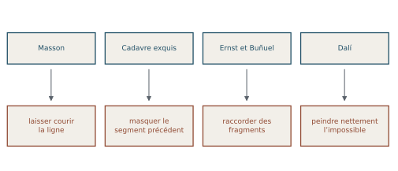
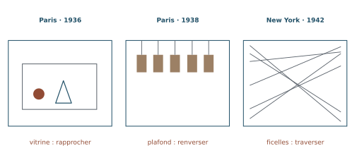

# ENS de Lyon · Histoire des arts · Oral 2 · 2026 · Corrigé guidé

*Corrigé rédigé par IA, non officiel. Signalez toute erreur.*

**Rédaction** · GPT-6.2 Astra Ultra · vitesse non renseignée · 24 novembre 2026

**Révision** · GPT-6.2 Astra Ultra · vitesse non renseignée · 26 novembre 2026

Ces deux exercices portent sur « Le surréalisme, cent ans après son premier manifeste ». Après tirage au sort d’un thème, les deux exercices se préparent ensemble pendant deux heures. Chaque exposé de vingt minutes est suivi de dix minutes d’entretien.

Le fascicule nomme les cinq œuvres sans reproduire les images. Pour les documents 3 et 4, l’identification de la feuille de Chicago et du photogramme projeté demeure ouverte. L’analyse de ces deux documents est partielle. Le second exposé se lit dans son intégralité.

## Sujet 1 · L’inconscient

### Les cinq documents du dossier

1. André Masson, *Dessin automatique*, 1925–1926. Encre de Chine sur papier, 31,5 × 24,5 cm, Centre Pompidou, Paris.
2. Salvador Dalí, *La Persistance de la mémoire*, 1931. Huile sur toile, 24 × 33 cm, Museum of Modern Art, New York.
3. Man Ray, André Breton, Yves Tanguy et Max Morise, *Cadavre exquis*, 1928. Crayon et encre sur papier, 21 × 30 cm, Art Institute of Chicago, selon le fascicule.
4. Luis Buñuel et Salvador Dalí, *Un chien andalou*, 1929. Photogramme du film. Le fascicule public en donne la légende.
5. Max Ernst, *La Chambre à coucher du maître (Il vaut la peine d’y passer une nuit)*, vers 1920. Collage, gouache et crayon sur papier, 16,3 × 22 cm, collection particulière, selon le fascicule.

> [!INDICATION]
> Commencez par faire suivre un tracé de Masson. Reprenez ensuite la même question devant chaque médium : où et quand surgit l’association imprévue ? Pour le cinéma, distinguez le photogramme en main de la séquence dont vous connaissez le montage.

> [!METHODE]
> Pour tenir les vingt minutes, comptez deux minutes pour l’ouverture, environ cinq pour chacun des trois développements et trois pour revenir à la question. Utilisez le temps d’observation pour situer les détails sur le document et expliciter les comparaisons.

### Proposition d’exposé

Une montre molle et un trait qui bifurque ne sollicitent pas la même croyance. Devant la première, je reconnais une chose dont je sais qu’elle ne pourrait pas se comporter ainsi. Devant le second, je ne sais pas encore si j’ai reconnu quelque chose. Tous deux peuvent pourtant faire travailler ce que les surréalistes appellent l’inconscient. Le terme, emprunté notamment à la psychanalyse, désigne ici la possibilité que des associations, des désirs et des tensions échappent au contrôle conscient. Une œuvre n’en apporte pas une radiographie. Elle peut mettre en crise les habitudes qui nous permettent de dire immédiatement ce que nous voyons. Par quels gestes et pour quelles sortes de spectateurs les cinq documents organisent-ils cette crise ?

### Le dessin comme expérience, seul ou à plusieurs

Sur la feuille verticale d’André Masson, *Dessin automatique* (1925–1926), des traits d’encre traversent le papier en oblique. Certaines lignes s’entrecroisent, d’autres s’épaississent, amorcent une boucle ou laissent une réserve blanche. L’œil croit reconnaître un profil ou une partie de corps, puis le contour continue et défait cette certitude. On peut faire l’épreuve devant le document : suivons un seul trajet sans nommer ce qu’il dessine, puis revenons à la même zone en cherchant une figure. Ce sont deux lectures d’une seule trace. Cela donne un sens concret à l’automatisme que le premier *Manifeste du surréalisme* définit en 1924. Le geste précède ici la décision d’illustrer un sujet. Rien dans l’épaisseur de l’encre ne prouve que l’artiste ait supprimé toute intervention consciente. Il choisit un support, accepte ou prolonge des rencontres, reconnaît après coup des formes.

Le *Cadavre exquis* de 1928 déplace l’expérience de la main à la table collective. Le fascicule le donne à Man Ray, André Breton, Yves Tanguy et Max Morise, crayon et encre sur papier. Le principe du jeu consiste à cacher une partie du travail déjà accompli, tout en laissant de quoi raccorder le segment suivant. Chaque participant peut dessiner intentionnellement ce qu’il ajoute. En revanche, personne ne connaît d’avance l’ensemble qui apparaîtra au dépliage. Cette dissociation est importante : le hasard porte sur la rencontre des contributions et la surprise finale, pas sur chaque mouvement de crayon. Là où Masson suspendait le projet d’une main, le pli distribue l’ignorance entre plusieurs personnes. Le spectateur de l’œuvre achevée en sait ainsi davantage sur le tout que chacun des dessinateurs pendant le jeu. Les différents cadavres exquis conservés ne sont pas interchangeables ; les noms et la localisation donnés ici sont ceux du sujet.

La feuille conservée à Melbourne aide à poser une question d’identification avant l’interprétation. La National Gallery of Victoria indique le même quatuor et la même date, mais mesure 30,5 × 20 cm alors que le feuillet du concours annonce 21 × 30 cm et Chicago. Décrire sa silhouette comme celle du document 3 déplacerait toute la preuve. Revenons au fait défendable à l’oral : cacher une partie de la feuille règle ce que saura le dessinateur suivant. Devant le document remis, c’est un raccord concret, continu ou décalé, qui permettrait d’en préciser l’effet. Pour le film également, l’arrêt sur image montre une organisation dans le cadre. Ce qui vient avant et après relève d’une deuxième opération, le montage. Ni une œuvre voisine ni un souvenir de projection ne fixe le détail du document distribué.

> [!INDICATION]
> Deux notices partagent quatre noms et une année. Relevez deux données qui divergent, puis montrez quel niveau de votre commentaire du jeu subsiste malgré cette incertitude.

### Des images précises pour des rapports impossibles

Dans *La Chambre à coucher du maître*, collage rehaussé de gouache et de crayon, Max Ernst transforme une image imprimée. Le plancher converge vers un fond, le lit et un meuble contre le mur établissent l’idée d’un intérieur en perspective. Mais des animaux pris à une autre logique d’illustration y prennent place : un grand mammifère occupe le fond, une forme de cétacé s’étire sur les lames du sol. Le trouble ne vient pas d’un dessin illisible. Chaque figure peut être localisée dans la feuille. C’est la règle de leur coexistence et de leur échelle qui cesse de fonctionner. Le titre promet qu’il vaut la peine d’y passer une nuit. Il nous demande presque d’habiter cet assemblage avant de songer à le traduire dans un dictionnaire des rêves. Le collage conserve la lisibilité des fragments et rend étrange l’espace censé les unir.

Le petit panneau peint par Dalí en 1931, *La Persistance de la mémoire*, relève d’un autre métier. Mesurons mentalement ses 24 sur 33 centimètres. L’œil doit s’approcher pour lire les cadrans et distinguer, sur un boîtier, les fourmis. Une ligne d’horizon nette, des falaises lumineuses, des ombres portées et un tronc sec construisent un monde stable. Sur la branche, sur un angle saillant et sur une forme molle au centre, les montres se plient. Il faut avoir reconnu le métal et sa rigidité ordinaire pour mesurer la contradiction. L’espace lointain est plus fixe que l’instrument censé mesurer le passage des heures. Le fini minutieux participe donc du trouble. Chez Masson, le dessin retardait l’identification. Chez Dalí, l’identification vient vite et ne résout rien. Seule l’observation de la matière peinte et des supports permet d’établir cette différence.

### Ce que le montage fait au spectateur

*Un chien andalou*, film de Luis Buñuel et Salvador Dalí montré à Paris en 1929, introduit la durée. Un photogramme est une image isolée de la pellicule ; il n’est pas le montage. Le fascicule public nomme le film sans reproduire le photogramme remis aux candidats. À l’oral, on commencerait par le cadrage effectivement proposé. Pour analyser une opération documentée du film, prenons son ouverture. Un nuage passe devant la Lune, un rasoir rencontre un œil. L’analogie de direction et de découpe établit un raccord qui heurte le regard. Il y a une ressemblance plastique et une rupture de registre. Le spectateur produit la liaison entre deux plans distincts. Cette violence inaugurale vise aussi la tranquillité avec laquelle on pensait simplement regarder un film.

Le cinéma peut donc faire éprouver une association à plusieurs personnes en même temps, par le contrôle très précis de la succession des images. Le résultat est tout différent du jeu collectif sur une feuille pliée : ici, les auteurs règlent l’enchaînement, tandis que le public subit son irruption. Ernst avait ménagé la rencontre de mondes incompatibles sur une surface fixe. Chez Buñuel et Dalí, elle se produit au passage d’une image à la suivante. Le titre ne donne aucune clef qui épuiserait cette rencontre.

Ce corpus permet enfin une précaution. Si l’on déclarait que tel animal signifie ceci ou que la montre prouve tel diagnostic, on substituerait une autorité extérieure au travail concret des formes. Les œuvres inventent des occasions de percevoir une autre logique : la ligne peut précéder son objet, le tout peut échapper à ses auteurs, le détail minutieux peut rendre un monde plus incertain et le raccord peut nous atteindre avant que nous en ayons formulé le sens. L’inconscient est ici une question posée au faire et au voir.

### Reprise en entretien

**Pourquoi un dessin exécuté à plusieurs peut-il être intentionnel ?** Chacun dessine sciemment sa partie. C’est la restriction d’information liée au pli qui soustrait la figure entière au projet individuel.

**La peinture lisse de Dalí contredit-elle l’automatisme ?** Elle constitue une autre voie. Comparez la netteté du bord des montres à l’indécision d’une ligne chez Masson. Les moyens plastiques sont différents, les deux œuvres sollicitent des associations que la reconnaissance ordinaire ne suffit pas à stabiliser.

## Sujet 2 · Exposer, montrer dans le surréalisme

> [!INDICATION]
> Choisissez un détail matériel par lieu. Décrivez un seul geste ordinaire du visiteur, puis expliquez ce qui le modifie. Prévoyez deux minutes en fin d’exposé pour comparer ce que donne à voir une photographie d’exposition.

### Proposition d’exposé

Que faites-vous habituellement en entrant dans un musée ? Vous cherchez un tableau bien éclairé, vous vous placez devant, vous lisez l’étiquette. Les surréalistes ont transformé ces gestes en questions. Si le plafond semble vous tomber dessus, si un fil passe devant une toile, si une cuillère voisine avec une sculpture, que devient votre façon de regarder ? « Exposer » signifie choisir des choses et les disposer dans un lieu pour d’autres personnes. « Montrer » peut aussi consister à publier une photographie, à faire voir une rencontre ou à faire sentir ce qui se dérobe. Je propose de visiter trois expositions. Dans chacune, un détail du lieu modifie le statut de ce qui est montré.

### Une vitrine peut changer la définition d’un objet

À Paris en 1936, l’*Exposition surréaliste d’objets* occupe la galerie du marchand Charles Ratton. La vitrine est un meuble familier du commerce et du musée. Elle rassemble, protège et retire aux mains. Les organisateurs y font voisiner des objets trouvés, des objets fabriqués ou transformés par les artistes et des objets issus de savoirs ou de cultures différents. Ce qui d’ordinaire serait séparé entre musée de sciences, galerie d’art et boutique devient voisin. Imaginons le trajet de l’œil entre deux objets dont les contours se ressemblent, mais dont l’un servait à une opération pratique et l’autre à une expérience plastique. La ressemblance est proposée par l’accrochage. Elle n’est pas inscrite dans un classement scientifique.

Cet exemple permet de définir l’objet surréaliste à partir d’une expérience. Retirer à une chose son voisinage familier peut la rendre à nouveau visible. Mais le meuble qui libère la comparaison maintient le pouvoir de celui qui classe. Un instrument dont on ignore l’usage ou un objet venu d’une société colonisée peut devenir un simple réservoir de formes pour l’œil du collectionneur. Une exposition contemporaine doit montrer aussi qui a nommé l’objet, d’où il vient et quelles informations ont disparu lors de son déplacement.

### Quand le visiteur entre dans l’œuvre

À la galerie des Beaux-Arts, à Paris en 1938, l’*Exposition internationale du surréalisme* change d’échelle. Le visiteur rencontre des mannequins transformés par différents artistes. Le mannequin, objet urbain de vitrine et substitut de corps, se trouve presque à sa hauteur ; déambuler devant lui n’est pas contempler à distance un nu peint. Dans la grande salle, Duchamp suspend des sacs de charbon au plafond. La salle élégante semble coiffée d’un stock destiné à une cave. Le plafond, auquel on ne prête généralement pas attention, devient une surface active. La pénombre, lors de l’ouverture, rend les conditions mêmes de visibilité incertaines.

La scénographie est l’organisation de l’espace, de la lumière et des déplacements. Ici elle commence à fabriquer son propre sens au lieu de simplement soutenir des tableaux. Le public doit lever les yeux, avancer et chercher. Il ne s’agit pas pour autant d’une totale liberté. Les artistes ont préparé la situation, et le visiteur d’un soir ne voit pas nécessairement ce que verra le lecteur d’une photographie prise ensuite. Une vue d’installation peut rendre très nette la composition d’ensemble qui échappait justement au visiteur dans la pénombre. Documenter une exposition, c’est déjà la montrer autrement.

À Paris en 1938, des objets suspendus déplacent le regard vers le plafond. À New York en 1942, les salles de *First Papers of Surrealism* sont parcourues de fils. Imaginez une photographie frontale de chacune. La première écrase la distance entre les objets et le sol. La seconde transforme le réseau de ficelles en lignes qui se superposent aux cadres des tableaux. Pour le visiteur, ces différences de profondeur règlent au contraire ce qu’il peut atteindre et à quelle distance il peut se tenir. Il existe donc au moins deux histoires d’une même exposition : celle de ses aménagements, que documentent les vues de salle, et celle des déplacements qu’ils permettaient. Pour la seconde, confronter plusieurs vues et les témoignages permet de tester ce qu’une photographie isolée laisserait seulement supposer.

> [!INDICATION]
> Proposez une question à poser à un visiteur de 1942 qu’une photographie des fils ne résout pas. Précisez quel témoignage pourrait soutenir ou déplacer votre hypothèse.

### Faut-il bien voir pour faire l’expérience d’une exposition ?

En 1942, à New York, *First Papers of Surrealism* a lieu dans un contexte de guerre et d’exil. Son titre évoque des documents de naturalisation. Marcel Duchamp tend de la ficelle à travers les salles. Le réseau reste assez ouvert pour laisser voir des images, mais une vue frontale et continue se heurte aux fils. Comparons-le à une corde de musée habituelle. Celle-ci indique à quelle distance il faut rester du tableau. Ici le fil lui-même fait événement et conduit à examiner l’espace entre l’image et son spectateur. Photographié, il peut presque devenir un dessin blanc posé sur les tableaux. Sur place, il oblige à prendre en compte son épaisseur, la profondeur de la salle et la présence d’autres corps. Les témoins et les vues d’installation ne permettent pas de réduire l’expérience à un parcours obligatoire identique pour chacun.

La même année, dans la galerie new-yorkaise *Art of This Century* de Peggy Guggenheim, Frederick Kiesler propose d’autres manières de dégager les œuvres du mur, sur des supports saillants dans l’espace. Même ville, même moment, effet différent : la ficelle de Duchamp oblige à négocier une obstruction, les supports de Kiesler réorganisent la distance entre toile et paroi. Ce rapprochement aide à donner au mot « montrer » un sens précis. Pendre une peinture autrement peut déjà changer l’expérience d’une surface apparemment inchangée.

Ces trois visites déplacent l’attention de la vitrine au plafond, puis à l’air traversé par des fils. On peut les prolonger par la revue, transportable hors de toute galerie : sa mise en page rapproche deux images devant un lecteur isolé. Une œuvre ne cesse pas d’avoir une matière ou un auteur lorsqu’elle est exposée. Mais le voisinage, la lumière, le support et la manière dont on y accède deviennent à leur tour des choix artistiques. Les surréalistes font de la visite elle-même un lieu où l’on peut perdre puis reconstruire ses habitudes de regard.

### Reprise en entretien

**Quelle différence y a-t-il entre cacher une œuvre et transformer la vision ?** Un fil laisse encore passer le regard. Il introduit un premier plan mobile relativement au tableau lorsqu’on se déplace. L’expérience tient à ce rapport mesurable.

**Une photographie remplace-t-elle une visite ?** Elle fixe une position, une lumière et un moment. L’écart entre le document et la possibilité de se déplacer fait partie de ce qu’il faut analyser.

## Documents et reproductions

Le fascicule officiel donne les cinq légendes et les deux consignes aux pages 14 et 15. Les attendus de l’oral se trouvent aux pages 5 et 6 du rapport. [Sujet de l’ENS de Lyon](https://www.ens-lyon.fr/sites/default/files/2026-11/Arts%202026.pdf#page=14) · [Rapport du jury](https://www.ens-lyon.fr/sites/default/files/2026-10/Arts%20-%20Histoire%20des%20arts%202026.pdf#page=5)

- Dessin et peinture. [Masson, Centre Pompidou](https://www.centrepompidou.fr/fr/ressources/oeuvre/czAzGRr) · [Dalí, MoMA](https://www.moma.org/collection/works/79018)

- Le collage et le film. [Ernst, catalogue Guggenheim, p. 78 imprimée](https://www.guggenheim.org/wp-content/uploads/2016/08/guggenheim-pub-max-ernst-retrospective-1975.pdf#page=82) · [Buñuel et Dalí, Cinémathèque française](https://www.cinematheque.fr/film/47197.html)

- Expositions. [1936 et 1938, dossier du Centre Pompidou](https://www.centrepompidou.fr/media/document/d6/95/d6958a01c5c2647e46e2b233a88f8ac8/normal.pdf) · [Peggy Guggenheim, archives du Guggenheim](https://www.guggenheim.org/finding-aids/collection/m0002) · [First Papers of Surrealism, Tate Papers](https://www.tate.org.uk/research/tate-papers/22/duchamp-childhood-work-and-play-the-vernissage-for-first-papers-of-surrealism-new-york-1942)

[Exemplaire distinct de Melbourne, NGV](https://www.ngv.vic.gov.au/explore/collection/work/107841/) · [Archives de la galerie de Peggy Guggenheim](https://www.guggenheim.org/finding-aids/collection/m0002)
