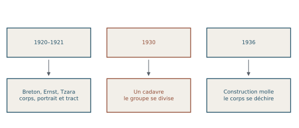
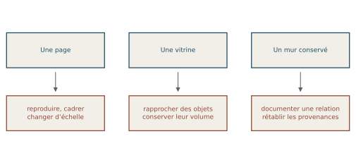

# ENS de Lyon · Histoire des arts · Oral 3 · 2026 · Corrigé guidé

*Corrigé rédigé par IA, non officiel. Signalez toute erreur.*

**Rédaction** · GPT-6.2 Astra Ultra · vitesse non renseignée · 24 novembre 2026

**Révision** · GPT-6.2 Astra Ultra · vitesse non renseignée · 26 novembre 2026

Ces deux exercices portent sur « Le surréalisme, cent ans après son premier manifeste ». Après tirage au sort d’un thème, les deux exercices se préparent ensemble pendant deux heures. Chaque exposé de vingt minutes est suivi de dix minutes d’entretien.

La photographie de la cible et les quatre pages du pamphlet ont pu être confrontées aux reproductions publiques. La légende du concours indique le 27 mars 1920 pour la photographie. Les reproductions publiées renseignent l’œuvre et ses détails, sans établir le cadrage de la planche du jury.

## Sujet 1 · Rébellion, engagements

### Les cinq documents du dossier

1. Photographe non identifié, *André Breton en homme-sandwich avec une affiche de Francis Picabia*, Paris, 27 mars 1920. Tirage en noir et blanc, 14 × 9 cm, Bibliothèque Kandinsky, Paris.
2. Collectif, *Un cadavre*, Paris, Imprimerie spéciale du cadavre, 1930. Imprimé de quatre pages, 36,8 × 31,9 cm.
3. Max Ernst, *The Punching Ball ou l’immortalité de Buonarotti*, 1920. Collage, photographie et gouache, 17,6 × 11,4 cm selon le sujet, Metropolitan Museum of Art, New York.
4. Salvador Dalí, *Construction molle avec haricot bouilli (prémonition de la guerre civile)*, 1936. Huile sur toile, environ 100 × 100 cm, Philadelphia Museum of Art.
5. Tristan Tzara, *DADA soulève tout*, 1921. Imprimé, 27,4 × 21 cm, Museum of Modern Art, New York.

> [!INDICATION]
> Placez les trois documents de 1920–1921 avant le manifeste de 1924. Faites ensuite varier le sujet de la prise de parole : corps du participant, signataires d’un tract, peintre d’une allégorie. Réservez du temps au détail matériel de la toile de Dalí.

> [!METHODE]
> Pour tenir les vingt minutes, comptez deux minutes pour l’ouverture, environ cinq pour chacun des trois développements et trois pour revenir à la question. Utilisez le temps d’observation pour situer les détails sur le document et expliciter les comparaisons.

### Proposition d’exposé

Qui parle quand Dada parle ? Sur un tract, DADA s’imprime en très grandes capitales. Sur une photographie, c’est André Breton qui porte une affiche de Francis Picabia sur son propre corps. Dix ans plus tard, des auteurs se rassemblent au contraire pour publier symboliquement la mort de Breton. Le pluriel du sujet, « engagements », commande de suivre ces déplacements. Une rébellion rompt avec une manière de voir ou d’obéir. Un engagement suppose une prise de position rendue publique, dont on peut demander qui l’assume et dans quel contexte. Les cinq documents font passer du scandale comme événement, à la lutte pour l’autorité d’un groupe, puis à la représentation d’un conflit historique. Ils ne défendent pas tous le même programme.

### Viser le public : l’affiche portée, la page distribuée, le portrait modifié

Le premier document est une petite photographie anonyme, en noir et blanc, de Breton en homme-sandwich au Théâtre de l’Œuvre, le 27 mars 1920. Distinguons les rôles : Picabia réalise l’affiche, Breton la porte, une autre personne fixe l’événement. L’homme-sandwich est d’ordinaire payé pour attirer l’attention sur une marchandise ou un spectacle. Ici l’affiche, avec sa cible, transforme le corps du participant en panneau et expose celui qui prétend interpeller le public à être visé en retour. Le théâtre ne contient plus simplement une représentation sur scène. La rencontre commence avant que l’on se soit assis. La petite photographie, que l’on pouvait tenir en main, conserve une action qui dépendait d’abord d’une présence et d’une réaction immédiates.

Dans le tract *DADA soulève tout* (1921), la voix prend corps dans la typographie. Le titre occupe toute la largeur. La taille des caractères et les changements d’orientation forcent à passer d’une formule à l’autre. On lit « OUI = NON » à plusieurs reprises, puis « JAMAIS JAMAIS JAMAIS ». Le mot « MAIS » interrompt une première assurance. La liste des sujets dont Dada parle ou ne parle pas lance des pistes et les déjoue. En bas de page, l’adresse au lecteur relance encore la parole. Un texte politique conventionnel devrait exposer ses raisons puis obtenir l’assentiment de lecteurs convaincus. La page de Tzara emprunte l’autorité visuelle du manifeste mais rend instable la proposition à laquelle on pourrait souscrire. La distribution du tract et la pluralité des noms déplacent le scandale du lieu théâtral à la main des lecteurs.

*The Punching Ball ou l’immortalité de Buonarotti* (1920) oblige à ralentir devant un autre type de montage. Max Ernst apparaît en buste, vêtu avec soin, dans les conventions du portrait photographique de studio. Une figure rapportée, dont la tête montre une anatomie artificielle, vient se placer contre lui. Les inscriptions nomment et dédoublent les protagonistes. Le papier ajouté et les interventions sur le tirage troublent la continuité crédible d’un portrait. Le « punching-ball » du titre introduit un instrument de boxe auprès de la promesse solennelle d’immortalité et d’un nom qui évoque Michel-Ange. L’autorité du grand artiste et la respectabilité de l’autoportrait sont tour à tour en jeu. Ernst attaque la mise en scène du génie en se mettant lui-même en scène. L’intérêt de ce petit objet tient à cette ambivalence et à la précision des raccords, très différente du cri typographique de Tzara.

### Une rébellion dirigée contre ceux qui la revendiquaient

Les trois documents précédents datent de Dada, avant le premier *Manifeste du surréalisme* de 1924. Le fascicule les fait dialoguer avec des objets surréalistes ultérieurs. Il convient d’expliquer la filiation sans effacer les ruptures. En janvier 1930, le pamphlet *Un cadavre* paraît sur un feuillet double, avec une apparence de journal. Les signataires, parmi lesquels Prévert, Desnos, Queneau, Leiris et Bataille, occupent des places différentes. Ils attaquent Breton après les prises de position et exclusions qui entourent son *Second Manifeste*. Le pamphlet donne à une querelle de légitimité une forme collective et publique. Le titre reprend celui du tract qui avait frappé Anatole France à sa mort en 1924. Cette fois la cible est vivante et appartient à l’avant-garde elle-même.

Dans le montage de couverture, Breton est figuré les yeux clos, le front entouré d’une couronne d’épines. La citation du Christ peut se lire comme une accusation de posture sacrificielle et d’autorité spirituelle. L’ornement religieux et la brutalité du titre se contredisent assez pour produire de l’ironie. Le lecteur passe d’un visage qu’il peut reconnaître à des colonnes signées qui lui contestent le droit de parler au nom du groupe. Cela ne suffit pas à faire des dissidents un parti homogène. Le document atteste une alliance polémique à un moment donné. Par rapport à 1920, la cible a donc changé : l’homme qui portait l’affiche de Picabia pour provoquer un public devient lui-même le support d’une image hostile.

Comparons maintenant les deux portraits de Breton. Sur le cliché de 1920, son visage se tourne de côté au-dessus du panneau. Sa main apparaît devant la cible dessinée, et la signature imprimée de Picabia se détache sous les cercles. Parmi les participants à la provocation, l’image distingue donc celui qui porte l’affiche et celui qui la signe. En première page d’*Un cadavre*, le visage de face, les yeux clos, se trouve assujetti au titre et à la légende « AUTO-PROPHÉTIE ». Tourner la feuille révèle des colonnes et plusieurs signatures ; le portrait unique introduit une parole collective hostile. Celui qui s’exposait pour provoquer le public est devenu la cible d’une publication dont d’autres maîtrisent la diffusion. Ce renversement de position donne un sens historique à la similitude entre les deux portraits.

> [!INDICATION]
> Cachez la cible du premier document, puis la légende du pamphlet. Qu’apprend-on de la position publique de Breton quand on les restitue ? Nommez le porteur, le signataire de l’affiche et les voix du tract.

### Faire voir la guerre sans lui donner deux camps symétriques

La *Construction molle avec haricots bouillis* de Dalí, datée de 1936, ne relève ni du tract collectif ni de l’intervention éphémère. Dans une toile presque carrée, un immense corps composite prend appui sur ses propres parties. Une main serre la chair, un pied pèse sur une masse qui semble appartenir au même organisme. L’ouverture entre les membres laisse voir un morceau de ciel. Au ras du sol, les haricots, le meuble et la petite figure humaine indiquent une échelle dérisoire auprès de cette anatomie monumentale. Les transitions de lumière et le modelé très précis rendent chaque détail crédible. Pourtant, il est impossible d’attribuer à deux combattants distincts les gestes de celui qui déchire et de celui qui souffre.

Le tableau est élaboré à la veille de la guerre civile espagnole. Son sous-titre, « Prémonition de la guerre civile », oriente la lecture historique. Il n’autorise ni à attribuer à la toile un pouvoir de prédiction ni à en déduire à lui seul une adhésion partisane de Dalí. Son apport est plus précis. Une allégorie, c’est une image qui donne une forme visible à une idée : ici, le corps collectif se détruit lui-même. Le visiteur n’a pas besoin d’un uniforme ou d’un drapeau pour éprouver cette idée, mais il a besoin de la date et du titre pour comprendre le conflit visé. On mesure ainsi la distance entre la parole imprimée qui déclare agir et la peinture qui construit une position de témoin.

Le point commun à ces objets est une modification du rapport ordinaire au public. Le corps porte une affiche, l’imprimé prend la parole, le portrait se retourne contre les signes du génie, le groupe met en scène sa propre rupture et la toile donne une anatomie à la guerre civile. Cette diversité permet de comprendre une tension durable du surréalisme : vouloir changer le monde en changeant les représentations ne dispense jamais de demander quel monde et quelle politique une œuvre engage effectivement.

### Reprise en entretien

**Pourquoi le pamphlet de 1930 est-il plus qu’une querelle personnelle ?** Sa mise en page publique, ses signatures multiples et la reprise du titre de 1924 déplacent le conflit vers la question de savoir qui représente le mouvement. Cela n’efface ni les inimitiés individuelles ni les désaccords politiques.

**Une toile allégorique est-elle nécessairement une affiche ?** L’affiche impose en général une formule lisible à distance. Le détail des haricots, le trouble de l’anatomie et l’incertitude sur les gestes supposent ici un temps de regard plus long.

## Sujet 2 · Le musée imaginaire du surréalisme

> [!INDICATION]
> Définissez dès l’ouverture le terme de musée imaginaire. Conduisez la visite de la page à la vitrine puis au mur. Décrivez à chaque étape une comparaison précise et ce qu’elle risque de faire oublier.

### Proposition d’exposé

Si vous deviez composer un musée avec une revue, une poignée d’objets et un pan de mur, que placeriez-vous ensemble ? Une peinture et une photographie peuvent se ressembler de loin sans avoir servi à la même chose. Une cuillère peut avoir une importance dans une vie sans être un chef-d’œuvre reconnu. J’appellerai ici « musée imaginaire du surréalisme » l’ensemble toujours modifiable des œuvres, des objets et des images que des artistes rendent voisins pour changer notre manière de les voir. L’expression fait aussi penser au *Musée imaginaire* d’André Malraux, paru en 1947. Chez lui, la photographie rend possibles des comparaisons entre des œuvres éloignées. Les surréalistes avaient déjà pratiqué d’autres rapprochements par le livre, la collection et l’exposition. La formule sert de question aux objets, sans faire de Malraux leur fondateur.

### Une collection qui commence entre deux images

Prenons une revue sur une table. Dans *La Révolution surréaliste* en décembre 1929, une page associe des portraits photographiques d’hommes aux yeux fermés à la reproduction d’un nu peint par Magritte. Une peinture et des tirages photographiques n’ont ni la même matière ni nécessairement la même taille. La reproduction et la mise en page leur donnent une surface commune. Elles produisent une relation qui n’existait pas entre des originaux dispersés. Au lecteur de passer d’un visage nommé à une figure sans nom, et du texte à l’image qui en remplace un mot. Ce premier musée tient dans la main. En tournant la page, on peut littéralement en changer la salle.

Que perd-on dans l’opération ? Le grain photographique, le format original du tableau, le relief d’un cadre. Que gagne-t-on ? La possibilité de lire les images ensemble et de s’interroger sur leur distribution. Cette page met aussi en évidence une limite : le montage construit une communauté masculine identifiable autour d’une femme anonyme. Tout musée, aussi imaginaire soit-il, choisit qui peut apparaître comme auteur.

Autre exemple, les collages d’Ernst. Dans *La Chambre à coucher du maître*, une image imprimée, des rehauts et des figures animales entrent dans un intérieur peint en perspective. Le cétacé posé sur un plancher est reconnaissable et pourtant déplacé. C’est une manière de faire entrer au musée des images de catalogue ou de manuel qui n’y auraient pas eu leur place comme objets d’art autonomes. L’opération est visible jusque dans les changements d’échelle. Dans la revue, la page réunissait différents médias. Dans le collage, une seule œuvre garde la trace de plusieurs familles d’images.

### Un objet garde une épaisseur et une histoire

Passons à la galerie Charles Ratton en 1936 pour l’*Exposition surréaliste d’objets*. Les rapprochements s’y font dans l’espace. La vitrine offre au regard des objets trouvés, construits, usuels ou déclassés. Les matières résistent aux analogies. Une chaussure retournée peut se mettre à ressembler à une volaille préparée, comme dans *Ma gouvernante* de Meret Oppenheim. Sa semelle, sa ficelle et son plateau signalent pourtant des gestes incompatibles avec l’idée d’une simple image. Un corps y est évoqué sans être représenté. Le visiteur comprend par cette expérience comment un déplacement peut transformer la valeur d’une chose sans abolir le souvenir de son usage.

Le rapprochement fait découvrir. Il peut aussi appauvrir. Des objets d’Océanie ou des Amériques, transportés à travers des circuits de collecte et de commerce, n’étaient pas des trouvailles anonymes pour les sociétés qui les avaient produits. Si le cartel indique seulement ce que le collectionneur européen y a vu, une part de leur histoire disparaît. Une présentation actuelle peut conserver la force d’un rapprochement et restituer à côté le nom de la société productrice lorsqu’il est connu, la fonction documentée, le trajet de l’objet et les lacunes de provenance. On donne alors au public les moyens de reconnaître une analogie proposée par un collectionneur, au lieu de la transformer en identité universelle.

Une petite boîte aide à faire cette expérience. Dans son *Objet* de juin 1931, Valentine Hugo dispose dans une boîte vitrée un tapis de jeu vert, des dés, des mains de mannequins gantées, des épingles et des fils. Les mains deviennent des partenaires possibles du jeu, mais la vitre interdit de lancer les dés. Ce premier rapprochement est construit par l’artiste et fixé dans un volume de 9,5 cm de profondeur. Quand la boîte prend place parmi les pièces du mur de Breton, un autre rapprochement survient, choisi par le collectionneur. Quand le musée lui donne le numéro AM 2003-3 (12), il permet enfin de retrouver une autrice, une date et des matériaux au sein de l’ensemble. Pour un visiteur, distinguer ces trois gestes évite de prêter au seul collectionneur toute l’invention d’une œuvre que la relation de voisinage a rendue plus visible.

> [!INDICATION]
> Distinguez trois décisions devant la boîte de Valentine Hugo. Qui a assemblé les éléments, qui a choisi un voisinage et qui a attribué le numéro d’inventaire ? Formulez pour chacune une conséquence visible ou documentaire.

### Que conserve le musée lorsqu’il conserve un mur ?

L’atelier de Breton, au 42 rue Fontaine à Paris, constitue un cas presque inverse du livre transportable. Un mur évoquant la seconde pièce de l’appartement est entré par dation au Musée national d’art moderne en 2003. Le Centre Pompidou dénombre 212 œuvres et objets dans cet ensemble. On peut regarder une pièce séparément, puis reculer pour retrouver des alignements, des contrastes de matières, de tailles et de silhouettes. L’unité pertinente devient parfois l’intervalle entre deux objets. Ce voisinage a lui-même une histoire. Il traduit la durée d’une collection et les choix de Breton, et ne représente pas à lui seul les goûts de toutes les personnes ayant participé au surréalisme.

Dans l’appartement, une chose pouvait être déplacée, montrée à une visiteuse, remplacée. Au musée, on peut étudier et protéger les relations entre ces choses, mais on stabilise une disposition et on sélectionne des informations pour le public. Un mur conservé n’est donc ni une collection intégralement restituée ni un simple décor. C’est un document sur une manière de construire des affinités. Comparé au petit musée mobile de la revue, il rappelle ce que l’image reproduite peine à communiquer : l’épaisseur des objets et leur présence simultanée autour de quelqu’un.

Je terminerais la visite par deux questions adressées au public. Quelle relation venez-vous de découvrir grâce au voisinage de deux objets ? Qu’aimeriez-vous maintenant savoir de chacun pris séparément ? La première question préserve la liberté d’association qui animait le surréalisme. La seconde protège les œuvres et les personnes de l’effacement de leur histoire. Le musée imaginaire devient ainsi une méthode de regard dont on peut éprouver à la fois le pouvoir d’invention et les limites.

### Reprise en entretien

**Pourquoi parler de musée si plusieurs objets n’y étaient pas destinés ?** L’enjeu est le choix et la disposition : le statut de ce qui mérite d’être regardé se joue précisément quand on déplace un objet de son cadre initial.

**Peut-on reconstituer toute une vie à partir de la rue Fontaine ?** Le mur documente une sélection et des voisinages. Ce qu’il ne montre pas, notamment les changements successifs et les provenances lacunaires, doit être traité comme tel.

## Documents et reproductions

Le fascicule officiel donne les cinq légendes et les deux consignes à la page 15. Les attendus de l’oral se trouvent aux pages 5 et 6 du rapport. [Sujet de l’ENS de Lyon](https://www.ens-lyon.fr/sites/default/files/2026-11/Arts%202026.pdf#page=15) · [Rapport du jury](https://www.ens-lyon.fr/sites/default/files/2026-10/Arts%20-%20Histoire%20des%20arts%202026.pdf#page=5)

- Le tract et le collage photographique. [Tzara, MoMA](https://www.moma.org/collection/works/184054) · [Ernst, Metropolitan Museum](https://www.metmuseum.org/art/collection/search/923122) · [Boiffard et le pamphlet, Centre Pompidou](https://www.centrepompidou.fr/fr/programme/agenda/evenement/cqp6Bbx)

- De l’image de la cible au tableau de 1936. [Photographie du festival Dada](https://www.bridgemanimages.com/fr/picabia/andre-breton-as-target-sandwich-man-by-picabia-at-dada-festival-paris-march-27-1920-photo/photography/asset/4158315) · [Dalí, Philadelphia Museum of Art](https://www.philamuseum.org/objects/51315)

- Exposition et collection. [Sophie Leclercq, Sciences Po](https://www.sciencespo.fr/artsetsocietes/fr/archives/2451) · [Un objet du mur de Breton et l’ensemble, Centre Pompidou](https://www.centrepompidou.fr/fr/ressources/oeuvre/ca9XzK)

[Cliché de Breton, chronologie d’Henri Béhar](https://www.melusine-surrealisme.fr/henribehar/andre-breton-chronologie-numerique-3) · [Pamphlet, quatre pages et détail](https://www.traces-ecrites.com/document/un-cadavre-violente-charge-contre-andre-breton/) · [Boîte de Valentine Hugo, Centre Pompidou](https://www.centrepompidou.fr/fr/ressources/oeuvre/ca9XzK)
