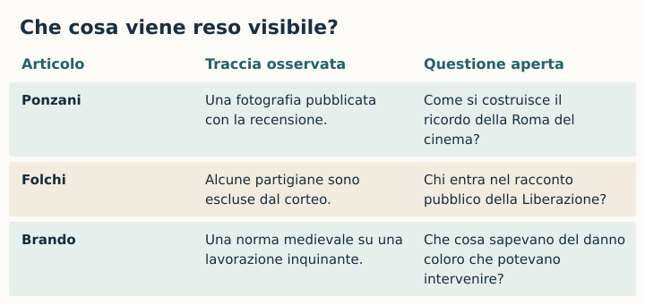

# ENS de Lyon · Séries A/L · Italien oral 2026 — Corrigé guidé partiel

*Corrigé rédigé par IA, non officiel. Signalez toute erreur.*

**Rédaction** · GPT-6.2 Astra Ultra · vitesse non renseignée

Le jury identifie treize billets. Les quatre textes littéraires sont expliqués entre les bornes officielles. Les neuf articles donnent lieu à des analyses de presse. Pour Ponzani et Scurati, seuls les passages consultables et les paratextes du journal ont été vérifiés. Pour les sept autres, le texte publié a été retrouvé. Les coupures de presse et l’illustration exactes du feuillet ne sont pas reproduites par l’ENS.

[Fascicule des sujets, p. 2–5](https://www.ens-lyon.fr/sites/default/files/2026-11/Italien%202026.pdf#page=2) · [Rapport du jury, p. 14–21](https://www.ens-lyon.fr/sites/default/files/2026-10/Italien%202026.pdf#page=14)

## Choisir des indices adaptés à l’épreuve

La série lettres et arts, les épreuves hors programme de LV1 et LV2 et la série sciences humaines portent sur des articles de presse. En LV1 littéraire, le jury admet un commentaire par mouvements ou par axes, à condition de faire entendre la construction du texte. Il indique environ vingt minutes d’explication et une dizaine de minutes de discussion. Préparez pour chaque billet une question à laquelle la dernière partie du passage apporte une réponse que la première partie ne donnait pas encore.

### Expliquer une image, distinguer les voix

Pour la recension de Ponzani, commencez par nommer le média qui a choisi la photographie. Repérez le noir et blanc, la table au milieu du groupe, les visages qui ne se tournent pas tous vers le photographe. Puis formulez ce qui peut être interprété, *il gruppo dà l’impressione di essere colto in un momento di vita ordinaria*. Le rapport signale que le document remis comportait une illustration, sans la reproduire. Sur le feuillet du jour, comparez les détails de cette préparation à ce qui y figure réellement avant d’identifier des personnes ou un film. Chez Franzoni, inversez la démarche. C’est l’auteur lui-même qui examine le pouvoir d’une ressemblance et son passage des murs d’une église aux écrans. Demandez qui en est l’initiateur, qui l’interprète et qui finit par l’effacer.

Dans le premier extrait de Campanella, essayez de prononcer le discours des Solari avant de revenir à la première personne du voyageur. *Il Genovese riferisce la loro spiegazione, poi racconta ciò che ha potuto verificare* distingue l’argument et la preuve. Dans le second, entourez les verbes qui introduisent l’incertitude et la possibilité d’un changement de coutume. Une phrase comme *Campanella afferma che…* risque alors de confondre l’auteur, le témoin et ses interlocuteurs. Chez Serao, l’attribution des voix fonctionne autrement. Le « nous » d’une chronique devient une foule visible qui se bouche le nez devant de vieilles étiquettes. C’est cette opération que la métaphore du débarras permet d’expliquer.

### Faire entendre une évolution

Lisez le poème de Saba à voix haute en marquant les occurrences de *qui*. À la première lecture, vous pourrez les entendre comme des indications de lieu. À la seconde, cherchez près de quel être se trouve le locuteur chaque fois qu’il les emploie. En fin de texte, la question porte sur ce qui a changé en lui. Pour l’article du Post sur les voix du cinéma, faites trois colonnes mentales, vocabulaire, intonation, diction. Un personnage peut employer des mots que tout le pays comprend tout en faisant entendre une origine locale. Vérifiez ensuite sur quelle observation précise repose le jugement de réalisme cité dans l’article.

### Soutenir une interprétation de presse

Entraînez-vous à définir la fonction d’une date dans les trois articles suivants. Chez Roghi, elle évite de présenter une proposition de loi en discussion comme une disposition déjà appliquée. Dans l’article sur Mattarella, elle distingue la controverse de novembre des tensions remontant aux années précédentes. Chez Brando, elle empêche de confondre une réglementation médiévale localisée et une conscience environnementale contemporaine. Essayez ensuite de proposer une objection en italien, *questa somiglianza ci aiuta a porre una domanda, ma non basta a provare che…*, et terminez la phrase avec l’exemple historique que vous venez d’analyser.

Pour Coin et Scurati, dessinez la ville ou la région dont parle l’article sur une feuille et notez, autour de ce nom, les lieux de vie, les usages et les intérêts qui y coexistent. Expliquez quelle donnée porte sur le lieu étudié et quelle comparaison sert à l’éclairer. Pour Folchi, remplacez la carte par deux colonnes, *partecipazione* et *riconoscimento pubblico*. Une même personne peut être très présente dans la première et absente de la seconde. À l’entretien, l’exemple du défilé fait immédiatement comprendre la distinction.

### Tenir la langue de l’entretien

Le jury signale la prononciation des consonnes doubles, les accents toniques et certaines formes d’article. Entraînez-vous avec les expressions dont vous aurez besoin, *il capo dello Stato*, *lo sviluppo industriale*, *qualche esempio*, puis placez-les dans une réponse de deux phrases. À une relance sur le tourisme, *la fotografia mostra molte persone in piazza. L’autore si domanda se la città offra ancora servizi a chi vi abita* formule une différence que l’on peut ensuite discuter. En littérature, une relance peut aussi vous conduire à réviser un mot. Dans le poème de Saba, remplacer la seule idée de compassion par celle de *compagnia* vous oblige à repenser la place du locuteur.

## 1. Michela Ponzani, Cinecittà e il romanzo di Walter Veltroni · Lettere e arti

La formula fiabesca del titolo invita a entrare in un mondo scomparso. Il libro recensito, *Il bar di Cinecittà*, ricostruisce le vicende di un luogo dove i film trasformavano le aspirazioni di molti in figure visibili a tutti. Ponzani ne raccoglie il fascino, ma ricorda anche la funzione politica affidata al cinema dal fascismo. Se lo spettatore si limita a scegliere fra sogno e propaganda, perde la ragione per cui la fabbrica dei sogni poteva interessare tanto al potere. Era capace di creare un immaginario condiviso.

L’accenno ai bambini che dopo la guerra trovano riparo e sostentamento negli studi cambia il senso del luogo. Gli stessi edifici possono servire a mettere in scena una società o ad accogliere persone reali che la guerra ha lasciato senza casa. La giornalista legge dunque un romanzo, ma si domanda anche che cosa significhi conservare la memoria pubblica di Roma.

Nella fotografia in bianco e nero pubblicata dal giornale vediamo un gruppo elegante seduto intorno a un tavolino. Le persone guardano in più direzioni e una figura sta in piedi alle loro spalle. Questa apparente disinvoltura contribuisce a produrre il mito di una vita romana che sembra offrirsi spontaneamente all’obiettivo. La fotografia illustra la seduzione dell’immaginario, mentre il testo ci chiede di ricostruire le condizioni che l’hanno resa possibile. Non possiamo accertare se il ritaglio dell’esame coincidesse con l’immagine intera della pagina web. **Domanda.** È una fotografia del bar del romanzo? La pagina non ne fornisce qui un’identificazione sufficiente. È più preciso descrivere l’organizzazione degli sguardi e spiegarne l’effetto sul lettore.

[Texte publié](https://www.repubblica.it/cultura/2026/05/03/news/walter_veltroni_nuovo_romanzo_mito_cinecitta_recensione_michela_ponzani-425319644/) · [Photographie publiée par La Repubblica](https://www.repstatic.it/content/nazionale/img/2026/05/02/174225180-2d67ce1b-b6d5-4a0e-9939-354bb6e3aead.jpg)

## 2. Umberto Saba, «Città vecchia» · LV1, letteratura

L’inizio dà una ragione ordinaria al passaggio per il quartiere della città vecchia di Trieste. L’io sta tornando a casa e percorre una strada che conosce già. Eppure le prime cose che si vedono sono un riflesso giallo in una pozzanghera e una folla. La luce appare di seconda mano, su una superficie modesta. Il tragitto più familiare prepara così un incontro che cambia lo sguardo di chi lo compie.

L’avverbio di luogo che si ripete scandisce la scoperta. Prima ci orientiamo con chi va da un edificio all’altro, poi la gente si distingue in volti, lavori, gesti e rumori. In un porto anche uomini e merci possono essere trattati come scarti. Ma il movimento della sintassi sospende questo giudizio. La parola che indica l’infinito arriva a poca distanza dal detrito, e l’umiltà, isolata dal verso breve, diventa il luogo di un ritrovamento. L’elenco non separa i personaggi in tipi morali. La fatica, il litigio, la bestemmia e l’attaccamento alla vita sono modi diversi di far parte della stessa strada.

La menzione del Signore arriva dopo che abbiamo imparato a vedere queste figure una per una. Il divino può muoversi negli altri come nell’io che li osserva. La conclusione produce un paradosso, sottolineato dalla prossimità dei due comparativi. La purezza è un mutamento del pensiero in compagnia degli umili. **Domanda.** Che cosa si perde se si dice solo che il poeta prova pietà per gli emarginati? Si mantiene l’io a distanza. Il verbo finale riguarda proprio ciò che accade al pensiero del passante quando riconosce di appartenere, per un momento, a quella compagnia.

[Texte publié](https://www.itals.it/sites/default/files/docs/musica/Umberto_Saba_Citta_vecchia_di_P._E._Balboni.pdf)

## 3. Matilde Serao, «Guerra ai ladri» · LV1, letteratura

Il titolo promette una denuncia, ma il testo comincia dall’olfatto. Da qualche giorno circola qualcosa che sa di chiuso e di stantio. Solo dopo questa reazione sensoriale il lettore riceve i nomi dei partiti tornati in uso nei comizi. La sequenza di aggettivi politici dischiude un ripostiglio ideale. L’accumulo, i suffissi e il commento colloquiale rivolto a chi ascolta fanno sentire il rumore delle etichette stesse. Pronunciarle non basta più a distinguere progetti politici vivi.

Seguono due paragoni domestici. Ferri arrugginiti e stracci scuciti non sono equivalenti come materiali, ma entrambi si possono aver conservati ben oltre il momento in cui servivano. Il passante si tura il naso. La giornalista dà così una forma pubblica e corporea al giudizio che aveva inizialmente espresso con un «noi». Poi sottopone le vecchie opposizioni a una prova concreta. Bisogna guardare che cosa fanno e con chi convivono oggi coloro che, sulla carta, dovrebbero restare divisi. La figura del duca di Regina, amato al di là delle fazioni, fa vacillare la solidità apparente dell’etichetta borbonica.

Alla fine cresce la scala delle immagini. Dopo gli oggetti ripescati arriva un intero ordine di idee sconvolto. La coscienza nuova sorge mentre alcuni continuano ad agitare una bandiera ormai logora. Il sorriso finale aggiunge pietà all’ironia iniziale. C’è chi tenta ancora di combattere senza accorgersi che i propri segni hanno perso efficacia. **Domanda.** Il passo ha già identificato i ladri? Il brano finisce prima dello sviluppo successivo del capitolo. Qui si mostra innanzitutto perché le etichette di partito non forniscono un giudizio affidabile sul comportamento concreto.

[Texte publié](https://it.wikisource.org/wiki/Il_ventre_di_Napoli_%281906%29/L%27anima_di_Napoli/Guerra_ai_ladri)

## 4. Tommaso Campanella, *La città del Sole*, sapere e governo · LV1, letteratura

L’Ospitalario pone due obiezioni in poche parole. Sembra impossibile sapere tanto e sembra improbabile che uno studioso sappia governare. Il Genovese risponde raccontando di aver già rivolto la stessa domanda ai Solari. Le loro parole, riferite in discorso diretto, rovesciano il punto di vista. Tocca ora agli europei spiegare perché ritengano competente un governante nato in una famiglia potente o eletto grazie a una fazione.

La replica passa poi dal modo di scegliere un governante al significato del sapere. Il bersaglio è una cultura che misura l’intelligenza sulla capacità di ripetere un autore. Chi ha studiato molte discipline in contatto con le cose e gli uomini, sostengono i Solari, avrà invece imparato a mettere in rapporto problemi diversi. Il ragionamento passa dall’affermazione alla dimostrazione quando entra in scena l’esperienza dei bambini. Il Genovese si trova davanti giovani che comprendono la sua lingua e riconosce di essere rimasto confuso. Il testimone non porta soltanto una dottrina al lettore. Ripercorre il processo attraverso cui un fatto lo ha indotto a cambiare idea.

Alla fine torna la distinzione delle funzioni. Le tre massime cariche dopo il Sole hanno competenze specifiche, pur condividendo una formazione storica, filosofica e naturalistica. La comunità del sapere ammette dunque una divisione del lavoro. **Domanda.** L’esperimento dei bambini dimostra che il sovrano sarà giusto? Dimostra una riuscita pedagogica osservabile. Il legame tra ampiezza della conoscenza e bontà del governo resta una tesi dei Solari. L’architettura del dialogo permette di misurare la distanza tra i due argomenti.

[Texte publié](https://www.epfl.ch/labs/lapis/wp-content/uploads/2019/01/VETU18_CIVITAS-SOLIS.pdf#page=10)

## 5. Tommaso Campanella, *La città del Sole*, beni comuni e autorità · LV1, letteratura

La prima frase ridimensiona il valore della proprietà materiale, ma contiene subito un’eccezione. Gli oggetti conservano importanza quando la comunità li assegna come segni d’onore. Corone, abiti e colori servono a immaginare una società nella quale l’onore dovrebbe dipendere dal servizio reso. Proprio perché i simboli contano tanto, anche la superbia e la disciplina collettiva ricevono grande attenzione. Il paragone fra piede e occhio dà una forma visiva al principio della cooperazione. Ciascun organo compie un lavoro diverso, entrambi concorrono alla vita del corpo.

L’esempio di Napoli fa passare dal principio alla distribuzione della fatica. Nel confronto polemico del Genovese, pochi lavorano per molti e soffrono tanto coloro che sopportano il peso quanto coloro che vivono oziosi. Nel mondo immaginato la divisione comune dei compiti libererebbe tempo per imparare, discutere e giocare. Il paradosso di essere tutti ricchi e poveri insieme diventa comprensibile distinguendo l’accesso ai beni dal doverli servire.

Quando si passa dai beni alle relazioni familiari, l’accordo fra gli interlocutori si incrina. L’Ospitalario richiama le interpretazioni cristiane della vita in comune. Il Genovese riferisce la risposta dei Solari, ma ammette che potrebbero sbagliarsi. Nelle città a loro soggette la consuetudine varia. L’affermazione finale sull’insufficiente formazione filosofica di quelle popolazioni va quindi attribuita ai Solari. Il testo ha aperto uno spazio di dubbio proprio mentre ne espone il giudizio. **Domanda.** Il secondo estratto offre la stessa prova del primo? Là c’erano un incontro e un fatto osservabile. Qui compaiono un conflitto di autorità e un’eccezione che impediscono di chiudere l’argomento con uguale sicurezza.

[Texte publié](https://www.epfl.ch/labs/lapis/wp-content/uploads/2019/01/VETU18_CIVITAS-SOLIS.pdf#page=16)

## 6. Claudio Franzoni, «Giorgia Meloni & gli Angeli» · LV1, stampa

La notizia iniziale ha l’andamento di una curiosità. Un volto angelico ridipinto in una chiesa romana somiglia alla presidente del Consiglio. Il riconoscimento divide chi guarda, genera reazioni sui social e richiama visitatori. La cancellazione successiva sembra poter chiudere l’episodio. Per Franzoni segna invece l’apertura di un problema di storia dell’immagine. Conta meno decidere se il ritocco fosse riuscito che capire perché il pubblico si sia subito messo a cercare quella somiglianza.

Il passaggio ai gesti pubblici del primo ministro albanese Edi Rama amplia il campo. Meloni è presente, ma i gesti e le immagini che le attribuiscono un ruolo sono prodotti anche da altri. Franzoni ricorda poi una lunga tradizione occidentale di figure femminili che personificano valori e istituzioni, in società che per secoli hanno affidato a poche donne il governo effettivo. Una somiglianza pittorica non equivale a un’allegoria. Tuttavia la presenza concreta di una donna a capo del governo riattiva quel repertorio e ne fa vedere le contraddizioni, fino al contrasto tra la figura visibile e il titolo istituzionale espresso al maschile. **Domanda.** Possiamo dedurne un’intenzione comunicativa di Meloni in ogni caso citato? L’autore insiste sul ruolo passivo che lei assume in più episodi. Una figura politica può diventare un’immagine pubblica anche per effetto delle iniziative altrui.

[Texte publié](https://www.doppiozero.com/giorgia-meloni-gli-angeli)

## 7. *Il Post*, l’italiano di film e serie · LV1, stampa

L’articolo parte da una sorpresa contemporanea. Oggi può dare nell’orecchio proprio un italiano ben levigato, privo di un accento regionale marcato, quando lo si sente in bocca a un personaggio la cui storia farebbe attendere altro. Per lungo tempo era stata la pronuncia sorvegliata a costituire la norma. L'esempio della serie *Il mostro* permette di capire che il realismo dipende anche dalle attese dello spettatore.

Nel ricostruire la trasformazione, l’articolo cambia la direzione del rapporto fra schermo e società. Il cinema sonoro ha contribuito alla diffusione di un modello comune di italiano. Successivamente cinema e televisione hanno cercato nella varietà delle voci locali una risorsa drammatica. Il dialetto usato per un effetto comico, un protagonista che conserva un’inflessione regionale e un dialogo che riproduce le esitazioni quotidiane sono però tre cose distinte. Un’interpretazione che contasse soltanto le parole dialettali trascurerebbe il ritmo e le condizioni della recitazione.

Il confronto fra generi e pubblici spiega anche perché coesistano più pratiche. Una televisione generalista può voler farsi capire subito in tutto il paese, una serie può chiedere all’ascoltatore di entrare in un ambiente linguistico inconsueto. **Domanda.** Il parlato più realistico è necessariamente meno costruito? È sempre scritto, recitato e registrato. Quando un dettaglio vocale appare naturale, spesso è riuscita una scelta precisa di chi lo ha costruito.

[Texte publié](https://www.ilpost.it/2025/10/29/litaliano-lingua-accenti-dialetti-film-serie-cinema/)

## 8. Vanessa Roghi, chi decide l’educazione a scuola? · LV1, stampa

Roghi scrive nel settembre 2025 durante la discussione parlamentare di proposte sul consenso preventivo delle famiglie per attività scolastiche di educazione sessuale. La data e lo stato parlamentare della proposta contano. Il titolo interroga un progetto di controllo, il corpo dell’articolo ne immagina gli effetti. La domanda sull’insegnante di scienze rende visibile una difficoltà pratica. Prima di scoprire quale autorizzazione occorra, bisognerebbe già stabilire dove cominci un argomento e finisca l’altro.

La storica allarga poi la cronologia agli anni sessanta. La questione di chi parli ai giovani è antica, ma le risposte sono cambiate con i mezzi d’informazione e con il rapporto tra famiglie e scuola. Il richiamo a ricerche, testimonianze e a un documentario porta nel dibattito la voce di persone che insegnavano e ascoltavano le domande delle classi. Anche il termine *alleanza* può indicare due cose diverse. Per l’autrice l’incontro educativo che nasce dal confronto non coincide con una facoltà di autorizzazione unilaterale. **Domanda.** In che senso si tratta di un articolo d’opinione? La formulazione interrogativa mette alla prova le conseguenze del provvedimento e la scelta degli antecedenti storici sostiene una posizione esplicita sulla libertà educativa.

[Texte publié](https://www.internazionale.it/opinione/vanessa-roghi/2025/09/29/educazione-sessuale-scuola)

## 9. Silvia Folchi, le donne nella Resistenza · LV1, stampa

Il testo si apre con la voce della letteratura, quella di Agnese, protagonista di Renata Viganò. La donna arriva a comprendere come le disuguaglianze vissute nel lavoro quotidiano siano legate a ciò che lei stessa un tempo chiamava una questione da uomini. Questa apertura sposta il luogo da cui siamo invitati a osservare la Resistenza. La casa, il lavoro necessario al sostentamento e la circolazione degli aiuti possono diventare luoghi di decisione politica.

Folchi passa dalla rappresentazione narrativa ai ricordi delle partecipanti. Il fatto che dopo la Liberazione ad alcune donne sia stato impedito di sfilare mostra come si possa riconoscere l’utilità di un’azione e sottrarle, subito dopo, una forma pubblica di riconoscimento. Sfilare significa apparire fra coloro che hanno fatto la storia. Le testimonianze di Lidia Menapace e Valchiria Gattavecchi mostrano che l’esperienza della parità durante la lotta non produce automaticamente uguali diritti alla memoria. **Domanda.** La tesi consiste nell’aggiungere alcuni nomi illustri al racconto tradizionale? Folchi interroga anche il criterio che stabilisce quali attività contino come partecipazione. Se quel criterio rimane identico, molte vicende tornerebbero a sparire anche dopo un omaggio nominale.

[Texte publié](https://www.strisciarossa.it/senza-il-coraggio-delle-donne-non-ci-sarebbe-stata-la-resistenza-contro-il-nazi-fascismo/)

## 10. *Il Post*, i rapporti tra Mattarella e Meloni · LV2, stampa

Un articolo di *La Verità* attribuisce al consigliere del Quirinale Francesco Saverio Garofani affermazioni che metterebbero in dubbio la lealtà nei confronti del governo. Il Post distingue il caso, i cui contorni sono controversi, dal deterioramento dei rapporti che intende documentare. Una dichiarazione di fiducia fatta per chiudere la polemica costituisce il punto di partenza di una verifica retrospettiva.

La cronologia torna agli anni novanta, ai rapporti di Mattarella con la destra italiana e al contesto dell’ascesa di Berlusconi. Passa poi per l’elezione di Mattarella al Quirinale e per i conflitti sulla scelta dei ministri. Le vecchie dichiarazioni di personalità di Fratelli d’Italia acquistano un significato diverso quando quelle stesse persone entrano nella maggioranza di governo. Questa costruzione giornalistica permette di distinguere il conflitto tra schieramenti dalla convivenza istituzionale che si impone al capo dello Stato e alla presidente del Consiglio. **Domanda.** La storia di una diffidenza dimostra che siano vere le specifiche dichiarazioni attribuite a Garofani? Può renderci più comprensibile la reazione dei partiti. Non offre una prova di quanto sarebbe stato detto nella circostanza contestata.

[Texte publié](https://www.ilpost.it/2025/11/19/mattarella-meloni-verita-garofani-quirinale/)

## 11. Francesca Coin, data center e proteste · LV2, stampa

Parliamo spesso di servizi digitali come se l’informazione abitasse uno spazio immateriale. Coin apre invece una questione territoriale. Tra il parco delle Groane e il parco Nord un progetto diventa oggetto di discussione per persone che usano direttamente quel territorio. La prospettiva locale fa emergere aspetti che spariscono in una conversazione limitata alle prestazioni dell’intelligenza artificiale, fra cui il consumo di suolo, di elettricità e d’acqua.

L’articolo cambia scala con confronti internazionali e stime. È essenziale specificare l’unità di cui si parla. La richiesta energetica di un impianto, una proiezione mondiale e un conflitto registrato in un altro paese non descrivono automaticamente l’effetto del progetto lombardo. Servono a capire quali informazioni dovrebbe chiedere una comunità prima di decidere. Il ritorno alla proposta regionale che privilegia aree già dismesse riporta il lettore da uno scenario generale alla scelta di regole locali. **Domanda.** A che cosa serve la protesta nel ragionamento dell’autrice? Rende discutibili decisioni che potrebbero apparire unicamente tecniche e fa emergere quali costi ricadrebbero su persone diverse dagli utenti dei servizi.

[Texte publié](https://www.internazionale.it/notizie/francesca-coin/2025/12/15/data-center-italia-proteste)

## 12. Antonio Scurati, «Il coraggio di proteggere Venezia» · LV2, stampa

L’autore parla da testimone e accumula ciò che ha visto scomparire. Un cinema, un negozio di pesce e una scuola sono luoghi con funzioni diverse. Insieme descrivono la capacità di una città di sostenere la vita ordinaria dei suoi residenti. Si può continuare a vedere una folla in piazza San Marco mentre questa capacità diminuisce. L’immagine pubblicata dal giornale reca infatti la didascalia che indica i turisti in piazza. La presenza di molte persone e la vitalità di una comunità sono due grandezze che vale la pena esaminare separatamente.

La metafora che avvicina la pressione del turismo a una marea dà unità alla presa di posizione. La linea di galleggiamento è un limite oltre il quale viene meno la possibilità stessa di tenersi a galla. Il titolo trasferisce il problema dal sapere al decidere. Chi propone di difendere Venezia deve accettare la controversia su un limite alle presenze turistiche. **Domanda.** Quale differenza resta tra le due maree? Le persone che arrivano hanno motivazioni diverse, e il flusso turistico dipende da scelte collettive su trasporti, alloggi e accessi. La metafora chiarisce l’idea del limite ma non determina da sola i criteri di una politica pubblica.

[Texte publié](https://www.repubblica.it/commenti/2026/05/05/news/venezia_il_coraggio_per_salvare_la_citta_antonio_scurati-425323118/)

## 13. Marco Brando, Medioevo e coscienza ecologica · Scienze umane

L’espressione *ritorno al Medioevo* offre al giornalista un fatto di linguaggio da contestare. Usata come sinonimo di regresso, impedisce di prendere sul serio ciò che persone vissute in quei secoli potevano sapere sugli effetti delle proprie attività. Brando presenta il lavoro dello storico Michele Campopiano per sostituire allo stereotipo una domanda verificabile. In quali circostanze alcuni contemporanei hanno percepito un rapporto fra una pratica umana e un mutamento del loro ambiente?

La disposizione federiciana che allontana dagli abitati una fase della lavorazione della canapa costituisce un esempio circoscritto. Documenta una preoccupazione per la qualità dell’aria, senza trasformare il legislatore del Duecento in un ambientalista odierno. Il giornalista considera poi la tesi che collega lo sfruttamento della natura alla tradizione cristiana. Con la diversità degli usi, delle interpretazioni e delle trasformazioni materiali, la recensione rende più difficile attribuire a una sola formula religiosa il potere di spiegare un millennio. Le crisi tardomedievali offrono infine un punto di confronto con l’ansia ecologica del presente. **Domanda.** Che cosa aggiunge qui l’idea di capacità di agire? Aiuta a distinguere le persone e le istituzioni che potevano cambiare una pratica da quelle che ne sopportavano gli effetti. Il rapporto della commissione indica che durante il colloquio questa nozione ha arricchito la discussione pur non comparendo esplicitamente nell’articolo.

[Texte publié](https://www.strisciarossa.it/il-medioevo-e-le-radici-della-nostra-ansia-ecologica/)

