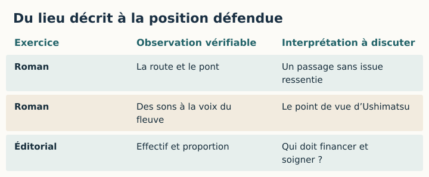

# ENS de Lyon · Séries A/L · Japonais (oral) 2026 — Corrigé brut

*Corrigé rédigé par IA, non officiel. Signalez toute erreur.*

**Rédaction** · GPT-6.2 Astra Ultra · vitesse non renseignée

La série Langues vivantes a proposé deux exercices distincts en LV1. Pour *Hakai*, les pages 346 à 348 sont délimitées dans le fascicule par la lecture de l’affiche et par la comparaison finale avec une flèche. L’édition ouverte d’Aozora conserve une orthographe ancienne mais permet de retrouver ces deux bornes. Pour l’éditorial du 8 janvier 2026, l’analyse s’appuie sur la publication originale du quotidien. Le fascicule n’en précise pas les coupures éventuelles.

## 作者の文章を読む · 島崎藤村『破戒』

### 発表例

この場面は丑松が町を歩き、千曲川に出て、船橋へ下りる場面です。移動の方向は地図に書けるほどはっきりしています。けれども、本人には自分がこれからどこに行けるのか分かりません。私は、この地理的な明確さと、社会の中で居場所を失う感覚とのずれに注目したいと思います。

冒頭で丑松は広告を読み、また歩き出します。普通なら、広告は不特定多数の人に同じ情報を伝える公共の文章です。ところが、そのあと丑松を取り囲むのはさまざまな顔や声です。自分をあざ笑うような声が右からも左からも迫る。しかも日光は明るい。暗闇だから何かを見間違えるという説明はできません。人を出自によって差別する社会に生きてきた彼には、よく見えることさえ、自分も他人の目にさらされているという恐怖につながります。鳥の鳴き声にまで軽蔑を聞き取るのは、鳥が実際に彼を差別するという意味ではありません。人間社会の視線から逃れる場所が見つからないのです。

川辺に着くと、語りの速度がいったん落ちます。船橋は対岸の地域への交通を支えています。旅人が通り、荷物を載せたそりも進みます。雪はあたりを一面に覆い、遠くの村からはかすかな鶏の声が聞こえます。こうした細部のおかげで、風景は単なる心象画にはなりません。ほかの人にとって、ここは生活の道なのです。同じ場所に立つ丑松の目には、ふだん見過ごすものが異様にはっきり見えたかと思うと、今度は輪郭そのものが揺れて見えます。目に入る情報が増えても、人生の行き先は決まりません。自分への問いが重なるのに答えは一つも出ず、足まで止まってしまいます。

次の節で丑松はまた動きます。後ろから誰かが追ってくるはずはないと頭では分かっているのに、何度も振り返る。理性と身体が同じ速さでは動かないことが、ここでは説明よりもよく伝わってきます。自分を奮い立たせようとする荒い言葉も、安心を取り戻すには足りません。川の近くには働く船頭や帰途につく農夫がいて、冬の暮らしそのものにも重さがあります。そのうえで最後に、水が彼を嘲り、死を促すかのように描かれる。静かだった千曲川が急に速まるのは、流速を測った結果ではありません。最後の矢の比喩は、人の目から逃れようとして歩いてきた丑松に、風景そのものが迫ってくる感覚を残します。この場面の苦しみは、個人の気の弱さだけに還元できません。

## 新聞記事を読む · 日本経済新聞の社説

### 発表例

この社説は、日本の高齢化について、負担する人と支えられる人を年齢だけで分け続けられるか、と問いかけています。人口の変化、社会保障の負担、介護の担い手という三つの問題が、切り離せないものとして論じられています。記事が出たのは二〇二六年一月八日です。以下の人数や制度への評価はその時点の議論として読む必要があります。

記事はまず、二〇二五年十二月の七十五歳以上の人口が二千百三十五万人で、五年前より二百六十三万人増えたと述べます。増加分を大阪市の人口に近いと説明することで、桁の大きな数字を読者の想像できる規模に変えています。もう一つ大切なのは人数と割合の違いです。ある年齢層の人数があまり増えなくなっても、若い世代が少なくなれば、全体に占める割合は上がります。この区別があるからこそ、記事は一時的な混雑への対応では足りないと主張できます。

次に社説は、高齢者を一律に弱い立場にあると考える仕組みを見直そうと提案します。例として介護保険の自己負担を挙げ、所得だけでなく保有する資産も考慮すべきだとしています。ここは予測ではなく、負担の公平さをどう考えるかという価値判断です。収入が同じ二人でも、自由に使える資産は違う場合があります。一方、住んでいる家の評価額が高くても、毎月の支払いに回せる現金が十分あるとは限りません。公平という言葉に説得力を持たせるには、どの資産をどう評価するのかまで議論しなければならないと思います。

さらに記事は、負担を調整するだけではケアをする人が増えないことにも目を向けます。職員の待遇や外国人の働き手に触れたうえで、センサーや遠隔診療などの活用を求めています。技術によって記録の手間が減れば、職員が利用者と話す時間を確保できるかもしれません。しかし機械を入れるだけで、本人の希望を聞く時間まで増えるわけではありません。仕事の配分をどう変えるかが問われます。最後には、子育てをどちらか一方の性に任せてきた仕組みの見直しも求めています。若い人だけに高齢者を支えるよう求めず、誰がどの時期に人を支え、どの時期に支えられるかを社会全体で組み直そうとする点に、この社説の射程があります。

## Questions d’entretien

**『破戒』の雪を白さの象徴とだけ読んでよいでしょうか。** 雪は景物を覆い隠す一方、通行する人や暗い道の線を浮かび上がらせます。白さを一つの意味に決めるより、何が見え、何が見えなくなるかを一つずつ確かめたいです。

**追ってくる人は実際に登場しますか。** この抜粋では登場しません。丑松自身もそういうはずはないと分かっています。それでも振り返らずにいられないという記述が重要です。

**社説のどの部分に異論がありますか。** 年齢だけで負担を決めることには限界があると思います。ただし、自己負担が増えた人が必要な受診まで控えないかも検討したいです。制度の公平さと、利用しやすさを別々に確認する必要があります。

**「支える側」は誰ですか。** 税や保険料を多く納める人だけではありません。たとえば孫の世話をする高齢者も、ほかの家族が働けるように支えています。家族の中の無償の仕事をどう数えるかによって答えが変わります。

## Documents

[Fascicule officiel de l’ENS de Lyon](https://www.ens-lyon.fr/sites/default/files/2026-11/Japonais%202026.pdf#page=3). [Texte de *Hakai* dans Aozora Bunko](https://www.aozora.gr.jp/cards/000158/files/1502_24633.html). [Éditorial du *Nihon Keizai Shinbun*](https://www.nikkei.com/article/DGXZQODK2718W0X21C25A2000000/).
