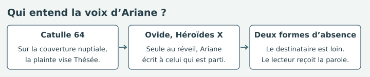

# ENS de Lyon · Latin oral · 2026 — Corrigé guidé

*Corrigé rédigé par IA, non officiel. Signalez toute erreur.*

**Rédaction** · GPT-6.2 Astra Ultra · vitesse non renseignée

La liste officielle réunit 52 références. Douze relèvent de la spécialité, vingt et une des lettres et arts hors programme, onze des langues vivantes et huit des sciences humaines. Chaque candidat présentait son propre texte. Le rapport donne vingt minutes pour l’exposé et recommande, en spécialité, de consacrer au plus huit minutes à la lecture et à la traduction. La série hors programme portait sur « Amour et amitié ».

Le fascicule publie les références, sans les billets individuels. Cinq entrées demandent une précaution. Pour Catulle « 67 (66) », les deux poèmes sont traduits. Pour les vers 43–59 de l’Art d’aimer, les trois livres sont envisagés. Les lettres I, 10 et I, 15 de Pline et le chapitre IV, 7 de Valère Maxime sont traduits en entier pour permettre de travailler toute la matière susceptible d’avoir été donnée. Le rapport mentionne neuf prestations en sciences humaines pour huit références publiées. Il nomme aussi Apulée parmi les auteurs de ces séries. La liste situe ses six références à Apulée en spécialité. Rien ne permet d’attribuer une œuvre, et encore moins des bornes, à un éventuel neuvième tirage distinct.

### Préparer sa lecture

Nommer celui qui parle et la personne à laquelle il s’adresse. Lire quelques lignes en dégageant leur articulation. Traduire ensuite par groupes de mots assez longs pour faire entendre le verbe et les noms dont il dépend. Choisir un changement repérable dans l’extrait, par exemple le passage de l’invocation au refus chez Junon, ou du discours indirect au vocatif chez Catulle. Il peut servir de charnière au commentaire.

## Spécialité Lettres et arts

### Spécialité 1 · Apulée, Métamorphoses V, 1–2, 2 · Le palais de Psyché

**Traduction.** Doucement étendue en un lieu à l’herbe tendre, sur la couche même du gazon humide de rosée, Psyché, enfin délivrée d’une si grande agitation, dormit d’un doux sommeil. Quand elle eut suffisamment repris des forces, elle se releva, l’esprit tranquille. Elle voit un bois sacré planté de hauts et vastes arbres, elle voit une source translucide comme le verre. Au beau milieu du bois, près du ruissellement de la source, se trouve une demeure royale, bâtie par l’art des dieux. Dès l’entrée, vous reconnaîtrez là le séjour splendide et riant de quelque divinité. Des colonnes d’or soutiennent en effet les hauts plafonds à caissons soigneusement creusés dans le bois de thuya et l’ivoire. De l’argent ciselé couvre toutes les parois. Des bêtes sauvages et autres animaux de la sorte viennent au-devant du visiteur. Quel prodigieux artisan, que dis-je, quel demi-dieu ou assurément quel dieu a su donner à tant d’argent, par la finesse de son art, tant de formes de bêtes ! Et les pavements eux-mêmes composent, de pierres précieuses finement taillées, toutes sortes de tableaux. Encore et toujours, que l’on proclame heureux ceux qui foulent gemmes et bijoux ! Toutes les autres parties de cette vaste demeure sont d’un prix inestimable. Les murs entiers, faits de masses d’or, étincellent de leur propre éclat, si bien que la maison se donne sa propre lumière, quand bien même le soleil s’y opposerait. Chambres, portiques, battants des portes eux-mêmes, tout brille ainsi. Le reste des richesses répond également à la majesté de la maison. À bon droit, je pense, on verrait là un palais céleste construit pour que le grand Jupiter puisse séjourner parmi les hommes. Attirée par l’agrément des lieux, Psyché s’approcha et franchit le seuil avec un peu plus d’assurance. Le ravissement d’un si beau spectacle l’entraîne bientôt à examiner chaque détail. De l’autre côté de la maison, elle aperçoit de grands magasins, d’une architecture élevée, où s’entassent d’immenses richesses. Il n’est rien qui ne s’y trouve. Au-delà de l’admiration qu’inspiraient de telles richesses, un fait surtout était merveilleux. Aucune chaîne, aucune serrure, aucun gardien ne protégeait ce trésor de l’univers.

**Commentaire.** Comment faire entrer le lecteur dans une maison sans lui en montrer le maître ? Le double *videt* règle d’abord la vue sur celle de Psyché. Le futur *scies* entraîne le lecteur à sa suite. L’art sait faire surgir une bête d’un mur d’argent et donner au bâtiment une lumière à lui. L’hésitation entre artisan, demi-dieu et dieu mesure la difficulté à attribuer l’ouvrage. La triple reprise de *nullo* clôt la visite sur le premier véritable mystère du palais. Le récit a conduit le visiteur jusqu’aux réserves par un chemin pavé de bijoux, sans lui faire rencontrer quiconque en défende le seuil.

**Pour l’oral.** Relier *occurrentibus* aux animaux représentés. La perspective donne l’illusion qu’ils avancent. Dans *nullo vinculo, nullo claustro, nullo custode*, les ablatifs nomment successivement l’entrave, la fermeture puis le gardien absents. *Curiose* qualifie ici la minutie du travail de sculpture.

### Spécialité 2 · Apulée, Métamorphoses V, 24, 4–25 · Le départ d’Amour

**Traduction.** « Moi, le fameux archer, je me suis moi-même atteint de mon propre trait et je t’ai faite mon épouse, pour qu’à tes yeux, apparemment, je sois une bête et que tu veuilles trancher de ton fer cette tête qui porte ces yeux épris de toi ! Voilà ce dont je te recommandais toujours, encore et encore, de te garder, voilà ce que je te rappelais avec bienveillance. Mais tes admirables conseillères paieront bientôt pour le funeste enseignement qu’elles t’ont donné. Quant à toi, mon départ sera ta seule punition. » Sa phrase achevée, il s’emporta sur ses ailes dans les hauteurs. Étendue à terre, Psyché suivait aussi loin qu’on pouvait le voir le vol de son époux. Elle s’accablait de plaintes désespérées. Quand l’étendue qui les séparait lui eut dérobé son époux, emporté par le mouvement de rame de ses ailes, elle voulut mettre fin à ses jours. Mais le fleuve bienveillant, en hommage au dieu qui a coutume d’enflammer les eaux elles-mêmes et par crainte pour lui-même, la déposa aussitôt sans lui faire de mal, d’un doux remous, sur la berge fleurie. Le dieu champêtre Pan se trouvait assis sur le rebord du fleuve. Il tenait dans ses bras Écho, la déesse des montagnes, et lui apprenait à répéter toutes sortes d’inflexions. Tout près de la rive, des chevrettes folâtraient, broutant à leur guise la chevelure du fleuve. Le dieu aux traits de bouc, qui n’ignorait pas tout de ce qui lui était arrivé, appela doucement Psyché, blessée et à bout de forces. Voici les paroles dont il l’apaisa. « Jolie jeune femme, je suis, certes, un campagnard et un berger, mais j’ai beaucoup appris au fil d’une longue vieillesse. Si je conjecture bien, ce que les gens avisés appellent, je crois, divination, ton pas si incertain et souvent chancelant, ta pâleur extrême et tes soupirs incessants, jusqu’à tes yeux languissants, me disent que tu souffres d’un trop grand amour. Écoute-moi donc. Ne cherche plus la mort. Cesse de te lamenter et dépose ta peine. Honore de tes prières Cupidon, le plus grand des dieux. Il est jeune, délicat, amoureux des plaisirs. Gagne sa faveur par de douces attentions. »

**Commentaire.** La première voix annonce une peine, la dernière invite à reprendre la parole. Le portrait ironique de l’archer prend appui sur *ipse me telo meo*. L’arme dont il devait disposer l’a atteint lui-même. Son vol creuse une distance que le récit mesure à ce que Psyché peut encore voir. Pan tire au contraire parti de ce qu’il observe de près, de la démarche à la respiration. Qu’il s’occupe d’Écho n’est pas un détail indifférent. Ce premier auditeur humainement attentif lui indique à qui adresser une prière.

**Pour l’oral.** La coupe entre dans le discours en cours sur *praeclarus*. Repérer la pointe d’ironie quand le locuteur reprend les mots *praeclarus* de lui-même et *egregiae* des sœurs. *Tantum* limite la sanction que reçoit sa femme. Dans la longue phrase de Pan, garder le diagnostic *amore nimio laboras* pour la fin.

### Spécialité 3 · Apulée, Métamorphoses VI, 3, 3–5, 2 · La supplication à Junon

**Traduction.** Repoussée contre son attente, abattue par une double tristesse, Psyché revient sur ses pas. Dans la clarté incertaine d’un bois au fond d’une vallée, elle aperçoit un sanctuaire habilement bâti. Résolue à ne négliger aucune voie, même douteuse, vers un sort meilleur et à solliciter la bienveillance de toute divinité, quelle qu’elle soit, elle s’approche des portes sacrées. Elle voit des présents précieux et des bandelettes à lettres d’or fixés aux arbres et aux montants des portes. Ces objets attestaient à la fois la reconnaissance de ceux qui les avaient offerts et le nom de la déesse à qui ils étaient dédiés. Alors, à genoux, embrassant des mains l’autel encore tiède après avoir essuyé ses larmes, elle prie ainsi. « Sœur et épouse du grand Jupiter, soit que tu habites à Samos ton vieux sanctuaire, là où seule une cité se glorifie de ta naissance, de tes vagissements et de ton enfance, soit que tu fréquentes dans la haute Carthage ces demeures heureuses où l’on vénère en toi la vierge parcourant le ciel à dos de lion, soit que tu présides aux illustres murailles d’Argos sur les rives de l’Inachos, qui te célèbre comme l’épouse du Tonnant et la reine des dieux, toi que l’Orient tout entier vénère sous le nom de Zygia et tout l’Occident appelle Lucine, sois dans ma détresse Junon Secourable. J’ai épuisé mes forces dans tant d’épreuves. Libère-moi de la peur du péril imminent. Tu as coutume, que je sache, de porter spontanément secours aux femmes enceintes en danger. » À cette prière Junon se présente aussitôt dans toute la majesté de sa puissance. « Combien je voudrais, en toute bonne foi, accorder ma faveur à tes prières ! Mais la retenue m’interdit de m’engager contre la volonté de ma belle-fille Vénus que j’ai toujours aimée comme une fille. Et puis les lois m’interdisent aussi de recueillir les esclaves fugitifs d’autrui contre le gré de leurs maîtres. » Terrifiée par ce nouveau naufrage de sa fortune et ne pouvant plus rejoindre son mari ailé, Psyché perd tout espoir de salut et tient conseil avec elle-même. « Quels autres secours peuvent encore être essayés, quel remède apporté à mes épreuves, quand même les déesses qui le voulaient n’ont pu m’accorder un soutien efficace ? »

**Commentaire.** L’image des ex-voto est d’abord une promesse de réussite. D’autres avant Psyché ont obtenu ce pour quoi ils remercient la déesse. La jeune femme multiplie les noms, les lieux et les fonctions de Junon jusqu’à la protection des femmes enceintes qui l’intéresse personnellement. Son langage est rituellement approprié. La déesse répond en invoquant une relation familiale et le droit attaché au statut d’esclave en fuite. La collision de ces deux registres explique le paradoxe final de protectrices qui voudraient et ne peuvent rien.

**Pour l’oral.** Dans la prière, suspendre la série *sive… sive… seu* jusqu’au souhait *sis*. *Quod sciam* borne l’affirmation à ce que sait la locutrice. La proposition relative *quae servos… vetant suscipi* dépend de *legibus* et expose le deuxième motif du refus.

### Spécialité 4 · Apulée, Métamorphoses VI, 7–8 · La proclamation de Mercure

**Traduction.** Elle se rend alors sans détour à la royale citadelle de Jupiter et demande avec hauteur l’indispensable concours de Mercure, le dieu à la parole éloquente. Le sourcil azuré de Jupiter ne lui refuse pas son assentiment. Aussitôt Vénus, triomphante, descend du ciel, accompagnée de Mercure, à qui elle déroule ses recommandations avec empressement. « Mon frère d’Arcadie, tu sais bien que ta sœur Vénus n’a jamais rien fait en l’absence de Mercure, et tu n’ignores certainement pas depuis combien de temps je suis incapable de retrouver l’esclave qui se cache. Il ne reste donc qu’à faire proclamer par ta voix une récompense publique pour qui la trouvera. Hâte-toi d’exécuter mes ordres. Indique clairement tous les signes auxquels on peut la reconnaître. Quiconque se sera rendu coupable de la cacher illégalement ne doit pouvoir plaider l’ignorance. » En disant ces mots elle lui tend une petite affiche sur laquelle figurent le nom de Psyché et le reste. Après quoi elle rentre directement chez elle. Mercure s’acquitta fidèlement de la mission. Courant de tous côtés parmi tous les peuples, il remplissait ainsi l’office de crieur qui lui avait été confié. « Quiconque pourra ramener une fugitive ou signaler sa cachette, à savoir une fille de roi, esclave de Vénus, nommée Psyché, est prié de se rendre derrière les bornes Murcia auprès de Mercure, crieur public. Il recevra pour prix de sa dénonciation, de Vénus en personne, sept doux baisers et un autre, infiniment plus doux, dont elle saura le gratifier. » À cette proclamation de Mercure, le désir d’une si grande récompense avait suscité entre tous les mortels une vive émulation. Voilà surtout ce qui leva les dernières hésitations de Psyché. Déjà, comme elle approchait de la porte de sa maîtresse, une servante de Vénus nommée Habitude vint à sa rencontre et se mit aussitôt à crier le plus fort qu’elle put. « Enfin, misérable esclave, tu commences à t’apercevoir que tu as une maîtresse ? Ou, conformément à ton habituelle insolence, prétends-tu ignorer aussi tout le mal que nous nous sommes donné à te rechercher ? Heureusement que c’est justement entre mes mains que tu es tombée. Te voilà déjà prise dans les pinces mêmes d’Orcus, et tu vas payer sur-le-champ tant d’insubordination. »

**Commentaire.** L’efficacité d’un édit divin se mesure aux changements de voix. Un sourcil suffit à Jupiter. Vénus dicte une série d’impératifs puis donne une affiche. Mercure en tire une proclamation qui emprunte au droit le tarif du renseignement et au cirque de Rome ses bornes de rendez-vous. La désignation « fille de roi, esclave de Vénus » fait entendre côte à côte deux conditions contradictoires. L’univers poursuit Psyché pour gagner des baisers. Cette disproportion burlesque n’atténue en rien la prise de pouvoir effective de la maison, dont Habitude assure la police.

**Pour l’oral.** Repérer le changement entre le subjonctif de l’annonce *conveniat* et le participe futur *accepturus*, qui indique ce que touchera le dénonciateur. *Libellum* désigne ici la fiche de signalement. *Indiciua* est la prime de dénonciation. Relever le nom parlant *Consuetudo*.

### Spécialité 5 · Apulée, Métamorphoses VI, 9, 1–10, 4 · Le premier travail

**Traduction.** Dès que Vénus la vit amenée et présentée devant elle, elle éclata d’un grand rire, comme en poussent les gens en proie à une colère furieuse. Secouant la tête et se grattant l’oreille droite, elle dit « Tu as enfin daigné saluer ta belle-mère ? Ou plutôt es-tu venue voir ton mari, que ta blessure met en danger ? Mais rassure-toi, je vais te recevoir comme il sied à une bonne bru. Où sont mes servantes Souci et Tristesse ? » Elle les fit entrer et leur livra Psyché pour qu’elles la tourmentent. Celles-ci obéirent à leur maîtresse, accablèrent de coups et de mauvais traitements la pauvre Psyché et la ramenèrent devant elle. Vénus rit de nouveau. « La voilà qui nous apitoie avec les séductions de son ventre arrondi ! Sans doute entend-elle, avec son illustre postérité, faire de moi une heureuse grand-mère. Que je suis heureuse en effet, moi qu’on appellera grand-mère en pleine fleur de l’âge ! Le fils d’une esclave de rien s’entendra appeler petit-fils de Vénus ! Encore suis-je sotte de l’appeler fils sans raison. Des noces inégales, célébrées de surcroît à la campagne, sans témoins, et sans le consentement du père, ne peuvent passer pour légitimes. Cet enfant naîtra donc hors mariage, à supposer que nous te laissions seulement aller jusqu’au bout de ta grossesse. » Sur ces mots, elle se jette sur elle, déchire son vêtement en plusieurs endroits, lui arrache les cheveux, lui secoue la tête et la malmène cruellement. Puis elle fait apporter du blé, de l’orge, du millet, du pavot, des pois chiches, des lentilles et des fèves, les mêle et les entasse pêle-mêle en un même monceau. « Si disgracieuse que tu sois, esclave, il me semble que tu sais t’attirer des amoureux uniquement à force de bons services. Je vais donc moi-même mettre à l’épreuve ta valeur. Trie cet amas de semences tout mélangées. Range comme il convient les grains soigneusement séparés, et fais-moi voir avant ce soir le travail achevé. » Elle lui assigna cet amas de graines et se retira, quant à elle, à un repas de noces.

**Commentaire.** Le rire qui encadre les deux répliques transforme le vocabulaire familial en menace. Vénus revendique l’étiquette de la bonne belle-mère, délègue la souffrance à Souci et à Tristesse puis s’institue juge de la légitimité du mariage. Le catalogue de semences exécute verbalement le mélange que la jeune femme devra défaire. La pointe du repas nuptial rappelle, à la dernière ligne, ce que Vénus vient de refuser à sa bru. Les fourmis n’apparaissent qu’après la limite du sujet.

**Pour l’oral.** Le début *quam ubi primum* reprend Psyché à l’accusatif. *Torquendam* exprime la destination du transfert, *nepos Veneris audiet* identifie ce qu’on appellera l’enfant. Relever le double sens de *frugem* au moment du passage du mérite personnel aux produits de la terre.

### Spécialité 6 · Apulée, Métamorphoses VI, 20–21 · Une boîte rapportée des Enfers

**Traduction.** Ainsi la tour clairvoyante acheva son oracle. Psyché se rend aussitôt au Ténare, prend comme il convient les petites pièces et les galettes et dévale le passage souterrain. Elle passe en silence devant l’ânier infirme, verse au passeur la pièce du fleuve, ne tient pas compte de la requête du mort qui flotte à la surface, dédaigne les prières trompeuses des tisseuses et, d’une galette, endort la rage redoutable du chien. Elle pénètre chez Proserpine. Sans accepter ni le siège délicat ni le repas somptueux que lui offrait son hôtesse, elle s’assied humblement à ses pieds, se contente de pain ordinaire et s’acquitte du message de Vénus. Sur-le-champ, elle reçoit une boîte qui a été remplie et refermée en secret. L’autre galette fait taire les aboiements du chien. Elle rend au batelier la pièce qui lui reste et revient des Enfers au pas de course, avec bien plus d’entrain. Elle a retrouvé et salué la lumière brillante du jour. Malgré sa hâte de terminer sa mission, une curiosité téméraire s’empare de son esprit. « Quelle sotte je fais, se dit-elle. Je porte la beauté divine, et je n’en prélève pas même une goutte pour moi, qui pourrais ainsi plaire à mon beau bien-aimé ! » Aussitôt dit, elle ouvre la boîte. Rien ne s’y trouvait, pas la moindre beauté. C’était un sommeil infernal, véritablement digne du Styx. À peine son couvercle soulevé, il l’envahit, inonde tous ses membres de l’épais brouillard de l’assoupissement et prend possession d’elle, tombée sur place au milieu du sentier. Elle gisait immobile, pareille seulement à un cadavre endormi. Mais Cupidon, remis à présent que sa blessure s’était fermée et incapable de supporter la longue absence de Psyché, s’échappa par une fenêtre très élevée de la chambre où on le retenait. Ses ailes s’étaient rétablies avec quelque repos. Il vola d’autant plus vite au-devant de sa Psyché. Il essuya soigneusement le sommeil, le replaça dans la boîte où il se trouvait à l’origine et réveilla Psyché d’une inoffensive petite piqûre de sa flèche. « Voilà, pauvre amie, une curiosité semblable avait de nouveau causé ta perte ! Pour l’instant, remplis courageusement la mission dont t’a chargée ma mère. Du reste, je m’occuperai moi-même. » Sur ces mots, le léger amant prit son vol. Psyché, elle, rapporta aussitôt à Vénus le présent de Proserpine.

**Commentaire.** Les ablatifs absolus accumulent les obstacles franchis avec une régularité impressionnante. Une seule parole intérieure interrompt ce retour réussi et suffit à rouvrir la boîte. Dans l’expression *dormiens cadaver*, le substantif et le participe semblent prononcer deux diagnostics opposés. Amour inverse matériellement tous les gestes du sommeil, qu’Apulée lui permet même d’essuyer. Le jeu entre *curiositate* et *curiose* différencie la témérité de l’ouverture et l’attention du secours. Le dénouement reprend ensuite deux directions distinctes, chacun des deux personnages ayant encore quelque chose à accomplir.

**Pour l’oral.** Traduire les actions condensées des participes dans leur ordre. À la fin, *perieras* est un plus-que-parfait qui donne la catastrophe pour déjà accomplie avant l’intervention d’Amour. Dans *cetera egomet videro*, le futur antérieur à la première personne prend la valeur assurée d’un engagement.

### Spécialité 7 · Catulle, Poésies 62, 20–31 et 39–58b · Les deux chœurs

**Traduction.** Les jeunes filles. « Hespéros, quel feu parcourt le ciel avec plus de cruauté que toi ? Tu as le pouvoir d’arracher la fille à l’étreinte de sa mère, d’arracher à l’étreinte de sa mère la fille qui s’y agrippe, et de donner la jeune fille encore vierge à l’ardent jeune homme. Que font de plus cruel des ennemis qui ont pris une ville ? Hymen, ô Hyménée, Hymen, sois là, ô Hyménée ! »
Les jeunes gens. « Hespéros, quel feu brille au ciel plus aimablement que toi ? Ta flamme consacre les unions promises, que les hommes ont conclues, que les parents ont conclues auparavant, et qu’ils n’ont pas scellées avant que ne brille ton feu. Qu’accordent les dieux de plus désirable que cette heure heureuse ? Hymen, ô Hyménée, Hymen, sois là, ô Hyménée ! »
Après la coupe, les jeunes filles. « Telle la fleur qui naît à l’écart dans un jardin clos, ignorée du bétail, épargnée par le soc, que les brises caressent, que le soleil fortifie, que nourrit la pluie. Tant de garçons, tant de filles la désirent ! Mais que la même fleur, cueillie d’un ongle fin, vienne à se faner, aucun garçon, aucune fille ne la désire plus. Telle est la jeune fille tant qu’elle reste intacte et chère aux siens. Quand elle a perdu la fleur de sa chasteté, le corps profané, elle ne reste ni aimable aux garçons ni chère aux filles. Hymen, ô Hyménée, Hymen, sois là, ô Hyménée ! »
Les jeunes gens. « Telle la vigne qui naît sans époux dans un champ nu. Jamais elle ne se redresse, jamais elle ne donne une grappe mûre. Son tendre corps s’incline sous le poids qui l’entraîne, et voici que l’extrémité de son sarment touche presque sa racine. Aucun paysan ne la cultive, aucun jeune bœuf ne travaille autour d’elle. Mais si cette même vigne se trouve mariée à un orme, alors abondent les paysans, abondent les jeunes bœufs qui travaillent autour d’elle. Telle est la jeune fille tant qu’elle reste intacte et vieillit sans soins. Quand elle a obtenu, à l’âge propice, une union assortie, son mari l’aime davantage et son père la voit d’un œil moins défavorable. Hymen, ô Hyménée, Hymen, sois là, ô Hyménée ! »

**Commentaire.** Ce débat chanté accorde aux deux chœurs les mêmes formes et des positions concurrentes. La première apostrophe associe le mariage à une prise de ville. La deuxième donne à cette même étoile du soir le pouvoir de ratifier un accord. Au retour de la coupe, la fleur perd sa valeur une fois cueillie, tandis que la vigne acquiert la sienne une fois mariée à l’orme qui la soutient. Les femmes et les hommes choisissent donc des cultures différentes, avec des conséquences opposées. Le refrain partagé permet d’entendre les deux points de vue au cours de la même cérémonie.

**Pour l’oral.** Prononcer les changements de voix après le refrain. Le polyptote *natam… matris / matris… natam* place mère et fille dans la phrase comme dans une étreinte. *Vidua* et *marito* attribuent à la vigne et à l’orme des statuts matrimoniaux avant même l’application à la jeune fille. Les v. 32–38 sont omis par le billet. Le v. 58b reprend le refrain.

### Spécialité 8 · Catulle, Poésies 64, 1–30 · Argo et la rencontre de Thétis

**Traduction.** Les pins jadis nés sur la cime du Pélion ont, dit-on, nagé à travers les eaux limpides de Neptune jusqu’aux flots du Phase et aux terres d’Éétès, quand de jeunes hommes choisis, élite vigoureuse de la jeunesse grecque, désireux d’enlever aux Colchidiens la toison d’or, osèrent s’élancer sur les étendues salées à bord de leur nef rapide et balayer la plaine bleue des paumes de leurs rames de sapin. Pour eux, la déesse qui tient les citadelles sur les hauteurs des villes construisit elle-même un char qui vole au moindre souffle, joignant le treillis de pin qui formait la coque incurvée. Cette nef, la première, initia par sa course Amphitrite, encore novice. Dès que son éperon eut labouré la plaine venteuse et que les vagues tordues par les rames eurent blanchi d’écume, des visages émergèrent du tourbillon blanc du détroit, ceux des Néréides marines, émerveillées devant le prodige. Ce jour-là, si jamais cela arriva, des mortels virent de leurs yeux les nymphes marines découvrir leurs corps, dressées au-dessus du flot chenu jusqu’à la poitrine. Alors, dit-on, Pélée s’enflamma d’amour pour Thétis. Alors Thétis ne dédaigna pas des noces humaines. Alors le Père lui-même jugea que Pélée devait être uni à Thétis. Ô héros nés en un temps entre tous désirable, salut, race divine, nobles enfants de vos mères, salut encore […] ! C’est vous que souvent, vous que par mon chant j’interpellerai, et toi tout particulièrement, Pélée, soutien de la Thessalie, honoré de flambeaux nuptiaux si heureux, toi à qui Jupiter lui-même, le père des dieux en personne, a cédé ses propres amours ! Est-ce toi qu’a serré dans ses bras Thétis, la plus belle des filles de Nérée ? Est-ce à toi que Téthys a permis d’épouser sa petite-fille, avec Océan, qui embrasse le monde entier de sa mer ?

**Commentaire.** Dans les premiers vers, ce sont des pins qui naviguent. Le navire apparaît ensuite comme un « char » réalisé par la main de Minerve. Cette surprise prépare une seconde reconnaissance, celle des Néréides qui regardent les hommes et se laissent à leur tour regarder. Le triple *tum* réunit alors en trois vers le désir de Pélée, l’assentiment de Thétis et l’accord paternel. Le passage du récit collectif à l’apostrophe personnelle du poète donne à cette époque sa valeur d’exception. Le destin de la toison, qui semblait être le sujet, attendra.

**Pour l’oral.** Reconstruire *pinus… dicuntur… nasse* comme une tournure personnelle de « l’on dit que ». *Quibus* reprend les jeunes gens pour qui la déesse bâtit le vaisseau. Distinguer *Thetis* (Thétis, la Néréide) et *Tethys* (Téthys, son aïeule). Le texte de l’édition latine conserve en 23b un second salut suivi d’une lacune. Océan rejoint Téthys, sujet de *concessit*, au v. 30.

### Spécialité 9 · Catulle, Poésies 64, 132–163 · La voix d’Ariane

**Traduction.** « Est-ce ainsi, perfide, qu’après m’avoir emmenée loin des autels de mes pères, perfide Thésée, tu m’as laissée sur un rivage désert ? Est-ce ainsi que tu t’en vas, sans souci de la puissance des dieux ? Ah, sans mémoire, tu remportes chez toi des serments maudits pour avoir été violés ! Rien n’a donc pu fléchir la décision de ton cœur cruel ? Nulle douceur n’est venue à ton secours pour amener ton cœur impitoyable à prendre pitié de moi ? Ce ne sont pas là les promesses que tu m’as faites jadis d’une voix caressante. Ce n’est pas ce que tu disais à la malheureuse que je suis d’espérer, mais de joyeuses noces, mais un hymen désiré. Tout cela, vain désormais, les vents du ciel le dispersent. Qu’à présent aucune femme ne croie un homme qui jure, qu’aucune n’espère trouver la fidélité dans les discours d’un homme. Tant que leur cœur brûle d’obtenir ce qu’il désire, ils ne craignent aucun serment, ils n’épargnent aucune promesse. Mais sitôt assouvi le désir qui les travaille, ils oublient tout ce qu’ils ont dit, ils n’ont nul souci de leurs parjures. C’est moi pourtant qui t’ai arraché au tourbillon même de la mort. J’ai choisi de perdre mon propre frère plutôt que de te manquer, à toi le trompeur, à l’heure suprême. Pour prix de cela je serai livrée en proie aux bêtes et aux oiseaux, et quand je mourrai, personne ne jettera sur moi la terre d’un tombeau. Quelle lionne t’a enfanté sous un rocher solitaire ? Quelle mer t’a conçu et rejeté de ses ondes écumantes ? Quelle Syrte, quelle Scylla ravisseuse, quel immense Charybde, pour que tu récompenses ainsi la douceur de la vie que tu me dois ? Si notre mariage n’était pas cher à ton cœur, parce que tu redoutais les ordres cruels de ton vieux père, tu aurais pu au moins m’emmener dans votre demeure pour que je t’y serve, esclave heureuse de sa peine, baignant tes pieds blancs dans l’eau claire ou étendant sur ton lit une couverture de pourpre. »

**Commentaire.** L’image brodée sur la couverture nuptiale de Pélée et de Thétis donne naissance à un discours entier adressé à un homme absent. Le redoublement de *perfide* et l’anaphore de *sicine* semblent retenir Thésée le temps d’une accusation. Ariane généralise ensuite, passant de *tibi* à toutes les femmes et à tous les hommes. La reprise *certe ego* la ramène à l’acte singulier dont dépendait la vie de Thésée. La dernière concession rend le déséquilibre insoutenable. Celle qui lui a donné la vie aurait accepté jusqu’à la place de servante.

**Pour l’oral.** Faire entendre trois changements de portée énonciative, de l’interpellation à la maxime, puis de la maxime au récit personnel. *Quae… famularer* est une relative au subjonctif de valeur finale. Les participes *permulcens* et *consternens* déploient les tâches que la locutrice s’imagine accomplir.

### Spécialité 10 · Catulle, Poésies 66, 37–68 · Une mèche devient constellation

**Traduction.** « En retour de ces bienfaits, rendue à l’assemblée céleste, je m’acquitte, par mon offrande nouvelle, des vœux d’autrefois. C’est malgré moi, ô reine, que j’ai quitté ta tête, malgré moi, je le jure par toi et par ta tête. Que celui qui ferait ce serment en vain en reçoive le juste prix ! Mais qui prétendrait pouvoir se mesurer au fer ? Elle aussi a été renversée, cette montagne, la plus grande que le glorieux rejeton de Théia survole sur ces bords, quand les Mèdes créèrent une mer nouvelle et que la jeunesse barbare fit passer sa flotte en plein milieu de l’Athos. Que pourraient faire des cheveux quand de telles masses cèdent au fer ? Jupiter, périsse tout le peuple des Chalybes et celui qui, le premier, entreprit de chercher les filons sous terre et de façonner la dureté du fer ! Mes sœurs, les mèches dont je venais d’être séparée, pleuraient mon sort lorsque le frère de l’Éthiopien Memnon se présenta, battant l’air de ses ailes frémissantes, cheval ailé d’Arsinoé. Il m’enleva, s’envola à travers les ombres de l’éther et me déposa sur le sein pur de Vénus. La Zéphyritide elle-même, Grecque établie sur les rivages de Canope, avait envoyé là son serviteur. Afin que ne brillât pas seule de mille feux au firmament la couronne d’or fixée jadis sur les tempes d’Ariane, mais que nous aussi nous brillions, dépouille vouée aux dieux d’une tête blonde, la déesse me prit encore humide de larmes, montant aux demeures divines, et me plaça, nouvel astre, parmi les anciens. Je touche en effet les feux de la Vierge et du redoutable Lion. Voisine de Callisto, la fille de Lycaon, je me tourne vers le couchant, précédant le lent Bouvier, qui se plonge à grand-peine et tardivement dans l’Océan profond. »

**Commentaire.** La voix de la mèche associe deux registres de grandeur. Le fer des ciseaux trouve son équivalent dans le canal que l’armée de Xerxès perça au mont Athos. La malédiction jetée aux inventeurs de la métallurgie rappelle les proportions singulières de cet objet qui parle. Puis le passage de l’enlèvement à la carte du ciel donne une place précise à la Chevelure de Bérénice. Les larmes ont suivi la mèche jusque dans l’univers des étoiles. L’origine d’un nom céleste demeure une histoire de séparation.

**Pour l’oral.** La comparaison s’appuie sur *quid facient crines, cum…* et son subjonctif explicatif. Le rejeton de Théia est le Soleil. Le frère de Memnon est le vent Zéphyr. L’écriture des v. 54 et 59 varie ou demeure corrompue suivant les éditions. Garder le mouvement assuré par *ales* et *tollens*, puis par le couple final *ne… sed…*. Au v. 66, Callisto est la mère d’Arcas devenue constellation.

### Spécialité 11 · Catulle, Poésies « 67 (66) », 1–30 · Deux numéros sur la liste

**Traduction.** Lecture du poème 67, la porte. « Ô toi qui plais tant à ce cher mari, qui plais à son père, salut, et que Jupiter t’accorde un généreux secours ! Porte, on dit que tu as jadis servi fidèlement Balbus, lorsque le vieillard occupait lui-même cette demeure, et qu’ensuite tu as bien mal servi ce que l’on attendait de toi, devenue épouse après que le vieillard eut été étendu pour la dernière fois. Allons, dis-nous pourquoi l’on rapporte que tu as changé et manqué de fidélité envers ton ancien maître. — Non, aussi vrai que je souhaite plaire à Caecilius, auquel je suis à présent confiée, la faute n’est pas à moi, quoi qu’on en dise. Nul ne peut dire que j’aie commis la moindre faute. Mais voilà le sort qu’on te fait, à toi, porte de ces gens ! À chaque fois qu’on découvre ici quelque méfait, ils crient tous après moi “Porte, c’est ta faute.” — Il ne suffit pas de l’affirmer d’un seul mot. Fais en sorte que chacun puisse s’en convaincre et le voir. — Comment le pourrais-je ? Nul ne pose de questions et personne n’a souci de savoir. — Nous le voulons. N’hésite pas à nous le dire. — On prétend d’abord que la jeune femme nous est arrivée vierge. C’est faux. Son premier mari n’aura certes pas été celui qui l’a touchée. Son corps était, dit la plaisanterie, plus mou qu’une tendre feuille de bette, incapable même de soulever sa tunique. Mais le père, à ce qu’on raconte, a violé la couche de son fils et souillé sa malheureuse maison, soit qu’une passion aveugle brûlât son cœur impie, soit que son fils fût impuissant et stérile et qu’il fallût chercher ailleurs un homme capable de dénouer la ceinture de la mariée. — Tu nous racontes là l’histoire d’un père remarquable et d’un admirable dévouement, qui s’est permis de profaner lui-même le lit de son fils ! » La dernière réplique emploie en latin une image corporelle injurieuse.

Lecture du poème 66, la chevelure. « Celui qui a observé toutes les lumières du vaste monde, qui a établi le lever et le coucher des étoiles, comment l’éclat de feu du soleil rapide s’obscurcit, comment les astres s’effacent à des époques fixes et comment le doux amour, retenant en cachette la déesse des carrefours sous les rochers du Latmos, la détourne de sa ronde aérienne, ce même Conon m’a vue dans la lumière céleste. Moi, la chevelure détachée de la tête de Bérénice, je brille d’un vif éclat. Elle m’avait promise à tous les dieux, tendant vers eux ses bras lisses, au temps où son époux, le roi tout juste marié, était allé ravager le territoire de l’Assyrie. Il portait les douces marques du combat nocturne livré pour cette dépouille virginale. Les nouvelles mariées ont-elles Vénus en haine ? Trompent-elles la joie de leurs parents par les petites larmes feintes qu’elles versent en abondance au seuil de la chambre ? Que les dieux me soient en aide, leurs gémissements ne sont pas sincères. Ma reine me l’a appris par toutes ses plaintes lorsque son nouvel époux vint affronter les combats farouches. Mais toi, laissée seule, ce ne serait pas ton lit désert que tu as pleuré ? Ce serait la séparation lamentable d’avec un frère chéri ? Comme le souci t’a rongée jusqu’au fond de tes tristes moelles ! Comme tu perdis alors la tête, toi dont tout le cœur s’alarmait, tous les sens t’abandonnant ! Je te connaissais pourtant, depuis ta petite enfance, comme une fille au grand cœur. As-tu oublié la belle action qui t’a valu un mariage royal et qu’une autre, même plus brave, n’oserait pas ? Mais alors, dans ta tristesse, quelles paroles tu prononças au départ de ton époux ! Jupiter, combien de fois ta main inquiète [essuya] tes yeux ! »

**Commentaire.** Le premier numéro donne la parole à une porte que les habitants tiennent pour responsable de leurs actes. La responsabilité se déplace du seuil à l’intérieur familial, mais le témoin reproduit les verbes de la rumeur, *dicunt*, *ferunt*, *dicitur*. Il faut attribuer ses insinuations à ce personnage. L’emploi ironique de *pietate* au dernier distique fait tomber l’image du bon père. Dans le second numéro, l’énigme est d’abord grammaticale. Le sujet longtemps décrit comme savant s’appelle enfin Conon, mais le véritable personnage doué de parole est le complément *me*, la mèche. Son savoir domestique sur les larmes de la reine rivalise avec les observations astronomiques du savant. Les registres judiciaire et élégiaque distinguent donc très nettement les deux lectures.

**Référence du billet.** Le numéro principal désigne la porte, le numéro entre parenthèses désigne la Chevelure. Les deux poèmes, v. 1–30, sont traduits et distingués.

**Pour l’oral.** La liste imprime exactement « 67 (66), 1–30 ». Les éditions usuelles distinguent deux poèmes. Dans le 67, répartir le dialogue entre la porte et son interrogateur. Le texte latin du v. 12 est incertain. Dans le 66, conserver le sujet retardé de *vidit* et distinguer le vœu de la reine du diagnostic de Conon. Le verbe du dernier vers est sous-entendu. Le titre du billet individuel permettrait de départager les deux possibilités.

### Spécialité 12 · Catulle, Poésies 68, 1–32 · Un refus adressé à Manlius

**Traduction.** Tu m’envoies ce billet écrit avec tes larmes, accablé par la fortune et un malheur cruel. Tu voudrais que je te relève, naufragé rejeté par les vagues écumantes de la mer, que je te ramène du seuil de la mort, toi que la divine Vénus ne laisse pas te reposer dans un doux sommeil, abandonné sur un lit solitaire, et que les Muses ne divertissent pas du doux chant des anciens poètes quand ton esprit inquiet veille sans répit. Je te sais gré de ta lettre, puisque tu me dis ton ami et me demandes d’ici les présents des Muses comme ceux de Vénus. Mais pour que tu n’ignores pas mes propres épreuves, Manlius, et pour que tu ne penses pas que je répugne aux services de l’hospitalité, apprends dans quels flots de la fortune je me noie moi-même. Ne demande plus à un malheureux des présents que donne le bonheur. Quand, pour la première fois, on me remit la toge sans bordure et que ma jeunesse en fleur connaissait son beau printemps, j’ai beaucoup joué. Elle me connaît bien, la déesse qui mêle une douce amertume aux soucis. Mais la mort de mon frère, par le deuil, m’a enlevé tout ce goût. Ô frère enlevé à ton malheureux frère, c’est toi, oui, toi, frère, qui, mourant, as brisé mon bonheur. Avec toi toute notre maison a été ensevelie. Avec toi ont péri toutes les joies que nourrissait de ton vivant la douceur de ton affection. Depuis ta disparition, j’ai chassé de ma pensée tous ces goûts et tous les plaisirs de mon esprit. Ainsi, lorsque tu écris que c’est une honte pour Catulle d’être à Vérone alors qu’ici quelque homme bien placé réchauffe dans le lit désert ses membres froids, cela, Manlius, ce n’est pas une honte. C’est bien plutôt un malheur. Tu me pardonneras donc de ne pas t’accorder ces présents que le deuil m’a enlevés et que je n’ai plus le pouvoir de te donner.

**Commentaire.** Le début du poème donne la parole au destinataire sans citer sa lettre. L’image du naufragé est d’abord empruntée à la demande de Manlius, puis le scripteur la retourne vers lui-même (*merger… ipse*). La lettre d’excuse se brise au vocatif *frater*. Les reprises de *tu* et de *tecum* font du disparu le destinataire provisoire d’une tout autre parole. Quand l’adresse revient à Manlius, le lecteur peut enfin mesurer le poids de la distinction entre honte et chagrin.

**Pour l’oral.** Rattacher tout *quod… mittis* des v. 1–8 à *id gratum est mihi* au v. 9. La *vestis pura* est la toge virile prise à l’entrée dans l’âge adulte. Dans *cum nequeo*, l’impuissance actuelle du locuteur justifie le refus final. Les éditions partagent ou réunissent les deux parties du poème 68. Ici la première partie est seule concernée.

## Lettres et arts hors programme

### LA 1 · Catulle, 99 · Le baiser dérobé

**Traduction.** Pendant que tu jouais, doux Juventius, je t’ai dérobé un petit baiser plus doux que la douce ambroisie. J’ai payé ce geste. Je me souviens d’être resté, plus d’une heure, comme cloué en haut d’une croix. Je me justifiais auprès de toi et toutes mes larmes ne pouvaient fléchir si peu que ce fût ta dureté. À peine était-ce fait que, de toutes tes jointures, tu essuyas tes lèvres lavées à grande eau, pour qu’il n’y restât rien qui vînt de ma bouche, comme si c’était la salive infecte d’une prostituée souillée. Et tu n’as cessé de me livrer, malheureux que j’étais, à l’hostilité d’Amour et de me tourmenter de toutes les façons. Ce petit baiser, pour moi, d’ambroisie qu’il était, tu l’as changé en quelque chose de plus amer que l’amer ellébore. Puisque c’est ce châtiment que tu réserves à mon malheureux amour, désormais je ne volerai plus jamais de baisers.

**Commentaire.** Qui possède le pouvoir de qualifier le geste ? Le locuteur passe de la comparaison avec la nourriture des dieux au goût d’une plante médicinale amère. Les mêmes comparatifs et la reprise de *saviolum* encadrent ce renversement. Entre les deux, Juventius répond au geste imposé en lavant ses lèvres. L’image injurieuse appartient au récit du poète, qui donne une ampleur démesurée à son humiliation. La seule promesse concrète arrive au dernier vers.

**Pour l’oral.** *Subripui* trouve sa réponse dans *numquam … subripiam*. Reconstruire au centre *memini me suffixum esse*. Relever le complément de comparaison à l’ablatif dans *ambrosia* puis dans *elleboro*.

### LA 2 · Catulle, 45, v. 8–26 · Acmé et Septimius

**Traduction.** À ces mots de Septimius, Amour éternua son approbation à gauche comme auparavant à droite. Alors Acmé, rejetant légèrement la tête et déposant de ses lèvres vermeilles un baiser sur les doux yeux enivrés du jeune homme, lui dit « Ma vie, mon cher petit Septimius, puissions-nous toujours servir ce maître seul, aussi vrai qu’un feu bien plus grand et plus vif me brûle jusqu’au tendre fond des os ! » À ces mots d’Acmé, Amour éternua son approbation à gauche comme auparavant à droite. Partis désormais sous cet heureux auspice, d’un sentiment réciproque ils aiment et sont aimés. Le pauvre Septimius préfère Acmé, elle seule, à toutes les Syries et à toutes les Bretagnes. La fidèle Acmé trouve dans le seul Septimius tout son bonheur et tout son désir. Qui a jamais vu deux êtres plus heureux, qui a vu amour placé sous un meilleur auspice ?

**Commentaire.** Le même éternuement ponctue les deux serments. Ce bref bruit corporel fait tout le travail d’un oracle. *Amant amantur* place le verbe actif et son passif côte à côte, puis *unam* et *uno* font passer la même exclusivité d’un nom à l’autre. Au terme du poème, la voix qui interroge le public transforme une scène intime en exemple de bonheur.

**Pour l’oral.** *Saviata*, participe d’un déponent, a un sens actif et se rapporte à Acmé. La construction corrélative *sic … ut* relie le souhait et le serment. Les directions de l’éternuement ont reçu plusieurs ponctuations. Le poème fixe lui-même son sens par *auspicio bono*.

### LA 3 · Ovide, Héroïdes IV, v. 1–16 · Phèdre se risque à écrire

**Traduction.** La fille de Crète envoie au fils de l’Amazone un salut dont elle-même sera privée si tu ne le lui donnes. Lis jusqu’au bout, quoi que vaille cette lettre. Quel mal fera une lettre une fois lue ? Peut-être y trouveras-tu, toi aussi, quelque chose qui te plaise. De tels signes portent les secrets par terre et par mer. Un ennemi examine même le message reçu d’un ennemi. Trois fois j’ai essayé de te parler, trois fois ma langue impuissante s’est arrêtée, trois fois le son s’est arrêté au bord de mes lèvres. Autant qu’il se peut et qu’elle consent à me suivre, il faut associer la pudeur à l’amour. Ce que j’avais honte de dire, Amour m’a ordonné de l’écrire. Mépriser quoi que ce soit qu’Amour ait ordonné est dangereux. Il règne et exerce son droit jusque sur les dieux souverains. Comme j’hésitais d’abord à écrire, il m’a dit « Écris ! Cet homme de fer rendra les armes. » Qu’Amour m’assiste ! Comme il entretient dans mes moelles une flamme dévorante, qu’il attache ainsi ton cœur à l’accomplissement de mes vœux !

**Commentaire.** Phèdre, épouse de Thésée, doit faire lire son aveu à Hippolyte. Elle se présente d’abord, comme lui, par une ascendance et au moyen de la troisième personne. Le *tu* brise cette distance. L’argument de l’ennemi qui consent à lire prépare le récit des trois échecs de la parole. Faire parler Amour dans sa lettre permet à Phèdre d’y faire entrer le premier impératif qu’elle n’osait prononcer en personne.

**Pour l’oral.** Distinguer les deux valeurs de *salutem*, formule épistolaire et salut de la personne. *Caritura est* appelle un ablatif dont le relatif *qua* serait attendu par sa fonction dans la relative, mais la forme transmise *quam* est le complément de *dederis*. *Adsit* et *figat* portent le souhait final.

### LA 4 · Ovide, Héroïdes X, v. 3–18 · Le réveil d’Ariane

**Traduction.** Thésée, ce que tu lis, je te l’envoie de ce rivage même d’où tes voiles ont emporté ton bateau sans moi, où mon sommeil m’a cruellement trahie et toi aussi, toi qui as criminellement profité de mon sommeil. C’était l’heure où la gelée transparente commence à poudrer la terre et où les oiseaux cachés dans le feuillage font entendre leurs plaintes. À demi réveillée, encore engourdie de sommeil, à moitié couchée sur le dos, j’ai tendu les mains pour saisir Thésée. Il n’était pas là ! Je ramène les mains, je tâtonne encore, j’étends les bras à travers le lit. Il n’était pas là ! La peur a chassé le sommeil. Je me lève épouvantée et mon corps s’est jeté hors du lit désert. Aussitôt ma poitrine a résonné sous mes paumes et j’ai arraché mes cheveux encore emmêlés par le sommeil. Il y avait de la lune. Je regarde si j’aperçois autre chose que le rivage. Mes yeux n’ont rien à voir que le rivage.

**Commentaire.** La lettre commence ici par l’indication du lieu d’où elle part. Au réveil, les mains cherchent d’abord un corps. La reprise de *nullus erat* rend deux fois sensible la même absence. Le regard se porte ensuite jusqu’au bord de la plage. *Litore*, puis *litora* et *litus* occupent la place de l’homme absent aux deux extrémités du billet.

**Pour l’oral.** Construire *Thesea prensuras manus*, avec un participe futur et un accusatif grec. Ne pas ajouter les vers liminaires imprimés hors numérotation par certaines éditions. Dans le texte édité par Ehwald, le v. 3 commence par *Quae legis* et le v. 18 finit par *litus habent*.

### LA 5 · Ovide, Héroïdes XVII, v. 77–91 · Hélène déchiffre Pâris

**Traduction.** Tantôt, effronté, tu me dévisages de tes yeux hardis dont mes regards soutiennent à peine l’insistance. Tantôt tu soupires, tantôt tu prends la coupe la plus proche de moi, et tu bois, toi aussi, précisément là où j’ai bu. Ah ! combien de fois ai-je surpris les signes discrets que donnaient tes doigts, combien de fois ceux que faisaient tes sourcils presque doués de parole ! Souvent j’ai tremblé que mon mari ne les voie et j’ai rougi de ces signes mal cachés. Souvent j’ai dit dans un murmure, ou même sans un son « Cet homme n’a honte de rien. » Et ma parole disait vrai. Sur le rond de la table, sous mon nom, j’ai aussi lu ce mot que des lettres tracées avec du vin pur avaient formé, « j’aime ». J’ai pourtant démenti d’un regard incrédule que je le crusse. Hélas ! Voilà que moi aussi, j’ai déjà appris à parler ainsi ! Devant ces flatteries, si j’avais été disposée à commettre la faute, je…

**Commentaire.** Hélène, l’épouse de Ménélas, raconte à Pâris ses propres gestes. La succession des *modo* donne l’impression qu’elle l’observe au moins autant qu’il la regarde. La seule déclaration écrite, *amo*, omet son complément. Le nom d’Hélène écrit à côté le fournit. Son geste de dénégation la rend malgré elle capable de parler la même langue que son correspondant.

**Pour l’oral.** *Ne … videret* dépend d’un verbe de crainte. *Qua … parte* signifie « du côté où ». La condition *si peccatura fuissem* reste suspendue au v. 91. C’est au v. 92, hors billet, que vient *flecterer*, « je me laisserais fléchir ».

### LA 6 · Ovide, Art d’aimer I, v. 1–17 · Le maître d’Amour

**Traduction.** Si quelqu’un, dans ce peuple, ignore l’art d’aimer, qu’il lise ceci et, instruit par la lecture de mon poème, qu’il aime. L’art met en mouvement les navires rapides, à la voile et à la rame. L’art conduit les chars légers. Par l’art il faut gouverner l’amour. Automédon savait conduire un char et manier les rênes souples. Tiphys était pilote sur le vaisseau de Thessalie. Moi, Vénus m’a donné pour maître au tendre Amour. On m’appellera le Tiphys et l’Automédon d’Amour. Sans doute est-il farouche et souvent rebelle à mes ordres. Mais c’est un enfant, âge souple qui se laisse conduire. Par la cithare, le fils de Philyra acheva l’éducation du jeune Achille et adoucit son âme farouche par un art paisible. Celui qui terrifia tant de fois ses compagnons, tant de fois ses ennemis, on le croit pris de peur devant un vieillard chargé d’ans. Ces mains dont Hector allait ressentir la force, il les tendit, sur l’ordre de son maître, pour recevoir des coups. Chiron fut le précepteur du descendant d’Éaque. Moi, je suis celui d’Amour.

**Commentaire.** Le maître de poésie didactique doit établir qu’un art s’enseigne. Les trois *arte* donnent pour modèles la navigation et le char. L’objection tient à l’élève, Amour, dieu rebelle. Le précédent de Chiron suggère qu’un jeune redoutable peut s’instruire par la musique. Au moment où l’élève semble le moins maniable, la comparaison se rééquilibre dans le partage du v. 17 entre Chiron et le poète.

**Pour l’oral.** *Hoc legat* et *amet* sont des subjonctifs d’exhortation adressés au lecteur hypothétique. Identifier sous trois noms deux personnages. Le fils de Philyra est Chiron et le descendant d’Éaque est Achille. Le rapport cite expressément l’incipit de l’œuvre.

### LA 7 · Ovide, Art d’aimer, v. 43–59 · Trois lectures d’une référence sans livre

**Traduction.** **Livre I.** Elle ne descendra pas vers toi en glissant à travers l’air léger. Il te faut chercher de tes yeux la jeune femme qui leur convient. Le chasseur sait bien où tendre ses filets aux cerfs et dans quel vallon se tient le sanglier qui grince des dents. Les oiseleurs connaissent les buissons, le pêcheur qui tient les hameçons sait quelles eaux fourmillent de poissons. Toi aussi, qui cherches un objet pour un amour durable, apprends d’abord en quel lieu se presse la foule des jeunes femmes. Je ne te ferai pas mettre à la voile pour la chercher et, pour la trouver, tu n’as pas un long chemin à parcourir. Que Persée ait ramené Andromède de chez les Indiens à la peau sombre, qu’un homme de Phrygie ait enlevé une jeune Grecque, Rome te donnera tant de belles jeunes femmes que tu diras « Elle possède tout ce qu’il y avait au monde. » Autant le Gargare porte de moissons et Méthymne de grappes, autant les eaux abritent de poissons et le feuillage d’oiseaux, autant le ciel a d’étoiles, autant ta Rome compte de jeunes femmes.

**Livre II.** L’adversité réveille souvent l’ingéniosité. Qui aurait jamais cru qu’un homme pût emprunter les chemins des airs ? Dédale dispose en rang les plumes qui servent de rames aux oiseaux et lie de fil son ouvrage léger. Il fixe la partie inférieure avec de la cire fondue au feu. Voici achevé le travail de cet art nouveau. L’enfant, tout sourire, maniait la cire et les plumes sans savoir que ces armes étaient préparées pour ses épaules. Son père lui dit « Ce sont là les vaisseaux qui nous ramèneront dans la patrie, le secours qui doit nous permettre d’échapper à Minos. Minos a tout fermé, sauf l’air, qu’il n’a pu fermer. Fends donc l’air qui nous est ouvert, grâce à mon invention. Tu n’auras à regarder ni la vierge de Tégée ni Orion porte-épée, compagnon du Bouvier. Suis-moi avec les ailes que je t’ai données. J’irai devant. Aie soin de me suivre. Si je te guide, tu seras en sûreté. Car si, par les airs de l’éther, dans le voisinage du soleil… »

**Livre III.** Aujourd’hui encore elles seraient sans savoir, mais la déesse de Cythère m’a ordonné de les instruire et s’est dressée en personne devant mes yeux. Elle m’a dit « Qu’ont mérité ces pauvres jeunes femmes ? On livre une foule sans défense à des hommes en armes. Deux petits livres ont fait d’eux des experts. À toi d’instruire aussi ce parti-là par tes conseils. Celui qui avait naguère flétri l’épouse de Thérapné chanta ensuite sa louange sur une lyre plus heureuse. Si je te connais bien, garde-toi d’offenser les jeunes femmes cultivées. Voilà la faveur qu’il te faut rechercher tant que tu vivras. » Elle dit et, de son myrte, car elle s’était présentée les cheveux ceints de myrte, elle donna une feuille et quelques baies. En les recevant, j’ai aussi ressenti sa puissance divine. L’air a brillé plus pur et tout le poids qui était sur mon cœur est tombé. Pendant que la déesse m’inspire, venez chercher ici des leçons, jeunes femmes à qui le permettent la pudeur, les lois et votre propre condition. Dès maintenant, pensez à la vieillesse qui viendra.

**Commentaire.** Le billet précédent vient du livre I d’après le jury. L’absence du numéro de livre sur cette deuxième ligne invite à distinguer les trois possibilités. Au livre I, l’anaphore de *quot* passe des espaces mythiques à Rome et met la recherche d’une compagne en rapport avec les techniques d’un chasseur. Au livre II, le sourire d’Icare et la promesse *tutus eris* font entendre l’écart tragique entre le récit connu du lecteur et l’assurance de Dédale. Au livre III, Vénus transforme la supériorité conférée aux hommes par les deux livres précédents en raison d’instruire aussi les femmes. Stésichore et sa rétractation sur Hélène, dite épouse de Thérapné, fournissent le précédent du changement de destinataires.

**Référence du billet.** Le livre manque. Les v. 43–59 des trois livres sont traduits séparément.

**Pour l’oral.** Au livre I, rattacher les comparatifs de quantité à *tot* et les subjonctifs *portarit*, *sit* à la concession. Au livre II, regrouper les adjectifs verbaux d’obligation *adeunda*, *effugiendus* et *aspiciendus*. Le v. 59 ouvre une condition poursuivie au v. 60. Au livre III, *illos* renvoie aux lecteurs masculins, *haec pars* aux jeunes femmes. Les trois traductions correspondent aux trois livres possibles, dans l’ordre de l’œuvre.

### LA 8 · Ovide, Métamorphoses VII, v. 7–21 · Médée délibère

**Traduction.** Tandis qu’ils se présentent au roi et réclament la toison de Phrixos, et qu’aux descendants de Minyas est imposée l’effrayante condition de grandes épreuves, la fille d’Éétès s’enflamme d’un violent amour. Après avoir longtemps lutté, comme elle ne pouvait vaincre par la raison son égarement, elle dit « Tu résistes en vain, Médée. Je ne sais quel dieu s’y oppose. Il serait étonnant que ce que l’on appelle aimer ne soit pas cela, ou du moins quelque chose qui lui ressemble. Pourquoi, en effet, les ordres de mon père me semblent-ils trop durs ? C’est aussi qu’ils sont trop durs. Pourquoi ai-je peur de voir périr un homme que je viens à peine de voir ? Qu’est-ce qui justifie une telle peur ? Secoue ces flammes entrées dans ton cœur de jeune fille, si tu le peux, malheureuse ! Si je le pouvais, j’aurais plus de raison. Mais une force nouvelle m’entraîne malgré moi. Le désir me conseille une chose, mon esprit une autre. Je vois le mieux et je l’approuve, je suis le pire. Quoi donc, dans un étranger, fille de roi… »

**Commentaire.** L’épisode commence à la cour du roi de Colchide, mais le narrateur abandonne aussitôt l’action des Argonautes pour rendre audible la naissance de la passion chez Médée. Elle se donne un ordre à la deuxième personne et lui répond à la première. *Aliud … aliud* organise deux avis contradictoires, avant que l’opposition entre trois verbes, voir, approuver et suivre, donne un mouvement à cette division.

**Pour l’oral.** *Ne pereat* est ce que Médée redoute de voir arriver. Comparer la condition ouverte *si potes* à l’irréel *si possem, sanior essem*. Le v. 21 coupe la nouvelle question avant son verbe *ureris*, « brûles-tu », placé au v. 22.

### LA 9 · Pline le Jeune, Lettres I, 12, § 1–4 · Le deuil de Corellius

**Traduction.** J’ai subi une très lourde perte, si l’on peut appeler une perte la disparition d’un si grand homme. Corellius Rufus est mort, et de son plein gré, ce qui rend ma douleur plus vive encore. De toutes les morts, la plus affligeante est celle qui ne semble ni naturelle ni imposée par le destin. Car, chez ceux qui succombent à la maladie, la nécessité elle-même apporte, tant bien que mal, une grande consolation. Mais chez ceux qu’emporte une mort qu’ils ont appelée, la douleur reste sans remède, parce que l’on pense qu’ils auraient pu vivre longtemps. Corellius, certes, a été poussé à cette décision par la raison souveraine, qui tient lieu de nécessité pour les sages. Il avait pourtant quantité de raisons de vivre, une conscience irréprochable, une excellente réputation, une très grande autorité et puis une fille, une épouse, un petit-fils, des sœurs et, parmi tous ces êtres chers, des amis véritables. Mais il se débattait depuis si longtemps contre un état si pénible que tout ce qui faisait à ses yeux le prix de la vie cédait aux raisons qui le portaient vers la mort. Dans sa trente-troisième année, comme je le lui ai entendu dire, il avait été saisi de douleurs aux pieds. Ce mal lui venait de son père, car les maladies aussi, très souvent, se transmettent comme un héritage, au même titre que le reste.

**Commentaire.** La première phrase se corrige elle-même. Le vocabulaire du préjudice paraît insuffisant pour évoquer l’ami. Pline oppose ensuite le point de vue du survivant à celui qu’il attribue à Corellius. Pour l’un demeure la pensée des années qui auraient pu rester, pour l’autre une longue maladie pèse face à une longue liste d’attachements. Le témoignage personnel final, *ut ipsum audiebam*, ramène le lecteur du raisonnement général à une conversation entre amis.

**Pour l’oral.** Suivre les deux valeurs de *necessitas* dans les § 2 et 3. *Potuisse diu vivere* exprime une possibilité envisagée par ceux qui restent. Garder à l’imparfait *audiebam* sa valeur d’habitude, « comme je l’entendais dire ».

### LA 10 · Pline le Jeune, Lettres I, 10 · Le portrait d’Euphratès

**Traduction.** Pline salue son cher Attius Clemens. Si jamais chez nous les études qui conviennent à un homme libre ont fleuri, c’est aujourd’hui plus que jamais. Il y en a de nombreux et illustres exemples. Un seul suffirait, le philosophe Euphratès. Quand je servais tout jeune en Syrie, j’ai appris à le connaître de près et dans sa maison. J’ai pris de la peine pour me faire aimer de lui, alors qu’il n’était nul besoin d’en prendre. Il se laisse aborder, se tient à la disposition de chacun et possède en abondance cette humanité qu’il enseigne. Puissé-je avoir répondu à l’espoir qu’il avait alors conçu de moi aussi bien qu’il a, de son côté, ajouté à ses vertus ! Ou peut-être les admiré-je davantage aujourd’hui parce que je les comprends mieux. Encore aujourd’hui, pourtant, je les comprends insuffisamment. De même qu’il faut être artiste pour juger un peintre, un graveur, un sculpteur en argile, seul un sage peut discerner pleinement un sage.

Pour autant qu’il m’est donné d’en juger, bien des qualités ressortent et brillent si vivement chez Euphratès qu’elles attirent et touchent même des gens d’une instruction moyenne. Il argumente avec finesse, gravité et élégance. Souvent il reproduit aussi l’élévation et l’ampleur du style de Platon. Sa conversation est abondante et variée, douce avant tout et capable d’entraîner et de pousser même ceux qui résistent. Joignez-y la haute taille, le beau visage, les longs cheveux, l’ample barbe blanche. Si fortuites et vaines qu’on puisse trouver ces choses, elles lui gagnent beaucoup de respect. Son apparence n’a rien de rude, rien de morose, beaucoup de sérieux. À le rencontrer on éprouve de la révérence sans avoir peur. Sa vie est d’une parfaite intégrité. Son affabilité l’égale. Il attaque les vices, épargne les hommes, corrige leurs erreurs sans les châtier. On suivrait ses conseils, attentif et suspendu à ses lèvres, et, même déjà convaincu, on souhaiterait l’être encore.

Il a aussi trois enfants dont deux garçons. Il apporte le plus grand soin à leur éducation. Son beau-père Pompeius Julianus est un homme important et illustre par le reste de sa vie et encore par ce seul trait. Premier personnage de sa province, ayant le choix parmi les plus hautes alliances, il a choisi un gendre qui occupait le premier rang par la sagesse plutôt que par les honneurs. Mais pourquoi parler plus longtemps d’un homme dont il ne m’est pas permis de jouir ? Pour souffrir plus encore d’en être privé ? Car je suis tiraillé par une charge aussi importante que fort pénible. Je siège au tribunal, j’annote des requêtes, je dresse des actes, je rédige force lettres tout à fait dépourvues de littérature. Je me plains parfois de ces occupations auprès d’Euphratès, mais quand en ai-je seulement le temps ! Il me console. Il affirme que c’est aussi une partie de la philosophie, et l’une des plus belles, que de s’occuper des affaires publiques, d’instruire les causes et de juger, de faire paraître et de pratiquer la justice, de mettre en application ce que les philosophes eux-mêmes enseignent.

Il est un seul point pourtant dont il ne me persuade pas, c’est qu’il vaut mieux faire tout cela que passer auprès de lui des journées entières à l’écouter et à apprendre. Je t’engage donc d’autant plus vivement, toi qui as du loisir, quand tu viendras à la ville la prochaine fois, et que cela même te fasse venir plus tôt, à te laisser polir et façonner par lui. Car à la différence de beaucoup, je n’envie pas aux autres un bien dont je suis moi-même privé. Au contraire, je goûte un sentiment de plaisir à voir à la disposition de mes amis ce qui m’est refusé. Porte-toi bien.

**Commentaire.** La familiarité passée en Syrie autorise un portrait dont Pline limite lui-même la portée. Qui, sinon un sage, reconnaît la sagesse ? Sa solution consiste à montrer comment la parole retient jusqu’à celui qui résiste, puis comment l’enseignement se continue dans la conduite familiale. Lorsque le magistrat oppose son travail à cette fréquentation désirée, Euphratès lui répond que rendre justice, c’est déjà philosopher. L’ami destinataire hérite du loisir qui manque à l’auteur de la lettre.

**Référence du billet.** La liste ne donne aucun paragraphe. Les douze paragraphes de la lettre sont traduits.

**Pour l’oral.** Repérer le jeu sonore des *illitteratissimas litteras*, les lettres administratives du magistrat, puis *unum non persuadet* après la capacité à convaincre du § 7. La liste ne donne aucun numéro de paragraphe. La traduction couvre les douze paragraphes de la lettre. L’extrait d’environ 110 mots évoqué par le rapport du jury ne peut pas être délimité à l’intérieur de cet ensemble.

### LA 11 · Pline le Jeune, Lettres I, 15 · Un dîner manqué

**Traduction.** Pline salue son cher Septicius Clarus. Hé, toi ! Tu promets de venir dîner et tu ne viens pas ? Jugement rendu, tu me rembourseras la dépense jusqu’au dernier as, et elle est loin d’être négligeable. Il y avait pour chacun une laitue, trois escargots et deux œufs, du gruau avec du vin au miel et de la neige. Oui, tu compteras aussi la neige, et même en tout premier, puisqu’elle s’est perdue sur le plat. Il y avait des olives, des betteraves, des courges, des oignons et mille autres mets tout aussi somptueux. Tu aurais entendu des acteurs comiques, un lecteur ou un joueur de lyre, ou même, telle est ma largesse, tous à la fois. Mais toi, chez je ne sais qui, tu as préféré les huîtres, les matrices de truie, les oursins et les danseuses de Gadès. Tu en seras puni, je ne dis pas comment. Tu as été bien dur. Tu as privé quelqu’un d’un plaisir, peut-être toi, moi sûrement, mais au fond toi aussi. Comme nous aurions joué, ri et étudié ensemble ! Tu trouveras chez bien des gens une table plus recherchée, nulle part un dîner plus gai, plus simple, où l’on soit plus à l’aise. En somme, fais-en l’essai. Si ensuite tu ne préfères pas donner tes excuses aux autres, donne-moi tes excuses à tout jamais. Porte-toi bien.

**Commentaire.** Le ton judiciaire de la première plainte oblige plaisamment le mauvais convive à payer même la neige qui a fondu. Les distributifs de la liste donnent un compte d’une précision disproportionnée à la modestie du menu. *Lusissemus, risissemus, studuissemus* ramène la perte à ce qui aurait rendu ce repas irremplaçable, le plaisir d’être ensemble. L’ultime défi fait passer le reproche au rang d’invitation renouvelée.

**Référence du billet.** La liste ne donne aucun paragraphe. La lettre, courte, est traduite en entier. Le tirage individuel confirmerait si elle était donnée en entier.

**Pour l’oral.** *Audisses* et les trois plus-que-parfaits du subjonctif racontent la soirée qui aurait pu avoir lieu. Entendre l’ellipse d’un destinataire dans *excusaveris* et *excusa*. La liste indique la lettre seule. Ses quatre paragraphes sont traduits ici.

### LA 12 · Pline le Jeune, Lettres I, 16, § 1–4 · Un ami orateur et historien

**Traduction.** J’aimais Pompeius Saturninus, je parle du nôtre, et je louais son talent, avant même de savoir à quel point il était varié, souple, multiple. Mais aujourd’hui il me tient tout entier, il m’a, il me possède. Je l’ai entendu plaider avec vigueur et ardeur et avec tout autant de finesse et d’élégance, qu’il prononçât des développements préparés ou improvisés. Il a des formules nombreuses et bien à leur place, une composition pleine de gravité et de noblesse, des mots sonores, de vieille frappe. Tout cela plaît merveilleusement quand un élan, un flot, l’emporte et plaît encore si on le reprend dans le détail. Tu le sentiras comme moi quand tu auras pris ses discours en main. Tu les compareras sans peine à ceux de n’importe lequel des anciens avec lesquels il rivalise. Pourtant, c’est en histoire que le même homme te satisfera davantage encore, par la brièveté, la clarté, la douceur ou même l’éclat et l’élévation de son récit. Dans les discours publics qu’il y rapporte, on retrouve la même force que dans ses plaidoiries, seulement plus serrée, plus ramassée, plus contenue.

**Commentaire.** L’éloge repose sur des épreuves successives. À la performance entendue au tribunal doit succéder la lecture que le correspondant peut faire lui-même. Saturninus passe ensuite de l’éloquence judiciaire à l’histoire, où les discours de personnages gardent une force qu’ils doivent adapter au récit. Les trois comparatifs qui les caractérisent resserrent également la phrase qui les imite.

**Pour l’oral.** Rétablir *orationibus* pour comprendre *cuilibet veterum*, « aux discours de n’importe lequel des anciens ». Distinguer les *orationes* plaidées par Saturninus des *contiones* intégrées à son récit historique. *Hunc … nostrum* marque une connaissance partagée par les correspondants.

### LA 13 · Pline le Jeune, Lettres III, 1, § 1–4 · Une matinée chez Spurinna

**Traduction.** Je ne sais si j’ai jamais passé de temps plus agréable que lors de mon récent séjour chez Spurinna. À tel point que je ne voudrais imiter personne davantage dans ma vieillesse, pourvu seulement qu’il me soit accordé de vieillir. Aucun genre de vie n’est mieux réglé que le sien. L’existence ordonnée des hommes me plaît, tout comme la course régulière des astres. Celle des vieillards surtout. Un peu de désordre, de confusion pour ainsi dire, ne messied pas encore aux jeunes gens. Aux vieillards conviennent la tranquillité et l’ordre en toutes choses, car chez eux une activité tardive n’est qu’une ambition déplacée. Spurinna s’en tient très fermement à cette règle. Même les menus actes de sa vie, menus à condition de ne pas les répéter tous les jours, il les fait revenir dans un certain ordre, comme sur une orbite. Le matin, il reste sur son lit. À la deuxième heure, il demande ses chaussures. Il marche trois milles et n’exerce pas moins son esprit que son corps. S’il y a des amis, ils engagent des conversations du plus grand intérêt. Sinon, on lit un livre, parfois même en présence des amis, pourvu qu’ils n’y voient pas d’inconvénient.

**Commentaire.** La première personne situe l’éloge dans un souvenir d’hospitalité. La comparaison astronomique pourrait rester grandiose et abstraite, mais le mot *orbe* devient l’image des petites habitudes répétées. L’exemple concret des chaussures et des trois milles donne à la règle une mesure humaine. La dernière réserve apporte une souplesse au programme quotidien, puisqu’on tient compte du désir des amis présents.

**Pour l’oral.** *Nescio an* incline ici vers une affirmation du plaisir exceptionnel. *Si modo senescere datum est* contient une restriction. Repérer la double négation *nec minus … quam*, qui associe l’exercice du corps à celui de l’esprit.

### LA 14 · Sénèque, Lettres à Lucilius III, § 1–2 · À qui se confier ?

**Traduction.** Tu as donné les lettres à me remettre, m’écris-tu, à un ami. Puis tu me recommandes de ne pas lui communiquer tout ce qui te concerne, puisque toi-même tu n’as pas l’habitude de le faire. Ainsi, dans la même lettre, tu as dit qu’il était ton ami et tu as dit qu’il ne l’était pas. Si tu as pris ce mot qui a une signification précise dans son acception courante et l’as appelé ton ami comme nous disons de tous les candidats que ce sont des gens de bien, ou comme nous saluons d’un « Monsieur » les passants dont le nom nous échappe, passe encore. Mais si tu tiens pour ton ami quelqu’un à qui tu ne te fies pas autant qu’à toi-même, tu es gravement dans l’erreur et tu connais mal la force d’une amitié véritable. Toi, délibère de tout avec ton ami, mais délibère d’abord sur lui-même. Après la naissance de l’amitié, il faut faire confiance. Avant elle, il faut juger. Ceux-là mélangent les devoirs et renversent leur ordre qui, contrairement aux préceptes de Théophraste, jugent après avoir accordé leur affection et retirent leur affection quand ils ont jugé. Demande-toi longtemps si quelqu’un doit être admis dans ton amitié. Quand ce sera décidé, accueille-le de tout ton cœur. Parle-lui avec autant de hardiesse qu’à toi-même.

**Commentaire.** L’existence matérielle de la lettre fait apparaître une contradiction. Lucilius a choisi un porteur qu’il appelle ami, puis défini les confidences à lui cacher. Sénèque admet d’abord la convention de langage. Ensuite, aux deux moments de la vraie amitié, il attache deux actes. Le jeu sur leur ordre permet de concilier un choix exigeant et la liberté de parler une fois ce choix fait.

**Pour l’oral.** *Amico tuo* est d’abord le destinataire de l’action *tradidisti*. Comparer *omnia cum amico* et *de ipso prius*. Les formes impersonnelles *credendum est* et *iudicandum [est]* énoncent une obligation générale.

### LA 15 · Sénèque, Lettres à Lucilius IX, § 11–12 · Aimer pour ce qui se suffit

**Traduction.** Il est certain que le sentiment des amoureux ressemble par quelque côté à l’amitié. On pourrait dire que c’est une amitié folle. Est-ce donc par appât du gain que l’on aime ? Est-ce par ambition ou pour sa gloire ? L’amour agit par lui-même. Indifférent à tout le reste, il enflamme les âmes du désir de la beauté, avec l’espoir d’une affection partagée. Quoi donc ? Un sentiment vil naîtrait-il d’une cause plus honorable ? « La question, dis-tu, n’est pas en ce moment de savoir si l’amitié est à rechercher pour elle-même. » Bien au contraire, rien ne demande davantage à être démontré. Car si elle mérite d’être recherchée pour elle-même, celui qui se suffit à lui-même peut aller à elle. « Comment donc y va-t-il ? » Comme à la chose la plus belle, sans être séduit par le profit ni effrayé par les vicissitudes du sort. Celui qui se ménage une amitié en vue de l’heureuse fortune qu’il en attend lui enlève sa grandeur propre.

**Commentaire.** Une objection à l’amitié du sage est que celui qui se suffit à lui-même n’aurait personne à rechercher. Sénèque repart d’une expérience accessible, l’amour qui n’attend ni gain ni prestige, et en tire un argument pour un lien plus réglé. L’accord des deux *per se* et *propter se ipsam* importe davantage que leur identité. Le premier caractérise l’élan de la passion, le second la valeur recherchée dans l’amitié.

**Pour l’oral.** Distinguer l’interlocuteur fictif qui formule le *non agitur* et le maître qui reprend par *immo vero*. Les deux *numquid* orientent l’auditeur vers une réponse négative. *Honestiore* est un comparatif à l’ablatif après *ex*.

### LA 16 · Sénèque, Lettres à Lucilius IX, § 8–9 · Être celui qui vient en aide

**Traduction.** Revenons maintenant à notre propos. Le sage, même s’il se suffit à lui-même, veut pourtant avoir un ami, ne serait-ce que pour pratiquer l’amitié et ne pas laisser une si grande vertu sans exercice. Son but n’est pas, comme disait Épicure dans cette même lettre, « d’avoir quelqu’un qui s’assoie à son chevet s’il est malade, qui lui porte secours s’il est jeté en prison ou s’il est sans ressources ». Il veut avoir quelqu’un au chevet de qui il puisse s’asseoir lui-même quand cet ami est malade et qu’il puisse lui-même délivrer quand l’ennemi le garde prisonnier. Celui qui ne regarde que lui-même et qui vient à l’amitié pour cette raison calcule mal. Comme il a commencé, il finira. Il s’est procuré un ami qui lui porterait secours contre les chaînes. Dès qu’il entendra tinter une chaîne, il s’en ira. Voilà les amitiés que les gens appellent de circonstance. Celui qu’on a choisi pour son utilité plaira tant qu’il aura été utile. Voilà pourquoi la foule des amis fait cercle autour des gens prospères. Autour de ceux que la fortune a renversés règne la solitude, et les amis fuient justement le lieu où ils sont mis à l’épreuve. Voilà pourquoi l’on voit tant d’exemples scandaleux, les uns abandonnant par peur, les autres trahissant par peur. Il faut que les commencements et les fins s’accordent. Celui qui a commencé à être ami parce qu’il y a intérêt cessera de l’être parce qu’il y a intérêt. On trouvera bien quelque prix qui plaise au point de sacrifier l’amitié, si l’on y trouve quelque chose qui plaise en dehors d’elle-même.

**Commentaire.** Un même tableau se dédouble, celui d’un malade et d’un visiteur, celui d’un prisonnier et de son secours. Le pronom *ipse* répété redistribue les rôles. La phrase sur le bruit de la chaîne transforme une maxime abstraite en petite scène. Le son qui aurait dû appeler l’ami suffit à le faire partir. La répétition de *quia expedit* explique à elle seule comment un calcul identique produit tour à tour la liaison et la rupture.

**Pour l’oral.** Distinguer *qui sibi … adsideat*, l’ami qui assisterait le sage, de *cui ipse … adsideat*, l’ami que le sage assisterait. Ces relatives au subjonctif dépendent de l’idée de but. *Circumsedet* a pour sujet singulier le collectif *turba*.

### LA 17 · Sénèque, Lettres à Lucilius XXXV, § 1–2 · Devenir l’ami de son maître

**Traduction.** Quand je te demande avec tant d’instance de te mettre à l’étude, je travaille pour moi. Je veux t’avoir pour ami. Or cela ne peut m’arriver que si tu continues, comme tu l’as commencé, à te cultiver. Pour le moment, en effet, tu m’aimes, mais tu n’es pas mon ami. « Quoi donc ? Les deux choses sont-elles opposées ? » Disons plutôt qu’elles sont différentes. Celui qui est ami aime. Celui qui aime n’est pas nécessairement ami. Ainsi l’amitié fait toujours du bien, tandis que parfois l’amour fait même du mal. Ne serait-ce que pour cette raison, fais des progrès afin d’apprendre à aimer. Hâte-toi donc de progresser pendant que ton progrès peut encore me profiter, de peur que ce ne soit pour un autre que tu aies appris cela. Pour moi, j’en recueille déjà le fruit quand je me figure que nous n’aurons qu’un seul cœur et que tout ce que mon âge a perdu de vigueur me reviendra de ta jeunesse, bien qu’elle ne soit pas si éloignée de mon propre âge.

**Commentaire.** Le maître commence par un aveu d’intérêt personnel. Les progrès qu’il exige de l’élève rendront possible une relation nouvelle, dont la réciprocité manque encore. La distinction logique entre aimer et être ami se vérifie dans la dernière image. Le maître âgé s’y voit, à son tour, recevoir quelque chose de celui qu’il forme. Le présent *percipio* dit que l’imagination anticipe déjà ce bénéfice.

**Pour l’oral.** *Qui amicus est, amat* énonce une implication dont la proposition inverse est aussitôt limitée par *non utique*. Dans *uno nos animo futuros*, suppléer *esse*, puis repérer la seconde proposition infinitive dont le verbe est *rediturum [esse]*.

### LA 18 · Sénèque, Phèdre, v. 360–376 · La nourrice décrit Phèdre

**Traduction.** Aucun espoir qu’un si grand mal puisse être adouci. Il n’y aura pas de terme à ces flammes insensées. Elle brûle d’un feu silencieux. Sa passion, même enfermée, si bien qu’on la cache, son visage la trahit. Le feu jaillit des yeux et son visage épuisé refuse la lumière. Dans son hésitation, rien de ce qui vient de lui plaire ne lui plaît encore. Une souffrance inquiète agite ses membres en tous sens. Tantôt elle s’affaisse, comme mourante, le pas défait. Sa nuque fléchit et soutient à peine sa tête. Tantôt elle se livre au repos et, oublieuse du sommeil, passe la nuit en plaintes. Elle ordonne qu’on la relève, qu’on la recouche, que l’on dénoue sa chevelure, puis qu’on la recoiffe. Toujours incapable de se supporter, elle change d’attitude. Elle ne songe plus ni à la nourriture de Cérès ni à sa santé. Elle marche d’un pas mal assuré, déjà abandonnée de ses forces. Ce n’est plus la même vigueur ni le même éclat pourpre qui colorait ses brillantes joues.

**Commentaire.** À la question du chœur, la nourrice répond en témoin. La passion intérieure devient visible sur le visage, dans le maintien de la tête et dans les ordres incompatibles donnés à l’entourage. Les *nunc* organisent des tableaux qu’aucune position ne peut stabiliser. Le diagnostic le plus sûr est une différence avec le passé, *non idem vigor*. Ce regard extérieur rend la reine présente sur scène avant que le spectateur entende sa propre voix.

**Pour l’oral.** *Tantum … malum* est le sujet de *posse leniri*. Les infinitifs passifs *attolli*, *poni*, *solvi* et *fingi* dépendent de *iubet*. *Cereris* désigne par métonymie les céréales et la nourriture. Les vers 360 et 376 ont été vérifiés dans l’édition Peiper et Richter.

### LA 19 · Virgile, Énéide IV, v. 68–83 · Didon, la biche blessée

**Traduction.** Elle brûle, l’infortunée Didon, et parcourt toute la ville dans son égarement, pareille à une biche atteinte d’une flèche. Au loin, tandis qu’elle ne se méfiait pas au milieu des bois crétois, un berger qui la chassait de ses traits l’a frappée et a laissé dans la plaie, sans le savoir, le fer ailé. Elle parcourt dans sa fuite les forêts et les vallons du Dicté. Le roseau mortel est fiché dans son flanc. Tantôt Didon conduit Énée avec elle au cœur de ses murailles et lui montre avec fierté les richesses de Sidon et la ville prête à l’accueillir. Elle commence à parler et s’arrête au milieu d’un mot. Tantôt, quand le jour décline, elle réclame de nouveau les mêmes festins et, éperdue, supplie d’entendre encore les épreuves de Troie. De nouveau elle est suspendue aux lèvres du conteur. Puis, après leur départ, quand la lune s’assombrit à son tour et voile sa lumière et que les astres qui descendent invitent au sommeil, seule dans sa demeure vide elle s’afflige et s’étend sur la couche qu’il a quittée. Loin de lui, elle l’entend et le voit, lui qui est absent.

**Commentaire.** Le berger n’a pas conscience d’avoir laissé sa flèche, mais le narrateur a déjà qualifié celle-ci de mortelle. Sous les gestes officiels de la reine qui fait visiter sa cité, le lecteur continue ainsi de voir la blessure. *Iterum* répété immobilise le temps du banquet. Avec la nuit, la cité pleine de richesses se contracte en une demeure vide, où l’accord apparent d’*absens absentem* souligne la séparation réelle.

**Pour l’oral.** *Quam* reprend la biche et *nescius* qualifie le berger. Suivre le glissement du *nunc … nunc* des activités publiques à *sola* et *vacua* dans la maison. *Illum*, à l’accusatif, est le même objet des verbes *audit* et *videt*.

### LA 20 · Virgile, Énéide IV, v. 279–294 · Énée reçoit l’ordre de partir

**Traduction.** Mais Énée, à cette apparition, resta sans voix, hors de lui. Ses cheveux se dressèrent d’effroi et la voix s’arrêta dans sa gorge. Il brûle de prendre la fuite, de quitter cette terre douce à son cœur, frappé de stupeur devant un si grand avertissement et l’ordre des dieux. Hélas, que faire ? Par quelles paroles oserait-il à présent aborder la reine en délire ? Par quels premiers mots commencer ? Vivement, il partage son esprit, maintenant de ce côté, maintenant de l’autre. Il l’emporte en divers sens et le tourne en toutes directions. À force de balancer, voici le parti qui lui parut préférable. Il appelle Mnesthée, Sergeste et le vaillant Séreste. Qu’ils apprêtent la flotte en silence, rassemblent les compagnons sur le rivage, préparent les armes et dissimulent la raison de ce changement. Quant à lui, pendant ce temps, puisque la très bonne Didon est dans l’ignorance et ne s’attend pas à la rupture de si grandes amours, il tentera de l’aborder, de trouver le moment le plus favorable pour lui parler, la manière appropriée aux circonstances. Aussitôt, tous…

**Commentaire.** L’apparition de Mercure laisse d’abord Énée incapable de parler. L’ordre des dieux détermine le but sans lui donner les paroles qui permettront de s’adresser à Didon. Les questions et le balancement de l’esprit occupent la place de cet entretien encore impossible. Deux décisions inégalement arrêtées se dessinent à la fin. Les compagnons reçoivent des ordres précis tandis qu’Énée se réserve la recherche d’un moment favorable.

**Pour l’oral.** Lire *quid agat?* comme un subjonctif délibératif. Sous le verbe qui introduit les instructions, *aptent*, *cogant*, *parent* et *dissimulent* transmettent des injonctions, tandis que *sese … temptaturum [esse]* énonce l’engagement d’Énée. Le v. 294 finit au milieu de la réponse de l’équipage, qui se poursuit au v. 295.

### LA 21 · Virgile, Énéide IV, v. 304–319 · Didon prend la parole

**Traduction.** Enfin elle prend les devants et adresse à Énée ces paroles. « Tu as donc espéré, perfide, pouvoir même dissimuler un si grand forfait et quitter ma terre en silence ? Ni notre amour, ni la main que tu m’as donnée jadis, ni Didon qui va mourir d’une mort cruelle ne te retiennent ? Bien plus, tu mets en chantier une flotte sous un ciel d’hiver, et tu te hâtes, au plus fort des vents du nord, de gagner la haute mer, cruel ? Et si tu ne cherchais pas des terres étrangères et des demeures inconnues, si l’antique Troie se dressait encore, est-ce sur une mer toute soulevée que tes vaisseaux iraient chercher Troie ? Est-ce moi que tu fuis ? Au nom de ces larmes, au nom de ta main droite, puisque je ne me suis moi-même rien laissé d’autre, malheureuse que je suis, au nom de notre union, au nom de ces noces commencées, si j’ai en quoi que ce soit bien mérité de toi, si quelque chose de moi t’a été doux, prends en pitié ma maison qui s’écroule. Et cette résolution, je t’en supplie, s’il demeure une place pour les prières, renonces-y. »

**Commentaire.** Énée cherchait un moment pour parler. Didon le devance, *ultro*. Sa première stratégie consiste à rendre le départ improbable même pour un retour à Troie, tant l’hiver est dangereux. La question très brève *Mene fugis ?* dégage alors la blessure personnelle. La main donnée reparaît dans la supplication. Les appels et les hypothèses retardent jusqu’aux derniers mots la demande directe d’abandonner le projet.

**Pour l’oral.** Dans *Troia … peteretur* rendre l’imparfait du subjonctif dans l’hypothèse irréelle. Distinguer le *per* des eaux parcourues et le *per* qui introduit les objets de la supplication. *Miserere* commande le génitif *domus labentis* et *exue* l’accusatif *mentem*.

## Langues vivantes

### LV 1 · Catulle, Poésies 64, 132–146 · Le réquisitoire d’Ariane

**Traduction.** « Ainsi donc, perfide, après m’avoir emportée loin des autels de mes pères, perfide Thésée, tu m’as laissée sur un rivage désert ? Ainsi donc tu repars, oublieux, au mépris de la puissance des dieux, et tu rapportes chez toi, hélas, des serments maudits ? Rien n’a pu fléchir la décision de ton âme cruelle ? Tu n’avais en toi aucune clémence qui pût disposer ton cœur impitoyable à me prendre en pitié ? Ce n’était pourtant pas là ce qu’autrefois tu me promettais d’une voix caressante, ce n’était pas là ce que tu m’invitais, malheureuse, à espérer. Tu me promettais la joie de notre union, les noces que j’appelais de mes vœux. Tout cela, les vents du ciel le déchirent et l’annulent. Désormais qu’aucune femme ne croie un homme qui fait serment, qu’aucune n’espère trouver dans les paroles d’un homme une promesse digne de foi. Lorsque leur âme pleine de désir brûle d’obtenir quelque chose, ils ne craignent aucun serment, ils ne s’épargnent aucune promesse… »

**Commentaire.** Sur la couverture nuptiale décrite par le poète, Ariane aperçoit au large le navire qui s’éloigne. La reprise de *sicine* et de *perfide* fait entendre l’incrédulité avant le réquisitoire. Les autels familiaux qu’elle a quittés, les dieux dont il méprise l’autorité et la promesse de noces donnent à son grief une dimension religieuse. L’alternance de *non haec* et de *sed* restitue ce que la voix de Thésée lui avait fait entrevoir. Le vent achève de défaire la parole. Avec *nulla* et *viro*, Ariane tire de son abandon une règle qu’elle adresse à toutes les femmes. C’est la généralisation d’un personnage blessé.

**Pour l’oral.** Rattacher *avectam* à *me* et *immemor* au sujet de *portas*. Le double *sed* reprend ce qu’elle attendait. La construction amorcée par *dum* au vers 145 se prolonge au-delà du vers 146.

### LV 2 · Ovide, Héroïdes XIX, 33–48 · La veille d’Héro

**Traduction.** Ainsi, lorsque s’est achevé le jour et que l’heure plus favorable de la nuit, chassant la lumière du jour, a fait paraître les étoiles brillantes, aussitôt nous plaçons tout en haut du toit des feux qui veillent, signaux et repères du chemin habituel. Faisant tourner le fuseau pour en tirer des fils torsadés, nous trompons par ce travail de femme les lenteurs de l’attente. Tu demandes de quoi je peux parler pendant tout ce temps ? Je n’ai à la bouche que le nom de Léandre. « Crois-tu, nourrice, que celui qui fait ma joie a déjà quitté la maison ? Ou bien tout le monde veille-t-il, et redoute-t-il les siens ? Crois-tu que déjà il ôte ses vêtements de ses épaules, que déjà il enduit ses membres de la riche huile de Pallas ? » D’ordinaire elle hoche la tête, nullement soucieuse de mes baisers, car c’est le sommeil qui, en la gagnant, fait remuer sa vieille tête. Un bref instant plus tard, je reprends. « Cette fois, c’est sûr, il navigue. De ses bras souples il écarte l’eau à grands mouvements. »

**Commentaire.** De son toit, Héro donne à Léandre un repère pour traverser l’Hellespont. Elle ne voit ni son départ ni sa nage. *Iamne* et *putas* marquent d’abord la conjecture. La nourrice endormie semble répondre affirmativement et cette méprise comique transforme l’hypothèse en certitude. *Navigat* ferait attendre un bateau. Le dernier vers fait surgir les bras du nageur, image créée par la jeune femme à distance. Le fuseau qui tourne comme le temps qui revient sans fin prépare la reprise des mêmes questions.

**Pour l’oral.** Dans *illum deponere* et *tinguere membra*, restituer *putas*. *Pallade* désigne l’huile d’olive par la déesse de l’olivier. Le comparatif *amicior* porte sur l’heure favorable à la rencontre.

### LV 3 · Ovide, Art d’aimer III, 31–48 · Vénus commande un livre

**Traduction.** Les hommes trompent souvent, les tendres jeunes femmes, rarement. À chercher leurs fautes de tromperie, on en trouverait peu. Jason l’imposteur a renvoyé la femme du Phase, déjà mère. Une autre épouse est venue dans les bras du fils d’Éson. Pour ce qui dépendait de toi, Thésée, Ariane, délaissée, seule en terre inconnue, aurait nourri les oiseaux de mer ! Demande pourquoi une seule route porte le nom de Neuf-Chemins, et écoute comment, en dépouillant leur chevelure, les forêts ont pleuré Phyllis. Il a pourtant le renom d’un homme pieux, cet hôte qui t’a fourni, Élissa, et l’épée et la cause de ta mort. Vous dirai-je ce qui vous a perdues ? Vous ne saviez pas aimer. L’art vous a manqué. C’est par l’art que dure l’amour. Aujourd’hui encore elles ne sauraient pas aimer. Mais la déesse de Cythère m’a ordonné de leur enseigner cet art, et s’est présentée elle-même à mes yeux. Voici ce qu’elle m’a dit. « Qu’ont fait ces malheureuses jeunes femmes pour mériter un tel sort ? Une foule sans armes est livrée à des hommes armés. Tes deux petits livres en ont fait des experts. Il faut aussi que tes conseils instruisent l’autre parti. »

**Commentaire.** Le maître d’amour commence par récuser un lieu commun en appelant comme témoins Médée, Ariane, Phyllis et Didon. Le ton de l’apostrophe à Thésée met l’homme en accusation. Le retournement *defuit ars* fait ensuite de ces héroïnes tragiques les destinataires imaginaires d’un manuel. Enfin Vénus traite les lecteurs déjà instruits par les deux premiers livres en combattants équipés. L’équilibre éditorial entre volumes devient une question d’équité dont la déesse garantit le bien-fondé. On entend aussi l’ironie d’un maître qui attribue à son livre le pouvoir de conjurer les abandons.

**Pour l’oral.** *Quantum in te* délimite la responsabilité de Thésée, même si Ariane a survécu dans le mythe. *Erudienda* marque l’obligation et s’accorde avec *pars*.

### LV 4 · Ovide, Pontiques II, 10, 37–52 · Un ami présent dans l’exil

**Traduction.** Souvent le jour fut trop court pour notre conversation. Même aux journées d’été, l’heure lente à passer nous manquait pour parler. Ce n’est pas peu que d’avoir partagé les mêmes craintes face aux hasards de la mer et porté ensemble nos vœux aux dieux des flots, d’avoir tantôt traité des affaires de concert, tantôt, une fois qu’on les avait quittées, pu échanger des plaisanteries dont on n’aurait pas à rougir. Quand ces souvenirs te reviendront, malgré mon absence je serai toutes ces années devant tes yeux, comme si tu venais de me voir. Moi, assurément, bien que je sois sous le pôle du monde qui reste toujours au-dessus des eaux limpides, je te vois pourtant de la seule façon que je puisse, en pensée, et souvent, sous ce ciel glacé, je converse avec toi. Tu es ici sans le savoir, et, absent, tu es très souvent à mes côtés. Du cœur de Rome, mon appel te fait venir chez les Gètes. Rends-moi la pareille, et puisque la contrée où tu vis est plus heureuse, là-bas garde-moi toujours présent à ta mémoire.

**Commentaire.** Ovide s’adresse à Macer. La durée vécue est d’abord paradoxale. Les lentes et longues journées estivales s’avèrent trop courtes pour les conversations. Les dangers maritimes, les affaires et les plaisanteries forment ensuite la mémoire commune. Le présent *hic es* fait exister l’ami au bord du Pont-Euxin par l’écriture. La dernière demande inverse le trajet. Si Macer garde le poète en mémoire, une part de l’exilé pourra encore séjourner à Rome.

**Pour l’oral.** Dans *absim licet*, le subjonctif pose la concession. *Quo solo pectore possum* ramène *intueor* à son instrument, l’esprit. Comparer les deux adverbes de lieu *hic* et *istic*.

### LV 5 · Ovide, Tristes I, 9, 1–16 · Les amis par beau temps

**Traduction.** Puisses-tu toucher sans trébucher au terme de la vie, toi qui lis cette œuvre sans m’être hostile ! Et puissent mes vœux être efficaces pour toi, eux qui, pour moi, n’ont pas touché les dieux inflexibles ! Tant que tu iras bien, tu compteras de nombreux amis. Si les temps se couvrent, tu seras seul. Tu vois comme les colombes viennent aux toits éclatants et comme une tour souillée n’accueille aucun oiseau. Jamais les fourmis ne se dirigent vers des greniers vides. Aucun ami n’ira vers celui qui a perdu sa fortune. Comme l’ombre accompagne ceux qui marchent dans les rayons du soleil, mais se dérobe quand il se cache derrière les nuages, ainsi la foule inconstante suit les lumières de la Fortune. À peine la nuit tombée les a-t-elle voilées qu’elle s’en va. Je prie pour que ces paroles puissent toujours te sembler fausses. Ma propre aventure force pourtant à les reconnaître vraies.

**Commentaire.** La lettre encadre une sentence par deux vœux bienveillants. La formule *multos… solus* serre l’expérience de l’abandon en deux vers. Les colombes, les fourmis puis l’ombre évoquent tour à tour l’attrait du cadre, le calcul des réserves et la dépendance à la lumière pour donner trois images de la défection. La personnification finale de la Fortune fait relire la météo comme une image de la faveur publique. Le dernier *meo* rend à l’exilé la responsabilité de cette leçon sévère et laisse au lecteur la chance d’une autre expérience.

**Pour l’oral.** Relever les futurs *eris* et *numerabis*, puis l’imparfait du subjonctif *possent* dans le vœu. Dans *cum latet hic*, *hic* reprend le soleil et *illa* désigne l’ombre.

### LV 6 · Pline le Jeune, Lettres III, 11, 1–4 · Ce que l’on doit à Artémidore

**Traduction.** Notre Artémidore est d’un naturel si généreux qu’il grandit les services de ses amis. De là ces éloges qu’il répand sur ce que j’ai fait, éloges véridiques quoique supérieurs à mon mérite. Pour ma part, lorsque les philosophes avaient été éloignés de Rome, je suis allé le voir dans sa propriété de banlieue. Ce qui rendait ma visite plus voyante, c’est-à-dire plus dangereuse, c’est que j’étais préteur. Il avait alors besoin d’une somme assez forte pour payer des dettes contractées pour les plus beaux motifs. Tandis que certains de ses amis, puissants et riches, marmottaient, j’ai emprunté moi-même de l’argent et le lui ai avancé sans intérêt. J’ai fait cela alors que sept de mes amis avaient été mis à mort ou relégués. De ces sept hommes et femmes, Sénécion, Rusticus et Helvidius avaient été mis à mort, Mauricus, Gratilla, Arria et Fannia relégués. Sous tant de coups de foudre tombés autour de moi, comme atteint déjà par leur brûlure, certains indices très sûrs me laissaient présager la même fin. Je ne crois pas pour cela avoir mérité une gloire exceptionnelle, comme il le proclame. Je crois simplement avoir échappé au déshonneur.

**Commentaire.** L’amitié s’exerce sous Domitien, à découvert, et la préture augmente la visibilité du geste. L’ami prêteur doit d’abord emprunter lui-même. En énumérant les noms de sept victimes et en répétant les deux sanctions, Pline fait mesurer le danger par des cas concrets. Sa correction finale replace sa conduite au niveau d’un devoir ordinaire. La construction de la lettre laisse tout de même au lecteur le soin d’admirer celui qui prétend seulement avoir fait son devoir.

**Pour l’oral.** Dans *gratuitam dedi*, restituer *pecuniam*. Distinguer les personnes reprises par *occisis* et *relegatis*. *Augurarer* commande l’infinitive *mihi… impendere idem exitium*.

### LV 7 · Properce, Élégies III, 8, 1–16 · La querelle relue par l’amant

**Traduction.** Elle m’avait paru douce, la querelle d’hier à la lueur des lampes, avec toutes ces injures de ta voix affolée. Oui, ose donc t’en prendre à mes cheveux, marque mon visage de tes jolis ongles, menace de me brûler les yeux en approchant une flamme, déchire ma tunique pour me laisser la poitrine découverte ! Quand le vin t’emporte, que tu repousses la table et que de ta main égarée tu jettes sur moi des coupes encore pleines, voilà assurément, pour moi, les signes d’une véritable ardeur. Car, à mes yeux, aucune femme ne souffre sans un amour profond. Celle qui lance des insultes d’une langue enragée roule aux pieds de la grande Vénus. Qu’elle s’entoure, en sortant, d’un troupeau de gardiens, ou se lance au milieu des rues, comme une ménade en délire, que des rêves fous l’épouvantent sans cesse dans sa crainte ou qu’une jeune femme peinte sur un tableau émeuve la malheureuse…

**Commentaire.** La première personne est décisive. *Dulcis… mihi* formule l’étrange plaisir du locuteur, puis les impératifs recomposent la querelle comme une scène qu’il voudrait diriger. Le mot *formosis* greffe un compliment sur un geste blessant. *Nimirum* annonce une prétendue preuve d’amour, que lui seul interprète ainsi. La comparaison avec la ménade transforme l’agitation en spectacle mythologique. Elle permet de comprendre comment cette voix élégiaque fabrique un portrait de femme à partir de ses propres attentes. Ses propos ne donnent aucun critère fiable pour juger une relation réelle.

**Pour l’oral.** Lire *ad hesternas… lucernas* comme un repère de temps. Les quatre *seu* introduisent une série d’hypothèses dont la construction se poursuit au vers 17.

### LV 8 · Salluste, Conjuration de Catilina X, 2–6 · Les effets de la victoire

**Traduction.** Pour ceux qui avaient aisément enduré les peines, les périls, les incertitudes et les épreuves, le loisir et les richesses, souhaitables en d’autres circonstances, furent un fardeau et un malheur. Ainsi grandit le désir de l’argent d’abord, du pouvoir ensuite. Voilà ce qui servit pour ainsi dire d’aliment à tous les maux. La cupidité renversa la loyauté, la probité et toutes les autres qualités. À leur place, elle enseigna l’arrogance, la cruauté, le mépris des dieux et l’idée que tout est à vendre. L’ambition força bien des hommes à devenir faux, à garder une chose enfermée dans le cœur et à en avoir une autre tout prête sur les lèvres, à mesurer amitiés et inimitiés selon leur intérêt plutôt que selon la réalité, et à préférer l’honnêteté du visage à celle du caractère. Ces maux grandissaient d’abord peu à peu et l’on sévissait parfois contre eux. Puis, lorsque la contagion eut envahi la cité comme une épidémie, l’État se transforma. Le pouvoir le plus juste et le meilleur devint cruel et intolérable.

**Commentaire.** Après la disparition de Carthage évoquée au paragraphe précédent, l’historien explique la décadence romaine par les conditions mêmes du succès. Deux couples, *otium divitiaeque* et *oneri miseriaeque*, retournent la valeur habituelle des biens acquis. Le vocabulaire de l’apprentissage fait ensuite de l’avidité un maître qui enseigne des vices. La paire *amicitias inimicitiasque* place jusqu’aux attachements personnels sous la loi du profit. La métaphore de la contagion étend à toute la cité la dissociation entre visage et caractère.

**Pour l’oral.** *Qui… iis* place le relatif avant l’antécédent. *Oneri* et *miseriae* sont des datifs de destination. Dans *haec primo paulatim crescere*, rendre l’infinitif historique par un imparfait.

### LV 9 · Sénèque, Lettres à Lucilius I, 3, 2–4 · Choisir puis faire confiance

**Traduction.** Si tu tiens quelqu’un pour ton ami et que tu ne lui fasses pas autant confiance qu’à toi-même, tu t’abuses lourdement et tu connais mal la force de l’amitié véritable. Toi, délibère sur tout avec ton ami. Mais commence par délibérer sur lui. Une fois l’amitié formée, il faut faire confiance. Avant de la former, il faut juger. Ils prennent les devoirs à rebours et les confondent, ces gens qui, contre le conseil de Théophraste, jugent après avoir aimé et n’aiment plus après avoir jugé. Examine longtemps si tu dois accueillir quelqu’un dans ton amitié. Quand tu en seras d’accord, ouvre-lui tout ton cœur. Parle avec lui aussi librement qu’avec toi-même. Vis, certes, de telle sorte que tu ne te confies rien que tu ne puisses aussi confier à ton ennemi. Mais comme certains faits ont été rendus secrets par l’usage, partage avec ton ami toutes tes préoccupations, toutes tes pensées. Si tu le tiens pour fidèle, tu le rendras tel. Certains ont appris à tromper à force de redouter d’être trompés, car leurs soupçons ont accordé à l’autre le droit de mal faire. Pourquoi retiendrais-je le moindre mot devant mon ami ? Pourquoi ne me croirais-je pas seul devant lui ? Les uns racontent au premier venu ce qu’on ne devrait confier qu’à ses amis, et déversent dans n’importe quelle oreille tout ce qui les tourmente. D’autres, à l’inverse, redoutent jusqu’à la confidence à leurs plus chers amis. S’ils le pouvaient, ils ne se fieraient pas même à eux-mêmes, tant ils enfouissent au fond d’eux tout secret. Il faut éviter l’un et l’autre. Faire confiance à tous et ne se fier à personne sont deux défauts. Je dirais seulement que le premier est plus honorable, le second plus sûr.

**Commentaire.** La maxime sur l’avant et l’après répond à une contradiction de Lucilius, qui a chargé un « ami » de porter sa lettre, puis déconseillé à Sénèque de lui faire des confidences. L’ordre temporel de *ante* et *post* rétablit une règle cohérente. La seconde personne fait passer l’interlocuteur de la sélection au partage. *Fidelem si putaveris, facies* attribue au jugement posé sur l’autre le pouvoir d’influencer sa conduite. Au terme de la démonstration, la discrétion de l’ami choisi se distingue de l’indiscrétion universelle comme de la défiance systématique.

**Pour l’oral.** *Credendum* et *iudicandum* sont des emplois impersonnels de l’adjectif verbal. Opposer l’infinitif actif *fallere* au passif *falli*. *Honestius* et *tutius* qualifient chacun un des deux défauts.

### LV 10 · Sénèque, Lettres à Lucilius I, 9, 18–19 · Ce que Stilpon emporte

**Traduction.** Pourtant, même s’il aime très vivement ses amis, s’il les met sur le même plan que lui-même et souvent les préfère à lui-même, le sage enfermera tout son bien en lui. Il dira ce qu’a dit ce fameux Stilpon, celui qu’attaque la lettre d’Épicure. Sa patrie avait été prise, il avait perdu ses enfants et sa femme. Comme il sortait de l’incendie qui dévorait sa cité, seul et pourtant heureux, Démétrios, surnommé Poliorcète parce qu’il détruisait des villes, lui demanda s’il avait perdu quelque chose. « Tous mes biens, répondit-il, sont avec moi. » Quel homme courageux et résolu ! Il a vaincu jusqu’à la victoire de son ennemi. « Je n’ai rien perdu », dit-il, et il a forcé Démétrios à se demander s’il avait vaincu. « Tout ce qui est à moi est avec moi » signifie précisément qu’il ne tient pour un bien rien qu’on puisse lui ravir. Nous admirons certains animaux qui traversent les flammes sans dommage pour leur corps. Combien plus admirable est cet homme sorti sans blessure ni perte du milieu des armes, des ruines et des feux ! Vois-tu combien il est plus facile de vaincre tout un peuple qu’un seul homme ? Cette parole de Stilpon est aussi celle du stoïcien. Lui aussi transporte des biens intacts à travers les villes incendiées. Car il se suffit à lui-même. Telle est la limite qu’il assigne à son bonheur.

**Commentaire.** L’énumération des pertes écarte toute équivoque sur la gravité de ce que Stilpon a subi. Sa réponse déplace le sens de *bona* vers les biens dont dépend le jugement moral. La répétition *victoriam vicit* prive le conquérant du dernier mot. Le sage mégarique devient ainsi le témoin d’une proposition également revendiquée par les stoïciens. L’ouverture maintenait expressément la place faite aux amis. Aimer et souffrir des pertes n’oblige pas à remettre à autrui le principe de son bonheur.

**Pour l’oral.** Garder la valeur concessive des premiers *cum*. *Numquid perdidisset* est une interrogative indirecte. Le pronom *illum* dans *dubitare illum coegit* vise Démétrios.

### LV 11 · Valère Maxime, Faits et dits mémorables V, 4, 1 · Véturie devant Coriolan

**Traduction.** Coriolan, homme d’un très grand courage et d’une profonde intelligence, qui avait rendu les plus grands services à la république, fut abattu par le désastre d’une condamnation fort injuste. Il se réfugia chez les Volsques, alors ennemis des Romains. Partout la valeur est tenue en haute estime. Aussi là même où il était venu chercher une retraite, il obtint bientôt le commandement suprême. Celui dont ses concitoyens n’avaient pas voulu comme d’un général capable de les sauver, ils faillirent le connaître comme un chef capable de les perdre. Car, après avoir souvent mis en déroute nos armées, il ouvrit aux soldats volsques, de victoire en victoire, un chemin jusqu’aux murailles de la ville. Dès lors ce peuple si dédaigneux dans l’appréciation de ses propres biens, qui n’avait pas épargné l’accusé, fut forcé de supplier l’exilé. Les ambassadeurs envoyés solliciter son pardon n’obtinrent rien. Des prêtres envoyés à leur tour, avec leurs bandelettes sacrées, revinrent tout aussi bredouilles. Le sénat demeurait frappé de stupeur, le peuple tremblait, hommes et femmes se lamentaient également sur la ruine imminente. Alors Véturie, mère de Coriolan, entraînant avec elle Volumnie, sa femme, et ses enfants, se rendit au camp des Volsques. Dès qu’il la vit, son fils s’adressa à sa patrie. « Patrie, tu as forcé et vaincu ma colère en faisant intervenir les prières de cette femme. Si justement que tu me sois devenue odieuse, je te donne en présent au sein qui m’a porté. » Aussitôt il délivra de l’armée ennemie le territoire romain. Ainsi la piété filiale fit place nette pour elle seule dans une âme remplie de la douleur de l’injustice subie, de l’espoir de prendre la victoire, de la honte de se soustraire à sa mission, de la crainte de la mort. La vue d’une seule mère transforma une guerre cruelle en une paix salutaire.

**Commentaire.** Le récit accorde à Coriolan une véritable cause de ressentiment. L’opposition entre général sauveur et général funeste met en évidence la responsabilité de Rome. Les ambassades successives ont une efficacité nulle. Quand la mère paraît, le récit change immédiatement de voix. C’est pourtant à la patrie que son fils dit « tu ». Véturie rend à Rome, abstraite et coupable, un visage qui oblige. À la fin, la *pietas* filiale prend littéralement toute la place dans le cœur du chef, au bénéfice de la communauté.

**Pour l’oral.** *Quem… imperatorem* reprend le même homme que *ducem*. *Cuius utero* désigne la mère par une métonymie, tandis que *invisam* repris avec le verbe *dono* s’applique à la patrie.

## Sciences humaines

### SH 1 · Justin, Abrégé de Trogue Pompée XII, 6, 3–8 · Clitos et le repentir d’Alexandre

**Traduction.** Un des anciens, Clitos, fort de l’amitié du roi dont il était le favori entre tous, défendait donc la mémoire de Philippe et faisait l’éloge de ses hauts faits. Il offensa si gravement le roi que celui-ci saisit l’arme d’un de ses gardes et tua Clitos au milieu du banquet. Exalté par ce meurtre, il reprochait au mort d’avoir défendu Philippe et loué les campagnes de son père. Lorsque son âme, rassasiée de meurtre, se fut apaisée et que la réflexion eut succédé à la colère, considérant tantôt la personne qu’il avait tuée, tantôt le motif qui lui avait fait tuer, il commença à regretter son acte. Il souffrait d’avoir accueilli les éloges de son père avec une colère que n’auraient même pas méritée des insultes, et d’avoir tué au milieu des mets et des coupes un vieil ami innocent. La même fureur qui l’avait porté vers la colère le tourna donc vers le repentir, et il voulut mourir. D’abord il éclata en sanglots, prit le mort dans ses bras, toucha ses blessures et reconnut sa folie comme si Clitos pouvait l’entendre. Il dirigea alors son arme contre lui-même. Ses amis intervinrent à temps pour l’arrêter.

**Commentaire.** Justin concentre l’épisode sur le passage d’un affect à un autre. Les amis interviennent aux deux extrémités du récit. Clitos prend la parole auprès du roi, puis les survivants l’empêchent de mourir. Au centre, l’échiquier politique se réduit à un père, un fils et un ami. La répétition de *modo* accompagne un retour de la capacité de juger. Mais la formule *eodem furore* interdit de confondre la naissance de la culpabilité avec une maîtrise immédiatement retrouvée.

**Pour l’oral.** *Cuius* reprend *amicitiae regiae*. Dans *pigere eum facti*, la personne qui éprouve le sentiment est à l’accusatif et la chose regrettée au génitif. À la fin, l’irréel du passé rend décisive l’intervention des amis.

### SH 2 · Ovide, Héroïdes VII, 1–16 · Le chant de Didon

**Traduction.** Ainsi, quand les destins l’appellent, le cygne blanc, abattu sur l’herbe humide, chante au bord des eaux du Méandre. Si je t’adresse la parole, je n’espère pas que tu puisses être ému par ma prière. C’est contre la volonté d’un dieu que j’ai entrepris cette démarche. Mais puisque j’ai tristement perdu mes services rendus et ma réputation, ainsi que la pureté de mon corps et de mon âme, perdre des mots coûte bien peu. Es-tu pourtant résolu à partir, à laisser la malheureuse Didon ? Les mêmes vents vont-ils emporter tes voiles et ta foi ? Es-tu résolu, Énée, à détacher tes navires en même temps que tu romps notre pacte, à rechercher des royaumes italiens dont tu ignores l’emplacement ? La nouvelle Carthage ne te touche donc pas, ni ces remparts qui s’élèvent, ni l’autorité suprême remise à ton sceptre ? Tu fuis ce qui est fait, tu cherches ce qui reste à faire. Il te faut chercher une terre à travers le monde, alors qu’une autre terre est déjà trouvée pour toi. En admettant que tu en trouves une, qui te la remettra en possession ? Qui donnera ses champs à occuper à des inconnus ?

**Commentaire.** La lettre d’adieu d’une héroïne transposée de l’épopée prend pour image le chant ultime du cygne. Le jury relève précisément une confusion lexicale entre *olor* et *odor*. Didon estime qu’elle peut encore parler parce qu’elle a déjà tout perdu. Sa parole recompose le choix politique d’Énée en un contraste entre le pouvoir présent qu’elle lui offre et un royaume hypothétique. *Solvere* gouverne implicitement deux objets, la flotte dont on délie les amarres et le lien personnel qu’on rompt. La série des questions amène l’inconnu jusqu’au vers final.

**Pour l’oral.** Le distique liminaire, numéroté a–b dans l’édition Ehwald, se traduit « Reçois, descendant de Dardanus, le chant d’Élissa qui va mourir. Ces mots que tu lis de moi, ce sont les derniers que tu lis. » D’autres éditions le comptent comme les vers 1–2. Le texte principal suit les vers 1–16 de *Sic ubi* à *tenenda dabit*. Au vers 5, la leçon *meriti famam* donne « la réputation que m’avaient acquise mes services ».

### SH 3 · Ovide, Héroïdes XVI, 231–246 · Pâris se trahit en se cachant

**Traduction.** Souvent j’ai voulu calmer ma flamme par le vin. Mais elle a grandi, et l’ivresse a été du feu ajouté au feu. Pour ne pas voir bien des choses, je m’étends à table en détournant la tête. Mais toi-même tu rappelles aussitôt mes regards. J’hésite sur ce que je dois faire. Ma douleur est de voir cela, mais j’ai plus de douleur encore à être privé de ton visage. Autant qu’il m’est permis et que je le peux, je lutte pour cacher ma folie. Pourtant, même dissimulé, l’amour se voit. Je ne cherche pas à t’en faire accroire, puisque tu sens mes blessures, tu les sens ! Puissent-elles n’être connues que de toi seule ! Ah, combien de fois, sentant venir mes larmes, ai-je détourné mon visage, de peur qu’il ne me demande la cause de mes pleurs ! Ah, combien de fois, sous l’effet du vin, ai-je raconté quelque histoire d’amour, rapportant chacun de mes mots à ma propre blessure ! C’est moi que j’ai ainsi dénoncé sous un nom inventé. Cet homme-là, si tu l’ignores, c’était moi, l’amant véritable.

**Commentaire.** Pâris écrit à Hélène en revenant sur un repas où son mari était présent. Dans les premiers distiques, les tentatives pour cacher la passion échouent. Le vin attise le feu, le visage se détourne et le regard revient. L’affirmation *sentis* prête à Hélène une connaissance qui reste celle de Pâris. La lettre révèle finalement le procédé du récit fictif. Le personnage décrit son habileté à déguiser sa passion au moment même où il livre la clef du déguisement.

**Pour l’oral.** *Verba dare* signifie ici « duper ». *Ille* au vers 242 désigne le mari, Ménélas. Au dernier vers, *ille ego* révèle l’identité de l’amant mis en scène dans l’anecdote.

### SH 4 · Properce, Élégies I, 16, 17–32 · Les paroles qu’une porte rapporte

**Traduction.** « Porte, plus cruelle encore, et de beaucoup, que ta maîtresse elle-même, pourquoi, fermée à double battant, gardes-tu envers moi ce dur silence ? Pourquoi ne t’ouvres-tu jamais pour laisser entrer mon amour ? Ne sais-tu pas, si tu te laissais fléchir, transmettre mes prières secrètes ? Aucun terme ne sera-t-il accordé à ma douleur ? Faudra-t-il subir la honte de dormir sur le seuil attiédi ? Les nuits profondes me plaignent, les astres sur leur déclin me plaignent de rester couché là, et le souffle froid de l’aube, chargé de givre, s’apitoie sur moi. Seule, sans avoir jamais pris en pitié les souffrances humaines, tu me réponds en retour par le silence de tes gonds. Ah ! Si seulement ma petite voix, passant à travers une fente, pouvait trouver le chemin des oreilles délicates de ma maîtresse et les frapper ! Elle a beau être plus impassible que le roc sicilien, elle a beau être plus dure que le fer et que l’acier, elle ne pourra pourtant retenir ses yeux, et un soupir s’élèvera parmi des larmes qui lui auront échappé. »

**Commentaire.** La porte parle dans le poème et cite le chant de celui qui voudrait la franchir. Il lui reproche donc son silence dans un récit dont elle est en réalité le locuteur. Le seuil a gardé un peu de chaleur, alors que le givre gagne la rue. Cette précision fait sentir la longue durée de l’attente. Par la fente, le chanteur imagine une voix capable d’atteindre la maîtresse et de l’émouvoir. La dernière concession et le futur expriment sa confiance dans ce chant. Les larmes restent une scène rêvée par celui qui veille au-dehors.

**Pour l’oral.** *Miserata* est un participe déponent de sens actif. *Utinam… vertat* porte le souhait de l’amant. Les vers 25–26, *tu sola… cardinibus*, ont été déplacés après le vers 36 dans une partie des éditions modernes. La traduction les donne à leur place numérotée.

### SH 5 · Quinte-Curce, Histoire d’Alexandre VIII, 14, 42–45 · Porus répond au vainqueur

**Traduction.** « Puisque tu m’interroges, lui répondit-il, je répondrai avec la liberté que tu m’accordes en me posant la question. Je croyais que personne n’était plus fort que moi. Car je connaissais mes forces et je n’avais pas encore éprouvé les tiennes. L’issue de la guerre m’a appris que tu es plus fort. Même ainsi, je ne manque pas de bonheur, puisque je viens après toi. » On lui demanda encore ce que, selon lui, le vainqueur devait décider. « Ce que te conseille ce jour, dit-il, ce jour où tu as éprouvé combien le bonheur est fragile. » Il obtint davantage par un conseil que s’il avait prié. En effet Alexandre jugea digne d’accueillir avec honneur autant qu’avec compassion la grandeur de cette âme, intrépide et que la fortune même n’avait pu briser. Il le fit soigner, malade, exactement comme s’il avait combattu pour lui. Une fois rétabli, contre l’attente de tous, il l’admit au nombre de ses amis et lui fit bientôt don d’un royaume plus vaste que celui qu’il avait possédé.

**Commentaire.** Le vaincu, Porus, parle à Alexandre. En reprenant deux fois le verbe « éprouver », il tire d’une même journée deux leçons distinctes. Lui-même a appris la force du vainqueur, qui peut maintenant apprendre l’instabilité du bonheur. Refuser de supplier lui permet d’adresser au conquérant un conseil qu’un flatteur n’aurait pas formulé. Les trois gestes d’Alexandre, soigner, accueillir parmi les amis et élargir le royaume, font de la reconnaissance d’un adversaire une politique royale.

**Pour l’oral.** *Quid… censeret* introduit une interrogation indirecte et *victorem statuere debere* en dépend. *Monendo* est un gérondif à l’ablatif. *Haud secus quam si* signifie « exactement comme si ».

### SH 6 · Tibulle, Élégies I, 2, 1–16 · Parole devant le seuil de Délie

**Traduction.** Verse du vin pur, apaise avec le vin ces douleurs nouvelles. Que le sommeil s’empare des yeux vaincus de l’homme épuisé, que personne n’éveille celui dont tant de vin a frappé les tempes, tandis que repose son amour malheureux. Car une garde impitoyable a été placée auprès de ma bien-aimée, et une porte solide se ferme à l’aide d’un verrou inflexible. Porte d’un maître intraitable, que la pluie te frappe, que les foudres lancées sur l’ordre de Jupiter viennent t’atteindre ! Porte, ouvre-toi désormais pour moi seul, cède à mes plaintes, et, quand tu te seras ouverte en tournant discrètement sur tes gonds, ne fais pas de bruit. Si mon égarement a prononcé contre toi quelque malédiction, pardonne-moi. Puisse-t-elle retomber sur ma tête, je t’en prie. Tu dois te rappeler toutes les requêtes que je t’ai faites d’une voix suppliante, lorsque j’offrais à ton montant des guirlandes de fleurs. Toi aussi, Délie, trompe tes gardiens sans trembler. Ose, Vénus en personne aide les gens de cœur.

**Commentaire.** Dans cette variation du chant de l’amant exclu, la parole se déplace d’un serviteur implicitement chargé de verser le vin à la porte puis à Délie. Le locuteur maudit les battants et, presque aussitôt, demande l’ouverture sans bruit. Le souvenir des couronnes déposées devant le montant transforme l’obstacle en destinataire d’un petit culte. Le second *tu*, adressé à Délie, substitue à cette prière l’espoir qu’un être humain prenne enfin l’initiative.

**Pour l’oral.** Distinguer les souhaits au subjonctif (*verberet*, *petant*, *pateas*) des impératifs. *Capiti… meo* est un datif. La fin emploie l’adjectif verbal de manière impersonnelle, *audendum est*.

### SH 7 · Valère Maxime, Faits et dits mémorables IV, 7 · L’amitié à l’épreuve

**Traduction.** La liste de Lyon indique le chapitre sans sous-section. Voici la traduction du chapitre entier, avec ses divisions, pour retrouver un passage à partir de ses premiers mots. Le chapitre latin compte environ 1 690 mots, alors que le rapport situe les extraits de prose autour de 110 mots.

**Préambule.** Considérons à présent le lien puissant et très solide de l’amitié. Il ne le cède en rien aux forces du sang et présente même une certitude plus éprouvée. Car ce dernier lien résulte du sort de la naissance, œuvre du hasard, tandis que le premier est noué par une volonté qui procède, chez chacun, d’un jugement assuré. Aussi peut-on plus facilement, sans encourir le blâme, se détourner d’un parent que d’un ami. Si la première rupture ne donne pas nécessairement prise à une accusation d’injustice, la seconde donne nécessairement prise à une accusation de légèreté. Puisque la vie d’un homme que ne protège le rempart d’aucune amitié est promise à la solitude, on ne doit pas se donner à la légère un secours si nécessaire. Une fois qu’on a fait le bon choix, il ne convient plus de le dédaigner. C’est surtout dans l’adversité que se font connaître les amis d’une fidélité sincère, car tout ce qu’ils offrent alors procède d’une invariable bienveillance. Les hommages rendus à la bonne fortune relèvent plus souvent de la flatterie que de l’affection. Ils restent du moins suspects, comme s’ils demandaient toujours plus qu’ils ne donnent. De plus, ceux dont la fortune est brisée ont davantage besoin du dévouement de leurs amis, pour en recevoir aide ou consolation. Des affaires heureuses et prospères, favorisées qu’elles sont par le suffrage divin, ont moins besoin de l’appui humain. Ainsi la mémoire de la postérité retient plus fermement les noms de ceux qui n’ont pas déserté leurs amis dans les revers que les noms de ceux qui les ont accompagnés dans un parcours prospère. Nul ne parle des familiers de Sardanapale. Oreste est presque mieux connu par son ami Pylade que par son père Agamemnon. L’amitié des premiers s’est dissipée dans la jouissance partagée des plaisirs et du luxe. L’union des seconds dans une vie dure et pénible a brillé à l’épreuve du malheur même. Mais pourquoi toucher aux exemples étrangers quand je puis commencer par ceux de chez nous ?

**1.** On estima que Tibérius Gracchus avait été l’ennemi de sa patrie, et avec raison, puisqu’il avait préféré son propre pouvoir au salut de sa patrie. Il vaut néanmoins la peine de savoir quel ami d’une fidélité constante il trouva en Caius Blossius de Cumes, jusque dans une entreprise si condamnable. Déclaré ennemi public, frappé du dernier supplice, privé de l’honneur de la sépulture, il conserva pourtant l’attachement de cet homme. Le Sénat avait chargé les consuls Rupilius et Laenas de sévir, selon l’usage des ancêtres, contre les partisans de Gracchus. Blossius alla plaider sa cause auprès de Laelius, dont les consuls prenaient particulièrement conseil. Il invoquait leur intimité comme excuse. « Si Gracchus t’avait ordonné, lui dit Laelius, de porter le feu au temple de Jupiter Très Bon et Très Grand, aurais-tu obéi à sa volonté en raison de cette intimité dont tu te vantes ? » « Jamais, répondit-il, Gracchus n’aurait donné cet ordre. » C’était assez, trop même, puisqu’il osait défendre la conduite d’un homme condamné à l’unanimité du Sénat. Mais la suite est bien plus audacieuse et bien plus périlleuse. Pressé par les questions persistantes de Laelius, il demeura aussi ferme et répondit qu’il aurait même fait cela, s’il avait suffi d’un signe de Gracchus. Qui l’aurait jugé criminel s’il avait gardé le silence ? Qui ne l’aurait même jugé sage s’il avait parlé selon ce qu’exigeaient les circonstances ? Mais Blossius refusa de protéger sa vie par un silence honorable ou par de prudentes paroles, pour ne déserter sur aucun point la mémoire de son amitié malheureuse.

**2.** La même famille nous offre des exemples aussi solides d’amitié constante. Quand les projets et la cause de Caius Gracchus furent abattus et ruinés et qu’on cherchait partout les membres de sa conjuration, deux amis seulement, Pomponius et Laetorius, protégèrent de leurs personnes cet homme abandonné de tout secours, tandis que les traits ennemis affluaient de tous côtés. Afin qu’il s’échappât plus aisément, Pomponius contint un moment, à la porte Trigémine, la poussée de ses poursuivants en leur livrant un très rude combat. On ne put le déloger vivant. Accablé de blessures, il fallut qu’on passât sur son corps, à son corps défendant, je crois, jusque dans la mort. Laetorius, quant à lui, se tint sur le pont Sublicius et le défendit avec toute son ardeur jusqu’à ce que Gracchus eût traversé. Quand il succomba au nombre, il se donna la mort et disparut dans le Tibre. Le dévouement qu’Horatius Coclès avait montré, sur ce pont même, à la patrie entière, il l’accorda à une seule amitié en y ajoutant une mort volontaire. Quels bons soldats auraient pu avoir les Gracques s’ils avaient voulu suivre le genre de vie de leur père ou de leur grand-père maternel ! Avec quel élan, quelle persévérance Blossius, Pomponius et Laetorius auraient contribué à leurs trophées et à leurs triomphes ! Compagnons si énergiques d’une folle entreprise, ils ont certes accepté les devoirs de l’amitié sous de funestes auspices. Mais plus ces exemples sont malheureux, plus ils attestent avec certitude la fidélité de leur dévouement à d’illustres personnages.

**3.** Si l’on juge Lucius Reginus d’après l’intégrité due au service public, il mérite les invectives de la postérité. Si on l’apprécie d’après le gage sincère qu’il a donné à l’amitié, il faut le laisser dans l’excellent port d’une conscience digne d’éloge. Alors qu’il était tribun de la plèbe, il libéra de la prison publique Caepion, emprisonné parce qu’on lui imputait l’anéantissement de notre armée par les Cimbres et les Teutons. Il s’était souvenu d’une amitié ancienne et étroite. Peu satisfait de s’être jusque-là conduit en ami, il l’accompagna encore dans sa fuite. Qu’elle est grande et insurpassable, ta puissance divine, amitié ! D’un côté la république mettait la main sur lui, de l’autre ta droite l’entraînait. L’une lui demandait de vouloir conserver son caractère sacro-saint, toi, tu prononçais son exil. Ton empire a tant de douceur qu’il préféra le châtiment à l’honneur.

**4.** Voilà une œuvre admirable de ta part, mais la suivante mérite encore davantage d’éloges. Reconnais jusqu’où tu as élevé la constance de Volumnius envers son ami sans léser aucunement la république. Issu de l’ordre équestre, il avait entretenu des liens étroits avec Marcus Lucullus. Marc Antoine fit tuer celui-ci parce qu’il avait suivi le parti de Brutus et de Cassius. Libre de fuir, Volumnius resta auprès de son ami mort. Il s’abandonna aux larmes et aux gémissements jusqu’à attirer sur lui, par l’excès de son affection, la cause de sa propre mort. L’éclat et la persistance de son deuil le firent en effet conduire devant Antoine. « Général, dit-il en sa présence, fais-moi conduire sur-le-champ auprès du corps de Lucullus et fais-moi tuer. Je ne dois pas lui survivre, puisqu’il s’était engagé dans cette malheureuse campagne sur mes conseils. » Quel dévouement fut plus fidèle ? Il atténua la haine que l’ennemi portait à son ami mort, rendit sa propre vie comptable de sa décision et, pour que celui-ci inspirât plus de pitié, se rendit lui-même plus odieux. Antoine lui accorda aisément ce qu’il demandait. Conduit où il avait voulu aller, il embrassa avec empressement la main droite de Lucullus, ramena contre sa poitrine la tête de son ami qui gisait séparée de son corps, puis s’inclina devant le glaive du vainqueur. Que la Grèce raconte que Thésée, souscrivant aux amours criminelles de Pirithoüs, se confia au royaume de Pluton. Il faut être vain pour raconter cela, insensé pour le croire. Mais voir le sang des amis se mêler, leurs blessures se rejoindre, une mort s’attacher à l’autre, voilà d’authentiques témoignages d’amitié romaine. Le reste ressemble aux inventions fabuleuses d’un peuple enclin à la fiction.

**5.** Lucius Pétronius revendique légitimement sa part de cet éloge, car celui qui a osé autant au service de l’amitié doit obtenir une part égale de gloire. Né dans une condition très modeste, il avait accédé à l’ordre équestre et à une brillante carrière militaire grâce à Publius Caelius. Il n’avait pas eu l’occasion de lui démontrer sa gratitude dans des circonstances heureuses. Il la lui montra très fidèlement dans la seule circonstance que la fortune lui accorda. Le consul Octavius avait placé Caelius à la tête de Plaisance. Lorsque l’armée de Cinna eut pris la ville, Caelius, déjà âgé et gravement malade, eut recours à l’assistance de Pétronius pour échapper au pouvoir de l’ennemi. Celui-ci tenta vainement de le détourner de sa résolution puis, comme il persistait dans ses instances, lui ôta la vie et joignit sa mort à la sienne. Il ne voulait pas survivre à l’homme auquel il avait dû tout le progrès de sa carrière. Ainsi la pudeur de l’un, le dévouement de l’autre furent la cause de leur mort.

**6.** Il faut joindre à Pétronius Servius Terentius, bien qu’il ne lui soit pas arrivé de périr pour son ami comme il l’avait souhaité. Car ce qui compte est la noblesse de son entreprise, non le fait qu’elle ait manqué son but. Pour autant que cela dépendait de lui, il était mort et Decimus Brutus avait échappé au péril. Celui-ci, fuyant Modène, apprit que les cavaliers dépêchés par Antoine pour le tuer étaient arrivés. Il s’efforçait en quelque endroit sombre de dérober à un juste châtiment la vie qu’il lui devait. Les cavaliers y pénétrèrent. Par un mensonge fidèle, à la faveur de l’obscurité, Terentius prétendit alors être Brutus et s’offrit à leurs coups. Mais Furius, chargé d’exécuter la vengeance contre Brutus, le reconnut. Terentius ne put détourner par sa mort le supplice de son ami. C’est ainsi que, contre sa volonté, il vécut sous la contrainte du sort.

**7.** Passons de ce visage farouche et triste de l’amitié obstinée à un visage serein et joyeux. Appelons-la hors de ces lieux remplis de larmes, de gémissements et de meurtres pour la faire resplendir de faveur, d’honneur et de richesses abondantes dans cette demeure du bonheur dont elle est plus digne. Levez-vous donc du séjour que l’on croit réservé aux ombres vénérables, toi, Decimus Laelius, et toi, Marcus Agrippa. Par votre discernement très sûr et sous d’heureux présages vous avez obtenu comme ami l’un le plus grand des hommes, l’autre le plus grand des dieux. Ramenez avec vous à la lumière toute la troupe des bienheureux qui, sous votre conduite, chargés d’éloges et de récompenses, ont accompli le service vénérable d’une fidélité sincère. En contemplant la constance de vos âmes, l’énergie de vos services, votre silence inexpugnable, votre veille et votre garde bienveillante continuellement montées pour la dignité et la sécurité de vos amis, et, en retour, les fruits si abondants de cette conduite, la postérité travaillera à cultiver les devoirs de l’amitié avec plus d’empressement et de religion.

**Exemple étranger 1.** Mon esprit s’attarde sur les exemples de chez nous, mais l’équité romaine invite à rapporter aussi les belles actions des étrangers. Damon et Phintias, initiés aux mystères de la sagesse pythagoricienne, avaient formé une amitié si fidèle que, lorsque Denys de Syracuse voulut tuer l’un d’eux, le condamné obtint le temps de rentrer chez lui pour régler ses affaires avant de mourir, et que l’autre n’hésita pas à se livrer au tyran comme garant de son retour. Celui qui venait d’être exposé au glaive était délivré du danger de mort. Celui qui aurait pu vivre en sécurité s’y soumettait à son tour. Tous, Denys le premier, guettaient donc l’issue de cette affaire inouïe et incertaine. Comme le jour fixé approchait et que l’absent ne revenait pas, chacun accusait de folie un garant si téméraire. Lui proclamait qu’il ne craignait rien quant à la constance de son ami. Au même instant survint l’heure fixée par Denys, et avec elle celui qui en avait accepté l’échéance. Admirant le courage des deux hommes, le tyran remit la peine en hommage à leur fidélité. Bien plus, il les pria de l’accueillir dans l’association de leur amitié. Il y tiendrait une troisième place et partagerait avec eux une bienveillance réciproque. Telles sont donc les forces de l’amitié ? Elles ont pu faire naître le mépris de la mort, effacer la douceur de la vie, adoucir la cruauté, convertir la haine en amour et compenser une condamnation par un bienfait. On leur doit presque autant de vénération qu’aux rites des dieux immortels. Car le salut public repose sur ceux-ci et le salut privé sur celles-là. Comme les édifices sacrés sont les demeures des rites, les cœurs fidèles des hommes sont pour l’amitié comme autant de temples remplis d’un souffle saint.

**Exemple étranger 2.** Le roi Alexandre en connut la vérité. Après avoir pris le camp de Darius, où se trouvaient tous les proches de ce dernier, il vint leur adresser la parole, ayant à son côté Héphestion, son ami le plus cher. À son arrivée la mère de Darius, réconfortée, releva sa tête qui s’était inclinée jusqu’à terre. Héphestion l’emportait par la taille et la beauté. Elle se prosterna devant lui selon la coutume perse et le salua comme s’il était Alexandre. Avertie de son erreur, elle cherchait, toute tremblante, des paroles d’excuse. « Tu n’as aucune raison, lui dit Alexandre, d’être troublée. Car lui aussi est Alexandre. » Lequel féliciter en premier ? Celui qui a voulu tenir ce langage, ou celui à qui il a été donné de l’entendre ? Un roi d’une si grande âme, qui embrassait déjà le monde entier par la victoire ou par l’espérance, en si peu de mots s’est partagé avec son compagnon. Ô présent d’une parole illustre, également magnifique pour qui le fait et qui le reçoit ! Pour mon compte aussi, je le vénère à juste titre, ayant éprouvé envers moi le dévouement empressé d’un homme très illustre et très éloquent. Je ne crains pas qu’il me convienne mal de voir un Alexandre dans mon cher Pompée, puisque Héphestion fut pour Alexandre un second lui-même. Je serais pour ma part passible d’un très grave reproche si je passais en revue les exemples d’amitié constante et généreuse sans mentionner celui dans le cœur duquel, comme auprès des plus tendres parents, ma vie a prospéré en des temps plus heureux et trouvé le repos en des temps plus tristes. J’ai reçu de lui l’accroissement de tous mes avantages, spontanément offerts. Par lui j’ai mieux résisté aux revers. Sous sa conduite et sous ses auspices mes travaux ont gagné en éclat et en ardeur. Par la perte de cet excellent ami, j’ai donc nourri l’envie de certaines personnes que tourmentait, apparemment, le bien que j’en avais retiré. Je ne l’avais assurément pas mérité, car le crédit que j’avais, si modeste qu’il fût, je le partageais avec tous ceux qui voulaient en user. Mais aucun bonheur n’a assez de réserve pour échapper aux dents de la malveillance. Dans quelle retraite échapper à certains ? Par quelles marques de supplication fléchir leur pitié pour les empêcher de se réjouir et d’exulter des malheurs d’autrui autant que de leurs propres biens ? Les pertes d’autrui font leur richesse, ses calamités leur fortune, ses funérailles leur immortalité. Quant à savoir jusqu’à quand ils pourront insulter aux malheurs des autres sans avoir encore éprouvé les leurs, l’inconstance de la condition humaine, qui punit si bien l’insolence, y pourvoira.

**Commentaire.** Le préambule distingue une parenté reçue de la naissance et un attachement contracté après jugement. À Rome, Blossius et Reginus rendent difficile la concordance entre devoir civique et fidélité personnelle. Volumnius offre au narrateur le contre-exemple d’une fidélité sans préjudice pour l’État. Au § 6, la valeur d’une tentative l’emporte même sur son résultat. Le passage à Laelius et Agrippa déplace l’éloge du sacrifice vers la durée d’un service heureux. Puis les deux récits étrangers se concluent par des paroles qui agrandissent le cercle des amis. Enfin le narrateur, en nommant son propre bienfaiteur, met en pratique le devoir de reconnaissance dont il vient de recueillir les exemples.

**Référence du billet.** La liste indique seulement le chapitre IV, 7. La traduction comprend le préambule et les neuf exemples romains ou étrangers. Le billet individuel manque pour déterminer la coupe exacte.

**Pour l’oral.** Pour une explication sur billet, identifier d’abord l’énonciateur. L’auteur évalue les amis des Gracques à partir d’une position sénatoriale hostile aux deux frères. Quand il dit « j’ai éprouvé », il témoigne de sa propre dette. Pour les paroles de Denys ou d’Alexandre, relever le verbe qui introduit la citation. Le rapport ne livre ni l’incipit, ni l’explicit, ni le numéro du sous-paragraphe retenu pour cet oral.

### SH 8 · Valère Maxime, Faits et dits mémorables V, 6, 5–6 · Les deux Decii

**Traduction.** Publius Decius Mus, le premier à faire entrer le consulat dans sa famille, vit, pendant la guerre des Latins, la ligne romaine plier, déjà presque abattue. Il voua sa propre vie pour le salut de la république. Aussitôt il lança son cheval au milieu de l’armée ennemie, cherchant le salut pour sa patrie et la mort pour lui-même. Après avoir infligé de grandes pertes, il succomba sous une multitude de traits. De ses blessures et de son sang surgit une victoire inespérée. Il serait le seul exemple d’un tel chef s’il n’avait engendré un fils dont le courage répondait au sien. Celui-ci, lors de son quatrième consulat, suivit l’exemple paternel. Par une consécration semblable, un combat d’une valeur égale et une fin comparable, il redressa les forces chancelantes et comme déjà ruinées de notre cité. Ainsi est-il difficile de dire si la communauté romaine a davantage gagné à avoir les Decii pour chefs ou à les perdre. Car leur vie empêcha qu’elle fût vaincue et leur mort fit qu’elle vainquit.

**Commentaire.** Il s’agit de la *devotio*, consécration rituelle dont l’auteur interprète l’issue comme une victoire publique. Le rapport de jury signale la nécessité de bien lire *Latino bello*. L’épisode du fils est construit avec trois ablatifs qui reprennent les étapes déjà exposées pour le père. Ce raccourci prépare le jeu sur *vinceretur* et *vinceret*. La maxime finale mesure l’action des deux hommes à l’avantage de Rome. Cette échelle de valeurs appartient au recueil d’exemples moraux.

**Pour l’oral.** L’interrogation indirecte est introduite par *utrum* et *an* et porte sur les deux verbes *habuerit* et *amiserit*. Dans *ne vinceretur* et *ut vinceret*, le sujet est dans les deux cas la cité.

## Sources

[Répertoire officiel, spécialité et lettres et arts p. 2, langues vivantes p. 3, sciences humaines p. 4](https://www.ens-lyon.fr/sites/default/files/2026-11/Latin%202026.pdf#page=2) · [Rapport du jury, épreuves orales p. 5–17](https://www.ens-lyon.fr/sites/default/files/2026-10/Latin%202026.pdf#page=5) · [Programme provisoire publié par l’ENS, p. 3](https://www.ens-lyon.fr/sites/default/files/2025-05/Programme%20provisoire%20concours%20litt%C3%A9raire%20ENS%20de%20Lyon%20session%202026_0.pdf#page=3).

Les textes latins ont été confrontés aux éditions numérisées et aux divisions des œuvres. [Textes de Perseus](https://github.com/PerseusDL/canonical-latinLit/tree/master/data) · [Corpus Tesserae](https://github.com/tesserae/tesserae/tree/master/texts/la) · [Latin Library, corpus CLTK](https://github.com/cltk/lat_text_latin_library) · [Apulée V, 2, Boston College](https://sites.bc.edu/latin-commentary/5-2/) · [Refrain 58b chez Cornish](https://la.wikisource.org/wiki/Carmina_(Catullus,_ed._Cornish)/62).
