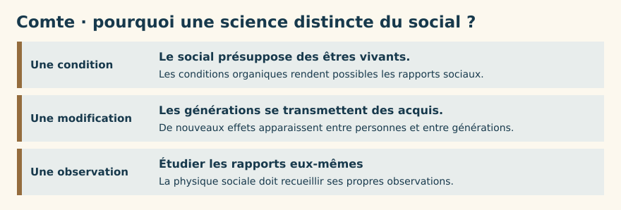
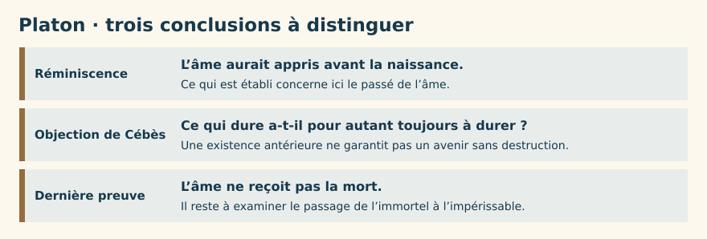

# ENS de Lyon · Séries A/L — Philosophie (oral) 2026 · Corrigé guidé

*Corrigé rédigé par IA, non officiel. Signalez toute erreur.*

**Lecture du rapport du jury** · GPT-6.2 Astra Ultra · vitesse non renseignée

**Rédaction** · GPT-6.2 Astra Ultra · vitesse non renseignée

**Autocontrôle** · GPT-6.2 Astra Ultra · vitesse non renseignée

Le fascicule de la série Sciences humaines réunit deux épreuves. Pour l’explication de texte, il présente 16 paires de passages de Comte puis 14 paires du *Phédon*. Pour l’exposé, il donne 30 paires de questions sur l’histoire et l’existence. Dans chaque section les numéros reprennent l’ordre de la feuille, deux numéros successifs formant une paire (1–2, 3–4, etc.). Les réponses couvrent les deux possibilités de chaque paire. Elles proposent une argumentation à développer dans les vingt minutes de présentation.

Les pages des textes sont celles indiquées par le jury. Les explications de Comte ont été confrontées aux témoins des premières leçons et de leur avertissement. Le billet p. 41–42 figure sur la feuille, bien que le rapport présente le programme de Comte comme p. 49–206. Pour le *Phédon*, le jury cite la traduction de Monique Dixsaut. Les références entre parenthèses donnent des repères dans la pagination de référence dite de Stephanus. La traduction de Léon Robin a servi de texte de comparaison.

## Choisir entre deux passages

Le rapport de l’explication précise le dispositif. L’enveloppe contient deux passages tirés de la même œuvre. Après une heure de préparation, l’échange comporte vingt minutes d’explication et dix minutes d’entretien. Les deux passages de chaque enveloppe se suivent ici. Choisissez en fonction de l’argument que vous êtes capable de reconstruire dans les limites imprimées. Une œuvre familière peut donner un billet difficile précisément parce que son extrait commence après la formule la plus célèbre ou s’arrête avant elle.

**Chez Comte.** Relevez le problème local avant de réciter la loi des trois états. Sur la feuille, les passages 3 et 17 illustrent à quel point des problèmes voisins exigent deux débuts différents. Dans le premier, il s’agit d’expliquer comment un être de faible puissance intervient efficacement sur des phénomènes. Dans le second, il s’agit d’identifier le travail intellectuel intermédiaire entre le savant et le praticien. Le premier mène à la prévision, le second aux ingénieurs. Devant le billet 13, découpez le propos en trois opérations, relever les conditions organiques, identifier un ordre de phénomènes sociaux et en tirer l’exigence d’observations spécifiques. L’action des générations successives est l’exemple qui empêche la deuxième étape de se confondre avec la première.

**Chez Platon.** Notez le nom de celui qui parle, la proposition déjà admise et celle qu’il s’agit maintenant de faire admettre. Dans le billet 6, Cébès vient soumettre à la discussion une objection que Socrate se charge de reformuler. Dans le billet 19, c’est Simmias qui consent à une démonstration portant sur la préexistence. Il reste alors une autre personne à convaincre et une autre conclusion à établir. Confondre ces moments ferait disparaître le travail de la discussion. Quand vous proposez un autre exemple, restituez ensuite l’exemple du texte et expliquez ce qu’il apporte que le vôtre n’apportait pas.

### Préparer la reprise d’une objection

- **Comte, billets 6 et 26.** Pourquoi l’ordre de l’invention peut-il redevenir le bon ordre d’apprentissage pour un résultat récent ? Le travail qui permettrait de réorganiser l’ensemble n’a pas encore eu lieu. La portée d’une règle didactique dépend donc de l’état historique du savoir.
- **Comte, billets 11 et 13.** Ce dont une science dépend doit-il fournir toute la matière de son explication ? Non. Les conditions de vie individuelle sont nécessaires à l’existence de rapports sociaux. Elles ne décrivent pas à elles seules les effets des relations entre générations.
- **Platon, billets 2 et 12.** Qu’arrive-t-il à l’hypothèse de l’harmonie si l’on suspend l’argument de la réminiscence ? La contradiction entre les deux thèses ne suffit plus à écarter la première. Il faut alors examiner ce qu’une harmonie, par définition dépendante des éléments composés, pourrait faire ou subir.
- **Platon, billets 6 et 4.** Pourquoi une durée très longue ne suffit-elle pas, et pourquoi le fait de ne pas devenir mort ne suffit-il pas immédiatement non plus ? Le premier raisonnement confond durée et impossibilité de périr. Le second doit exclure une disparition du porteur au moment où le contraire s’approche. La dernière prémisse ne répète pas simplement l’affirmation initiale.

## Choisir entre deux questions d’exposé

Pour l’exposé, le jury indique vingt minutes de présentation dans une épreuve de trente minutes. Les paragraphes proposés plus loin donnent des réponses argumentées que l’on peut développer à l’oral. Même lorsque deux questions voisines comportent le même nom, changez l’opération que vous entreprenez. Dans « Les événements historiques », il faut donner un critère pour distinguer un événement de tout ce qui se produit. Dans « Qu’est-ce qu’un fait en histoire ? », la différence entre une trace et une proposition établie importe davantage. Un exemple ne vaut qu’une fois déterminé le problème auquel il doit répondre.

- **Repartir d’un cas.** Pour comparer histoire et mémoire, faites décrire un souvenir familial et l’entrée correspondante d’un registre. Une divergence peut d’abord tenir à ce que les deux documents ne concernent pas exactement le même événement. Cette vérification vient avant tout procès en infidélité de la mémoire.
- **Faire varier une condition.** Pour discuter la vie sociale et la liberté, comparez deux personnes auxquelles la même règle permet de demander un recours. Si l’une n’a ni le temps, ni la langue, ni l’information nécessaires pour l’exercer, le droit commun et ses conditions réelles ne se confondent plus.
- **Éprouver une inférence.** Pour la question des preuves d’existence, proposez un exemple de concept cohérent dont rien n’atteste la réalisation. Demandez ensuite pourquoi une preuve mathématique d’existence peut pourtant être concluante. Le problème cesse d’être une querelle sur un mot et devient une enquête sur les critères de preuve.
- **Répondre à une difficulté précise.** Lorsque vous évoquez les limites d’une thèse, dites quelle affirmation subsiste. Qu’un récit soit construit ne rend pas les documents interchangeables. Que la liberté soit située ne permet pas de prédire tout choix singulier. Que des gens aient subi un même événement ne suffit pas à constituer un groupe capable d’agir.

Une reprise peut aussi porter sur les bornes de ce qu’on vient d’établir. À « L’histoire a-t-elle une fin ? », indiquer les fins que poursuivent les acteurs montre qu’il y a des buts dans l’histoire. Cette première réponse ne tranche pas la question d’un but de l’histoire tout entière. En formulant vous-même cet écart, vous donnez à l’échange une difficulté sur laquelle on peut réellement avancer.

## Comte · Auguste Comte, Cours de philosophie positive

### 1. P. 51–53. Entrer dans une philosophie par son histoire

Comte demande comment définir une manière de penser qui n’a pas toujours existé. Il propose de la situer dans la succession des formes de l’intelligence. La loi des trois états est présentée comme une découverte susceptible de deux sortes d’appui, une raison tirée de l’organisation humaine et une vérification dans le passé. Il faut entendre que chaque branche suit cette succession, ce qui n’implique pas que toutes franchissent les mêmes seuils au même moment. Les trois méthodes proposent des systèmes explicatifs incompatibles en leur principe. La dernière phrase leur attribue pourtant des fonctions solidaires dans une histoire, commencement nécessaire, transition, état final. Ce que la suite devra justifier est cette nécessité, plus exigeante qu’une simple chronologie.

### 2. P. 176–177. De l’échelle des sciences au plan du cours

Qu’est-ce qui autorise un ordre d’enseignement à prétendre être autre chose qu’une commodité ? Comte rapporte les cinq sciences énumérées ici aux propriétés relatives des phénomènes qu’elles prennent pour objets. De l’astronomie à la physique sociale, on va des rapports les plus généraux à des phénomènes de plus en plus complexes, particuliers et dépendants. Une relation de condition ne signifie pas que la discipline supérieure se réduise à celle qui la précède. Elle explique pourquoi il sera raisonnable de l’aborder après elle. La dernière étape est un engagement méthodologique. L’échelle esquissée globalement sera reprise depuis chaque science particulière. La solidité qu’on lui prête doit se manifester dans ces études successives.

### 3. P. 126–127. Prévoir pour modifier

Le passage accorde sa place à l’utilité de la science à l’échelle de l’ensemble du travail humain. Comment des êtres dont les moyens immédiats sont limités peuvent-ils agir efficacement ? Ils repèrent une relation régulière, prévoient les effets d’une modification des circonstances, puis introduisent un changement qui oriente le résultat. Un faible moyen peut donc avoir un grand effet sans suspendre les lois de la nature. La chaîne qui conduit de la science à l’action comprend ce terme indispensable de prévision. Dans la formule finale, l’« art » désigne largement les pratiques d’intervention. La concession initiale ne prouve pas que chaque recherche doive être jugée selon son rendement immédiat.

### 4. P. 197–199. Enseigner la méthode par son exercice

Comte conteste qu’on puisse apprendre à observer et à former des lois en abordant d’emblée les objets les plus compliqués. Le cas des jeunes physiologistes donne une cible précise à l’argument. Leur enseignement antérieur, privilégiant les langues anciennes, ne les a guère exercés à la physique et à la chimie. Ce qui leur manque dépasse un stock de résultats, car ils n’ont pas éprouvé le travail grâce auquel ces résultats ont été établis. La critique porte ensuite sur les réformateurs de la science sociale. Réclamer une méthode positive ne la fait pas exister dans leurs recherches. Ils doivent en avoir vu les exigences à l’œuvre dans les sciences antérieures. Ainsi la réforme éducative devient une condition de la réforme intellectuelle et sociale.

### 5. P. 41–42. Comment définir le titre du cours ?

Le passage relève de l’avertissement où Comte explique son titre. La constance d’un usage peut, selon lui, faire davantage qu’une formule isolée pour définir une notion. « Philosophie positive » reçoit sa détermination dans le travail auquel ce nom s’applique. La première leçon déploie cette définition en situant historiquement la méthode et en montrant le genre de problèmes qu’elle permet de résoudre. La difficulté est réelle pour un lecteur qui commence le cours et voudrait d’abord savoir à quoi s’en tenir. Il faut donc distinguer l’indication préliminaire donnée par le titre et l’intelligence exacte que l’œuvre rend possible. Les témoins de lecture séparent ensuite le développement consacré au mot « philosophie » dans un nouvel alinéa.

### 6. P. 145–146. Deux ordres possibles d’exposition

L’ordre historique reproduit la succession effective des découvertes. L’ordre que Comte appelle dogmatique refait le système à partir de ce qu’un esprit formé peut en comprendre aujourd’hui. Le terme ne désigne pas une obligation de croire sans preuve. Il désigne un rapport logique entre des connaissances rendues disponibles par l’histoire. Lorsque les découvertes sont encore peu nombreuses, suivre les ouvrages qui les ont apportées est praticable. Plus la science croît, plus cette traversée s’allonge et plus une reconstruction rationnelle devient possible. Le progrès qui rend la première exposition difficile fournit ainsi les ressources de la seconde. À l’endroit de la coupure finale, les éditions de comparaison impriment le comparatif « plus direct » que la feuille abrège.

### 7. P. 53–55. Trois réponses à la question d’expliquer

Le premier état cherche les causes premières et les fins en invoquant des agents surnaturels. Le deuxième conserve la recherche des causes intimes, mais substitue aux agents des entités abstraites supposées productrices. Changer de vocabulaire peut donc laisser intacte une manière de poser le problème. La rupture positive concerne l’objet de l’explication. L’observation avec le raisonnement dégagent des relations constantes, de succession ou de similitude, qui rapportent des faits particuliers à des faits plus généraux. L’ambition de coordonner les faits peut grandir au moment même où l’on renonce à une connaissance absolue. La dernière précision sur la diminution du nombre de faits généraux éclaire cette nouvelle sorte d’économie explicative.

### 8. P. 178–179. L’usage des savants comme épreuve de la classification

L’échelle encyclopédique doit rencontrer les distinctions que la pratique scientifique a effectivement dégagées. Le travail séparé des chercheurs apporte un indice parce que des besoins durables ont orienté leur division, souvent sans plan d’ensemble. Mais alors quel travail reste-t-il au philosophe ? L’objection est précisément celle à laquelle répond le dernier mouvement. Une coordination implicitement pratiquée n’est pas encore une conception raisonnée des dépendances. Elle peut donc être enfreinte jusque par ceux qui l’emploient ordinairement. La classification rend intelligible et discutable une expérience collective qui en était la condition. L’accord avec la pratique sert de contrôle sans dispenser de l’explication.

### 9. P. 111–112. La crise politique comme désaccord des intelligences

La formule sur le gouvernement du monde par les idées prend un sens précis dans le diagnostic de Comte. Les institutions ne se stabilisent pas durablement si les personnes qui doivent les faire vivre ne partagent aucune maxime fondamentale. Une réforme politique peut alors jouer le rôle d’un palliatif en conservant intacte la cause intellectuelle du désordre. Le passage ne prouve pas isolément cette priorité, qu’il tient déjà pour acquise auprès de ses lecteurs. Il en tire une orientation pratique. Ceux qui souhaitent un ordre durable doivent travailler aux principes d’une doctrine commune. On peut interroger à l’entretien le degré d’accord que requiert réellement une société sans substituer cette objection à l’explication de son raisonnement.

### 10. P. 58–60. Pourquoi l’observation a déjà besoin de théorie

Comte passe d’une confirmation historique de la loi des trois états à une nécessité liée aux opérations mêmes de l’intelligence. La maxime empiriste selon laquelle une connaissance réelle doit reposer sur les faits vaut pour la science déjà formée. En explique-t-elle la naissance ? Pour observer efficacement il faut remarquer certaines choses, les retenir et les coordonner. Une accumulation d’impressions sans principe préalable ne remplirait aucune de ces fonctions. Se précise ainsi un problème d’origine. Une théorie positive présuppose des observations, mais la pratique de l’observation présuppose une théorie quelconque. Le changement de qualificatif est déterminant, car il permet de comprendre à quoi a pu servir une théorie initiale qui ne satisfaisait pas encore aux exigences de la science.

### 11. P. 159–161. Distinguer l’organique sans supposer deux essences

La séparation entre corps inorganiques et corps organisés pourrait ressembler à une thèse sur deux sortes de substances. Comte déplace la question vers ce qu’une étude doit prendre en compte. Les phénomènes mécaniques et chimiques s’observent dans les vivants aussi. L’organisation y ajoute des conditions dont il faut étudier les effets. Cette asymétrie explique à la fois que l’étude du vivant présuppose des connaissances sur les corps inorganiques et qu’elle mérite une enquête distincte. Introduire un principe intime et inaccessible pour garantir la distinction serait contraire à la méthode qui l’établit. La division est donc justifiée par les conditions de l’explication des phénomènes, sans prétendre décider de ce que les choses sont en elles-mêmes.

### 12. P. 106–107. Des problèmes que la spécialisation laisse entre deux sciences

La philosophie des sciences a une utilité pour les disciplines elles-mêmes. Comte qualifie leurs frontières d’artificielles et récuse cependant l’idée qu’elles seraient arbitraires. La division permet de mieux résoudre les difficultés réelles d’un même monde. Elle devient un obstacle lorsque la solution exige un rapport que deux spécialistes, absorbés par leurs problèmes ordinaires, n’ont pas de raison d’étudier. La géométrie analytique de Descartes fait comprendre le bénéfice recherché. On relie des relations géométriques à des équations et l’on peut reformuler des difficultés de figure dans une autre pratique de raisonnement. La conclusion est une question rhétorique qui rapporte un progrès interne aux mathématiques à la rencontre de deux investigations antérieurement séparées.

### 13. P. 170–174. Le social dépend du vivant et demande ses observations propres

Comte relève chez les vivants des phénomènes individuels et des phénomènes concernant l’espèce. Lorsque des humains agissent les uns sur les autres, l’action de chaque génération sur la suivante complique encore le rapport. Les lois de la vie individuelle restent des conditions de la vie sociale. En déduire qu’une connaissance parfaite du corps de chaque individu donnerait toute la science du social manquerait pourtant ce qui se produit entre eux. La transmission des acquis, par exemple, change les conditions d’action de nouveaux individus. L’explication s’achève sur une exigence de méthode. La physique sociale doit se donner des observations propres tout en tenant compte de sa dépendance. Le billet va jusqu’à ce second rappel de la physiologie proprement dite.

### 14. P. 120. Pourquoi les classements des connaissances ont échoué

Au seuil d’une nouvelle classification, Comte doit expliquer ce qui justifie qu’on reprenne une question discréditée par les essais antérieurs. Il examine le principe souvent employé, distribuer les savoirs suivant les facultés de l’esprit. Or une science concrète réclame simultanément plusieurs facultés. Une différence psychologique, fût-elle réelle, ne suffit donc pas à rendre compte des divisions entre sciences. La suite constate la multiplicité des classements et les vices relevés dans chacun. L’échec ne prouve pas que toute classification soit impossible. Il explique la prévention à laquelle le projet se heurte et donne une raison de chercher un fondement du côté des rapports entre phénomènes.

### 15. P. 74–75. Une loi d’évolution, des vitesses différentes

Si toute branche du savoir passe par trois états, pourrait-on descendre d’une époque à l’autre en attribuant à toute l’humanité une seule façon de penser ? Comte écarte la simultanéité de ces passages. Une classification doit compléter la loi historique pour expliquer pourquoi les phénomènes deviennent objets de science dans un ordre déterminé. La généralité, la simplicité et l’indépendance relative ne sont pas synonymes, même si elles orientent ici la même série. L’astronomie vient en tête, puis les diverses sciences dont les phénomènes comportent des conditions supplémentaires. L’inégale progression des sciences ne réfute donc pas la loi proposée. Elle formule le problème auquel la leçon suivante devra répondre.

### 16. P. 112–113. Le conflit des doctrines et la doctrine qui pourrait prévaloir

Comte applique la loi des trois états à une conjoncture historique particulière. L’instabilité présente ne signifie pas que les sociétés soient dépourvues d’idées. Elles en ont de trop incompatibles pour organiser durablement la vie en commun. Dans l’hypothèse avancée, une philosophie théologique, métaphysique ou positive entièrement dominante rendrait un ordre déterminé possible. C’est la coexistence conflictuelle qu’il faut expliquer. Pour sortir de l’impasse, Comte compare ensuite le mouvement des méthodes. Le progrès continu de la positive et le recul des deux autres doivent orienter l’engagement individuel, indépendamment des préférences antérieures. Cette dernière transition du constat historique à la consigne pratique constitue l’enjeu du passage.

### 17. P. 134–135. Le travail entre théorie et pratique

Il ne suffit pas d’aligner un résultat de science et un geste de métier pour rendre compte d’une application. Comte observe l’apparition d’une fonction intermédiaire, celle des ingénieurs. Leur objet est de tirer d’un état déterminé des connaissances des conséquences pour des opérations industrielles. Cela suppose des élaborations propres, orientées vers des fins réalisables et susceptibles d’organiser l’action de plusieurs métiers. Comte distingue la tendance qu’il croit discerner et son état effectif. Des doctrines intermédiaires existent à l’état d’éléments dans les domaines avancés. Il serait donc prématuré de les présenter en système achevé. L’extrait fait comprendre ce qui justifie de les reconnaître et ce qui empêche encore le cours d’en donner une classification entière.

### 18. P. 87–88. Deux buts qui s’appuient l’un sur l’autre

Le cours veut compléter la philosophie positive par l’étude des phénomènes sociaux et articuler les méthodes et résultats des sciences déjà développées. Ces deux objectifs pourraient sembler concurrents. Or la synthèse générale resterait inachevée si les phénomènes qui intéressent le plus directement l’humanité y échappaient. En sens inverse, une physique sociale ne saurait se constituer par décret. Elle a besoin de connaître des conditions étudiées par d’autres sciences et de s’instruire de méthodes déjà mises à l’épreuve. La dernière remarque invite à reconsidérer l’intérêt pratique apparent de chaque discipline. Une science éloignée des préoccupations immédiates peut compter de façon décisive comme base des autres ou comme lieu d’apprentissage d’une méthode.

### 19. P. 91–92. Une spécialité chargée des généralités

Le remède à un excès de spécialisation pourrait sembler consister à demander à chacun de tout étudier. Comte propose une solution d’organisation plus précise. Une catégorie de chercheurs prendra pour objet les méthodes, les relations et les résultats généraux des différentes sciences. Cela fait une spécialité supplémentaire. La difficulté est de la maintenir au contact du travail réel des chercheurs. Une formation d’ensemble permettra aux spécialistes d’utiliser les rapprochements proposés et, en sens inverse, d’en rectifier les erreurs depuis leur propre domaine. Cet échange final est une condition de la solution. Sans lui, la culture des généralités pourrait devenir un discours détaché des problèmes qui justifient son existence.

### 20. P. 125–126. Pourquoi le cours privilégie les connaissances théoriques

Comte part d’une division des travaux entre action et spéculation. Il en dérive une distinction entre savoirs pratiques et théoriques, puis limite le propos de son propre cours. Le but est de rechercher les conceptions fondamentales relatives aux grandes classes de phénomènes, celles qui fournissent la base d’autres combinaisons sans emprunter leur principe à une application particulière. Une application peut intervenir pour éclaircir une théorie, sans donner pour autant son ordre au cours. Le rapport à Bacon sert à situer cette entreprise. Comte reconnaît, avec une réserve explicite, dans l’idée d’une philosophie première extraite des sciences une intuition dont il entend écarter certaines lectures métaphysiques.

### 21. P. 152–154. Ce qu’une exception peut réfuter dans un classement

L’astronomie doit précéder la physique dans l’échelle de Comte. Mais pour faire une astronomie complète, y compris une étude adéquate de l’observation, il faut de l’optique. Le cas oblige-t-il à abandonner tout le classement ? Comte propose un critère. Un emprunt ultérieur touchant des notions particulières est inévitable, tandis qu’une dépendance affectant les conceptions caractéristiques d’une discipline contredirait le rang qu’on lui assigne. L’ordre rationnel ne prétend donc pas reproduire intégralement l’histoire ni supprimer toutes les relations croisées. La limite finale tient à la nature artificielle de la division du travail. Le problème est de la construire de façon instructive, sans la prendre pour une juxtaposition absolue de domaines clos.

### 22. P. 68–70. Quel sens garder au mot « expliquer » ?

La délimitation des connaissances positives pourrait donner à croire que la science se contente d’enregistrer des faits successifs. Comte lui assigne en réalité un programme exigeant. Déterminer les lois d’un phénomène suppose d’analyser exactement ses circonstances et de relier ses relations régulières à un ensemble aussi cohérent que possible. Ce à quoi l’enquête renonce est la prétention d’atteindre une cause première, finale ou génératrice qui rendrait compte de la possibilité de ces relations elles-mêmes. Ajouter une entité censée produire le phénomène reculerait la difficulté. La dernière distinction permet ainsi de voir pourquoi l’explication par une loi peut atteindre son but sans apporter de réponse à toute question qu’on peut formuler grammaticalement.

### 23. P. 193–194. Une seule méthode à travers ses modifications

L’échelle encyclopédique ordonne des contenus, mais son intérêt éducatif porte aussi sur la méthode. Si les phénomènes effectivement homogènes sont étudiés ensemble et les phénomènes hétérogènes dans des sciences distinctes, parcourir leur série donne accès aux différentes façons dont la méthode positive se réalise. On ne peut apprendre ces variations en récitant un protocole général. Les exigences de l’observation se modifient avec les objets et la complexité de leurs rapports. La dernière phrase énonce une condition de validité. Une classification arbitraire aurait pu masquer des différences méthodiques ou en créer d’illusoires. La prétention de former complètement l’esprit dépend donc de ce que l’ordre rend réellement visible.

### 24. P. 60–62. Comment sortir du cercle des théories et des observations ?

Pour constituer une théorie empirique, il faut des observations. Pour commencer à observer, il faut déjà des idées qui rendent certains phénomènes dignes d’attention. Comte situe dans cette double nécessité le rôle initial de la théologie. Elle fournit des conceptions spontanément disponibles et répond aux premières questions sur l’origine et la fin des choses. L’immensité même de ces ambitions a un effet d’entraînement. Une appréciation lucide des limites de la connaissance suppose déjà des expériences que l’humanité n’avait pas encore. L’exagération des premières prétentions a donc pu servir le développement de capacités dont l’exercice permettrait ensuite d’en mesurer la portée. Ce raisonnement explique une fonction historique sans établir la vérité de ces premières réponses.

### 25. P. 97–100. Qui regarde l’image ou le raisonnement ?

Expliquer la vision en disant qu’une image se forme dans l’œil laisse à expliquer ce qui la verrait comme image. La comparaison conduit Comte à interroger l’idée d’un spectateur intérieur de nos opérations de pensée. Le cas des passions donne lieu à une concession historiquement située. Comte invoque une différence d’organes pour admettre quelque observation de soi tout en soulignant que la passion la plus vive rend bien difficile une attention détachée. Dans le cas du raisonnement en cours, la difficulté devient, selon lui, une impossibilité. Le même esprit devrait à la fois produire l’opération et se diviser pour la regarder. La cible est cette observation directe simultanée. Reconstituer après coup une démonstration écrite pose un problème différent.

### 26. P. 146–147. Une vie d’élève face à des siècles d’invention

La disproportion de temps est ici l’argument initial. Une personne doit apprendre en quelques années ce que de nombreuses générations ont établi à travers de longs détours. Même s’il est plus facile d’apprendre que d’inventer, une répétition fidèle de tous les intermédiaires empêcherait d’atteindre ce but. L’ordre dogmatique recompose les dépendances des résultats pour les rendre plus directement intelligibles. La nuance finale est importante. Cette recomposition demande elle-même du temps et du travail, de sorte que les découvertes les plus récentes s’apprennent encore souvent dans leur ordre de production. Le mode historique conserve ainsi localement sa valeur, précisément là où son principal inconvénient, la trop longue accumulation des détours, ne se présente pas encore.

### 27. P. 64–65. La valeur historique d’une espérance illusoire

L’attente de confirmer une loi suffit à soutenir des recherches chez des savants déjà formés. Comte demande d’où serait venue la même persévérance au début de l’astronomie ou de la chimie. Les attentes de l’astrologue ou de l’alchimiste ont pu inciter à accumuler observations et expériences avant que l’établissement d’une loi devienne par lui-même une fin attractive. Il faut donc distinguer la valeur de vérité d’un but poursuivi et l’usage ultérieur des résultats obtenus en le poursuivant. Kepler et Berthollet sont nommés comme témoins d’une dette historique dans deux disciplines. Le passage demande un effort d’imagination historique, car notre capacité à reconnaître une ancienne chimère tend à en rendre la fonction initiale difficile à comprendre.

### 28. P. 149–152. L’ordre historique d’un manuel peut manquer l’histoire réelle

On prétend suivre l’histoire en retraçant chronologiquement les découvertes internes d’une science. Or aucune science ne s’est effectivement développée dans cet isolement. L’objection renverse la supériorité historique qu’on prêtait à cette présentation. Comte n’en conclut pas que l’histoire serait accessoire. Elle devient intelligible quand on connaît déjà les problèmes scientifiques et lorsqu’on rattache les transformations de chaque discipline aux autres et au développement social. Il réserve donc à une autre partie du cours une histoire des sciences incluse dans l’histoire générale des sociétés. Dans l’étude propre d’une science, une remarque historique incidente demeure possible, pourvu qu’on ne confonde pas son rôle et celui de l’exposition rationnelle des résultats.

### 29. P. 114–115. Une doctrine homogène peut-elle admettre plusieurs lois ?

Comte s’explique sur l’ambition d’ensemble de son cours. Réunir les connaissances dans une doctrine homogène pourrait ressembler aux systèmes qui prétendent déduire tous les phénomènes d’un fait unique. La démarche positive recherche une coordination de méthodes et de lois effectivement établies. Elle n’est donc pas tenue de présupposer une réduction universelle. Le passage avance plusieurs réserves distinctes. Notre capacité à atteindre une loi unique est douteuse, le bénéfice théorique qu’on en espère est peut-être exagéré, et l’état présent des recherches rend de toute façon une pareille tentative prématurée. Même si la possibilité métaphysique restait indécidable, la dernière raison suffirait à orienter raisonnablement le travail actuel.

### 30. P. 89. La division du travail comme résultat du développement

Au commencement, l’ensemble des connaissances est assez restreint pour qu’une même personne puisse cultiver des objets que les modernes sépareraient. À mesure qu’un domaine croît, il devient capable de soutenir l’activité durable de chercheurs qui s’y consacrent. Sa séparation est donc à la fois le signe de son développement et l’une des conditions de nouveaux progrès. L’universalité ancienne de la recherche personnelle n’est pas un modèle directement transposable à une situation où la masse des problèmes a changé. Comte attribue à la division du travail une place constitutive dans la philosophie positive. Ce qu’il établit ici est son efficacité, avant la question des moyens d’en corriger les effets d’isolement.

### 31. P. 70–72. En quel sens la gravitation explique-t-elle ?

La gravitation rapproche les mouvements célestes et la pesanteur que nous éprouvons à la surface de la Terre. La réussite vient de ce que des classes d’événements auparavant séparées peuvent être rapportées à une loi commune. Elle ne dépend nullement d’une connaissance intime de ce qu’est l’attraction. La pesanteur nous est familière, et cette familiarité peut donner à tort l’impression que nous en connaissons le principe générateur. Comte développe la critique à propos des explications par impulsion, qui reporteraient simplement la même difficulté sur un autre phénomène. Le gain est pourtant bien réel, car identifier l’unité d’une relation transforme les prévisions et l’intelligence que nous avons des faits, même si leur nature ultime demeure inaccessible.

### 32. P. 185–186. Une proposition précise peut être certainement fausse

Les sciences les plus complexes donnent parfois des résultats moins précis. Sont-elles pour cette raison moins certaines ? Comte distingue deux dimensions logiques à l’aide de contre-exemples. Une égalité numérique très précise peut être absurde, comme attribuer trois angles droits à la somme des angles d’un triangle dans le cadre géométrique envisagé. Une affirmation sûre sur la mortalité humaine peut en revanche laisser indéterminée la date de la mort. La précision concerne le degré de détermination d’un énoncé, la certitude concerne sa justification. Il faut dès lors juger une discipline par les liens de ses propositions à des faits contrôlés et distinguer les conjectures de ses résultats établis. Une précision moindre n’autorise pas à décourager l’étude des objets complexes.

## Platon · Phédon

### 1. P. 218–219. Purifier et séparer (67c–68a)

Socrate demande à Simmias ce que signifie une purification de l’âme. Il la décrit par un exercice de l’attention qui rassemble l’âme en elle-même au lieu de la laisser dispersée dans les sollicitations du corps. Si la mort désigne la séparation du corps et de l’âme, il paraît incohérent, dans l’argument de Socrate, de tenir toute recherche philosophique pour un exercice de séparation et de s’irriter lorsque survient le terme de sa vie. La comparaison finale avec l’espoir de retrouver des êtres aimés porte sur la cohérence d’un attachement. Elle éclaire l’attitude de Socrate devant la condamnation déjà prononcée. La purification est ici la discipline du jugement dans la vie présente. L’existence séparée de l’âme reste à examiner dans le dialogue.

### 2. P. 264–265. Une harmonie peut-elle précéder l’instrument ? (92a–c)

Simmias tient l’âme pour une harmonie résultant des tensions de ses éléments corporels. Socrate rappelle un autre résultat auquel son interlocuteur a donné son assentiment, la préexistence de l’âme impliquée par la réminiscence. Il ne juxtapose pas simplement deux opinions sur la même chose. Il en compare les conditions temporelles. Une harmonie suppose les éléments et l’agencement dont elle résulte. Elle ne peut être déjà là avant eux. Si l’âme préexiste à l’organisation corporelle, elle ne peut donc être une harmonie en ce sens. La forme dialoguée rend la contradiction précise, car le même interlocuteur adhère aux deux propositions. L’étape suivante demandera à Simmias laquelle il entend conserver.

### 3. P. 231–232. Les égaux et l’Égal (74a–d)

Partir d’un objet ressemblant pour se souvenir d’un autre engage une opération de comparaison. La ressemblance peut être imparfaite. Socrate demande alors si deux morceaux de bois ou deux pierres qui paraissent égaux se confondent avec l’Égal lui-même. Les choses sensibles peuvent paraître égales sous un rapport, inégales sous un autre. L’Égal lui-même, en revanche, n’apparaît pas comme son contraire. C’est donc à partir de réalités différentes de l’Égal que nous en avons conçu l’idée. La conclusion réemploie la définition de la réminiscence, une perception fait penser à autre chose, que la relation soit ressemblance ou dissemblance. Le texte ne déclare pas les sens inutiles. Il demande ce qui permet de juger ce qu’ils présentent.

### 4. P. 290–291. De l’immortel à l’impérissable (106a–e)

La difficulté porte sur une inférence. Si une chose n’admet pas un prédicat contraire, s’ensuit-il qu’elle ne puisse disparaître ? Un nombre impair ne devient pas pair, ce qui ne démontre pas, par cette seule opposition, que son porteur doive toujours subsister. Appliquée à l’âme, l’analogie établit qu’elle n’accueille pas la mort comme propriété, mais elle laisse encore ouverte la possibilité qu’elle se retire en périssant. Le texte exige donc une prémisse supplémentaire. Cébès accorde que ce qui est proprement immortel est aussi impérissable et invoque à ce propos l’accord attaché notamment au divin et à la vie elle-même. Il faut faire entendre ce point d’accord et sa fonction. Sans lui, le résultat antérieur sur la non-mortalité ne suffirait pas à clore la démonstration.

### 5. P. 229–230. Qu’est-ce que se ressouvenir ? (73b–d)

Simmias n’objecte pas simplement que la réminiscence serait fausse. Il demande à Socrate de lui faire comprendre le type d’acte dont il est question. Une première condition s’impose, on ne se ressouvient que de ce qu’on a connu. La seconde introduit une différence d’objet. À la vue d’une lyre ou d’un vêtement, une personne qui aime reconnaît la chose présente et pense aussi à la personne qui en fait usage. Connaître la lyre et connaître quelqu’un ne sont pas une seule et même connaissance. L’exemple ordinaire isole donc un rapport que le raisonnement pourra transposer. Dans les limites de ce billet, ces cas reconnaissables établissent la structure du ressouvenir. Ils ne démontrent pas encore à eux seuls tout le propos sur les Formes.

### 6. P. 270–271. Quelle objection reste-t-il à examiner ? (95a–e)

Après la réponse à Simmias, Socrate calme l’enthousiasme de son interlocuteur et redonne toute sa force à l’objection de Cébès. Avoir existé avant ce corps, durer plus longtemps que lui et avoir déjà traversé de nombreux changements ne signifient pas durer sans possibilité de destruction. Une âme très durable pourrait encore rencontrer une ultime disparition. Le passage impose donc un critère plus exigeant à la discussion, rendre raison de l’indestructibilité et ne pas déduire d’un passé, même très long, une persistance sans terme. À la fin, Socrate demande à Cébès de corriger la reformulation. Cette invitation illustre le travail de l’entretien lui-même, exposer la difficulté adverse de telle sorte que celui qui l’a soulevée puisse la reconnaître.

### 7. P. 228–229. Des vivants issus des morts à la réminiscence (72c–73b)

La fin de l’argument des contraires met à l’épreuve une hypothèse asymétrique. Si le vivant provenait d’autre chose que du mort alors que les vivants aboutissent à la mort, comment éviter que la série n’aboutisse finalement à un état uniforme ? Socrate y oppose l’existence d’un mouvement réciproque. Cébès apporte ensuite une autre voie. Si apprendre est se ressouvenir, l’âme doit déjà avoir appris avant sa présente existence corporelle. Le changement de locuteur compte, car le deuxième argument vient corroborer une conclusion par un moyen différent. Cébès invoque la capacité de répondre à des questions bien conduites, notamment devant des figures géométriques. La différence entre posséder des ressources pour répondre et avoir déjà donné une réponse devient l’enjeu du débat.

### 8. P. 244. La durée du corps et l’affinité de l’âme (80c–81a)

Le cadavre lui-même, quoique visible et exposé à la dissolution, peut laisser des restes durables. Socrate s’appuie sur ce fait pour déstabiliser l’image d’une âme qui s’évanouirait nécessairement dès la mort du corps. L’argument fait intervenir une affinité déjà établie entre l’âme et ce qui échappe à la vue. Il reste conditionnel, car l’âme n’entretient pas toujours le même rapport au corps ni aux désirs. Une âme qui s’est habituée à se recueillir en elle-même correspond à la description du philosophe. L’évocation de l’entraînement philosophique ramène ainsi la question de la persistance à une manière de connaître et de vivre. La seule durée de restes corporels ne constitue pas une preuve générale d’immortalité.

### 9. P. 221–222. Avec quelle monnaie acquérir la vertu ? (69a–c)

Socrate examine une conduite qui semble vertueuse, renoncer à un plaisir par désir d’un autre, ou supporter une peur par crainte d’une plus grande. La métaphore de la monnaie rend perceptible l’insuffisance d’un échange entre passions. Leur quantité relative change, mais la règle qui gouverne l’agent reste sa dépendance à leur égard. Une seule monnaie pourrait donner sa justesse à l’échange, la pensée ou sagesse. Le courage et la tempérance méritent alors leur nom en tant qu’ils vont avec elle. L’image des initiations relit ensuite le contraste entre purification et apparence selon le vocabulaire de l’accès à la demeure divine. Il faut expliquer la fonction de cette image dans l’examen de la vertu plutôt que de la prendre pour une preuve indépendante.

### 10. P. 276–277. Cause véritable et condition sans laquelle on ne peut agir (99a–d)

Socrate demeure assis dans sa prison. La présence de ses os et de ses muscles explique comment la position est physiquement possible. Elle ne rend pas raison de la décision de demeurer et de se soumettre au jugement plutôt que de s’en aller. La distinction entre cause et condition permet de préciser ce qui avait déçu Socrate chez ceux qui annonçaient un principe d’intelligence et se contentaient ensuite de conditions matérielles. Le passage élargit cette distinction aux essais d’explication de la Terre. L’attente d’une raison qui rende compte de la meilleure disposition demeure insatisfaite. L’entretien s’arrête sur l’annonce d’une autre manière de rechercher la cause. Sa mise en œuvre détaillée appartient au passage suivant de l’ouvrage.

### 11. P. 233–234. Quel savoir précède la sensation ? (75b–d)

Pour trouver qu’un égal sensible est imparfaitement égal, il faut disposer du terme auquel on le compare. Le passage pousse la conséquence dans le temps. Les sens commencent à fonctionner dès la naissance. Si l’on doit déjà connaître l’Égal pour constater que les choses sensibles lui sont inférieures, cette connaissance doit avoir été acquise auparavant. Simmias accorde les étapes à mesure qu’elles sont formulées. Socrate étend ensuite la conclusion à ce qui est visé par les questions et les réponses portant sur la réalité même du beau, du juste ou du bon. Le découpage s’arrête sur cette extension. L’enjeu est de savoir ce que suppose un jugement comparatif, nullement de décrire empiriquement des souvenirs que le nouveau-né pourrait raconter.

### 12. P. 265–266. Sur quoi repose l’adhésion à une doctrine ? (92c–93a)

Entre l’âme comme harmonie et le savoir comme réminiscence, Simmias choisit la seconde proposition. Il donne aussi la raison de cette préférence. L’idée d’harmonie s’était rendue attirante par sa vraisemblance et par l’analogie de l’instrument. La réminiscence s’appuyait, dans le dialogue, sur l’hypothèse discutée des réalités en elles-mêmes. Le choix entre deux résultats incompatibles doit tenir compte de la différence de leurs titres à être crus. Socrate revient ensuite au sens même d’une composition. L’harmonie, si elle résulte d’éléments accordés, ne peut ni les précéder ni agir par avance sur eux. C’est à cette dépendance que s’arrête le billet. Elle prépare un nouvel examen de ce qui pourrait gouverner le corps.

### 13. P. 213–214. Quelle sorte de vie rend le philosophe méconnaissable ? (64c–65a)

Socrate propose à Simmias de reprendre l’enquête par des questions concrètes. Le philosophe donne-t-il la priorité aux plaisirs de table, aux ornements et aux soins du corps qui dépassent le nécessaire ? Leur examen fait apparaître un ordre des fins. La préoccupation majeure du philosophe est celle de l’âme. Dans cette mesure, il desserre sa dépendance aux satisfactions corporelles. Le jugement de la foule s’éclaire alors. Pour qui tient ces satisfactions pour la substance même d’une vie, celui qui en fait bon marché ressemble à un homme déjà proche de la mort. Cet effet de perspective appartient au raisonnement. Socrate n’a pas identifié le philosophe à un corps inerte ni interdit les soins nécessaires à la vie.

### 14. P. 262–263. Se défier de son désir de convaincre (90e–91b)

Des arguments qui semblaient solides viennent d’être ébranlés. L’erreur serait d’en conclure que les raisonnements sont incapables de vérité. Socrate invite à examiner plutôt notre propre compétence et à travailler à l’améliorer. Il applique aussitôt cette règle à son cas. À l’approche de l’exécution d’une condamnation déjà prononcée, il a intérêt à trouver réconfortante la thèse qu’il soutient. Il pourrait donc chercher à s’imposer comme celui qui a raison au lieu de rechercher ce qui est vrai. Ce retour critique sur ses propres motifs donne un sens précis à sa façon d’entrer de nouveau dans le raisonnement. Il se donne une règle de discussion qui peut aller contre sa préférence immédiate.

### 15. P. 216–217. Les obstacles rencontrés par la recherche de la pensée (66b–e)

Socrate tire les conséquences d’une enquête conduite par l’âme au sujet de ce que les choses sont. Le corps fournit des occasions d’erreur et poursuit des besoins qui distraient l’attention. Le passage élargit cet argument au temps absorbé par les soins, les possessions et les conflits qu’ils suscitent, puis le ramène aux troubles qui peuvent atteindre le philosophe jusque dans la recherche elle-même. La conséquence est formulée dans l’horizon d’une connaissance pure, qui demanderait que l’âme examine par elle-même ce qu’elle cherche. Le texte exprime un espoir relatif à la pensée. Il ne transforme pas cet espoir en une démonstration déjà acquise de la persistance de l’âme ni en consigne d’interrompre la vie.

### 16. P. 232–233. Reconnaître un défaut suppose une mesure (74d–75a)

Le raisonnement déplace la comparaison. On vient de distinguer les objets égaux de l’Égal lui-même. Pour dire à présent que les objets sensibles tendent vers l’Égal sans lui être parfaitement conformes, il faut déjà pouvoir distinguer ce vers quoi ils tendent de la propriété que j’y perçois. Le passage procède d’abord par une règle générale. Juger qu’une chose ressemble imparfaitement à une autre suppose qu’on ait quelque connaissance de cette dernière. Il applique ensuite la règle aux égalités sensibles et à la connaissance de l’Égal. La vue a bien fourni l’occasion du jugement. Elle ne suffit pas à produire, à partir de la seule collection des cas, le critère dont ce jugement exprime la présence.

### 17. P. 235–236. Peut-on tous rendre raison de ce que l’on sait ? (76a–c)

Socrate formule une alternative. Ou bien les connaissances considérées sont depuis toujours présentes comme connaissances effectives, ou bien apprendre revient à reprendre ce qu’on a su auparavant. Simmias hésite à choisir. Socrate déplace la question vers un critère plus accessible, celui qui sait peut-il rendre raison de ce qu’il sait ? Or tous ceux qui usent des choses sensibles ne sont pas capables de rendre compte de l’Égal ou du Beau en eux-mêmes. Dans le cadre de l’argument admis sur le caractère antérieur de leur connaissance, c’est la réminiscence qui doit donc expliquer leur reprise. La conséquence porte sur une existence de l’âme antérieure à son entrée dans la forme humaine. La survie future constitue une question distincte.

### 18. P. 278–279. Une réponse sûre à la question de la cause (100b–d)

Socrate appelle Cébès à admettre, à titre d’hypothèse, la réalité du Beau en soi et de réalités semblables. Il examine alors ce qu’il peut affirmer sans changer de critère chaque fois qu’un bel objet se présente. La couleur, la figure et d’autres qualités sensibles paraissent expliquer la beauté ici, mais échouent à en donner partout la raison. Dire qu’une chose belle l’est par sa participation au Beau garantit une cohérence à la réponse. Socrate laisse expressément ouverte la manière dont se fait cette présence ou cette participation. La modestie et la force de la proposition tiennent au même geste. Elle fixe le type d’explication recherché tout en laissant le mode de relation à examiner.

### 19. P. 236–237. De quelle hypothèse la démonstration dépend-elle ? (76d–77a)

Socrate explicite la solidarité de deux propositions. Si les réalités auxquelles nous rapportons nos comparaisons sensibles existent, et si leur connaissance doit précéder l’usage de nos sens, alors notre âme devait exister auparavant. Si l’on retire cette prémisse, le raisonnement maintenant exposé perd sa force. Simmias déclare que les réalités telles que le Beau ou le Bien lui sont particulièrement assurées. C’est donc à proportion de cet assentiment que la conclusion lui paraît convaincante. Pour commenter la dernière réplique, il faut respecter sa portée dialogique. Un interlocuteur se déclare satisfait sur la préexistence. Socrate demandera ensuite si Cébès est lui aussi convaincu, et la question de l’avenir de l’âme reviendra.

### 20. P. 261–262. Pourquoi la haine des raisonnements est-elle un danger ? (90b–e)

Une série de déceptions peut conduire à ne plus faire confiance à personne. L’expérience de raisonnements défaits peut produire une défiance analogue envers toute argumentation. Le passage précise toutefois une différence avec l’exemple des hommes. La pratique de discours opposés peut donner à celui qui les manie le sentiment de posséder une sagesse supérieure parce qu’il est capable de tout faire osciller. Mais si des raisons solides existent, attribuer sa propre difficulté à l’absence de toute vérité revient à se priver du moyen même de les reconnaître. La réponse pratique consiste à former son jugement et à reprendre l’examen. Ce que Socrate demande de préserver en premier est la possibilité de distinguer un argument réellement solide de celui qui a seulement paru tel.

### 21. P. 212–213. Une défense de Socrate devant d’autres juges (63e–64c)

Socrate se tourne vers ses compagnons comme vers des juges devant lesquels il doit justifier sa confiance à l’approche de la mort. Celui qui a consacré sa vie à philosopher aurait des raisons particulières de ne pas accueillir la condamnation par la colère. La formule sur l’exercice de mourir prend d’abord une forme provocante. Simmias imagine ce qu’en penserait la foule et rit malgré la gravité de l’heure. Elle croirait y reconnaître une confirmation de son hostilité aux philosophes. Or elle ignore encore dans quel sens ils s’y exercent. La décision de poursuivre entre interlocuteurs est donc logiquement nécessaire. Le mot qui paraît compris doit être redéfini. Cette déclaration initiale ouvre un examen et n’en tient pas lieu.

### 22. P. 271–272. Comment la recherche des causes a mis Socrate en difficulté (95e–96c)

Répondre à Cébès exige de considérer les causes de la génération et de la disparition. Socrate passe au récit de son apprentissage. Dans sa jeunesse, l’étude de la nature l’intéressait notamment parce qu’elle promettait d’expliquer comment les êtres croissent, comment naissent des êtres vivants et ce qui rend la pensée possible. Les hypothèses évoquées font intervenir des facteurs corporels divers. Socrate avoue ensuite une conséquence étonnante, il s’est trouvé moins assuré de ce qu’il pensait comprendre auparavant. Il introduit le cas de la croissance humaine comme témoin de cette perte d’assurance. Le découpage s’arrête au problème. Il faut expliquer la fonction du récit dans l’enquête sur la causalité avant d’y importer la réponse platonicienne ultérieure.

### 23. P. 222–223. Une défense de la vie philosophique rencontre une objection (69d–70a)

Socrate vient de rapprocher le philosophe de celui qui accomplit véritablement l’initiation. Il donne aux figures du langage religieux une interprétation qui engage sa propre existence. Il espère avoir cherché à philosopher comme il convenait et s’attend à rencontrer ailleurs des maîtres et des compagnons bons. L’argumentation rejoint ainsi la scène de défense devant ses amis. Cébès reconnaît la force du propos mais distingue ce qu’il laisse en suspens. Quelqu’un pourrait accepter la description de la philosophie tout en craignant que l’âme n’ait plus aucune existence après sa séparation d’avec le corps. La crainte de la dispersion change donc le fardeau de la preuve. Il faut désormais rendre raison de la persistance nécessaire à cet espoir.

### 24. P. 246–247. Une habitude forme une manière d’être (82a–d)

Socrate présente, dans le cadre des destinées de l’âme, un principe de correspondance. Les dispositions acquises dans la vie rendent approprié un certain genre de condition. La vertu ordinaire acquise par la coutume, faite de justice et de mesure dans la vie civique, vaut à ceux qui la pratiquent un sort meilleur que les dispositions prédatrices. Le dialogue établit cependant un degré supplémentaire. La fréquentation de ce qui est divin demande à l’âme une purification philosophique. Cette échelle éclaire le retour final à la conduite présente des philosophes. Leur distance à l’égard de certains plaisirs et ambitions procède d’un rapport à la connaissance, et non de la simple crainte de perdre argent, honneurs ou réputation.

### 25. P. 249–250. Comment le plaisir et la peine accréditent une apparence (83b–84a)

Le passage oppose deux manières pour l’âme de se rapporter à ce qu’elle tient pour vrai, à travers l’intelligible ou sous l’ascendant du visible. L’obstacle principal n’est pas simplement qu’un plaisir détourne momentanément l’attention. Plus une expérience affecte fortement, plus l’âme risque de tenir ce qui a suscité cette émotion pour le plus manifeste et le plus réel. L’image de la fixation ou du clou indique comment se construit une adhésion durable à la perspective du corps. Partager ses jugements et ses plaisirs devient une habitude qui attache l’âme à un genre de vie. La conclusion sur la difficulté de fréquenter le divin s’explique ainsi par une théorie de la croyance, au-delà d’une exhortation générale à la modération.

### 26. P. 282–283. Simmias est grand et petit sans contradiction (102c–103a)

Simmias est plus grand que Socrate et plus petit que Phédon. Un seul individu reçoit ainsi deux dénominations contraires, sous des rapports différents. Il n’en résulte pas que la grandeur, considérée dans ce qui est grand, puisse devenir elle-même petitesse. Socrate précise les termes avec une insistance dont il sourit, car il faut empêcher qu’un changement de prédication soit présenté comme une conversion de la propriété en son contraire. La grandeur dans un individu peut se retirer ou cesser de s’y trouver à l’approche du contraire. Elle ne saurait, tout en demeurant précisément grandeur, accueillir la petitesse. La distinction entre le sujet qui porte des déterminations et la détermination elle-même prépare la suite de la preuve.

### 27. P. 227–228. Que deviendrait un processus sans retour ? (72a–c)

Socrate vient de mettre en rapport les passages entre vivants et morts. Il propose maintenant de tester le refus de la réciprocité. À supposer que tout passage entre contraires se fasse dans un seul sens, les différences dont le devenir a besoin finiraient par disparaître. Si tout s’endormait sans qu’aucun réveil soit possible, l’histoire d’Endymion perdrait sa singularité faute d’êtres éveillés pour la remarquer. Si tout se composait sans jamais se dissocier, on retrouverait rapidement l’état de mélange évoqué à propos d’Anaxagore. Les exemples donnent à voir les conséquences du modèle linéaire. Ils soutiennent une demande de compensation entre devenirs inverses. Ils ne prouvent pas séparément que chaque individu conserverait tous ses souvenirs.

### 28. P. 292–293. Après la démonstration, pourquoi faut-il encore prendre soin de l’âme ? (107a–d)

Simmias reconnaît la force des arguments mais conserve une réserve en raison de la grandeur de la question et des limites de l’intelligence humaine. Socrate accueille cette attitude. Même les hypothèses dont on est satisfait doivent encore être examinées avec précision. La discussion passe ensuite d’une thèse sur la durée de l’âme à son enjeu éthique. Si l’âme est immortelle, le soin qu’on en prend ne concerne pas seulement le temps de la vie actuelle. Ce qu’elle emporte relèverait de son éducation et de sa conduite. Le billet se termine sur cette conséquence, au seuil du récit du voyage dans l’au-delà. Il convient de conserver le conditionnel de l’argument et de distinguer la révision possible de ses prémisses de l’urgence pratique que Socrate en tire.

## Exposé sur une question de philosophie

### 1. L’histoire par en bas

« En bas » désigne une position dans une hiérarchie et un point d’observation. Une histoire de l’école peut prendre pour objet les lois scolaires, puis suivre la manière dont une institutrice, des parents et des enfants se sont saisis d’une obligation. Les deux enquêtes ne racontent déjà plus le même changement. Les absences d’élèves en période de travaux agricoles, par exemple, font apparaître une négociation que le calendrier réglementaire ne suffit pas à décrire. Mais les moins puissants ont laissé moins d’archives écrites et le dossier d’un juge transmet souvent leur parole à travers ses catégories. Écrire par en bas oblige donc à croiser les traces et à expliquer cette médiation. Le gain porte sur la causalité historique elle-même, car la façon dont une mesure est appliquée contribue à déterminer son effet.

### 2. Les hommes font-ils l’histoire ?

Un décret porte des signatures. Une crise économique, elle, peut résulter de décisions dont personne n’a voulu l’effet combiné. Si « faire » signifie former un projet puis le réaliser comme on fabrique un objet, une grande partie du changement historique n’a pas d’auteur. Pourtant ces effets passent par des conduites, et les règles qui les orientent ont elles-mêmes une histoire. Marx, au début du *Dix-huit Brumaire*, joint précisément l’action des hommes et les circonstances transmises par le passé. La tâche est alors de distinguer la décision, les conditions de son efficacité et ses conséquences inattendues. Une histoire faite par des humains peut leur échapper sans devenir l’œuvre d’une puissance cachée.

### 3. L’histoire est-elle une science ?

Deux récits incompatibles sur la date d’un vote ne se valent pas si le registre et des correspondances indépendantes permettent de trancher. La critique de provenance, la confrontation des séries et l’exposition publique des raisons donnent à l’histoire des moyens de corriger ses propositions. Mais l’historien ne reproduit pas 1789 pour isoler une variable. Son objet associe des régularités, des décisions singulières et les significations que les acteurs leur donnaient. Il faut donc examiner la portée de chaque prétention. Une date peut être établie fermement alors que le poids relatif de plusieurs causes reste discutable. La scientificité de l’enquête tient à ces distinctions contrôlables, compatibles avec la pluralité des questions et des récits.

### 4. Histoire individuelle et histoire collective

Lire un carnet de mobilisation fait entrer dans un événement national par l’attente, les séparations et les informations lacunaires d’une personne. Le carnet révèle ce que les statistiques ne peuvent dire. Il peut pourtant être exceptionnel, et son auteur ignore souvent les décisions qui ont fixé son trajet. Le passage du singulier au collectif demande donc des comparaisons. Inversement, une même institution produit des vies différentes selon la position, le lieu et les ressources. Il faut tenir ensemble deux mouvements, situer un parcours dans des conditions partagées et observer ce que ses bifurcations apprennent sur ces conditions. Une biographie devient historique quand ses écarts autant que ses ressemblances peuvent recevoir une explication.

### 5. Se sentir exister

L’expression semble redondante. Comment quelqu’un qui se sent pourrait-il douter qu’il existe ? Pourtant un réveil progressif, la douleur ou le soulagement donnent à l’existence des intensités très différentes. Dans la cinquième *Rêverie*, Rousseau décrit au bord du lac un sentiment d’existence qui persiste lorsque s’apaisent les projets et les comparaisons. La conscience de soi peut donc être une présence sensible sans inventaire de qualités. Elle peut aussi être troublée, et son absence momentanée pendant le sommeil n’abolit pas l’existence du dormeur. Il faut distinguer l’évidence éprouvée à la première personne, sa tonalité et l’existence dont des tiers et un corps continu fournissent également des signes.

### 6. Choisissons-nous notre existence ?

Personne ne choisit d’être né, ni les premières relations dans lesquelles il apprend à nommer ses possibilités. Pourtant décider d’un métier ou tenir un engagement peut donner rétrospectivement une unité à une existence. Entre ces deux affirmations se trouve la situation. Deux élèves peuvent vouloir poursuivre leurs études et disposer de ressources très différentes pour convertir le projet en possibilité réelle. La liberté ne consiste donc ni à sélectionner son point de départ ni à dessiner un avenir qui s’accomplirait de lui-même. Elle s’exerce en reprenant des conditions données, parfois collectivement, pour ouvrir ou fermer des possibilités. Nous choisissons des manières d’exister, avec des effets que nous ne maîtrisons jamais tous.

### 7. Les événements historiques

Tout ce qui arrive dans le temps ne devient pas pour autant un événement historique. La fermeture d’un atelier peut sembler locale, puis devenir le point de départ d’une grève suivie ailleurs. Son importance dépend de ce qu’elle rend possible dans une séquence. Le regard rétrospectif présente toutefois un danger. Savoir la suite conduit à traiter les signes encore ambigus des contemporains comme les annonces d’une issue nécessaire. Définir un événement exige alors trois opérations, établir le changement, reconstituer les attentes qu’il a rompues et préciser son échelle d’effets. Un événement peut avoir été vécu comme décisif avant d’avoir été durable, ou n’avoir acquis de portée que par ses reprises ultérieures.

### 8. Histoire sacrée, histoire sociale

Un jubilé peut être pour les fidèles un moment dans une histoire du salut, et pour l’enquêteur un rassemblement qui mobilise temps, argent, autorités et déplacements. Ce sont deux questions posées au même fait. Si l’on traduit entièrement la première en intérêts sociaux, on perd le sens que les personnes donnent à leurs actes. Si l’on adopte la finalité sacrée comme principe de preuve, on ne peut plus discuter les explications sur un terrain partageable. Une histoire sociale des pratiques religieuses doit donc faire place aux croyances comme raisons d’agir et comme réalités collectives. L’enquête établit ce que fait une attente de salut dans un monde social, tout en laissant ouverte la question théologique de sa vérité.

### 9. Comment s’écrit l’histoire ?

L’écriture commence avant la rédaction, lorsqu’une question fait de certaines traces des documents. Pour expliquer une flambée des prix, une mercuriale fournit une série, une lettre de ménagère un effet vécu, un règlement une tentative d’action. Il reste à vérifier leurs conditions de production et à établir des relations que chacune ignore. Puis l’ordre de l’exposé fait voir certaines relations plutôt que d’autres. Commencer par le règlement invite à raconter une politique, commencer par une file d’attente à en examiner les effets. L’historien répond de ce choix et doit permettre au lecteur de retrouver les preuves et les incertitudes. Une écriture démonstrative admet le récit, à condition que sa continuité ne masque pas les lacunes.

### 10. Les monuments de l’histoire

Un monument transmet une trace et une consigne de mémoire. Un monument aux morts apprend quels noms une municipalité a inscrits, dans quel ordre, à quelle date et au milieu de quels symboles. Il ne suffit pas à établir comment chaque personne a vécu ni ce que tous les habitants pensaient du conflit. Son silence peut lui-même devenir une question, si l’on compare la liste avec d’autres registres avant d’interpréter une omission. Le monument a enfin une histoire après son inauguration, faite de cérémonies, de déplacements ou de nouvelles inscriptions. Il mérite donc une double lecture comme document sur ce qu’il commémore et comme intervention datée qui sélectionne la forme publique du souvenir.

### 11. Les fragilités de l’existence

Le pluriel empêche de confondre trois précarités. Un organisme peut être blessé, une existence matérielle dépendre d’un revenu, et une personne perdre la reconnaissance qui rend sa parole audible. Une même maladie ne produit ainsi pas les mêmes ruptures selon que l’entourage et les institutions assurent ou non la continuité des soins et des ressources. La vulnérabilité n’est pourtant pas uniquement privation. Le fait d’être affecté par autrui rend aussi possibles l’apprentissage et l’attachement. Cette possibilité ne transforme pas toute exposition en bien. Il faut distinguer la finitude constitutive d’une vie et les risques évitables dont une organisation sociale aggrave la distribution. Prendre cette fragilité au sérieux permet alors de préciser sur quoi on peut agir.

### 12. Peut-on dire que les animaux existent ?

Au sens logique, un chien particulier existe tout autant qu’une personne. La question porte donc sur un emploi plus exigeant du verbe, celui d’habiter un milieu suivant des significations, voire de se rapporter à ses propres possibilités. L’étude de la tique par Uexküll montre qu’un animal sélectionne dans son environnement des signaux pertinents à sa manière de vivre. Elle ne permet pas de lui attribuer pour autant une autobiographie consciente. Plutôt que réserver le verbe par décret ou prêter indifféremment à toute espèce les mêmes facultés, il faut distinguer la réalité d’un vivant, son monde propre et les formes de réflexivité que l’observation autorise à lui attribuer.

### 13. Histoire matérielle

Une étude du pain met en relation grains, moulins, combustibles, fours, temps de travail et habitudes alimentaires. Elle rend visibles les conditions de gestes qu’une histoire des idées laisserait à l’arrière-plan. La matière ne parle pourtant pas d’une seule voix. Une hausse du prix du pain peut dépendre d’une mauvaise récolte, d’une réglementation ou des modalités de circulation. Il faut donc articuler l’objet à ses usages, aux rapports sociaux et aux représentations. Ce qu’une famille juge être du « bon pain » peut, à son tour, modifier les produits demandés. L’histoire matérielle gagne en portée lorsqu’elle explique les médiations entre choses et conduites, jusque dans le sens que les acteurs donnent à leurs besoins.

### 14. Téléologie et histoire

Expliquer un événement par la fin à laquelle il aboutit semble lui donner un sens. Mais si l’établissement d’un régime rend nécessaire, après coup, chacune des décisions qui l’ont précédé, l’enquête confond conséquence et cause. Il faut distinguer trois fins. L’acteur peut poursuivre un but présent dans ses délibérations. L’historien connaît une issue que cet acteur ignorait. Le philosophe peut enfin supposer une direction d’ensemble. Seule la première fournit d’emblée un type de cause historique, encore faut-il établir qu’elle a réellement orienté l’action. L’issue connue aide à formuler la question. La direction supposée reste une hypothèse à éprouver au contact des bifurcations et des projets déçus.

### 15. Exister, est-ce exister contre ?

Une protestation peut révéler un sujet jusque-là traité comme un objet. Dire non à une décision prise pour moi fait apparaître ma capacité à juger. Mais si je définis toute mon existence par ce refus, je reste dépendant de ce à quoi je m’oppose. Un enfant apprend sa langue grâce à des personnes avec lesquelles il pourra ensuite être en désaccord. Même la contestation suppose des signes partagés et des soutiens. Il faut donc distinguer l’opposition qui permet une individuation dans certaines conditions de l’ensemble des conditions positives de l’existence. Une autonomie se vérifie aussi lorsque la personne peut formuler un projet dont l’adversaire ne fixe plus seul les termes.

### 16. L’existence est-elle contingente ?

Qu’une chose soit effective n’implique pas immédiatement qu’elle ait dû être. Leibniz distingue les vérités dont la négation implique contradiction et les vérités de fait, qui appellent une raison suffisante. Mais Spinoza conteste que nous puissions passer de l’ignorance des causes à la possibilité réelle d’un autre ordre. Le désaccord porte sur la modalité et sur ce que peut établir l’explication. À l’échelle de mon existence, une rencontre a des causes sans être contenue dans la seule définition de ce que je suis. Il faut donc préciser ce dont on affirme la contingence, un événement relativement à des conditions partielles, l’existence d’un singulier ou l’ordre du monde pris dans son ensemble.

### 17. Exister en tant que groupe social

Des personnes qui attendent un train ont un trait commun sans nécessairement former un groupe social durable. Une association peut au contraire continuer d’exister quand ses membres changent. Qu’ajoute alors le groupe aux individus qui le composent ? Des pratiques réglées, une reconnaissance interne ou externe et la possibilité, dans certains cas, d’agir au nom du groupe. Ces critères doivent rester distincts. Une catégorie imposée de l’extérieur peut avoir des effets réels avant que les personnes ainsi classées se reconnaissent en elle. Une mobilisation peut ensuite transformer cette catégorie en sujet collectif. L’existence sociale se mesure à des relations et à leurs effets, au-delà du seul nombre de personnes.

### 18. L’existence est-elle un objet pour la raison ?

On peut démontrer qu’un certain nombre possède une propriété, et vérifier qu’un instrument se trouve dans une pièce. Les preuves ont-elles la même portée ? En mathématiques, une démonstration d’existence répond aux règles d’une théorie. Pour une chose empirique, l’absence de contradiction dans son concept ne suffit pas à l’installer dans le monde. Kant souligne cette différence lorsqu’il remarque que l’existence n’est pas un prédicat réel qui enrichirait le concept d’une chose. Cela ne met pas l’existence hors de toute raison. La raison examine les conditions d’une inférence, distingue les genres de preuves et juge de la force d’un témoignage. Elle doit préciser ce qu’elle prétend établir en demandant si quelque chose existe.

### 19. Raconter son histoire

En ordonnant des épisodes de mon passé, je peux reconnaître le lien entre un apprentissage, une déception et un choix qui m’était resté obscur. Mais je connais maintenant l’issue et je risque d’aligner des moments dispersés comme si chacun l’avait annoncée. Le récit de soi ne donne donc pas accès à une identité immédiatement présente. Il la configure depuis une situation actuelle, avec des mots reçus et des souvenirs parfois contestés par autrui. La notion d’identité narrative chez Ricœur permet de penser ce travail sans réduire la personne à un récit immuable. Raconter son histoire engage une responsabilité de rectification devant les faits, les autres témoins et les changements à venir.

### 20. Les grands hommes et l’histoire

Une nomination ou une décision peut infléchir un cours d’événements. Supprimer les noms propres d’un récit ferait perdre les choix singuliers et les occasions manquées. Pourtant la « grandeur » est en partie un jugement rétrospectif. Elle peut concentrer sur une figure visible le travail de milliers de personnes ou transformer un succès en preuve de nécessité. Pour apprécier un rôle, il faut demander quelles options étaient effectivement ouvertes et par quelles institutions une décision a pu être mise en œuvre. Le modèle du grand homme devient instructif lorsque le personnage sert à étudier une capacité d’action historiquement déterminée. Il devient trompeur lorsqu’il dispense d’en expliquer les soutiens et les limites.

### 21. Que perçoit-on de l’existence d’autrui ?

Je vois un visage, une voix qui hésite, un geste qui s’interrompt. Je n’en reçois pas la douleur de la même manière que celle que j’éprouve moi-même. Faut-il dire que je ne perçois qu’un corps et que j’invente ensuite une conscience ? La conduite expressive se donne souvent immédiatement comme celle de quelqu’un. Un sourire peut toutefois être feint ou ambigu. Il faut donc distinguer la présence d’un autre sujet et le contenu précis de son expérience. La perception rend possible l’adresse, puis la parole peut corriger mon interprétation. Reconnaître cette distance est une condition de la rencontre avec autrui, car un autre qui serait pour moi absolument transparent n’aurait plus de point de vue propre.

### 22. Peut-on prouver une existence ?

Le verbe « prouver » recouvre des actes différents. La preuve de l’existence d’une infinité de nombres premiers raisonne à partir d’une hypothèse contraire. La découverte d’un astre peut s’appuyer sur des mesures, des calculs et une observation indépendante. Le *cogito* donne encore une autre forme, car l’acte même de douter atteste que quelqu’un pense au moment où il doute. On commettrait une erreur en transférant sans examen un type de preuve à un autre domaine. Un concept cohérent établit une possibilité dans certains cadres, mais ne suffit généralement pas à établir une présence empirique. La bonne réponse devra donc expliciter à la fois l’être visé et la procédure qui permet d’en exclure raisonnablement l’inexistence.

### 23. Exister, est-ce exister avec autrui ?

Un être humain peut subsister quelque temps dans la solitude. Mais la personne qui y pense et y parle intérieurement a appris une langue auprès d’autres et dépend de savoirs accumulés qu’elle n’a pas produits. « Avec » peut donc désigner une condition historique et symbolique de l’individu même en l’absence d’un partenaire présent. Cette dépendance ne suffit pourtant pas à rendre toute existence interchangeable. Une douleur singulière ou une décision engage quelqu’un dans une situation que personne d’autre n’occupe exactement. L’existence avec autrui rend possible une singularité qu’elle n’absorbe pas. La question éthique devient alors celle des relations qui lui font une place, y compris le droit de se retirer et de différer.

### 24. Faut-il se donner des raisons d’exister ?

La question peut porter sur une justification à fournir ou sur des motifs qui orientent une vie. La première lecture est contestable. La dignité d’une personne ne dépend pas de sa capacité à produire un bilan de son utilité. La seconde désigne une activité ordinaire, choisir un engagement, une amitié ou un travail dont la signification se découvre et se modifie dans la durée. Une raison d’agir n’est pas la cause de notre venue au monde. Elle fournit un point d’appui pour un choix à venir. On peut donc accueillir et réviser ses motifs sans faire de l’existence un droit à mériter, ni exiger d’avance un projet total qui donnerait sens à chacun de ses moments.

### 25. Le sujet de l’histoire

« Sujet » peut désigner le thème dont traite un livre, l’acteur d’un changement ou une unité supposée capable de se diriger à travers le temps. Un historien peut prendre une classe sociale pour sujet de recherche avant d’avoir établi que ses membres ont agi de concert. Pour soutenir la deuxième thèse, il devra montrer des organisations, des mots d’ordre, des conflits internes et des effets reconnaissables de l’action commune. Quant à faire de l’humanité entière le sujet d’une aventure unique, c’est ajouter une thèse sur la continuité et le sens d’ensemble. On peut raconter les interactions des sociétés à l’échelle mondiale sans présupposer qu’un seul agent en aurait écrit ou connu l’issue.

### 26. Toute narration est-elle histoire ?

Une fiction et une enquête historique peuvent alterner les points de vue, ménager une attente et reconstruire une chronologie. La distinction ne tient donc pas à la présence de procédés narratifs. Elle tient à ce dont le narrateur répond. L’historien qui prête une intention à une personne doit indiquer sur quelles traces il s’appuie et à partir d’où commence une hypothèse. Le romancier peut inventer une scène et y produire une vérité d’expérience sans la présenter comme un acte attesté. Un témoignage ajoute un cas intermédiaire, récit sincère mais à vérifier, susceptible lui-même de devenir source. Raconter rend une séquence intelligible. La qualifier d’historique demande une relation contrôlable aux événements dont il est question.

### 27. Être inexistant

Dire qu’un dragon n’existe pas semble déjà parler de quelque chose. La difficulté se résout en séparant l’objet d’un discours et ce qui existe dans le domaine de réalité considéré. On peut décrire un personnage de roman, le comparer à un autre et nier qu’une personne de ce nom ait accompli ces actions. Une seconde difficulté tient à l’expression sociale « être inexistant ». Une personne présente à une réunion peut voir toutes ses interventions ignorées. Son existence physique et morale demeure, tandis qu’une capacité d’agir et d’être reconnue lui est refusée. Dans les deux cas, il importe d’expliciter le mode d’existence en jeu pour que l’usage négatif ne fasse pas disparaître la question réelle.

### 28. Vivre et exister

Un organisme vit en maintenant et en renouvelant certaines relations avec son milieu. Dans l’usage courant, dire que quelqu’un « se contente de vivre » oppose à cette conservation une existence orientée par des projets et des relations qu’on peut assumer ou refuser. Cette distinction éclaire une différence d’expérience. Elle devient injuste si elle fait de la capacité à annoncer publiquement ses projets une condition de toute existence digne. Le nourrisson et la personne empêchée de parler sont des sujets d’attention. Il faut donc articuler la vie, comme ensemble de conditions corporelles, et les manières d’exister qui se développent au sein de ces conditions, sans hiérarchiser la valeur des personnes.

### 29. Connaissance historique et action politique

La connaissance d’une politique passée offre un inventaire de moyens, de contraintes et d’effets imprévus. Peut-elle commander l’action présente ? L’analogie est instructive lorsque l’on compare les institutions et les conditions pertinentes. Elle devient un slogan si l’on confond une ressemblance de vocabulaire et une identité de situation. L’histoire est aussi un enjeu de l’action, puisque commémorations et récits officiels sélectionnent ce qu’une collectivité veut juger mémorable. Pour éclairer une décision, l’enquête doit pouvoir corriger les usages intéressés de ses résultats. Elle établit des possibilités et des conséquences plausibles. Le choix entre plusieurs fins reste un acte dont les responsables doivent répondre au présent.

### 30. Les hommes savent-ils l’histoire qu’ils font ?

Un syndicat peut savoir exactement pourquoi il soutient une réforme et ignorer l’usage que d’autres feront du dispositif vingt ans plus tard. Il faut distinguer le sens qu’un acteur donne à son geste, l’effet obtenu dans la situation et la signification historique acquise après coup. L’historien dispose d’informations ultérieures, mais il perd aussi les hésitations vécues si aucune trace n’en demeure. L’ignorance des conséquences n’efface pas la responsabilité de ce qui était raisonnablement prévisible. Inversement, elle invite à ne pas transformer la rétrospection en accusation d’aveuglement universel. Les hommes connaissent une part de l’histoire qu’ils font et agissent précisément dans l’écart entre anticipation raisonnable et complète prévision.

### 31. Les archives de l’histoire

Une archive résulte d’actes de conservation, de classement et parfois d’élimination. Un registre d’impôt peut nous renseigner aujourd’hui sur des professions qu’aucun de ses rédacteurs ne voulait étudier comme telles. L’historien construit donc une question nouvelle à partir d’une trace produite dans un autre but. Il doit cependant respecter ses catégories, leurs transformations et leurs silences. Une personne absente d’un registre n’était pas pour autant absente du lieu. Il faut chercher d’autres séries et reconstruire la procédure d’enregistrement. L’archive rend l’enquête contrôlable sans garantir d’elle-même une histoire exhaustive. Une critique de l’archive porte à la fois sur sa fidélité matérielle et sur le pouvoir qui a rendu certaines vies plus documentées que d’autres.

### 32. L’histoire a-t-elle une fin ?

« Fin » peut être l’arrêt d’un processus ou la finalité qui en donnerait le sens. Une société disparaît, une période reçoit un terme choisi pour les besoins d’une enquête, mais aucune de ces limites ne prouve que l’histoire humaine entière poursuive un but. Les philosophies de l’histoire donnent une intelligibilité d’ensemble en ordonnant des transformations. Elles risquent de convertir les pertes et les chemins non pris en simples instruments du résultat attendu. On peut soutenir un projet politique commun sans affirmer qu’il sera nécessairement réalisé. L’horizon que des acteurs choisissent est alors l’une des forces de l’histoire, distincte de la destination que l’on attribuerait à son cours entier.

### 33. Mythe et histoire

Un récit de fondation peut attribuer une ville à un héros et organiser des fêtes ou des frontières bien après la disparition de toute mémoire directe de son origine. L’historien ne peut prendre le récit pour un procès-verbal de la fondation. Il n’en résulte pas qu’il soit sans vérité pour l’enquête. Les versions successives, les usages rituels et les conflits d’interprétation attestent une manière de donner sens au passé. L’histoire critique doit donc distinguer l’événement raconté de la circulation historiquement attestée du récit. Une société qui se raconte une origine agit en fonction de cette origine. Le mythe devient ainsi facteur de l’histoire autant que l’histoire en fait un objet.

### 34. Les répétitions dans l’histoire

Un anniversaire répète un rite, une institution reconduit une règle, une crise paraît rejouer un épisode antérieur. Ces répétitions n’ont pas le même statut. La première dépend d’acteurs qui entendent reproduire un geste. La deuxième obéit à une organisation durable. La troisième peut être une comparaison proposée par l’enquêteur. Des causes homologues peuvent engendrer des effets comparables sans reproduire une situation à l’identique. Les acteurs ont en outre la possibilité de connaître le précédent et de modifier leur conduite pour l’imiter ou l’éviter. Parler de répétition est donc fécond si l’on précise ce qui revient, à quelle échelle, et ce que la connaissance du premier épisode a changé dans le second.

### 35. Prendre soin de son existence

Les soins du corps rendent l’action possible. Prendre soin de son existence comprend également l’examen des habitudes, des engagements et des relations qui donnent forme à une vie. Une amitié exige par exemple un temps que nul calcul de rendement ne ferait apparaître comme prioritaire. Cette dimension du soin est déjà politique, car l’accès au repos, aux soins et à un milieu habitable dépend d’institutions. Inversement, le mot d’ordre de prendre soin de soi peut devenir injuste s’il fait porter à une personne tout le poids de contraintes qu’elle ne maîtrise pas. Un soin réfléchi articule ce que chacun peut entreprendre et ce qui demande l’action d’autrui et du collectif.

### 36. Conscience et existence

L’acte de penser donne au sujet une raison immédiate de tenir pour certaine son existence présente. Il ne démontre pas, à lui seul, que toute chose existante soit consciente, ni que ma propre existence s’interrompe avec le sommeil. La conscience est donc à la fois un mode privilégié d’accès à mon existence et un phénomène qui suppose un corps et une histoire. Elle peut devenir rétrospective, lorsque je m’approprie un engagement que j’avais presque oublié. Elle peut aussi fausser son interprétation de mes motifs. L’existence ne se déduit pas intégralement de ce qui est actuellement conscient. Mais la conscience contribue à ce qu’un être puisse répondre de sa manière d’exister.

### 37. Suffit-il d’agir pour exister ?

L’action manifeste une puissance et peut faire apparaître une personne comme interlocutrice au sein d’un monde commun. Chez Arendt, parole et action donnent à voir qui intervient, au-delà de ses propriétés déjà classées. Pourtant un geste automatique ou imposé peut produire un effet sans exprimer un projet. Et une personne empêchée d’agir n’en existe pas moins. Le verbe « exister » peut viser la réalité de l’être ou la possibilité d’apparaître et de compter pour d’autres. L’action ne fonde pas la première et ne garantit pas seule la seconde, qui dépend aussi de relations et d’institutions. Elle est l’une des manières d’inscrire une singularité dans des effets partagés.

### 38. Les conditions matérielles de l’existence

Se nourrir, disposer d’un abri, pouvoir se déplacer et consacrer du temps à une activité sont des conditions concrètes dont dépend l’exercice de capacités. Deux personnes ayant formellement le même droit d’étudier peuvent rencontrer des possibilités très différentes selon leur revenu, leur lieu d’habitation et les tâches qui leur reviennent. Ces conditions ne constituent pourtant pas un destin lisible d’avance. Les individus composent avec elles, et l’organisation du travail ou des services publics peut les transformer. Le problème philosophique est donc double, reconnaître les dépendances que la célébration du seul mérite efface, et expliquer comment une action devient possible au sein même de ces dépendances.

### 39. Exister dans son milieu

Un milieu n’est pas un décor identique pour tous. Un cours d’eau est obstacle pour un marcheur, voie pour un navigateur et habitat pour certains vivants. Les propriétés matérielles sont réelles, mais leur signification dépend des aptitudes et des besoins d’un être. Réciproquement, cet être transforme parfois son milieu, comme les humains le font en aménageant une rive. La relation n’est pas toujours d’adaptation heureuse. Un environnement aménagé pour certains peut rendre la vie d’autres personnes ou d’autres espèces beaucoup plus difficile. Exister dans son milieu signifie donc dépendre d’un ensemble de relations, les sélectionner et contribuer, à des échelles inégales, à les transformer.

### 40. Suffit-il de persévérer pour exister ?

Chez Spinoza, l’effort par lequel chaque chose persévère dans son être exprime sa puissance actuelle. Il ne s’agit pas d’une préférence consciente pour un état immobile. Un vivant persévère en changeant, en se nourrissant et en nouant des relations dont sa puissance dépend. Dans le langage ordinaire, pourtant, persévérer dans une habitude peut empêcher de reprendre un projet devenu impossible ou injuste. Il faut distinguer la persévérance comme dynamique constitutive d’un être et l’obstination à reproduire une conduite particulière. La première rend intelligible la continuité au sein du changement. Elle ne fournit pas à elle seule un critère pour choisir les formes de vie qui valent d’être poursuivies.

### 41. Les acteurs de l’histoire

Qui compter comme acteur lorsqu’une loi est adoptée ? Les députés votent, mais des associations ont élaboré le problème, des agents administratifs appliqueront le texte, et certaines personnes en modifieront la portée par leurs usages. Tous n’ont ni la même capacité d’action ni le même degré de conscience du résultat. Étendre la liste ne doit pas dissoudre toute responsabilité dans un ensemble indifférencié. Il faut reconstruire qui pouvait décider de quoi, avec quelles ressources, dans quelles relations et avec quels effets. L’acteur historique se définit donc par une contribution située à une séquence, ce qui permet d’étudier ensemble des initiatives individuelles, des organisations et des collectifs provisoires.

### 42. Histoire intellectuelle

Une idée a des arguments que l’on peut discuter indépendamment de son origine. Pourquoi en écrire l’histoire ? Le sens d’une thèse dépend aussi de la question à laquelle elle répondait, des institutions où elle circulait et des adversaires auxquels elle s’adressait. Lire un discours sur la tolérance dans une situation de conflit confessionnel peut ainsi révéler ce que son intervention changeait dans les droits et usages disponibles. Réduire l’argument aux intérêts de son auteur supprimerait toutefois ce qui rendait sa formulation persuasive ou contestable. L’histoire intellectuelle gagne à articuler le contenu, l’acte de prise de parole et les transformations de réception. Une même formule peut devenir l’outil de projets très différents.

### 43. Qu’est-ce qu’un fait en histoire ?

Un fait passé s’est produit indépendamment de ce qu’en dira l’historien. Un fait établi par l’histoire est une proposition sur ce passé, formulée et justifiée à une certaine échelle. Dire qu’un conseil municipal a voté un budget requiert un registre et une connaissance des procédures. Dire que la ville s’est modernisée demande des critères et des séries autrement plus vastes. La construction de la deuxième proposition ne signifie pas qu’on soit libre de lui faire dire n’importe quoi. De nouvelles sources peuvent imposer une rectification ou une restriction d’échelle. Il faut donc distinguer réalité antérieure, trace disponible et énoncé historiquement établi.

### 44. Le temps de l’histoire

Le calendrier permet de situer des événements les uns par rapport aux autres, mais il ne dit pas à lui seul ce qui change vite ou lentement. Une élection, la transformation d’un réseau de transport et l’évolution d’un littoral relèvent de durées différentes qui peuvent se rencontrer dans une même ville. L’intérêt des distinctions de durée chez Braudel est d’obliger à expliciter l’échelle du phénomène étudié. La longue durée, toutefois, ne rend pas imaginaire le choc d’un événement vécu. Le temps historique est construit par la comparaison de rythmes et de ruptures sur une base chronologique commune. Il est aussi un temps vécu, orienté par des attentes contemporaines que la connaissance de la suite pourrait effacer.

### 45. Les fins de l’histoire

Le pluriel invite à distinguer les buts des acteurs, les objectifs de l’enquête historique et les destinations que des philosophies assignent au devenir humain. Un mouvement peut viser l’égalité et produire des effets qu’il n’a ni voulus ni prévus. Une enquête peut vouloir comprendre ces effets, parfois aussi nourrir une mémoire publique. Rien de cela ne suffit à établir que l’histoire entière tend nécessairement à l’égalité. Confondre ces sens exposerait à traiter l’échec d’un mouvement comme le verdict d’une histoire personnifiée. L’analyse des fins devient rigoureuse lorsqu’elle indique qui les poursuit, à quel moment et par quels moyens on pourrait les reconnaître comme atteintes.

### 46. L’histoire est-elle affaire d’interprétation ?

Une même lettre peut apporter une information sur une relation familiale, une pratique d’écriture ou la circulation du courrier. Choisir ce dont elle témoigne demande une interprétation qui dépend de la question posée. Mais constater que le destinataire a changé ou que la date avait été mal lue peut invalider une interprétation, même ingénieuse. Les documents ne produisent pas leur récit tout seuls et ils opposent pourtant une résistance. L’enquête historique conjugue donc critique des traces, construction d’un problème et comparaison d’explications. Une pluralité d’interprétations est possible lorsque plusieurs questions demeurent légitimes. Deux réponses contradictoires à la même question restent à départager selon les raisons et les pièces qu’elles mobilisent.

### 47. Est-il juste de dire que seul le présent existe ?

Seul le moment présent paraît donné, alors que le passé n’est plus et que l’avenir n’est pas encore. Pourtant le présent lui-même serait insaisissable si toute épaisseur temporelle lui était retirée. Écouter une mélodie demande de retenir la note précédente et d’attendre la suivante. Dans le livre XI des *Confessions*, Augustin distingue le présent du passé dans la mémoire, celui du présent dans l’attention et celui de l’avenir dans l’attente. Cette analyse décrit nos modes d’accès au temps. Elle ne suffit pas encore à démontrer que la réalité entière se réduise à ce qui nous est actuellement donné. Il faut préciser si l’affirmation porte sur l’expérience ou sur l’être du temps.

### 48. La vie sociale entrave-t-elle l’existence individuelle ?

Les règles sociales interdisent certains actes, distribuent des places et peuvent rendre coûteuse une conduite singulière. Mais la langue, l’éducation et les institutions de droit sont aussi des moyens dont un individu dépend pour formuler un choix et le faire respecter. La question est donc mal résolue par une balance abstraite entre contraintes et avantages. Une même règle peut protéger l’autonomie de certains et limiter celle d’autres, selon sa conception et les possibilités de recours. Il faut examiner qui participe à son élaboration et qui supporte ses effets. Une société rend l’existence individuelle possible en même temps qu’elle en dessine les frontières, lesquelles peuvent devenir objets de contestation et de révision.

### 49. Être vulnérable, est-ce exister ?

Une pierre peut être brisée, sans qu’on dise normalement qu’elle souffre d’une blessure. La vulnérabilité désigne, pour un vivant ou une personne, la possibilité d’être atteint dans des relations et des activités qui lui importent. Elle est donc liée à ce qui fait la richesse de certaines manières d’exister, un être capable de s’attacher peut perdre ce à quoi il tient. Pourtant elle n’est ni le tout de l’existence ni un critère pour mesurer la valeur d’une personne. Il faut encore distinguer l’exposition commune au changement et les vulnérabilités évitables qu’aggravent des institutions. Reconnaître la vulnérabilité permet de penser les conditions d’un soin et d’une action qui lui répondent.

### 50. Que reste-t-il d’une existence ?

Des objets, des récits et des habitudes transmises survivent parfois à une personne. Rien ne garantit pourtant que la trace la plus durable ait été la plus importante pour elle. Une signature administrative peut rester quand une conversation décisive ne laisse aucun document. Il faut encore séparer le souvenir conservé par les proches, les effets poursuivis dans des institutions et l’accès impossible à l’expérience d’autrui dans sa totalité. L’effacement de certaines traces change ce dont nous pouvons parler, sans annuler ce qui a eu lieu. Poser la question de ce qui reste invite ainsi à examiner les responsabilités des témoins et des institutions de mémoire, autant qu’à reconnaître les limites de leurs archives.

### 51. Histoire et mémoire

La mémoire reconnaît un passé comme mien ou comme nôtre. Elle peut conserver la tonalité d’une expérience qu’un relevé administratif ne transmet pas. L’histoire soumet les témoignages à la comparaison, parfois au risque de contredire un souvenir sincère. Leurs relations dépassent l’opposition de la chaleur et de la froideur. Une enquête peut rendre à une famille des traces perdues, tandis qu’un souvenir longtemps écarté peut faire découvrir des questions que les institutions d’archives avaient négligées. La différence décisive tient au rôle du contrôle. Honorer une expérience ne suffit pas à établir toutes les propositions que l’on en tire, et les rectifier exige de respecter la personne qui a témoigné.

### 52. La nécessité dans l’histoire

Un gouvernement confronté à une crise peut présenter une politique comme nécessaire. Cela peut vouloir dire qu’elle était indispensable à une fin choisie, que les contraintes ne laissaient que peu de possibilités, ou qu’aucune autre issue n’était réellement possible. Ces affirmations demandent des preuves différentes. Pour tester la dernière, il faut examiner les alternatives envisagées, les ressources dont disposaient les acteurs et les conséquences plausibles de leurs décisions. Une explication causale rétrospective n’établit pas automatiquement une nécessité absolue. L’historien peut reconnaître des contraintes fortes, notamment démographiques ou institutionnelles, et rendre en même temps compte de bifurcations dont l’issue a tenu à une décision singulière.

### 53. Prendre son existence en main

L’expression suppose un écart entre ce que l’on subit et ce que l’on pourrait assumer ou transformer. Prendre une décision d’orientation en se renseignant sur des formations permet de remplacer une attente passive par une initiative. Mais l’image de la main suggère aussi une maîtrise excessive. Les ressources, la santé, les engagements d’autres personnes et les conséquences imprévues ne sont pas des objets disponibles à volonté. L’autonomie peut précisément consister à reconnaître une dépendance et à demander de l’aide, plutôt qu’à prétendre n’avoir besoin de personne. Prendre son existence en main est alors une activité située, faite de choix, d’alliances et de révisions, dont personne ne possède seul toutes les conditions.

### 54. Comment l’existence se constate-t-elle ?

Voir une chaise suffit d’ordinaire à constater sa présence. Déceler un objet astronomique, un fait institutionnel ou une existence passée requiert d’autres médiations. Une inscription établit la création d’une association selon des règles de droit, alors qu’un signal lumineux demande une théorie de la mesure et la vérification de l’instrument. Le constat n’est donc pas toujours une sensation immédiate. Il met une prétention à l’épreuve de critères adaptés au mode d’existence visé. Cela ne le rend pas arbitraire. On peut contrôler la procédure et confronter des indices indépendants. La première personne constitue un cas particulier, puisque l’expérience actuelle de douter manifeste déjà qu’a lieu une pensée.

### 55. L’existence a-t-elle un sens ?

Le « sens » peut être une direction vers un terme, une signification comprise et une valeur que l’on reconnaît. Qu’une vie soit finie ne suffit pas à lui assigner un but. Qu’elle ne reçoive pas de finalité universelle démontrée ne rend pas davantage insignifiants les projets qu’une personne partage. Comprendre une vie peut consister à relier ses engagements sans effacer les ruptures ni en faire les moyens d’une destinée écrite d’avance. Il faut enfin distinguer la question que je me pose et le jugement que je porte sur la vie d’autrui. Un sens peut se construire et se transmettre sans requérir de justification globale de la valeur de chaque existence.

### 56. La matière de l’existence

La formule peut désigner le corps et les ressources qui rendent une vie possible. Elle peut aussi viser ce dont une vie est faite, occupations ordinaires, imprévus, rencontres ou travaux. Une heure de transport est une condition matérielle imposée par un trajet, mais elle peut devenir un temps de lecture ou de fatigue selon les circonstances. Opposer une matière inerte à une liberté qui lui donnerait seule une forme masque ces interactions. Le corps est à la fois condition et puissance de perception. Les institutions organisent la distribution des ressources et du temps. La matière de l’existence offre donc des prises à l’action, tout en mettant des limites précises aux projets.

### 57. Les conditions d’existence

Une condition nécessaire n’est pas forcément suffisante. Un revenu est nécessaire dans nombre de sociétés pour accéder à un logement, mais sa seule présence ne garantit pas qu’un logement adapté soit disponible. Le pluriel invite à distinguer les conditions vitales, institutionnelles et symboliques d’une existence humaine. La reconnaissance d’un nom et de droits n’a pas la même fonction que l’apport de nourriture, bien qu’une privation de droits puisse restreindre l’accès à celle-ci. Une existence singulière se forme à l’intersection de ces conditions et peut en modifier certaines. L’enjeu de la question est donc de cartographier des dépendances vérifiables sans confondre les conditions d’une vie avec la totalité de ce qu’elle devient.

### 58. Liberté et existence

Une liberté sans être qui l’exerce semble vide, mais une existence définie d’avance jusque dans ses choix ne laisserait à la liberté qu’un nom. Chez Sartre, l’existence précède l’essence pour l’être humain en ce sens qu’une définition ne fixe pas d’avance ce qu’il fera de sa situation. Cela ne donne pas à la décision le pouvoir de supprimer les contraintes. Un engagement s’inscrit dans un corps, un passé, un monde social et la présence d’autres libertés. Le problème devient celui des prises effectives sur une situation. Une liberté incarnée se reconnaît dans des possibilités ouvertes, des actes assumés et parfois dans l’action collective qui transforme ce qu’un individu isolé ne pouvait modifier.

### 59. La vérité en histoire ?

Des versions adverses d’un fait peuvent servir des mémoires incompatibles. La pluralité de ces usages n’efface pas la question de savoir ce qui a eu lieu. Une proposition limitée, telle la date d’une décision, peut être solidement vraie grâce à des traces recoupées. Une interprétation plus large devra justifier la sélection de ses faits, l’échelle retenue et les causes qu’elle privilégie. Toute vérité historique n’est donc pas du même type ni du même degré d’assurance. L’idéal de vérité demande de distinguer ce qui est établi, vraisemblable et encore inconnu, puis de rendre visibles les raisons d’une révision éventuelle. Une enquête révisable peut pour cette raison progresser vers des affirmations plus exactes.

### 60. Le matérialisme historique

Le terme désigne une manière d’expliquer les transformations sociales à partir des rapports dans lesquels les humains produisent les conditions de leur vie. Il ne suffit pas d’énumérer des innovations techniques et de supposer qu’elles imposent mécaniquement une politique. Une même organisation matérielle engage des rapports de propriété, une division du travail et des conflits sur la distribution de ses fruits. Les institutions et les représentations sont des lieux où ces conflits se formulent et se décident. Le *Dix-huit Brumaire* de Marx étudie justement l’efficacité de formes politiques et de traditions héritées. L’intérêt de la méthode est de demander quels rapports sociaux rendent une transformation possible et quels acteurs peuvent les reproduire ou les modifier.

[Fascicule officiel](https://www.ens-lyon.fr/sites/default/files/2026-11/Philosophie%202026.pdf#page=2) · [Rapport du jury](https://www.ens-lyon.fr/sites/default/files/2026-10/Philosophie%202026.pdf) · [Comte, édition électronique de l’UQAM](https://classiques.uqam.ca/classiques/Comte_auguste/cours_philo_positive/cours_philo_pos_1_2.pdf) · [Comte, Hurlus](https://hurlus.fr/comte1830_cours-philosophie-positive/comte1830_cours-philosophie-positive.pdf) · [Platon, Phédon, trad. Robin](https://fr.wikisource.org/wiki/Ph%C3%A9don_(trad._Robin))
