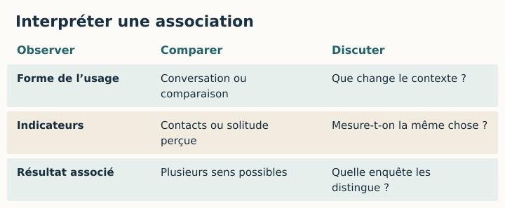

# ENS de Lyon · Séries A/L · Portugais (oral) 2026 — Corrigé brut

*Corrigé rédigé par IA, non officiel. Signalez toute erreur.*

**Rédaction** · GPT-6.2 Astra Ultra · vitesse non renseignée

Le seul sujet de portugais effectivement proposé concerne l’analyse hors programme en LV2, série Langues vivantes. Le fascicule désigne l’article de Juliana Casotti Santi et de ses collègues paru en 2024. Il ne donne pas les bornes de l’extrait remis au candidat. L’exposé prend appui sur la publication intégrale, pages 5086 à 5098, et les questions d’entretien sont proposées pour l’entraînement.

## Exposição em português

O que mudou quando a palavra «amigo» passou também a designar alguém cuja fotografia aparece numa lista? Posso ter centenas de contatos e não saber a quem telefonar numa hora difícil. Posso também morar longe da família e conversar todos os dias com uma pessoa que de outro modo não veria. Essa tensão dá sentido ao título do artigo de Juliana Casotti Santi e suas colegas. O caminho que vai da conexão ao isolamento é uma possibilidade, não uma sequência inevitável. Para explicar quando uma plataforma aproxima ou afasta, é preciso saber o que se faz nela, com quem e em que circunstâncias.

O texto saiu em 2024 numa revista brasileira da área da saúde e apresenta uma revisão de literatura. As autoras descrevem uma busca nas bases Scopus e PubMed por trabalhos publicados entre 2019 e 2024 e informam ter priorizado textos completos em inglês. Examinam primeiro os títulos, depois os resumos e por fim os artigos selecionados. Essa escolha permite confrontar experiências de mais de um país. Impõe também um limite importante. Falar de uma publicação brasileira não é falar de uma amostra representativa dos jovens brasileiros. E comparar pesquisas diferentes não equivale a seguir as mesmas pessoas ao longo dos anos.

A primeira contribuição do artigo é mostrar por que o número de horas de uso, sozinho, explica pouco. Dois adolescentes podem passar a mesma hora no telefone. Um conversa com um colega que mudou de cidade. O outro acompanha fotografias escolhidas para mostrar as melhores férias, as melhores festas e os corpos mais admirados. O primeiro pode sair da conversa com uma amizade fortalecida. O segundo, ao comparar o conjunto da própria vida com uma seleção de momentos da vida alheia, pode julgar que é o único a sentir vergonha ou solidão. Nesse caso, o problema começa antes de qualquer insulto explícito. A comparação já altera a regra pela qual ele avalia a si mesmo.

Há ainda riscos ligados à arquitetura do espaço digital. Uma humilhação no pátio da escola pode ganhar espectadores que nem sequer estavam presentes quando aconteceu. Os comentários ficam visíveis e podem reaparecer fora de contexto. Na vida profissional, outra dificuldade é a expectativa de disponibilidade permanente. O fato de um trabalhador poder abrir uma mensagem à noite pode ser interpretado por um superior como obrigação de respondê-la. Em ambos os casos, o tempo de conexão diz pouco se não sabemos quem pode exigir a presença de quem e que consequências há para quem sai da conversa.

Que valor têm, então, as provas apresentadas? A revisão menciona, entre outros exemplos, uma pesquisa transversal na Turquia que encontra uma associação entre estresse relacionado às redes e sofrimento psicológico. Seria precipitado transformá-la numa explicação individual. Uma pessoa que já se sente só pode procurar mais vezes o telefone. O uso pode, por sua vez, acentuar o mal-estar. Para distinguir esses percursos, seria preciso observar o que muda ao longo do tempo e levar em conta condições como o apoio familiar. Também não se deve converter comentários ou curtidas de uma pessoa em diagnóstico. O próprio artigo levanta questões de privacidade quando discute o estudo dos rastros digitais.

A meu ver, a consequência mais fértil dessa análise é distribuir responsabilidades. Uma escola pode discutir com os alunos como reagir quando alguém é humilhado num grupo. Uma plataforma pode tornar mais fácil interromper a circulação de uma mensagem ofensiva. Uma empresa pode deixar explícito que responder fora do expediente não é critério de dedicação. Nenhuma dessas decisões exige que um jovem abandone o grupo em que encontra apoio. Todas mudam uma condição concreta da interação. A pergunta que eu guardaria para o debate é esta: quando alguém encerra a sessão, leva consigo um vínculo que poderá reencontrar ou apenas a obrigação de voltar para continuar visível?

## Questions d’entretien

**Uma mensagem privada já é uma interação significativa?** Não necessariamente. A privacidade permite falar sem uma plateia, mas a qualidade da relação depende da escuta e da liberdade de responder. Um grupo público também pode criar solidariedade, por exemplo quando aproxima pessoas que enfrentam a mesma dificuldade e não se conheciam.

**Como verificaria se as redes causam isolamento?** Eu começaria por definir indicadores distintos de solidão percebida e de frequência dos contatos. Acompanharia as mesmas pessoas durante certo período, registrando os tipos de uso e mudanças na escola, no trabalho ou na família. Mesmo assim, apresentaria as conclusões com cautela. Comparar dois grupos num único dia não permite reconstruir toda a trajetória de cada pessoa.

**Que expressão do título pode ser discutida?** A preposição *ao* sugere movimento de um extremo ao outro. A expressão é eficaz para abrir uma questão, mas, se fosse lida como regra geral, excluiria justamente os casos de apoio que a revisão também considera.

## Documents

[Fascicule officiel de l’ENS de Lyon](https://www.ens-lyon.fr/sites/default/files/2026-11/Portugais%202026.pdf#page=3). [Article intégral et références de la revue brésilienne](https://doi.org/10.36557/2674-8169.2024v6n8p5086-5098).
