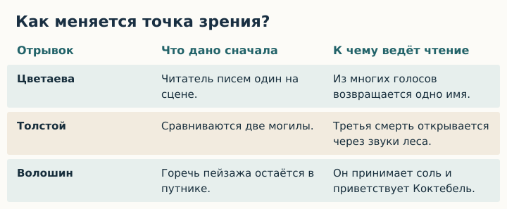
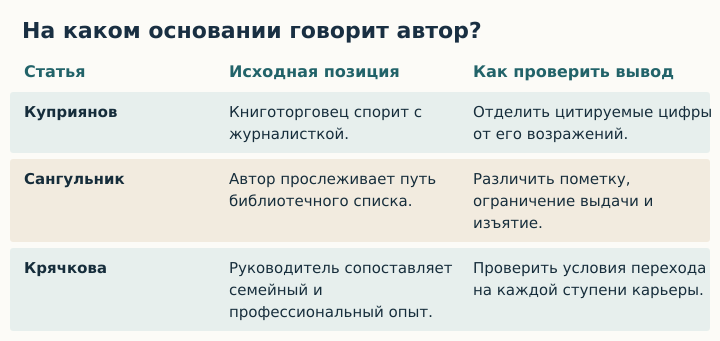

# ENS de Lyon · Séries A/L · Russe oral 2026 — Corrigé guidé partiel

*Corrigé rédigé par IA, non officiel. Signalez toute erreur.*

**Rédaction** · GPT-6.2 Astra Ultra · vitesse non renseignée

Le fascicule délimite les trois billets littéraires par leurs premiers et derniers mots. Ils sont expliqués intégralement, dont les deux poèmes de Volochine sur un seul billet. Les cinq analyses de presse s’appuient sur les articles originaux publiés. L’ENS ne fournit pas les feuillets des candidats qui permettraient d’en établir les coupes.

[Sujets de LV, p. 3](https://www.ens-lyon.fr/sites/default/files/2026-11/Russe%202026.pdf#page=3) · [Sciences humaines, p. 4](https://www.ens-lyon.fr/sites/default/files/2026-11/Russe%202026.pdf#page=4) · [Rapport du jury, p. 15–16](https://www.ens-lyon.fr/sites/default/files/2026-10/Russe%202026.pdf#page=15)

## Adapter l’exposé au billet tiré

Les trois textes d’auteur étaient proposés aux spécialistes de LV1. Les trois articles de Gorky relevaient de l’analyse hors programme en LV1, celui de Psychologies de la LV2 et celui de Forbes Woman de la série sciences humaines. La série lettres et arts n’a pas eu de candidat. Le rapport comprend aussi un article du site Нож présenté par une candidate B/L. Son corrigé appartient à la série SES. Le jury souligne à la fois l’intérêt d’une analyse formelle précise et la pénalisation d’une prestation trop courte.

### S’entraîner sur une scène, une fin de récit et deux poèmes

Sur la scène de Tsvetaeva, prenez trois crayons. Avec le premier, entourez les remises en scène matérielles, notamment le fauteuil, les chandelles, les lettres et les fleurs. Avec le deuxième, indiquez où le personnage commente son propre courrier. Réservez le troisième aux voix que l’acteur fait entendre en lisant. Chronométrez une trentaine de secondes de la scène en maintenant ces voix distinctes. Puis cherchez le moment où cette distinction devient presque impossible. À l’oral, *когда письма сменяют друг друга всё быстрее, зритель уже не успевает узнать каждую корреспондентку* transforme l’observation en interprétation. Le retour final d’un nom prend alors un sens précis.

Dans la fin du récit de Tolstoï, tracez un trait entre la cuisine et le bosquet. Que prévoit-on de fabriquer dans le premier lieu ? Qu’entend-on mourir dans le second ? Les répliques donnent la raison du déplacement de Serioja. Les verbes de perception et de mouvement dans le sous-bois déplacent ensuite le centre de l’attention. Essayez de conclure sans employer tout de suite *природа*. Décrire précisément les branches, le feuillage et les oiseaux oblige à dire en quoi la dernière image relie la mort d’un arbre à la vie de la forêt.

Chez Volochine, lisez successivement la première et la dernière désignation de Koktebel dans le second poème. Entre les deux, soulignez les verbes au futur et identifiez la personne qui en sera le sujet. Qu’est-ce qui autorise un salut solennel là où le voyageur disait sa tristesse ? Revenez ensuite au premier poème et à la place qu’y tient l’amertume. Si vous donnez un nom savant à une image liturgique, accompagnez-le d’une explication de son effet à cet endroit du texte. La réponse doit permettre d’entendre à la fois deux poèmes distincts et le passage de l’un à l’autre.

### Interroger un article de presse

Avec Kouprianov, attribuez chaque chiffre à son énonciateur. Il reproduit un article dont il conteste ensuite le maniement des chiffres. La bonne restitution commence par deux verbes distincts, *журналистка утверждает* puis *Куприянов возражает*. Avec Sangoulnik, essayez de restituer en deux phrases le circuit d’un livre. Qui décide, qui transmet la liste, qui répond au lecteur ? Une case laissée vide dans le texte fait partie de l’explication.

Avec Rybitskaïa, repérez la source d’une parole rapportée et revenez au moment où la journaliste la fait entendre. L’itinéraire d’Edith Eva Eger mérite d’être présenté dans sa chronologie propre. Le commentaire de sa vie après la libération peut éviter d’en faire un épilogue en montrant à quels lecteurs ou interlocuteurs s’adresse sa parole. Pour Radzina, distingue-t-on une expérience scientifique rapportée, une situation imaginée et un conseil ? Le titre réunit science et pratique. Cette distinction permet précisément d’examiner comment il tient sa promesse. Dans l’article de Kriatchkova, trouvez un détail vérifiable du quotidien du travail avant de parler d’égalité en général. Le fait que la garderie ferme avant la fin du poste explique mieux un obstacle qu’une formule abstraite sur la conciliation des temps.

### Préparer la discussion en russe

Ne réduisez pas l’exposé pour réserver les idées difficiles à l’entretien. Le rapport signale qu’un très bon échange ne compense qu’en partie une présentation écourtée. Entraînez-vous à formuler une objection qui vous oblige à revenir au texte. *Слова о предательстве принадлежат автору или его оппоненту?* demande de retrouver la référence à Milioukov dans la seconde moitié de la chronique. *Кто видит Коктебель в конце стихотворения?* oblige à préciser qui salue et à qui s’adresse le salut. Une réponse courte assortie d’un indice textuel laisse au jury la possibilité d’engager un véritable échange.

## 1. Марина Цветаева, «Феникс», начало третьей картины

**Границы.** От первой ремарки о библиотеке замка Дукс до первого восклицания с именем Розины. Литературный текст позволяет точно остановиться в указанном месте.

В конце 1799 года пожилой Казанова остаётся один среди бумаг. Однако на сцене вскоре зазвучит целая толпа голосов. Как из вещей, которые он намерен выбросить, возникает присутствие другого человека? Ремарка сначала даёт зрителю время присмотреться к неподвижному пространству. Свечи делают заметнее темноту, очаг кажется островом среди холода, книги давно спят. На этом фоне особенно выразительны живые глаза героя. Одежда одновременно внушает почтение и может показаться смешной. Возраст Казановы приходится видеть вместе с концом столетия, которое ещё узнаётся в его облике.

Затем актёр должен сыграть сразу и читателя, и тех, чьи письма он держит. Обрывки фраз не всегда успевают обрести автора. Казанова узнаёт письмо наизусть и тут же путает имена. Между стихами одной корреспондентки вклиниваются ответ героя, голос следующей, короткая ремарка о движении его руки. Зритель слышит, как легко одна история рифмуется с другой, и видит, как быстро скомканные листы теряют индивидуальность. Ряд известий о детях, воображаемое укачивание ребёнка и преувеличенные подсчёты превращают каталог воспоминаний в комедию утраты контроля.

Всё быстрее повторяется короткое слово, которым герой сопровождает бросок письма в огонь. Различия между письмами почти стёрты. Потом Казанова на мгновение успокаивается и отделяет цветы и локоны от остального. Предметы сохраняют цвет и фактуру, а с ними возвращается и место. Воспоминание о Лионе вызывает почти осязаемое ощущение движения танцовщицы. Конечное имя, Розина, выделяет одну женщину из хора. **Вопрос жюри.** Как передать этот переход голосом? При чтении писем важно менять темп и интонацию. Перед последним именем можно выдержать паузу, чтобы слушатель услышал, как перечисление уступает место узнаванию.

[Texte publié](https://ru.wikisource.org/wiki/%D0%A4%D0%B5%D0%BD%D0%B8%D0%BA%D1%81_%28%D0%A6%D0%B2%D0%B5%D1%82%D0%B0%D0%B5%D0%B2%D0%B0%29/%D0%9A%D0%B0%D1%80%D1%82%D0%B8%D0%BD%D0%B0_%D1%82%D1%80%D0%B5%D1%82%D1%8C%D1%8F)

## 2. Лев Толстой, «Три смерти», финал

**Границы.** От сопоставления двух могил до движения ветвей над упавшим деревом. В лионском сборнике первый глагол дан в форме «воздвигалась», в издании Русской виртуальной библиотеки читаем «воздвиглась». Обе границы и последовательность фраз позволяют уверенно определить отрывок.

Первый абзац измеряет расстояние между людьми после смерти по тому, какие следы остаются видны. На одной могиле уже стоит каменная часовня. О существовании ямщика напоминают невысокий холм и молодая трава. Камень был обещан, но обещание пока живёт главным образом в разговоре на станции. Повариха напоминает Серёге о долге перед Хведором, а старший ямщик предлагает поставить хотя бы крест. Разговорная речь возвращает действие в мир, где забота о покойном существует рядом с рассуждениями о цене, времени и доступном материале.

Переход к роще меняет масштаб. Серёга там по вполне конкретной человеческой причине. Но повествование даёт лесу собственное время ещё до того, как мы услышим первый звук. Тишина, роса, туман и ожидание рассвета занимают пространство, которое в разговоре представлялось просто местом, где можно взять дерево. Прислушиваясь к изменению звука, читатель понимает, что происходит, даже когда человек почти исчезает из поля зрения. Дрожание одной вершины впервые отделяет это дерево от остальных. Его падение ненадолго задерживает течение утра.

В последнем предложении вновь движется весь лес. Слова, обозначающие радость, покой и величие, относятся к живым существам и ветвям, а определение мёртвого дерева стоит в конце. Его исчезновение необратимо, хотя ничто вокруг не останавливается. Получается парадоксальная связь трёх смертей. Чтобы сохранить знак памяти об одном умершем, человек становится причиной гибели другого живого существа. **Вопрос жюри.** Выражает ли финал равнодушие природы? Живые деревья не произносят суждения. Повествователь, однако, уделил отдельной смерти время и внимание, которых она не получила бы в рассказе только о выполнении обещания.

[Texte publié](https://rvb.ru/tolstoy/01text/vol_3/01text/0021-full.htm)

## 3. Максимилиан Волошин, «Киммерийские сумерки», два стихотворения

Билет объединяет «Полынь» и следующее стихотворение о дороге в Коктебель. Их нужно читать последовательно. В первом место, где догорает костёр, постепенно получает тело. В начале ещё можно различить зрительные, слуховые и обонятельные впечатления. Перекличка шипящих согласных заставляет услышать движение там, где глаз видит почти застывшую поверхность. Горечь полыни приобретает душу. Каменные формы напоминают раненые крылья и согнутую спину. Обращение к праматери переводит описание пейзажа в разговор с существом, которое само ещё не может ответить.

В центре стихотворения лирическое «я» предлагает стать глазами и устами земли. Но этот жест упирается в общий предел. Поэт сам называет себя незрячим и немым. Противоречие существенно. Родство рождается из разделённой немоты, и голос поэта только так может не заслонить собой землю. В заключительных строках горечь дыма, травы и волн остаётся в нём. Присвоенное впечатление оказывается обязательством помнить.

Во втором тексте человек идёт, и направление задано с первой строки. Терновник, серебро кустов и розоватый миндаль соединяют весну с образами страдания и богослужения. Будущие действия путника складываются в последовательность жестов. Он склонится к камням, примет горькую соль, украсит лоб местными травами. Когда в конце он приветствует Коктебель, эпитет при том же топониме уже изменился. Скорбный путь привёл к торжественному обращению, в котором след страдания остаётся слышен. **Вопрос жюри.** Что связывает два стихотворения помимо общего места? Горечь, в первом тексте оставшаяся в человеке, во втором уже принимается им в сознательном жесте приобщения.

[Premier poème](https://ru.wikisource.org/wiki/%D0%9F%D0%BE%D0%BB%D1%8B%D0%BD%D1%8C_%28%D0%92%D0%BE%D0%BB%D0%BE%D1%88%D0%B8%D0%BD%29) · [Second poème](https://rvb.ru/20vek/silver-age/1900-e/05/039-maksimilian-voloshin.html)

## 4. Борис Куприянов, «Провал — это измена!», 11 мая

Это колонка участника книжной торговли. Куприянов спорит с автором другого материала, который объясняет закрытие магазинов среди прочего недостатком воображения и сравнивает российские магазины с китайскими. Поэтому первая задача читателя — различить прямую цитату, ироническое замечание и позицию самого Куприянова. Воспроизведение чужого типографического выделения даёт увидеть тот способ подачи цифр, с которым он спорит. Денежная выручка и число проданных экземпляров могут двигаться в разных направлениях. По одной величине нельзя заключить, что именно стали читать люди.

Затем меняется само основание спора. Для книготорговца за вопросом о привлекательности магазина стоят арендная плата, хозяйственные расходы и ограничения на работу с книгами. От обсуждения чужих доказательств автор переходит к обязанности сохранить место встречи продавца и читателя. Финальная историческая отсылка к речи Милюкова 1916 года придаёт слову из заголовка необычную для хозяйственного спора силу. Коллективное «мы» в конце обращено к людям его профессии. Когда они продолжают работать, они сохраняют возможность для другого человека когда-нибудь найти книгу. **Вопрос жюри.** Следует ли считать каждое закрытие магазина изменой с точки зрения автора? Он сам оговаривает непреодолимое внешнее принуждение. Его категорическая формула выражает моральное требование к своим и спорна именно в таком качестве.

[Texte publié](https://gorky.media/context/proval-eto-izmena)

## 5. Анастасия Рыбицкая, «Лучшая месть нацистам», 14 мая

Мемориальная статья посвящена Эдит Еве Эгер, еврейской девушке, пережившей Аушвиц и позднее ставшей психологом и писательницей. Заголовок ставит вопрос о смысле мести. В биографии ответ открывается через долгую возможность жить, говорить и помогать другим. Для читателя важно различать голоса Рыбицкой и Эгер. Одна выстраивает композицию памяти, другая рассказывает о собственном опыте в цитируемых книгах.

Автор сначала помещает читателя в момент, когда танец оказывается для Эдит испытанием и способом внутренне удержаться. Затем рассказ восстанавливает то, что существовало до лагеря. Были семья, дом, тренировки, ожидания юности. Шоа разрушила эти возможности в жизни конкретного человека, и перечисление дат само по себе не передало бы масштаба утраты. В рассказе об освобождении меняется смысл времени. Окончание заключения — датируемое событие. Возвращение способности жить с воспоминаниями заняло годы.

Поэтому такое большое место получает послевоенная жизнь, образование и переписка. На последнем этапе голос Эгер обращается к другим людям. Возможность говорить о пережитом и строить отношения становится ответом на заглавие, при этом ответственность за преступление по-прежнему лежит на совершивших его. **Вопрос жюри.** Можно ли вывести из этой истории правило о том, как должен вести себя каждый переживший насилие? Ценность статьи в индивидуальном пути Эгер. Превращение этого пути в предписание лишило бы её свидетельство исторической и личной точности.

[Texte publié](https://gorky.media/context/luchshaya-mest-natsistam)

## 6. В. Сангульник, «Логики тут не ищите», 28 мая

Статья о петербургских библиотеках начинается с вопроса, который имеет практические последствия для читателя. Где книга, которая вчера ещё была в каталоге или на полке? Чтобы объяснить исчезновение, автор различает несколько действий. Одно дело пометить издание, другое изменить условия выдачи и третье убрать его. Читатель может видеть лишь конечный результат. Библиотекарь при этом не всегда знает, кто и на каком основании составил поступивший список.

Примеры нужны потому, что общая ссылка на запреты не объясняет отдельного решения. В перечнях попадаются разные издания одного названия. Считать позиции в таком перечне и считать произведения — две разные операции. В случае книг Фредрика Бакмана результаты экспертизы и дальнейшая судьба изданий в местном списке расходятся. Появляются и живые голоса читателей, удивлённых судьбой знакомых книг. Они возвращают обсуждение процедур к опыту человека, пришедшего в библиотеку.

Отсылка к духам из рождественской истории Диккенса в конце меняет регистр. Будущее ограничений лишь предполагается, тогда как нынешняя неопределённость уже проявляется в повседневной работе. **Вопрос жюри.** Почему фраза в заглавии не отменяет необходимость внимательно читать правила? В статье есть конкретные механизмы и учреждения. Неясным для библиотекаря может оставаться переход от общего правила к выбору данного экземпляра. Эту непрозрачность и требуется объяснить.

[Texte publié](https://gorky.media/context/logiki-tut-ne-ishchite)

## 7. Ольга Радзина, «Как эмоции формируют наши решения и поведение», 13 мая

Журнал обещает читателю и научное объяснение, и практическую пользу. Этому обещанию соответствует устройство статьи. Вначале автор предлагает простую модель связи между эмоциями, вниманием и выбором, затем переносит её в повседневные ситуации и лишь после этого переходит к советам. Переход важен для критического чтения. Пример удачно показывает, как могло бы происходить взаимодействие, но ещё не устанавливает универсальную закономерность.

В эпизоде с руководителем настроение одного человека создаёт условия разговора для целой группы. В примере с близкими две разные реплики можно произнести по поводу одного и того же молчания. Изменяется предполагаемое намерение говорящего, а вместе с ним и возможный ответ собеседника. Читателю предлагают заметить разницу между переживанием и тем толкованием фактов, которое оно подсказало. Во второй части предложения с обращением к читателю делают его участником упражнения. Популяризаторский текст выигрывает в наглядности, но его краткая нейробиологическая схема упрощает сложный процесс. **Вопрос жюри.** Считает ли автор эмоции препятствием для разумного действия? При тревоге и интересе человек замечает разные стороны ситуации. Распознавание этого обстоятельства, согласно статье, может расширять выбор реакции.

[Texte publié](https://www.psychologies.ru/wellbeing/kak-emocii-formiruyut-nashi-resheniya-i-povedenie-vzglyad-nauki-i-praktiki/)

## 8. Дарья Крячкова, «Женщины работали всегда», 2 июня

Крячкова начинает с двух женщин из собственной семьи. Она видела тяжёлый труд бабушки и работу матери, руководившей участком на заводе, но сама долго соглашалась с представлением о «мужских» руководящих должностях. Этот разрыв между опытом и убеждением позволяет точнее поставить вопрос статьи. Отсутствие женщины в привычном образе директора ещё не означает отсутствия женского труда в истории предприятия.

Дальше автор рассматривает карьеру как последовательность отборов. Девушка выбирает специальность, приходит в цех, получает первый опыт, а затем может или не может получить руководящую работу. Небольшие ограничения, которые повторяются при каждом переходе, дают заметный результат на вершине иерархии. При этом видимость препятствий неодинакова. Отсутствие подходящей спецодежды можно обнаружить сразу. Труднее доказать, что сотрудницу систематически не приглашают туда, где обсуждаются будущие назначения. В моногороде завод может быть привычной частью жизни девушки, тогда как путь к управлению всё ещё кажется закрытым.

В конце Крячкова переходит к условиям, которые можно проверить, от распределения повышений до совместимости смены с часами работы детского сада. Её позиция руководителя кадровой службы даёт ей знание организации и объясняет, почему среди аргументов появляется цена потери опытной сотрудницы для компании. **Вопрос жюри.** Почему история одной женщины-директора не опровергает общий тезис? Она показывает, что такой путь возможен. Чтобы судить о его доступности, нужно знать, сколько людей доходит до каждого этапа отбора и по каким правилам.

[Texte publié](https://www.forbes.ru/forbes-woman/562070-zensiny-rabotali-vsegda-pocemu-v-tazelyh-industriah-vse-ese-susestvuet-neravenstvo)

