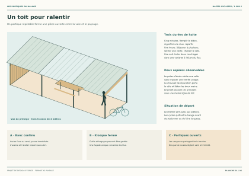
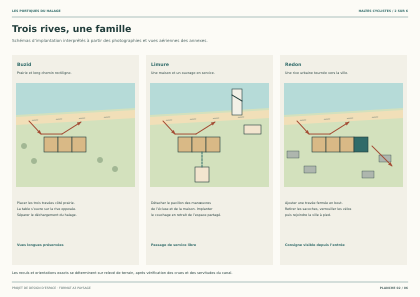
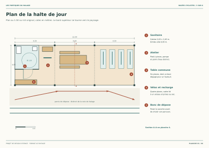
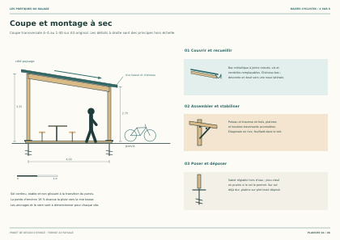
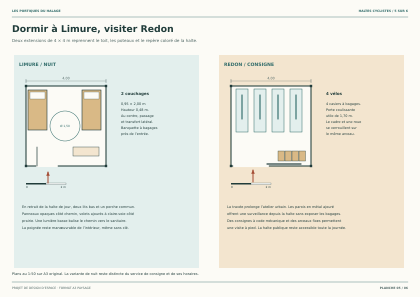
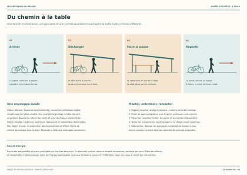

# ENS Paris-Saclay — Design d’espace 2026 · Corrigé guidé

*Corrigé rédigé par IA, non officiel. Signalez toute erreur.*

**Rédaction** · GPT-6.2 Astra Ultra · vitesse non renseignée

**Les Portiques du halage** est une proposition de projet pour une halte cycliste déclinée sur les trois sites du sujet. Les six planches vectorielles anonymes et numérotées sont dessinées en A3 paysage (420 × 297 mm). Les barres graphiques permettent de lire les dessins lorsque le document est réduit. Les textes accompagnent les planches.

Pour les deux journées de huit heures, consacrer trois heures à la lecture des sites et aux variantes, cinq aux plans et coupes, six au dessin des six planches et deux à la vérification des échelles, de la numérotation et des parcours.

## Planche 1 — Un toit pour ralentir

> [!INDICATION]
> Que devient une famille qui arrive sous la pluie, chargée de sacoches, alors qu’une autre personne ne veut que regonfler son pneu ? Faire apparaître leurs deux gestes avant de dessiner l’enveloppe.

### Proposition

Deux roues passent au sec sous un portique, puis une table devient visible derrière l’atelier. **Les Portiques du halage** proposent cette séquence comme signe commun aux haltes. Quatre portiques espacés de 4 m couvrent trois travées parallèles à la voie. Le pignon à lattes et la sous-face verte annoncent la halte dans les deux sens du parcours. La table se tourne vers le canal. Son extrémité dégagée peut accueillir une poussette ou un fauteuil.

Le préau d’une école fournit un exemple de pièce commune abritée, accessible en plusieurs points et ouverte à la vue. Un pied d’atelier pour vélo montre comment libérer les deux mains du réparateur tout en gardant l’objet devant lui. La recherche compare un banc linéaire, un kiosque fermé et une file de portiques. Le banc laisse la réparation sous la pluie. Le kiosque protège les biens mais crée une seule entrée. La file de portiques permet de séparer la réparation, le repas et le stationnement, et de fermer seulement ce qui le demande.

## Planche 2 — Trois rives, une famille

> [!INDICATION]
> Pour chaque photographie de l’annexe, nommer une chose à préserver, un conflit de circulation possible et un emplacement où le projet pourrait prendre place.

### Proposition

Le dossier appelle l’itinéraire Rennes–Brest dans son titre et décrit le canal de Nantes à Brest dans le texte. Les trois implantations proposées suivent les vues de Buzid, Limure et Redon. Sur la photographie de **Buzid**, la voie rectiligne longe une prairie avec une longue vue sur l’eau. La halte s’installe du côté de la prairie. La position en retrait laisse le chemin continu et conserve la vue depuis la table. À **Limure**, la maison, l’ouvrage de maçonnerie et le passage des agents rendent inappropriée une installation au droit des manœuvres. Le module de jour se place sur un dégagement disponible après relevé. Le couchage se tient en retrait, relié au sanitaire par un chemin lisible. À **Redon**, les quais et le tissu bâti suggèrent une visite à pied. La consigne prolonge la halte vers la liaison urbaine et reste visible depuis la table.

Ces plans d’implantation interprètent des images, sans attribuer une mesure ou une orientation cardinale aux terrains. La position définitive dépend du levé topographique, des servitudes de navigation, des racines, des niveaux de crue, du vent et des accès d’entretien. À chaque site, la même trame porte des écrans que l’on peut retourner et des ouvertures cadrant un paysage propre.

## Planche 3 — Plan de la halte de jour

> [!INDICATION]
> Dessiner séparément le vélo en stationnement, la personne qui le décharge, la personne attablée et la personne traversant le parvis. Examiner les conflits avant de coter.

### Proposition

L’emprise entre axes est de 12 × 4 m. Sur le côté du chemin, un parvis stable reçoit les vélos avant l’entrée. Deux raccords au halage rendent possible un mouvement continu. La première travée associe une cabine sanitaire de 2,40 × 2,40 m, un banc et un atelier à pompe et outils captifs. La porte de 0,95 m s’ouvre vers l’extérieur sur une zone réservée. Une aire de rotation de 1,50 m de diamètre et un espace de transfert latéral jouxtent la cuvette. Le point d’eau potable se distingue du poste de lavage ou de nettoyage.

Au centre, la table de 2,70 × 0,90 m reçoit six personnes, avec deux bancs courts et des places en bout. Le bord libre offre un passage de genoux. Dans la troisième travée, quatre vélos se rangent contre des arceaux fixés au cadre de plancher, leurs roues à l’écart de la circulation. Un vélo chargé peut patienter sur le parvis sans boucher l’entrée. La recharge utilise des prises protégées sous abri, des tablettes pour chargeurs et des passages de câbles hors du cheminement. Les chargeurs personnels évitent d’imposer un connecteur propriétaire.

## Planche 4 — Coupe et montage à sec

> [!INDICATION]
> Couper perpendiculairement à la voie, depuis la vue sur le canal jusqu’au parvis. Ajouter l’usager debout, l’égout, le chemin de l’eau et le raccord au sol.

### Proposition

Au droit de la table, le portique atteint 3,35 m côté paysage et 2,70 m côté parvis. Le toit descend de 0,65 m sur 4 m. Il dépasse les poteaux pour protéger les assises. Une gouttière conduit l’eau en bout vers une noue latérale, en maintenant l’accès au sec. La face exposée au vent reçoit un écran de lattes remplaçables. Les autres faces gardent la vue et la ventilation. Le plancher rejoint un parvis de niveau. Un raccord en pente douce, dimensionné après levé du site, résout les dénivelés résiduels.

La première solution constructive utilise des portiques en bois assemblés par platines et boulons, des pannes démontables, des cassettes de couverture métallique et des remplissages en lames vissées. Le contreventement se fait dans le plan de toiture et les travées d’extrémité, hors du cheminement. Une longueur d’élément d’environ 4 m facilite le transport sur véhicule de chantier. La prairie autorise des pieux vissés après reconnaissance du sol et des réseaux. Sur un quai dur, des plots lestés et déposables peuvent recevoir les mêmes pieds réglables. Le dimensionnement au vent, au soulèvement et aux charges de neige reste à vérifier pour la configuration choisie. Les composants se séparent par matériau en fin de service.

## Planche 5 — Dormir à Limure, visiter Redon

> [!INDICATION]
> Vérifier sur des plans distincts la place du vélo le plus long, le dégagement devant les portes et le transfert entre circulation et couchage.

### Proposition

À Limure, un module de 4 × 4 m accueille deux lits de 0,95 × 2 m, un banc à bagages et un espace central de retournement. Une cloison opaque protège des vues depuis le halage. Les volets ajourés côté prairie assurent ventilation et intimité. La fermeture est libérable de l’intérieur. Le chemin nocturne vers le sanitaire est éclairé au niveau du sol et évite l’atelier. Les vélos sont attachés aux arceaux de la halte de jour. Cette variante suppose une exploitation dédiée à l’accueil nocturne, avec entretien des couchages et suivi des réservations.

À Redon, la travée supplémentaire ferme quatre emplacements pour vélos et quatre casiers à sacoches. Les usagers disposent de leur propre antivol pour le cadre et la roue et d’un code pour le casier. Un portail coulissant laisse environ 1,70 m de passage. Les panneaux ajourés permettent de surveiller l’entrée depuis la table. Pour exploiter la consigne, le gestionnaire affiche les horaires, le contact en cas de blocage et un accès de service. Pendant la visite piétonne, le cycliste peut laisser le véhicule et les bagages ensemble sans devoir transporter sa batterie jusqu’en ville.

## Planche 6 — Du chemin à la table

> [!INDICATION]
> Tester la réponse une première fois en plein soleil puis sous l’averse, et une troisième fois lors du démontage. Qui intervient, avec quels accès et dans quel ordre ?

### Proposition

Une cycliste quotidienne aperçoit le pignon, quitte le flux, gonfle son pneu puis repart par le second raccord. Une famille dépose ses sacoches sur le banc, attache les cadres et mange face à l’eau. La recharge peut durer pendant le repas. À Redon, le cycliste passe de la dépose à la consigne puis à la marche. Une personne venue à pied peut s’asseoir sans traverser les places vélos. À Limure, les deux personnes hébergées utilisent le chemin en retrait une fois la halte de jour refermée pour son entretien.

Une deuxième famille constructive emploie des cadres d’aluminium réemployé, des goussets boulonnés et une toile tendue. Elle se lève plus légèrement, mais demande retension et remplacement de la toile. Pour la série principale, le toit métallique et les parois bois facilitent la réparation par éléments et offrent un abri permanent. La toile convient à un ombrage d’été complémentaire.

Le site urbain peut utiliser des réseaux existants après confirmation. Pour une prairie isolée, prévoir une réserve d’eau potable gérée, des toilettes sèches avec filière de collecte et le suivi des consommations. Une hypothèse de quatre recharges de 0,25 kWh par jour représente 1 kWh délivré avant pertes. Sur un site sans réseau, on dimensionnera photovoltaïque, stockage et secours saisonnier à partir du productible local et de l’usage réel. Une simple prise dessinée n’assure pas le service. Le contrôle de montage porte enfin sur la stabilité, la continuité du sol, l’étanchéité, les protections électriques et l’évacuation de l’eau avant ouverture.

[Sujet officiel et annexes](https://ens-paris-saclay.fr/sites/default/files/CONCOURS/ANNALES_1C/1C_Design/2026/2026_sujet_1A_design_d_espace.pdf)
