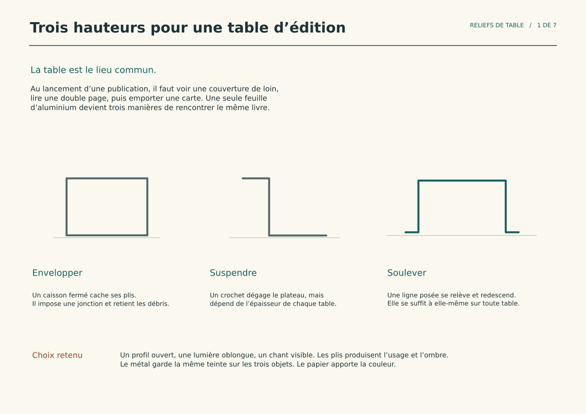
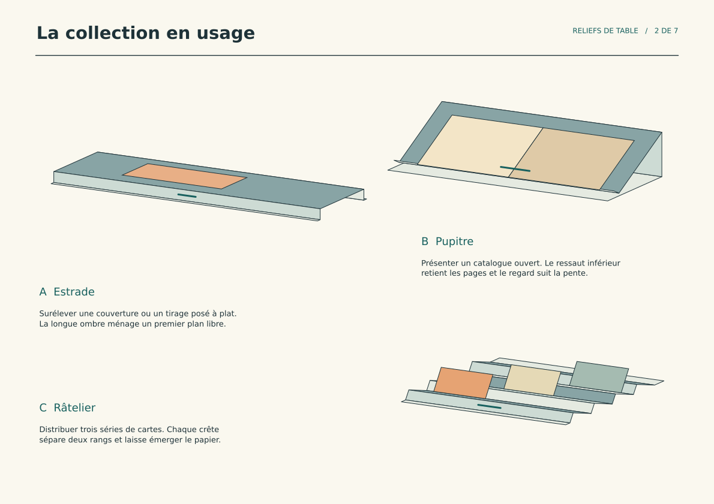
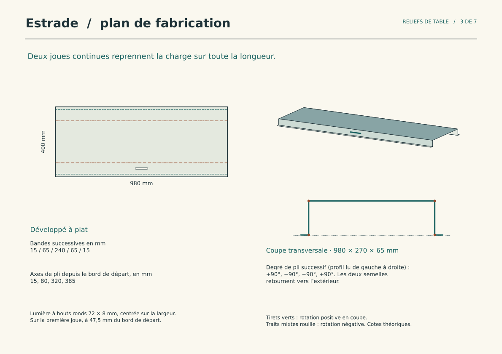
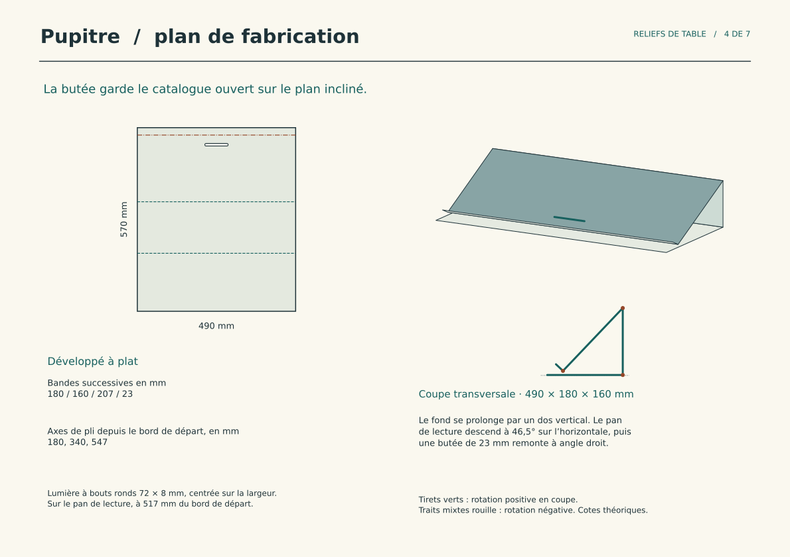
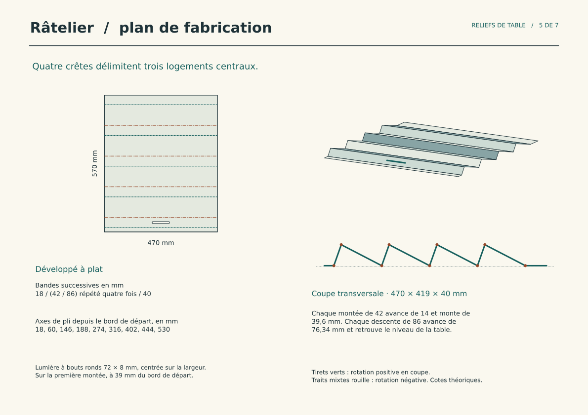
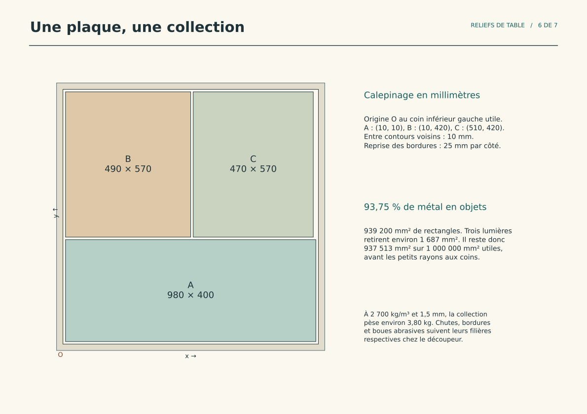
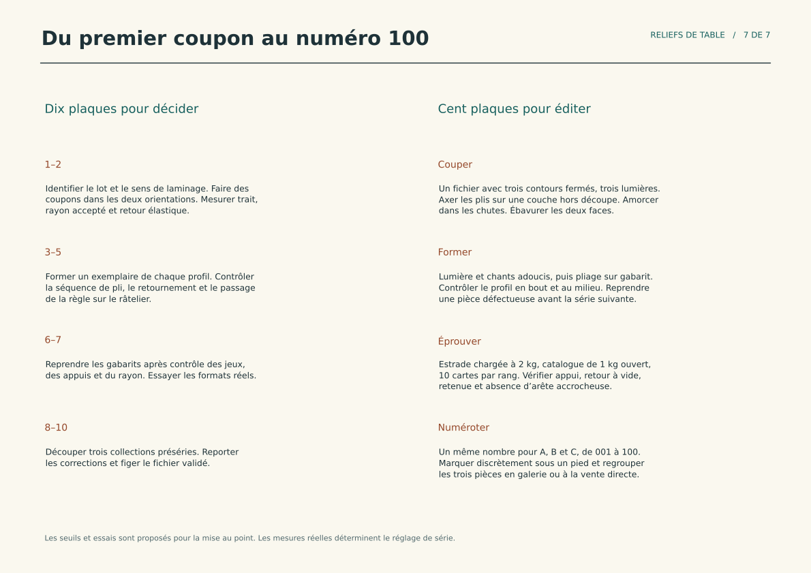

# ENS Paris-Saclay, design de produit 2026 — Corrigé brut

*Corrigé rédigé par IA, non officiel. Signalez toute erreur.*

**Rédaction** · GPT-6.2 Astra Ultra · vitesse non renseignée

**Reliefs de table** réunit une estrade, un pupitre et un râtelier. Le dossier graphique comprend sept planches A3 paysage anonymes et numérotées. Chaque figure vectorielle est dessinée au format physique de 420 × 297 mm. Les indications et calculs accompagnent ces planches.

## Planche 1 — Le parti et les pistes écartées

La collection **Reliefs de table** équipe une petite table d’éditeur. Debout, le visiteur aperçoit une estampe sur une estrade basse. Il s’approche d’un livre ouvert sur un pupitre, puis choisit une carte dans un râtelier. Trois moments de lecture commandent trois hauteurs. Le chant mince et l’ombre portée permettent de lire la feuille d’origine. Une lumière oblongue laisse passer le jour dans chaque profil.

Les recherches portent d’abord sur le contact avec la table. Le caisson fermé est lourd visuellement et demande un joint. Le crochet suspendu rend l’objet tributaire de l’épaisseur du plateau. Le pli ouvert fonctionne sur une table ordinaire, sans fixation au mobilier. Son profil reste visible de côté et se nettoie par les extrémités.

## Planche 2 — Les volumes mis en situation

Les trois objets autonomes peuvent se répartir sur plusieurs tables ou être réunis sur une table d’environ 180 × 75 cm. L’estrade se place à l’arrière, le pupitre se tourne vers le lecteur et le râtelier reste accessible au bord. Les joues ouvertes gardent la table visible. Une seule face d’aluminium reçoit un brossage fin unidirectionnel, la même gamme de trois teintes argentées apparaît avec l’éclairage sous les pans horizontaux, obliques et verticaux. Le papier reste le point coloré.

## Planche 3 — A. Estrade pour les couvertures

Le rectangle de 980 × 400 mm devient une marche de 980 mm de long, d’environ 270 mm de profondeur hors tout et 65 mm de haut. Deux joues de 65 mm et leurs semelles extérieures de 15 mm encadrent le plateau de 240 mm. Les appuis sont continus dans le sens des 980 mm. La flexion du plateau se joue surtout sur la portée transversale de 240 mm. Une estampe sous passe-partout ou des livres légers y reposent à plat. La lumière de la joue crée une seconde ligne d’ombre. Plier les deux semelles en premier, puis les deux angles du plateau, avec une règle de longueur utile d’au moins 980 mm.

## Planche 4 — B. Pupitre de consultation

Le développé mesure 490 × 570 mm. À partir du bord avant libre, la semelle se prolonge sur 180 mm jusqu’au dos vertical de 160 mm. Le pan de 207 mm revient vers le lecteur sous un angle de 46,5° avec la table. Son extrémité se trouve à environ 38 mm du bord avant de la semelle et 10 mm au-dessus de la table, car $180-207\cos(46{,}5^\circ)\simeq38$ et $160-207\sin(46{,}5^\circ)\simeq10$. La butée de 23 mm lui est perpendiculaire. Le catalogue repose sur le pan et son chant s’appuie sur la butée. La résultante des poids reste dans l’emprise de la semelle en usage centré.

Former la butée avant de rabattre le pan. Former ensuite le pli du sommet sur un mandrin accessible par les côtés et refermer la semelle en dernier. Une semelle continue évite deux pieds ponctuels. Le pied et le pan restent ouverts à l’avant. Vérifier sur la présérie que la lèvre laisse passer la couverture d’un livre épais.

## Planche 5 — C. Râtelier pour cartes

Une bande de 470 × 570 mm forme quatre crêtes et trois creux centraux. La première lèvre horizontale fait 18 mm et la dernière 40 mm. Entre les deux viennent quatre reprises du couple 42 et 86 mm. Chaque pan court avance de 14 mm et monte de $\sqrt{42^2-14^2}=39{,}6$ mm. Le pan long redescend de la même hauteur et avance de 76,3 mm. La profondeur théorique vaut $18+4(14+76{,}34)+40=419{,}4$ mm. Les cartes appuient leur chant dans le creux et leur dos sur le pan court suivant, incliné à environ 70,5°. Avec une carte A6, une partie de la face dépasse la crête et peut être saisie.

Former les plis successifs dans un gabarit mâle-femelle à segments courts ou autour d’une règle amovible, du centre vers les bords. Le segment se retire par l’extrémité ouverte de la pièce. Un calibre en découpe latérale contrôle les quatre hauteurs et les trois creux. Après ébavurage, le papier doit glisser le long des flancs sans accrocher.

## Planche 6 — Le carré utile et la série

Le découpeur reprend 25 mm sur chaque côté du carré brut de 1 050 mm. Dans le carré utile de 1 000 mm de côté, les trois rectangles occupent $980\times400+490\times570+470\times570=939\,200$ mm². Un ajour oblong de 72 × 8 mm comporte une partie droite de 64 × 8 et deux demi-cercles de rayon 4 mm, soit environ 562,3 mm². Les trois objets conservent environ 937 513 mm², soit **93,75 % du carré utile** avant les petits arrondis d’angles (rayon indicatif 3 mm). Le taux rapporté au carré acheté est d’environ 85,0 %. À une masse volumique indicative de 2 700 kg/m³, la collection garde environ 3,80 kg d’aluminium.

Le plan réserve au moins 10 mm entre deux pièces, indépendamment du trait de coupe. Le prestataire compense le trait vers les chutes et place les amorces hors pièce. La même implantation fournit une collection à chaque passage. Cent plaques donnent cent A, cent B et cent C. Les dix autres plaques sont réservées aux essais et préséries.

## Planche 7 — Mise au point, fabrication et diffusion

Les cotes de coupe sont celles du plan à plat. Les dimensions de volume et positions des sommets sont des cotes de principe, sur la ligne moyenne et à angles vifs. La nuance et l’état de l’aluminium de réemploi sont à identifier. Les coupons mesurent le rayon intérieur réalisable, le retour élastique et la perte au pli dans les deux sens du laminage. Pour un angle de rotation $\theta$ en radians, la longueur de fibre neutre dans le pli vaut $\theta(r_i+Kt)$, avec $t=1{,}5$ mm et $K$ estimé sur les essais. Corriger la position des axes dans le rectangle retenu avant de figer les fichiers. Un gabarit de contrôle permet environ 2 mm de tolérance sur les dimensions formées, sous réserve de validation en présérie.

Les 1re et 2e plaques servent aux coupons de coupe et de pli, les trois suivantes à un premier A, B et C. Deux plaques servent aux reprises et les trois dernières à trois collections de présérie. Sur une table témoin, prévoir 2 kg répartis sur l’estrade pendant une heure (flèche résiduelle visée inférieure à 1 mm), un catalogue de 1 kg ouvert sur le pupitre et dix cartes par logement du râtelier. Effectuer vingt prises de carte et dix changements de livre. Contrôler les rayures du papier, le glissement, le basculement et le retour au niveau des appuis. Ces valeurs sont des critères de réception proposés, à vérifier lors des essais physiques.

Ébavurer les deux faces, arrondir les coins et adoucir tous les chants et les ajours. Brosser dans le même sens avec un abrasif fin puis nettoyer. Une brosse non ferreuse dédiée évite les traces. Les trois pièces restent monoblocs, sans colle, peinture ni soudure. Un atelier francilien effectue la découpe à partir du même fichier, puis le résident assure le pliage au gabarit, le contrôle et le marquage. Le même numéro de 001 à 100 figure sous une semelle de chaque objet. Des intercalaires de papier de réemploi séparent les pièces pour la vente directe ou la remise en galerie.

[Sujet officiel](https://ens-paris-saclay.fr/sites/default/files/CONCOURS/ANNALES_1C/1C_Design/2026/2026_sujet_1A_Design_produit.pdf)
