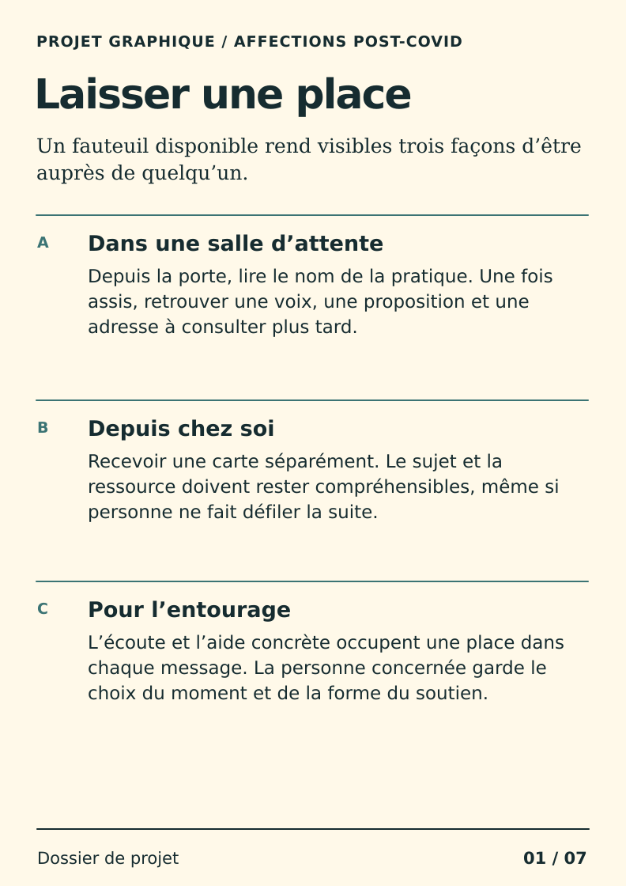
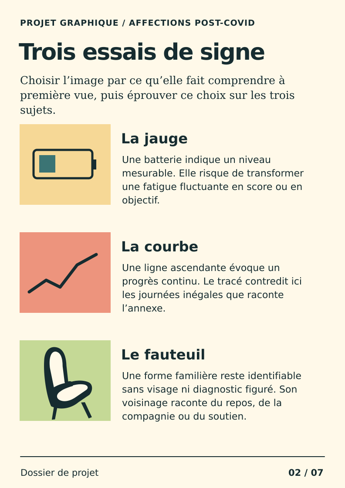
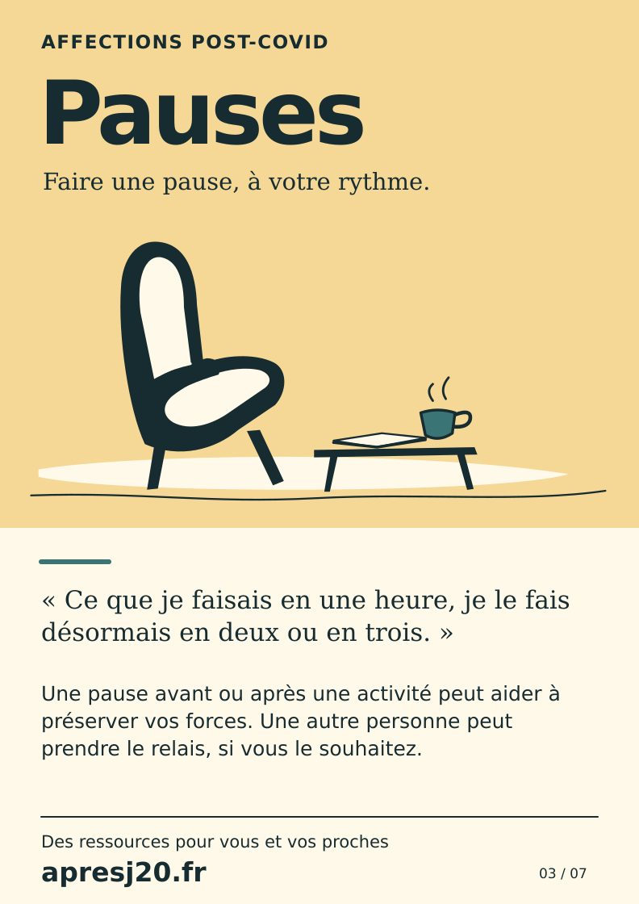
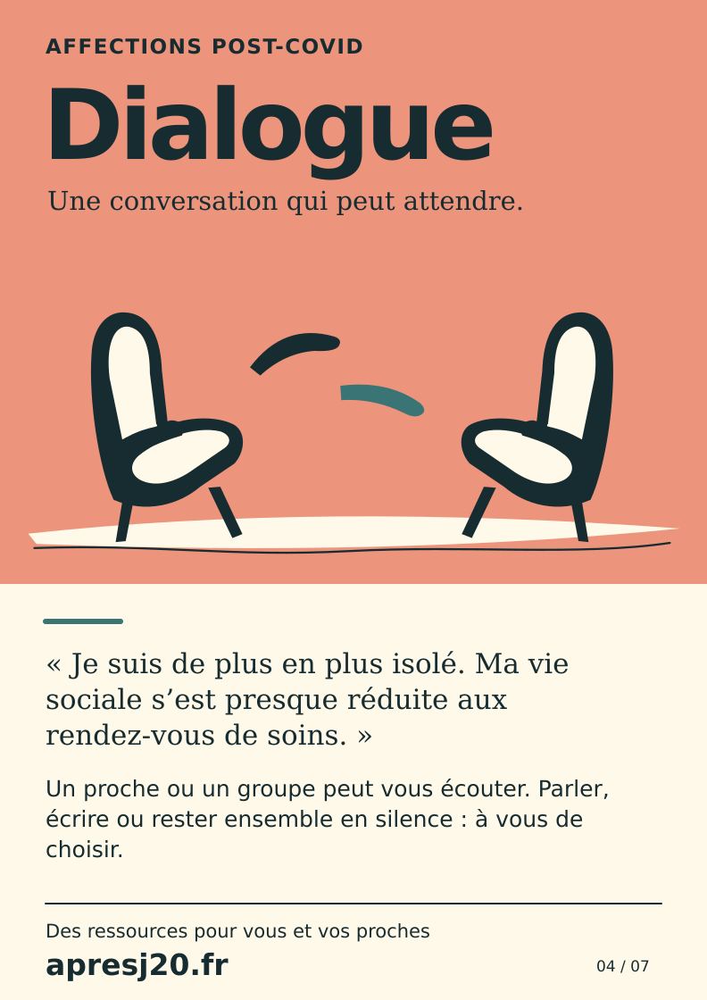
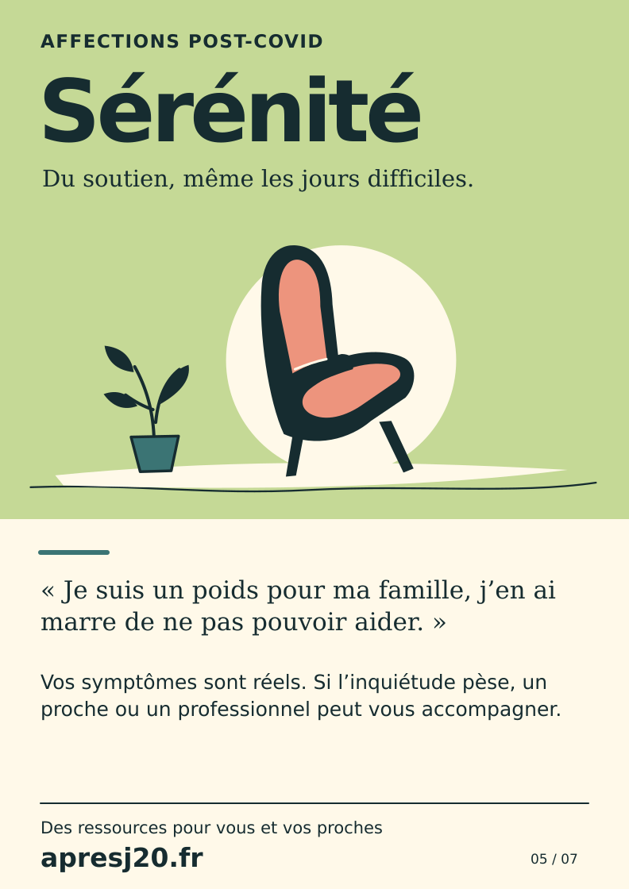
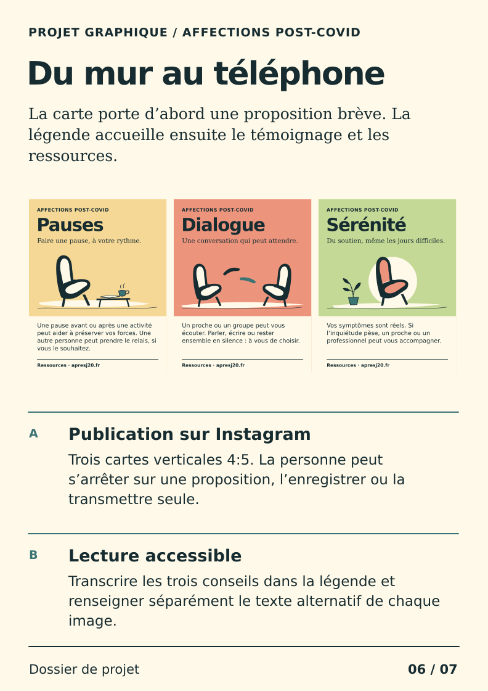
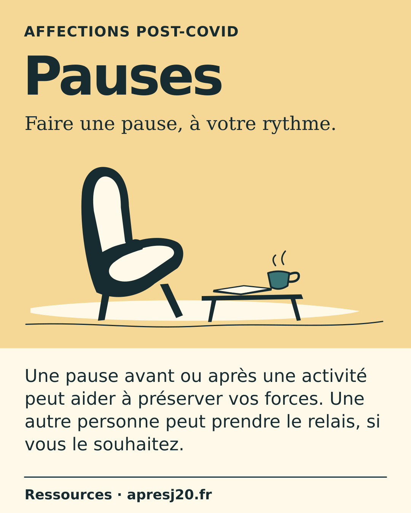
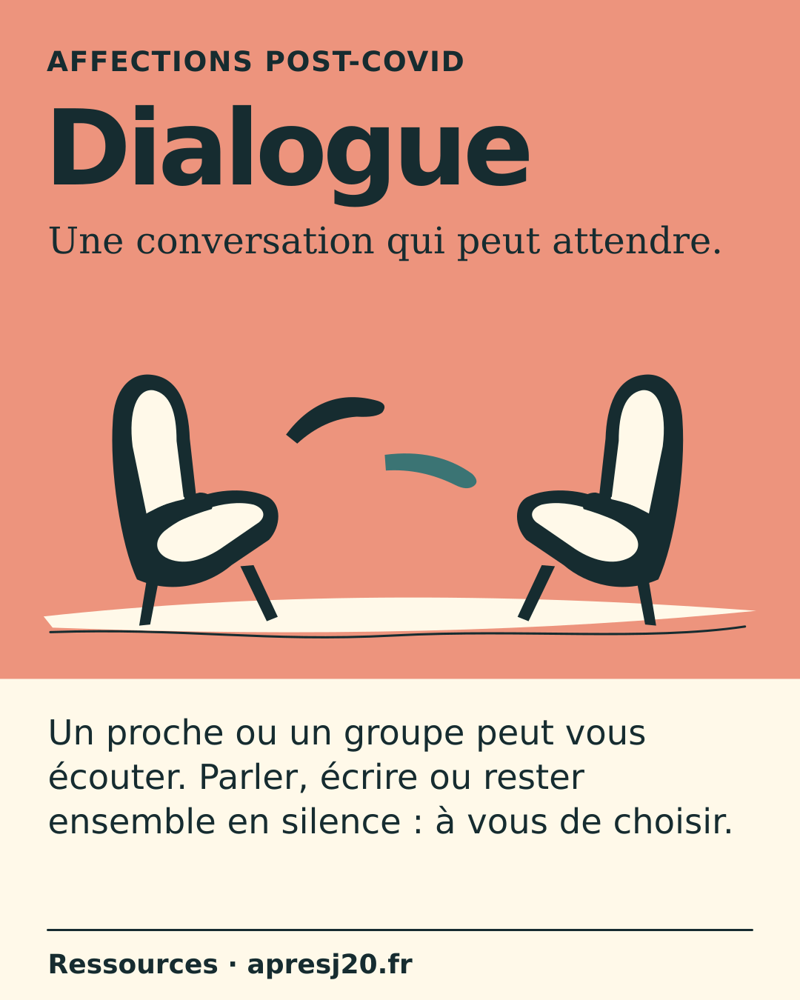
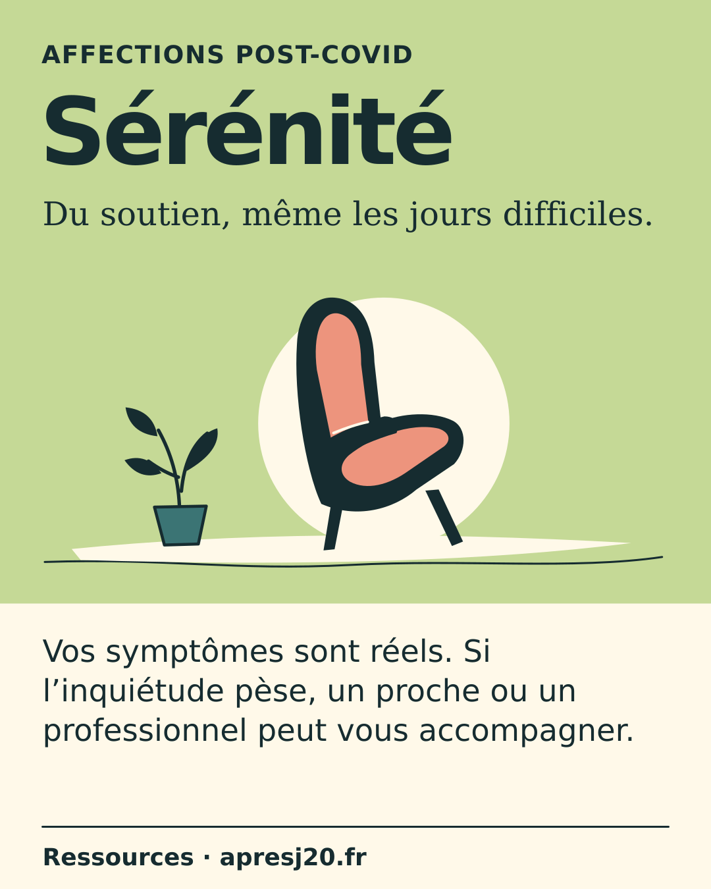
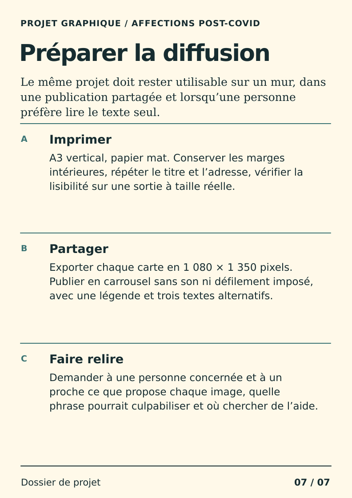

# ENS Paris-Saclay · Design graphique 2026 · Corrigé brut

*Corrigé rédigé par IA, non officiel. Signalez toute erreur.*

**Rédaction** · GPT-6.2 Astra Ultra · vitesse non renseignée

**Autocontrôle** · GPT-6.2 Astra Ultra · vitesse non renseignée

Sept planches A3 et trois cartes numériques composent la proposition « Laisser une place », destinée aux personnes touchées par les affections post-Covid et à leur entourage. Les visuels sont originaux. Les paroles entre guillemets sur les affiches proviennent de l’annexe du sujet.

## 01 · Le projet dans son lieu de lecture

Une personne assise dans une salle d’attente n’a pas nécessairement l’énergie de lire trois affiches ni l’envie de raconter ce qu’elle vit. Un proche, debout devant le même panneau, peut vouloir aider sans savoir comment. J’installe dans les trois affiches un fauteuil vacant. Chacun peut s’y projeter, y voir une place laissée à quelqu’un ou une invitation à rester auprès de lui. La campagne s’intitule « Laisser une place ». Son titre de projet figure dans le dossier. Sur le mur, la priorité revient aux trois mots de l’annexe.

La première lecture donne le contexte et le nom de la pratique. La deuxième associe un objet familier à une situation vécue. La troisième livre un geste possible et une adresse que l’on peut recopier. Les affiches citent un passage du témoignage imprimé dans l’annexe, puis reformulent son paragraphe explicatif. L’affiche peut ainsi parler au proche sans obliger la personne malade à lui donner elle-même toutes les explications. L’adresse renvoie à une association existante citée par le sujet. Cette campagne est une proposition de concours indépendante.

## 02 · Recherches et choix du signe

J’ai dessiné une jauge, une courbe, puis un fauteuil. La jauge aurait l’avantage d’un signe très vite reconnu, mais elle prêterait au corps une réserve d’énergie mesurable. La courbe deviendrait une promesse de progression régulière dès qu’on la lirait de gauche à droite. Or les témoignages décrivent des jours inégaux. Le fauteuil peut rester le même d’une image à la suivante tandis que sa relation aux choses change. Une petite table suggère qu’on peut reprendre plus tard. Un deuxième siège ouvre un face-à-face. Un cercle éclairé ménage une place à l’inquiétude exprimée par le témoignage.

Dans *Divan Japonais* (1892-1893), Toulouse-Lautrec fait reconnaître une situation à partir de silhouettes et d’accessoires sélectionnés. Je retiens cette économie pour que le fauteuil soit reconnaissable avant la lecture, en évitant une représentation extérieure du « visage du malade ». Le travail de Gerd Arntz avec Otto Neurath montre comment des formes stables facilitent la comparaison visuelle. Ici, le nombre de fauteuils exprime une relation qualitative. Il ne donne aucune mesure de fréquence ni de prévalence. [Notice du Metropolitan Museum](https://www.metmuseum.org/art/collection/search/334197) · [Collection de l’université de Reading](https://collections.reading.ac.uk/art-collections/collections/arntz-gerd/)

## 03 · Pauses

Le titre se lit en haut du panneau. La tasse et le livre posé sur la table restent à portée du fauteuil. L’activité peut être interrompue et reprise au moment choisi. L’intervalle silencieux au-dessus de la scène est volontaire. Un chronomètre aurait au contraire défini une « bonne » durée de repos. Le témoignage est composé en caractères à empattements. Le conseil revient aux caractères sans empattements des informations pratiques. Il propose aussi au proche de prendre le relais. La HAS souligne l’importance de respecter les limites individuelles et de fractionner les activités en tenant compte des exacerbations post-effort. [Parcours de soins de la HAS](https://www.has-sante.fr/jcms/p_3507843/fr/parcours-de-soins-de-l-adulte-avec-des-symptomes-prolonges-de-la-covid-19)

## 04 · Dialogue

Les deux sièges sont à la même hauteur. Aucun personnage porteur d’une blouse, d’un micro ou d’une autre marque d’autorité ne vient décider qui a le droit de parler. Les deux petites formes entre les dossiers font circuler la parole sans surcharge de bulles écrites. La phrase de proximité prévoit aussi le silence et l’écrit. Dans une salle de soins, le témoignage sur l’isolement peut être reconnu comme tel, puis discuté plus tard avec quelqu’un que l’on choisit.

## 05 · Sérénité

Le cercle clair rassemble un fauteuil et le vide autour de lui. La plante sert de contrepoids visuel. Elle ne décrit aucun traitement. Le passage de l’annexe exprime la crainte de devenir une charge. Le texte qui lui répond reconnaît la réalité des symptômes et la possibilité d’un accompagnement. En parcourant les trois affiches côte à côte, le lecteur retrouve les mêmes marges, la même ligne de sol, la même adresse et la même distinction entre parole vécue et proposition.

## 06 · Le carrousel Instagram

Je choisis un carrousel d’images fixes au format 4:5. Chaque carte existe en 1 080 × 1 350 pixels logiques à l’export. L’utilisateur peut s’arrêter, revenir sur une carte, l’enregistrer ou la transmettre seule. Le contexte et la ressource restent donc sur chaque image. Sur téléphone, le témoignage long passe dans la légende pour donner davantage de place au conseil. La planche 06 montre la séquence. Les trois cartes qui la suivent sont les fichiers de diffusion, indépendants des sept feuilles de concours.

**Légende prête à publier.** Les affections post-Covid peuvent bouleverser le quotidien. Pauses — une activité peut être fractionnée et quelqu’un peut prendre le relais si vous le souhaitez. Dialogue — parler avec un proche ou des pairs, écrire ou partager un silence sont autant de possibilités. Sérénité — les symptômes sont réels et il existe des personnes à qui confier une inquiétude. Dans les mots de l’annexe de cette série, une heure de tâche peut en demander deux ou trois, les rendez-vous de soins peuvent occuper presque toute une vie sociale et la crainte de peser sur ses proches peut être difficile à dire. Pour retrouver des ressources et des réseaux de soutien, consulter l’association AprèsJ20. [Ressources d’AprèsJ20](https://www.apresj20.fr/)

## 07 · Imprimer, diffuser et éprouver le système

Le dossier comprend sept feuilles A3 verticales de 297 × 420 mm. Les trois affiches occupent les feuilles 03 à 05. La feuille 06 réunit les trois cartes, dont les fichiers autonomes conservent le format numérique. Les feuilles portent un numéro discret en pied sans nom de candidat. Le dessin en aplats peut être exécuté au feutre, au papier découpé et au calque dans les deux séances de huit heures. La première est consacrée à l’analyse, aux variantes et à la fixation des gabarits. La seconde sert à réaliser la série, à recomposer les cartes et à contrôler les sorties.

L’encre foncée des caractères, le papier ivoire et les fonds ocre, corail ou vert distinguent les plans. Même en niveaux de gris, le nombre et la position des sièges, le titre et la phrase permettent de différencier les trois affiches. Pour la diffusion envisagée, prévoir du papier mat, une sortie à taille réelle et le contrôle sur un téléphone étroit. Le lien est écrit en clair, sans compte à créer ni appareil photo requis pour le recopier.

Avant toute diffusion réelle, demander à des personnes concernées de lire les propositions, de décrire à qui elles s’adressent et de retrouver la ressource. Observer où le regard s’arrête et quelle tournure pourrait ressembler à une injonction. Une hésitation sur la place de l’aide dans « Sérénité » appellerait une modification du texte ou du cadrage ; des difficultés à lire l’adresse appelleraient un agrandissement du pied. Il s’agit de tests proposés. Aucun résultat d’enquête auprès de malades n’est revendiqué.

[Fascicule officiel, demande p. 3 et annexe p. 4](https://ens-paris-saclay.fr/sites/default/files/CONCOURS/ANNALES_1C/1C_Design/2026/2026_sujet_1A_design_graphique.pdf)
