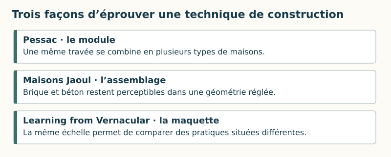

# ENS Paris-Saclay · Design — Histoire de l’art 2026 · Corrigé brut

*Corrigé rédigé par IA, non officiel. Signalez toute erreur.*

**Rédaction** · GPT-6.2 Astra Ultra · vitesse non renseignée · 24 novembre 2026

**Autocontrôle** · GPT-6.2 Astra Ultra · vitesse non renseignée · 24 novembre 2026

**Révision (tour 1)** · GPT-6.2 Astra Ultra · vitesse non renseignée · 25 novembre 2026

**Révision (tour 2)** · GPT-6.2 Astra Ultra · vitesse non renseignée · 26 novembre 2026

## Le matériau fixe peut-il remplacer le matériau naturel ?

Dans *Vers une architecture* (1923), Le Corbusier ne se contente pas de prévoir qu’une matière en remplacera une autre. Il transforme une différence entre matières en hiérarchie entre savoirs. Ce qui varie de pièce en pièce devient « douteux ». Ce qui se soumet à l’essai du laboratoire devient une promesse de certitude. Puis le futur implicite d’une évolution industrielle se change en obligation, « le matériau fixe doit remplacer le matériau naturel ». De la cité Frugès à l’exposition *Learning from Vernacular*, que devient cette prétention à fixer, par l’industrie, la valeur d’une technique de fabrication ?

### I. Fixer la matière pour pouvoir projeter en série

Un matériau dit « fixe » n’est pas immobile. Il possède des caractéristiques que le concepteur peut raisonnablement tenir pour constantes d’un exemplaire à l’autre. La régularité permet de dimensionner avant le chantier, de calculer un assemblage et de confier l’exécution à distance. L’épreuve décisive devient répétable. À une pierre dont l’ouvrier apprécie individuellement la veine, la doctrine oppose un élément éprouvé selon un protocole public. L’opposition possède une force polémique dans le débat sur la production du logement. Si l’on veut multiplier les maisons de qualité, connaître à l’avance les éléments disponibles et leurs combinaisons promet d’affranchir le projet d’une série de décisions particulières, coûteuses à répéter.

La cité Frugès à Pessac permet de suivre cette proposition de l’écrit au chantier. L’industriel Henry Frugès sollicite Le Corbusier après avoir lu son ouvrage. Avec Pierre Jeanneret, l’architecte travaille sur une trame de cinq mètres, sur des travées et sur leurs combinaisons. Une maison à arcades et une maison dite « gratte-ciel » ne présentent pas au passant la même silhouette, bien qu’elles appartiennent au même projet de normalisation. La répétition de l’élément de base rend ici possible la variation du type. La polychromie traite en outre la perception de la profondeur et des volumes. Un matériau industriel ne prescrit donc pas à lui seul l’aspect de la rue. La décision esthétique intervient à l’échelle du groupement et des rapports entre ses parties.

L’émancipation promise vis-à-vis du savoir de chantier rencontre pourtant une limite sur ce chantier même. Le canon à ciment voulu à Pessac pose des problèmes de mise en œuvre. Les secteurs effectivement achevés recourent à des murs en blocs de mâchefer. Le laboratoire peut garantir certaines propriétés en amont sans garantir que des ouvriers, un outillage et un calendrier formeront sur place un système opérationnel. L’expérimentation révèle donc à la fois l’efficacité du module dans la conception et la dépendance d’une technique envers ceux qui la réalisent.

### II. Une pratique moderne peut reprendre ce que son manifeste écartait

L’antithèse de 1923 place sous le même terme de « naturel » des choses distinctes. Le bois varie avec l’essence, la coupe ou l’humidité. Décider quel morceau convient à quel usage est cependant une opération de sélection et de transformation. Inversement, une brique issue de la cuisson d’une pâte préparée est un produit artificiel qu’un artisan peut employer suivant un savoir transmis. Le partage entre naturel et artificiel ne se superpose donc ni à celui de l’artisanat et de l’industrie, ni à celui du variable et du régulier. La taille d’une pièce, la tolérance d’un joint et la possibilité de reprendre localement l’ouvrage constituent trois manières différentes de maîtriser une variation.

Les maisons Jaoul, réalisées à Neuilly-sur-Seine dans les années 1950, mettent à l’épreuve ces distinctions dans l’œuvre même de Le Corbusier. Les façades associent brique apparente et bandeaux de béton brut. La couverture utilise des voûtes catalanes en éléments plats de terre cuite. Dans la pièce, la courbe de l’intrados donne à lire le passage d’un appui à l’autre. Dans le mur, le joint et les petites différences de surface permettent de percevoir l’unité de maçonnerie. L’ensemble n’abandonne pourtant pas le contrôle des proportions. La trame des travées est réglée suivant le Modulor. La rigueur de la mesure peut ainsi changer d’objet. Elle porte sur les intervalles et sur l’accord des techniques, tout en laissant paraître les différences entre les pièces fabriquées et posées.

Ce déplacement invite à lire le verbe « remplacer » comme la prise de position d’un manifeste. Il désignait un adversaire pour ouvrir des possibilités. La pratique ultérieure n’avance pas en éliminant, l’une après l’autre, des techniques expirées. La voûte traditionnelle reçoit un autre sens lorsqu’elle devient, dans une maison de banlieue parisienne, une expérience moderne de l’épaisseur, de la courbure et de l’assemblage. Réciproquement, vingt briques semblables ne suffisent pas à transmettre l’intelligence du geste qui les fait tenir en voûte.

Le Domaine de la Terre, à Villefontaine, offre en 1985 une expérience à l’échelle de soixante-cinq logements. On y bâtit notamment en pisé, en blocs de terre comprimée et en terre-paille. Dans le pisé, la terre est tassée par couches entre les parois d’un coffrage. Dans le deuxième procédé, la presse donne à des éléments distincts des dimensions répétables, puis ces éléments sont assemblés en mur. Le passage d’un mur compacté sur place à un mur de blocs déplace le moment où l’on fixe la géométrie. Il laisse entière la question de la composition locale du sol et de sa convenance au chantier. Ce quartier habité dissocie ainsi deux opérations que le manifeste de 1923 tendait à confondre. Éprouver un matériau peut permettre de réemployer une ressource locale. Produire des éléments fixes peut renouveler une technique de terre crue. La prescription du remplacement devient une proposition technique que l’on peut soumettre, elle aussi, à l’essai. [Les techniques du Domaine de la Terre, Ville de Villefontaine](https://villefontaine.fr/wp-content/uploads/2019/04/plaquette-village-terre-final.pdf)

### III. Qu’apprend-on du vernaculaire lorsqu’on l’expose ?

L’exposition *Learning from Vernacular*, présentée notamment au domaine de Boisbuchet en 2009, part d’un autre dispositif de connaissance. Les Archives de la construction moderne de l’EPFL conservent un ensemble de modèles d’architectures vernaculaires. Trente-deux maquettes au 1/20 sont réunies à Boisbuchet avec des schémas et des photographies de Deidi von Schaewen. La répétition d’une échelle de présentation ne vise plus à faire produire partout un même élément. Elle offre au regard des constructions différentes dans des conditions qui permettent de comparer leurs rapports au climat, aux ressources et aux usages.

Cette réhabilitation est plus exigeante qu’un goût pour les silhouettes pittoresques. Un toit débordant organise l’ombre et la protection des parois. Une enveloppe entretenue à intervalles réguliers suppose des matériaux réparables, du temps et des personnes capables de refaire le geste. Copier le grand débord ou la couleur d’un mur en déplaçant tout le reste reviendrait à prendre pour un style ce qui était une réponse collective à une situation. La maquette a justement une limite instructive. Elle fixe sous le regard une construction qui, dans son milieu, peut être périodiquement transformée. Les photographies et les documents replacent le modèle dans la durée de l’entretien et dans un paysage habité.

Ce que l’on compare change d’un dispositif à l’autre. À Pessac, une travée standard peut se répéter dans des distributions différentes. Aux maisons Jaoul, c’est la régularité d’un assemblage qui rend compatibles des matériaux distincts. Dans l’exposition, l’échelle commune des maquettes rend les différences de construction lisibles. La standardisation du moyen de comparaison peut donc servir à montrer la variété que le manifeste paraissait vouloir écarter.

Le déplacement entre le manifeste et l’exposition concerne ainsi ce qui fait preuve. Le premier demande à la répétition de l’essai de garantir les propriétés du matériau. La seconde donne à comparer des solutions éprouvées par des groupes humains dans des lieux et des temps distincts. La critique historique du slogan de 1923 n’exige pas de renoncer à l’essai de laboratoire. Elle oblige à ajouter à la propriété mesurée de l’élément la variété des assemblages, l’organisation du chantier et les conditions sociales qui permettent à une technique d’être reprise et transmise.

Le feuillet attribue l’extrait à « Flammarion, 1923 ». La Fondation Le Corbusier identifie l’édition originale de 1923 aux Éditions Crès, dans la collection de L’Esprit nouveau. [Notice de l’ouvrage, Fondation Le Corbusier](https://www.fondationlecorbusier.fr/oeuvre-livre/vers-une-architecture-le-corbusier-1923/)

[Énoncé officiel](https://ens-paris-saclay.fr/sites/default/files/CONCOURS/ANNALES_1C/1C_Design/2026/2026_SUJET_1A_Design_Histoire_de_l_art.pdf)
