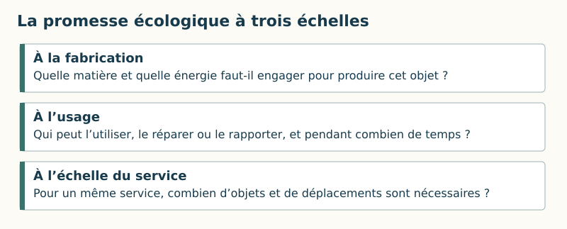

# ENS Paris-Saclay · Design — Philosophie de l’art 2026 · Corrigé guidé

*Corrigé rédigé par IA, non officiel. Signalez toute erreur.*

**Rédaction** · GPT-6.2 Astra Ultra · vitesse non renseignée · 24 novembre 2026

**Autocontrôle** · GPT-6.2 Astra Ultra · vitesse non renseignée · 24 novembre 2026

**Révision (tour 1)** · GPT-6.2 Astra Ultra · vitesse non renseignée · 25 novembre 2026

**Révision** · GPT-6.2 Astra Ultra · vitesse non renseignée · 26 novembre 2026

## Définir par un problème

La bouteille consignée peut être plus lourde. Le poids d’un objet permet-il alors de reconnaître un design écologique ? Fixez le service à comparer avant de compter les contenants.

## Construire deux objections

**Que prouve le calcul ?** Comptez le remplissage initial parmi les usages. À service égal, le passage de cinq à deux remplissages porte le nombre de bouteilles de vingt à cinquante. Il reste à connaître leur fabrication, les retours, l’eau de lavage et l’état du milieu au moment du prélèvement.

**Qui peut réaliser la promesse ?** Une batterie amovible reste inutilisable sans pièce accessible et sans logiciel maintenu. L’exemple distingue l’ouverture technique du service réellement prolongé. Appliquez ensuite ce critère au choix entre concevoir un nouvel objet et entretenir celui qui existe déjà.

[Fraunhofer IZM, étude du Fairphone 5](https://www.fairphone.com/resources/pdf/Fairphone5_LCA_Report_2024.pdf) · [ADEME, réemploi du verre](https://observatoire-reemploi-reutilisation.ademe.fr/actualites/etude-consigne-emballages)

## Composition rédigée

Une bouteille de verre consignée peut porter des traces d’usure, tandis que sa voisine jetable ressort neuve du magasin. La première pourrait pourtant avoir exigé moins de matière pour rendre le même service sur plusieurs années. Le designer qui voudrait faire reconnaître la solution écologique par la seule apparence de l’objet se heurterait à cette difficulté. Or le mot design désigne à la fois une activité de conception et les formes qu’elle propose à l’usage. Que doit-on concevoir pour mériter le qualificatif d’écologique lorsque le jugement porte sur des relations et des conséquences qu’une forme visible ne suffit pas à révéler ?

### I. Il faut d’abord suivre l’objet au-delà de son apparence

L’objet fini rend présents une matière, une couleur, un poids. Une partie de ses effets a pourtant déjà eu lieu au moment où il apparaît à l’usager. Le métal a dû être extrait et transformé, le verre porté à haute température. D’autres effets dépendront de l’usage et de la fin de vie. Le qualificatif écologique demande donc une comparaison dont on fixe la fonction et la durée. Comparer le poids d’une bouteille réutilisable à celui d’une bouteille à usage unique n’apprend pas combien de bouteilles sont nécessaires pour distribuer mille litres de boisson dans les mêmes conditions. Le design change d’échelle dès qu’il prend au sérieux le service rendu.

Une analyse de cycle de vie donne une forme méthodique à cette intuition. Elle oblige à expliciter les limites retenues, les étapes et les indicateurs. Dans le cas du verre consigné, le transport de retour, le nombre effectif de rotations, le lavage et la casse modifient le résultat. Une bouteille affichée « réemployable » qui ne revient jamais au point de collecte consomme sa matière plus lourde pour une seule utilisation. L’ADEME a précisément étudié les conditions dans lesquelles des circuits français de réemploi se comparent aux solutions à usage unique. L’exemple fait apparaître une première obligation du designer, rendre possible dans les faits l’avantage dont il se réclame.

Prenons une hypothèse volontairement simple, cent livraisons d’un litre à remplissage identique. Vingt bouteilles utilisées cinq fois chacune, remplissage initial compris, suffisent. Si chacune ne sert que deux fois, il en faut cinquante. Ce calcul compte des contenants distincts. Il ne décide pas si les vingt premières sont les plus écologiques, car leurs matières, leurs trajets et l’organisation de leurs lavages peuvent différer. Son intérêt est de rendre la promesse réfutable. On peut vérifier combien d’usages ont vraiment été atteints et pourquoi certaines bouteilles restent hors du circuit.

Cette mesure ne rend cependant pas toutes les conséquences commensurables. Une option peut réduire la consommation de matière première et augmenter celle d’eau ou de transport. Le lieu des prélèvements et ceux qui en supportent la charge comptent. Une définition du bon design par un chiffre unique dissimulerait le choix de ce qui est mesuré. L’exigence écologique comporte alors deux opérations, examiner ce que l’objet engage matériellement et rendre discutable l’arbitrage effectué.

### II. La durée de vie est une relation organisée

Considérons un téléphone à batterie remplaçable. Un assemblage qui permet d’ouvrir l’appareil sans le détruire donne un pouvoir nouveau à son utilisateur. Il détache la durée de vie du téléphone de celle de l’un de ses composants. Cependant, l’accès à une vis manifeste seulement une possibilité. Pour que l’appareil dure, il faut une batterie disponible plusieurs années, une information intelligible, un prix acceptable et des logiciels encore maintenus. L’étude du Fairphone 5 par l’institut Fraunhofer IZM examine précisément l’incidence de scénarios de durée de service et de réparation. Le geste du designer porte donc à la fois sur l’assemblage présent et sur l’organisation future qui en tiendra la promesse.

La forme esthétique conserve ici un rôle essentiel. Un joint lisible, une pièce identifiable et un mode d’ouverture qui ménage la main font comprendre comment l’objet peut continuer à servir. Au contraire, une surface parfaitement lisse peut suggérer que tout défaut marque la fin du produit, bien qu’une réparation soit possible. On retrouve sous une forme écologique la question philosophique de la relation entre forme et fonction. La fonction envisagée n’est plus seulement le service immédiat. La forme communique aussi comment entretenir, démonter, transmettre. Elle fait de l’usager quelqu’un qui peut poursuivre le travail de conception dans le temps.

On peut objecter que cette conception transfère une charge vers l’utilisateur. Celui qui n’a ni argent ni temps pour réparer ne gagne pas nécessairement une liberté nouvelle. Une consigne dont le point de retour est éloigné pénalise ceux qui se déplacent difficilement. Concevoir ensemble un objet et ses conditions de reprise oblige donc à traiter la proximité, l’effort et le coût comme des dimensions de la qualité du dispositif. La relation écologique inclut les personnes qui assurent l’entretien ou qui ramènent l’emballage, et celles qui, faute d’accès, en resteraient exclues.

### III. Concevoir peut conduire à produire moins d’objets

Une difficulté demeure. Si chaque nouveau modèle revendique un gain écologique, le renouvellement accéléré peut annuler une partie du bénéfice. Le dessin d’un objet plus sobre ne suffit pas à justifier le remplacement de celui qui fonctionne déjà. Un design réfléchi doit pouvoir soumettre le projet lui-même à la question de sa nécessité. Cette interrogation prolonge la critique de Victor Papanek dans *Design for the Real World*. À qui répond le besoin que le projet se propose de satisfaire ? Qui décide qu’il appellera une nouvelle marchandise ? Il se peut que la réponse soit un service de réparation, un usage partagé ou la réaffectation d’une pièce disponible.

Un dernier cas éprouve la portée du qualificatif. Une installation peut consommer la même quantité annuelle d’eau de lavage dans deux régions. Là où le prélèvement se concentre à l’étiage, il peut accroître la pression sur des milieux aquatiques et des usages locaux déjà fragiles. Un bilan annuel identique ne dit pas ce que le milieu est en mesure de supporter à cette date. La conception écologique doit donc pouvoir déplacer une opération dans le temps, réduire le débit nécessaire ou renoncer au dispositif si ses conditions locales de fonctionnement sont incompatibles avec la persistance du milieu.

La bouteille constitue à ce titre un cas exemplaire. Des marques peuvent vouloir chacune une forme unique, immédiatement reconnaissable. Or un parc de formats compatibles facilite la collecte, le tri et le remplissage. La fascination pour la nouveauté individuelle de la bouteille peut entrer en conflit avec la sobriété du système entier. Renoncer à la singularité d’un profil peut devenir un acte exigeant de design si cette décision facilite les usages, raccourcit un circuit et laisse encore à l’usager les informations dont il a besoin. Le dessin de la caisse de transport, de l’ouverture lavable ou de la signalétique du retour prend alors une importance égale à celle de la silhouette en rayon.

Prenons deux réseaux utilisant la même bouteille lavable. Dans l’un, elle revient avec la livraison suivante ; dans l’autre, chaque usager doit faire un trajet spécifique pour la rapporter. La forme et la résistance de la bouteille sont identiques, mais le coût écologique par boisson servie peut différer. La conception engage donc aussi l’organisation de la circulation et du lavage.

Un design écologique est finalement une conception qui engage sa responsabilité à l’égard des milieux et des personnes sur la durée du service rendu. Elle exige de rendre vérifiables les effets matériels attendus, d’organiser les usages qui les conditionnent et de pouvoir réviser, jusqu’à l’abandonner, le projet d’un objet supplémentaire. L’esthétique retrouve dans cette définition une tâche précise. Rendre sensible la manière de prendre soin d’une chose peut contribuer à sa durée, à condition que la possibilité montrée par la forme soit effectivement offerte à ceux qui l’emploient.

[Sujet officiel, p. 3](https://ens-paris-saclay.fr/sites/default/files/CONCOURS/ANNALES_1C/1C_Design/2026/2026_SUJET_1A_Design_Philosophie_de_l_art.pdf#page=3)
