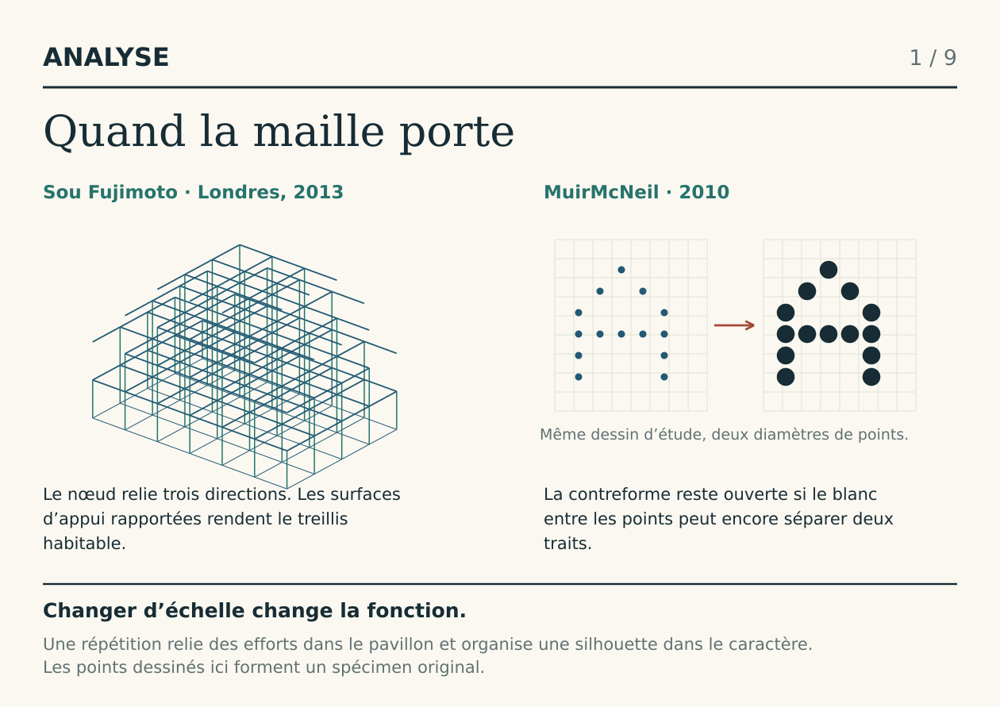
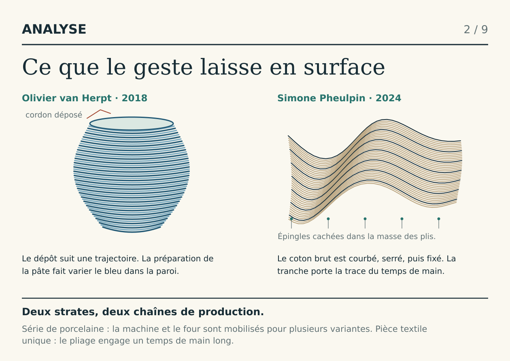
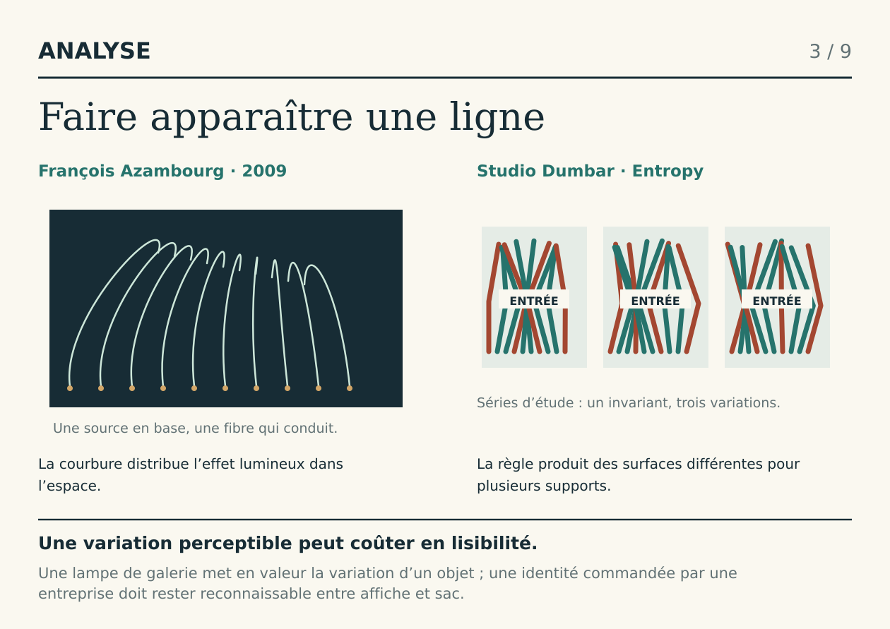
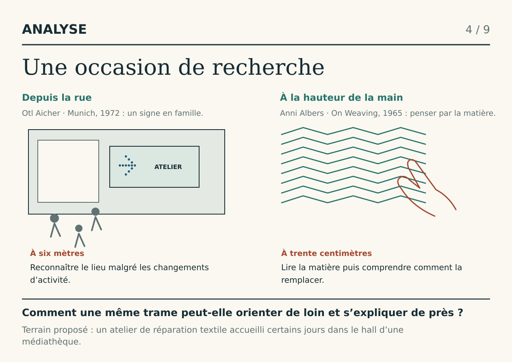
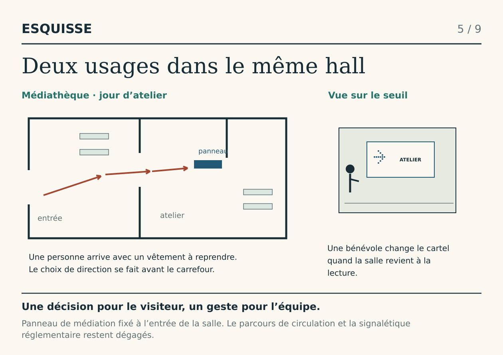
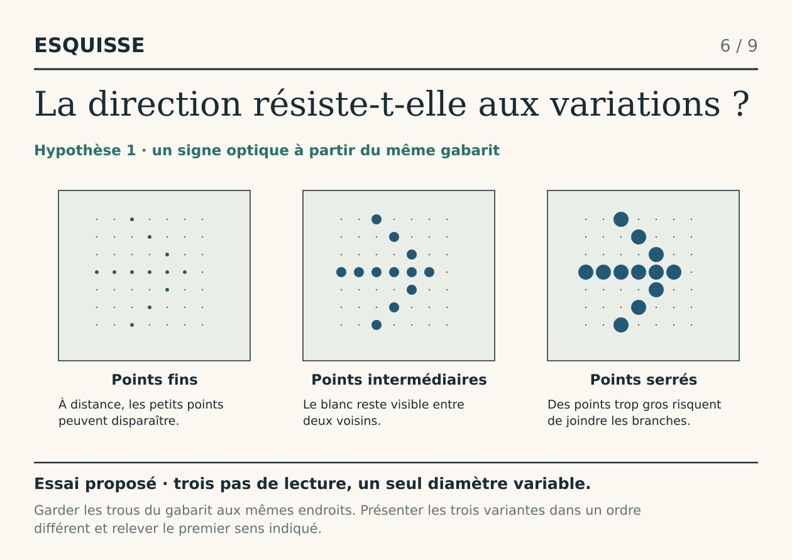
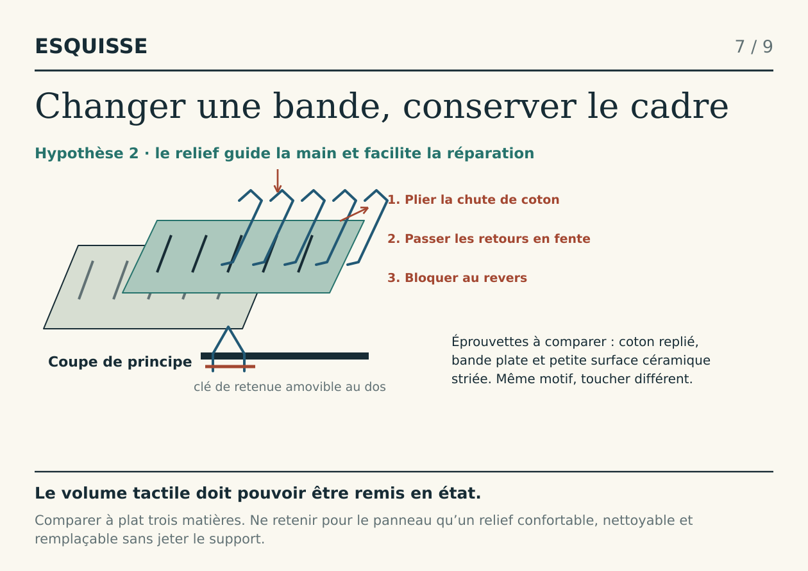
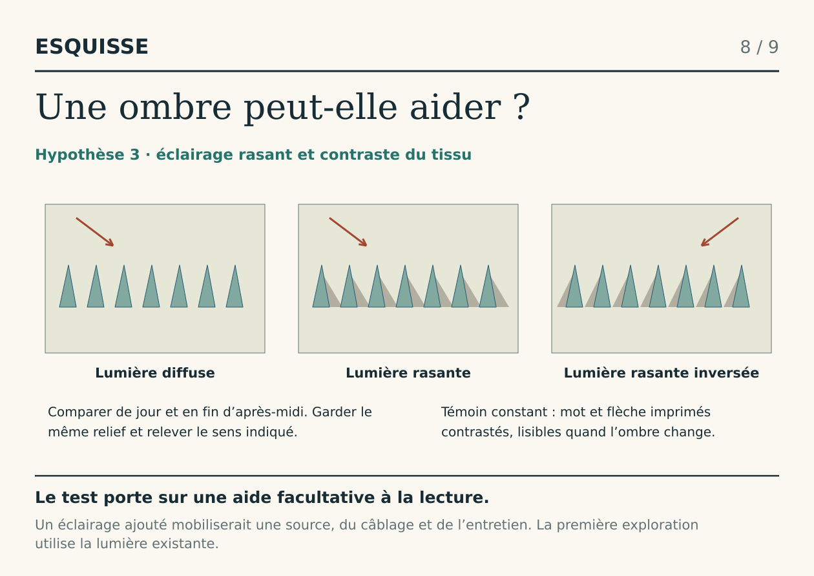
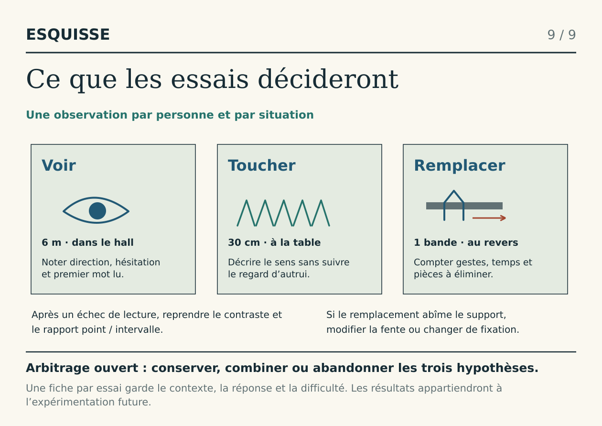

# ENS Paris-Saclay — Design, Techno-design 2026 · Corrigé guidé

*Corrigé rédigé par IA, non officiel.*

**Rédaction** · GPT-6.2 Astra Ultra · vitesse non renseignée

**Une trame à deux distances.** Cette proposition pour un atelier de réparation textile s’organise en neuf planches A3 paysage. Les planches 1 à 4 développent l’analyse du corpus ; les planches 5 à 9 présentent les esquisses. Chaque dessin porte son titre et son numéro. Les textes qui suivent les planches explicitent la démarche.

**Organiser les huit heures.** Réserver les quatre premières heures au repérage des procédés, à la comparaison et au dessin des quatre planches d’analyse. Garder les quatre suivantes pour situer l’usage, produire les hypothèses en parallèle et dessiner la façon de les départager. Lors de la composition sur papier, numéroter chaque planche et veiller à ce que le nom du candidat n’apparaisse ni au recto ni au verso.

## Analyse — Quand la maille porte · planche 1/9

> [!INDICATION]
> Se servir du détail du nœud pour comprendre la structure et du blanc pour comprendre la lettre. Dessiner en axonométrie un nœud à trois directions, puis esquisser deux A sur une même grille en ne changeant que le rayon des points. Encadrer un vide dans chaque dessin. Nommer ce que ce vide autorise à l’échelle du corps et à l’échelle de l’œil.

### Proposition rédigée

Le pavillon de Sou Fujimoto pour la Serpentine Gallery à Londres (2013) et les caractères *Two & Three Point* de MuirMcNeil (2010) partagent une grille. Dans le pavillon, les barres d’acier blanches de 20 mm se rencontrent selon trois directions. L’assemblage répartit les efforts entre nœuds. La photographie des pieds montre pourquoi les mailles seules ne font pas un sol. Des surfaces transparentes rapportées permettent de marcher tout en laissant voir le vide. Selon la profondeur traversée par le regard, les barres se superposent en un fond dense ou se détachent devant le parc. Le constructeur a assemblé de grands sous-ensembles en atelier pour cette commande d’architecture temporaire. L’apparente légèreté visuelle engage un travail de fabrication, de transport et de montage. [Le pavillon à la Serpentine](https://www.serpentinegalleries.org/whats-on/serpentine-gallery-pavilion-2013-sou-fujimoto/) · [Fabrication par Stage One](https://www.stageone.co.uk/project/serpentine-gallery-pavilion-2013/)

Chez MuirMcNeil, les points s’inscrivent dans une grille plane. Leurs diamètres et les intervalles entre eux déterminent les pleins, les contreformes et la valeur optique. Le bord du caractère peut sembler continu quand on recule. Un diamètre excessif peut boucher un intervalle essentiel. Le dessin initial et ses règles permettent de commercialiser plusieurs variantes typographiques, réutilisables sur différents supports. **Transfert à éprouver** — garder la direction d’un signe quand sa densité change, comme on garde la trame d’un pavillon quand une partie devient praticable. Les lettres d’étude de la planche sont originales. [Collection modulaire de MuirMcNeil](https://muirmcneil.com/project/mtc/)

## Analyse — Ce que le geste laisse en surface · planche 2/9

> [!INDICATION]
> Le mot « strate » décrit un aspect. Il faut encore expliquer ce qui porte et fixe chaque strate. Étudier un fragment de bord plutôt que de recopier les silhouettes. Dessiner un cordon en cours de dépôt à gauche et une coupe schématique de bandes comprimées à droite. Une flèche indique le temps de fabrication dans chaque dessin.

### Proposition rédigée

Dans les vases d’Olivier van Herpt (2018), les sillons horizontaux résultent de l’extrusion d’une pâte de porcelaine suivant un trajet commandé. Le rayon du trajet varie avec la hauteur. Le vase se resserre à la base et au col. Le bleu et le blanc se prolongent dans la paroi. Van Herpt indique qu’il mêle à la main l’oxyde de cobalt à la pâte avant l’extrusion. Une même géométrie d’impression peut donc donner des marbrures différentes. Le travail répond à une commande liée à une pyramide à fleurs historique du Kunstmuseum Den Haag. L’objet réinterprète les échanges entre porcelaines importées et faïences de Delft. Le réglage de la machine, le séchage et la cuisson entrent dans le temps de la série. [Olivier van Herpt, *Blue and White Porcelain*](https://oliviervanherpt.com/blue-and-white-porcelain/)

Dans *Lune de Bois* (2024), Simone Pheulpin plie des bandes de calicot brut et les maintient par un très grand nombre d’épingles. Sur la vue de détail, des nappes de fines lignes s’orientent différemment et se rencontrent en crevasses. Le changement de direction entre deux masses plissées produit une ressemblance avec un bois fendu. Les épingles stabilisent un matériau souple en volume. Cette sculpture de 66 × 66 × 10 cm est signalée en collection privée. La singularité de la pièce tient en partie au temps manuel accumulé. L’impression et le pliage rendent tous deux la succession des gestes visible. La cuisson fige les premiers, le maintien mécanique retient les seconds. **Piste** — rendre visible, sur un objet partagé, la manière dont une surface peut se démonter. [Pratique de Simone Pheulpin](https://simonepheulpin.com/bio/)

## Analyse — Faire apparaître une ligne · planche 3/9

> [!INDICATION]
> Distinguer la production de lumière, sa conduction et la perception du signe. Reprendre trois états d’un trait, de la source à l’effet perçu. Au regard du sac et de l’affiche du corpus, dessiner ensuite trois variantes graphiques dans lesquelles une même zone d’identification reste en place.

### Proposition rédigée

Avec *Bouclette & Baguette* (2009), François Azambourg compose un volume lumineux d’environ 50 cm de haut sur une base de 35 × 35 cm. Les photos font apparaître les connexions en pied, les lignes claires et de grandes boucles de courbures différentes. La LED fournit la lumière et la fibre optique la guide. La photographie établit la visibilité des lignes. Elle ne précise pas comment chaque fibre est traitée pour diffuser latéralement. L’effet d’ensemble dépend du contraste avec le fond. La lampe, présentée par la galerie kreo, demande en usage une alimentation et un accès aux composants. Une pièce de galerie peut donner une place considérable à l’assemblage et au réglage de ses fibres. [François Azambourg, *Bouclette & Baguette*](https://azambourg.com/portfolio/lampes-bouclette-baguette/)

Studio Dumbar répond à une commande d’identité pour Entropy, une entreprise du domaine de la cryptographie. Dans les images, les lettres et les masses colorées se superposent et changent de proportions entre le sac et l’affiche. La production d’une identité générative engage un travail initial sur les règles et sur leurs limites. Les coûts se déplacent ensuite vers la déclinaison et la vérification des formats. Un bord déformé peut évoquer une identité ouverte tandis qu’un mot trop recouvert disparaît. **Piste** — mettre la variation dans la matière ou le fond et réserver une zone stable à la direction et au nom. Les essais dessinés sur la planche utilisent un mot et des motifs créés pour cette copie. [Studio Dumbar, *Entropy*](https://studiodumbar.com/work/entropy)

## Analyse — Une occasion de recherche · planche 4/9

> [!INDICATION]
> Passer d’une parenté visuelle à une question située à laquelle plusieurs réponses restent possibles. Identifier une personne, une distance et une décision pour chaque lecture. Le terrain proposé est une hypothèse du candidat. Il peut être décrit précisément sans lui attribuer une enquête qui n’a pas eu lieu.

### Proposition rédigée

Les six productions déplacent le travail de conception vers l’unité répétée, son assemblage et ce qui varie d’une occurrence à l’autre. Deux références extérieures donnent des critères de choix. Pour Munich 1972, Otl Aicher organise un ensemble de pictogrammes et de supports à partir de règles graphiques communes. Le visiteur doit reconnaître des fonctions différentes dans une même famille de signes. Dans *On Weaving* (1965), Anni Albers invite à concevoir à partir de la structure et du comportement du matériau. La même étoffe peut rendre perceptible, au toucher, la manière dont elle tient. Le projet peut ainsi emprunter à Aicher la constance du signe et à Albers l’attention portée au geste et à la matière. [SFMOMA, *Otl Aicher: München 1972*](https://www.sfmoma.org/exhibition/otl-aicher/) · [Fondation Albers, *On Weaving*](https://www.albersfoundation.org/alberses/teaching/on-weaving)

**Question de recherche.** Dans le hall d’une médiathèque municipale qui accueille périodiquement un atelier de réparation textile, comment une même trame peut-elle orienter de loin et s’expliquer de près ? À six mètres, une personne venant faire réparer un vêtement doit décider vers quelle salle tourner. À trente centimètres, la bénévole qui remet le hall en configuration de lecture doit voir où saisir le module et comment le changer. Ces deux distances sont des hypothèses de terrain. Une matière riche peut résister à l’usage tout en brouillant la direction. Une impression permanente se lit facilement, mais elle multiplie les affiches à chaque changement d’activité.

## Esquisse — Deux usages dans le même hall · planche 5/9

> [!INDICATION]
> Choisir un emplacement en fonction du moment où la personne doit décider. Faire un plan du seuil et une élévation. Superposer un trajet et une position de remplacement, puis vérifier que le panneau se trouve avant le choix de direction et que les gestes de maintenance ne bloquent pas l’entrée.

### Proposition rédigée

**Proposition.** Un cadre mural reçoit une cassette de repérage pour les activités temporaires. Dans la première scène, une personne entre par la gauche avec une veste à reprendre. Depuis l’entrée, elle distingue une flèche et le mot ATELIER. À la bifurcation, le panneau lui confirme la salle. Dans la deuxième scène, la bénévole ouvre la retenue au dos de la cassette et change uniquement le cartel ou une bande usée. Le cadre et la direction principale servent de nouveau. Une nouvelle destination imposerait de mettre à jour flèche et intitulé ensemble.

Le panneau serait implanté sur le mur, à un endroit visible pour une personne assise comme debout et accessible à la main au seuil. Son emplacement réel et les hauteurs restent à éprouver avec les usagers. Le repère de l’atelier complète la signalétique publique permanente sans empiéter sur l’issue, son cheminement ou les indications de sécurité. La vue en plan teste la place et le moment de la lecture. L’élévation teste l’hypothèse d’une même cassette visible de loin et manipulable de près.

## Esquisse — La direction résiste-t-elle aux variations ? · planche 6/9

> [!INDICATION]
> Fixer le contour de la flèche et le fond de l’échantillon avant d’en faire varier la densité. Construire le même chevron sur trois matrices identiques de sept rangées. Modifier seulement l’étendue apparente de la tache. Garder un échantillon imprimé contrasté pour comparer avec le relief.

### Proposition rédigée

**Hypothèse optique.** Un signe construit en points peut être reconnu à six mètres si ses blancs restent assez ouverts et ses points assez présents. Sur trois éprouvettes, le centre de chaque point est fixé par le même gabarit. Seul son diamètre change. La plus fine risque de se perdre dans le fond du hall. La plus dense peut fermer l’espace entre deux branches. La variante intermédiaire constitue une hypothèse, présentée aux visiteurs dans un ordre alterné avec les autres.

Le visiteur indique d’abord une direction puis nomme la destination. Relever l’hésitation, l’inversion éventuelle et le besoin de s’approcher. Refaire l’essai avec une scène d’arrière-plan plus chargée. Le mot ATELIER conserve une zone calme et un contraste franc sur les trois prototypes. Si les trois flèches échouent quand le hall est animé, l’alternative est un signe continu classique sur fond uni. La texture peut alors rester cantonnée au registre de proximité.

## Esquisse — Changer une bande, conserver le cadre · planche 7/9

> [!INDICATION]
> Rendre le geste et le point de retenue compréhensibles dans une coupe et une vue éclatée. Dessiner séparément le cadre, la cassette ajourée, la bande repliée et la retenue. En coupe, vérifier que la main accède à la matière et que la pièce d’arrêt est au revers.

### Proposition rédigée

**Hypothèse tactile et constructive.** Un pli saillant pourrait rendre sensible le sens d’un motif et signaler à la bénévole où commence une bande amovible. Une chute de coton est pliée en crête. Ses deux retours passent par des fentes du support. Une petite clé accessible au revers les bloque. Un cadre commun reçoit la cassette entière. Un module abîmé peut ainsi être extrait et la bande remplacée séparément. La fixation emprunte au maintien mécanique de Pheulpin et remplace ses épingles, inadaptées à une manipulation publique, par une pièce retenue au dos.

Comparer sur table trois éprouvettes de même taille et présentant le même sens. Le coton plat sert de témoin. Le coton plissé teste une structure souple. Une petite plaquette de céramique aux stries arrondies transpose les cordons de van Herpt dans une surface rigide. Observer accrochage des fils, compréhension du sens, sensation des arêtes, entretien, casse et temps de remplacement. Noter la masse ajoutée, le temps de pliage et le recours à la cuisson séparément. La cuisson d’une céramique ou la collecte d’une chute textile ne suffit pas à établir un bénéfice environnemental. Si le relief s’avère ambigu à la main, conserver le pli comme indice de maintenance et la flèche contrastée pour l’orientation.

## Esquisse — Une ombre peut-elle aider ? · planche 8/9

> [!INDICATION]
> Disposer la même éprouvette sous trois éclairages pour distinguer ce qui appartient à la forme de ce qui dépend de la lumière. Tracer trois coupes identiques avec des flèches d’incidence différentes. Marquer l’ombre et le fond. Regarder si une ombre inversée suggère la mauvaise direction avant de décider de l’exploiter.

### Proposition rédigée

**Hypothèse lumineuse.** La lumière rasante du hall pourrait accentuer la succession des plis sans alimentation ajoutée au panneau. On expose le même module à une lumière diffuse puis à une lumière venant de la gauche et de la droite. On le retrouve ensuite dans le hall à deux moments de la journée. Le visiteur indique la direction avant toute explication. Relever séparément la lisibilité du mot, la direction donnée et la gêne éventuelle due à un reflet.

Azambourg montre l’intérêt d’un trait qui apparaît par la lumière. Le projet soumet cet effet à une contrainte différente, celle d’un repère public. Si une ombre inversée trompe la lecture ou si le panneau perd son sens dans la pénombre, supprimer la dépendance à l’ombre. Le mot et la flèche imprimés restent lisibles sous l’éclairage ambiant ordinaire du hall. Une installation de fibres et de LED ajouterait une alimentation, du montage et des pièces à entretenir. Elle ne serait étudiée qu’en cas de besoin établi par les essais.

## Esquisse — Ce que les essais décideront · planche 9/9

> [!INDICATION]
> Décider de ce qui pourra faire conserver, modifier ou abandonner une hypothèse. Préparer une fiche avec la configuration du hall, la variante, la première réponse et le geste observé. Laisser vide la colonne des résultats tant que l’essai n’a pas eu lieu.

### Proposition rédigée

Organiser trois moments avec l’accord de volontaires et de l’équipe de la médiathèque. À l’entrée, proposer les trois signes optiques dans des ordres alternés et relever la direction choisie, le premier mot lu et les hésitations. À une table, demander à des personnes aux habitudes de lecture et aux capacités visuelles différentes de décrire les trois échantillons, avec et sans vue selon leur préférence. Une préférence tactile ne garantit pas la compréhension du sens. Dans un troisième temps, demander à une bénévole de remplacer une bande avec le seul dessin au dos de la cassette. Relever le nombre de gestes, le temps, les pièces endommagées et l’accessibilité de la retenue.

Comparer le temps de fabrication par panneau, la masse effectivement remplacée après usure et les contraintes de nettoyage à ceux d’un cartel imprimé simple. Aucune économie n’est acquise avant cette comparaison. Si le signe est lu mais le montage échoue, garder la grille optique et reprendre les fentes. Si le relief est compris mais la flèche se perd à distance, séparer le signe continu et la surface explorée par la main sur le même support. Si les deux lectures et le remplacement sont possibles, éprouver le dispositif sur un deuxième atelier avant de définir une série. **Le résultat de l’esquisse est ce programme d’essais et d’arbitrage.**
