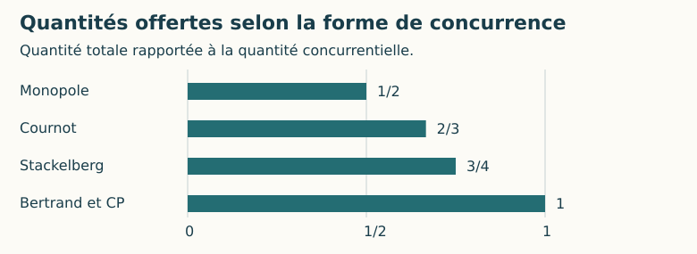

# ENS Paris-Saclay · Économie-gestion option 1 — Analyse microéconomique 2026 · Corrigé brut

*Corrigé rédigé par IA, non officiel. Signalez toute erreur.*

**Rédaction** · GPT-6.2 Astra Ultra · vitesse non renseignée

**Autocontrôle** · GPT-6.2 Astra Ultra · vitesse non renseignée

**Révision (tour 1)** · GPT-6.2 Astra Ultra · vitesse non renseignée

**Révision (tour 2)** · GPT-6.2 Astra Ultra · vitesse non renseignée · 26 novembre 2026

**Couverture vérifiée.** Les 44 questions terminales des pages 1/4 à 4/4 ont été vérifiées dans les deux éditions. Le contrôle porte sur les cinq structures de marché, les surplus et l’indice de Lerner, l’entrée avec coût fixe et engagement préalable, puis les profits avec et sans information sur les coûts. Un équilibre numérique à production nulle vérifie la portée des formules de la troisième partie.

## Concurrence, entrée et information sur les coûts

On pose $A=a-c>0$ et $K=A^2/b$. Les quantités sont non négatives. Dans la première partie tous les équilibres symétriques calculés sont intérieurs. Les parties suivantes nécessitent parfois de traiter une production nulle.

### Première partie. Deux firmes identiques

**1.1.1 à 1.1.3.** Pour $0\leq p\leq a$, $Q(p)=(a-p)/b$. Au-delà du prix de réservation maximal $a$, la demande est nulle. Pour $0<p<a$, l’élasticité signée vaut $\varepsilon=(dQ/dp)p/Q=-p/(a-p)$. Une hausse locale de 1 % du prix diminue la quantité d’environ $p/(a-p)$ %. La pente de la demande directe est constante, mais son élasticité en valeur absolue croît de 0 à l’infini lorsque le prix monte de 0 à $a$. Elle vaut 1 à $p=a/2$.

**1.2, 1.2.1 et 1.2.2.** Les acheteurs reçoivent la différence entre leur disposition totale à payer et leur dépense. L’aire entre demande inverse et prix payé vaut
$$S=\int_0^Q(a-bu)\,du-pQ=bQ^2/2=(a-p)^2/(2b).$$
Quand le prix baisse, les anciens acheteurs économisent et de nouveaux achats deviennent avantageux. En particulier $dS/dp=-Q$.

**1.3.1 à 1.3.4.** À quantité rivale fixée, chaque firme maximise $(A-bq_i-bq_j)q_i$ sur $q_i\geq0$. La dérivée seconde vaut $-2b$. La réaction est $R_i(q_j)=\max(0,(A-bq_j)/(2b))$. À l’intersection,
$$q_1^C=q_2^C=A/(3b),\quad Q^C=2A/(3b),\quad p^C=c+A/3,\quad \pi_i^C=K/9.$$
Chaque quantité maximise le profit de son producteur compte tenu de la quantité de l’autre. Aucune déviation unilatérale n’est profitable, ce qui définit l’équilibre de Nash.

**1.3.5.1 à 1.3.5.3.** Le monopole maximise $(A-bQ)Q$, d’où $Q^M=A/(2b)$, $p^M=c+A/2$ et $\pi^M=K/4$. En concurrence parfaite le prix égalise le coût marginal, soit $p^{CP}=c$, et $Q^{CP}=A/b$. Chaque profit est nul. À coût marginal constant sans capacité limitée, toute répartition de cette quantité totale convient. Une répartition symétrique donne $A/(2b)$ par firme.

| Structure | $bQ/A$ | $(p-c)/A$ | Profit total / $K$ | $S/K$ | Surplus total / $K$ |
|---|---:|---:|---:|---:|---:|
| Monopole | $1/2$ | $1/2$ | $1/4$ | $1/8$ | $3/8$ |
| Cournot | $2/3$ | $1/3$ | $2/9$ | $2/9$ | $4/9$ |
| Concurrence parfaite | $1$ | $0$ | $0$ | $1/2$ | $1/2$ |

L’augmentation des quantités du monopole à la concurrence réduit le prix et le profit total de la branche. Les gains des acheteurs dépassent les profits perdus car des échanges dont la valeur excède le coût deviennent possibles.

**1.4.1 à 1.4.4.** La demande de $i$ vaut $Q(p_i)$ si $p_i<p_j$, $Q(p_i)/2$ si les prix sont égaux et zéro si $p_i>p_j$. Au-dessus de $c$, sous-coter de très peu un prix commun permet de prendre toute la demande. Avec des prix inégaux et une marge positive, la firme exclue peut à son tour vendre avec profit en sous-cotant le prix bas. Si le prix bas est $c$ et l’autre est supérieur à $c$, le vendeur à coût marginal peut hausser un peu son prix. Vendre sous $c$ à demande positive fait une perte évitable. L’unique équilibre en prix purs est donc $p_1^B=p_2^B=c$, chacun vendant $A/(2b)$ pour un profit nul. Le prix est plus bas qu’à Cournot, chaque firme fournit davantage, les profits disparaissent et $S^B=K/2>2K/9$. Deux producteurs suffisent ici à reproduire le prix concurrentiel. Ce résultat, dit paradoxe de Bertrand, dépend de l’homogénéité du produit, du coût identique et de la capacité de servir tout le marché.

**1.5.1 à 1.5.5.** Par récurrence à rebours, le suiveur répond $R_2(q_1)=\max(0,(A-bq_1)/(2b))$. Sur la branche positive, le leader maximise $q_1(A-bq_1)/2$. D’où
$$q_1^S=A/(2b),\quad q_2^S=A/(4b),\quad Q^S=3A/(4b),\quad p^S=c+A/4.$$
Une production du leader assez forte pour évincer totalement le suiveur donnerait ici un profit nul ou négatif. Les profits sont $\pi_1^S=K/8>K/9$ et $\pi_2^S=K/16<K/9$. Le leader gagne deux fois le profit du suiveur. Le surplus des acheteurs vaut $9K/32$ et le surplus total $15K/32$. Ils dépassent ceux de Cournot et restent en dessous des niveaux concurrentiels. L’engagement crédible du premier producteur incite le second à réduire sa quantité. Cette contraction ne compense qu’en partie l’expansion du leader.

À coûts identiques, l’engagement du meneur porte la quantité totale de $2A/(3b)$ à $3A/(4b)$, soit un gain de $A/(12b)$ par rapport au jeu simultané. Par la demande inverse, cet écart fait baisser le prix de $A/12$. L’écart à la quantité concurrentielle se réduit donc quand le meneur s’engage en premier.

**1.6.1 à 1.6.4.** L’indice $L=(p-c)/p$ mesure la fraction du prix correspondant à la marge sur coût marginal. À un optimum intérieur de prix d’une firme dont la demande propre est $Q(p)$, la condition $Q+(p-c)Q'=0$ donne $L=-1/\varepsilon$. Une demande plus élastique en valeur absolue limite la marge relative soutenable. En oligopole il faut distinguer la demande de marché de celle que perçoit chaque firme compte tenu de sa stratégie et des réactions des autres. Ici $L$ augmente avec $p$ puisque $c>0$. Les valeurs $0,0,A/(a+3c),A/(a+2c),A/(a+c)$ correspondent respectivement à la concurrence parfaite, Bertrand, Stackelberg, Cournot et au monopole. Ainsi $L^{CP}=L^B<L^S<L^C<L^M$.

**1.7.** La même paire de producteurs peut avoir une marge nulle, intermédiaire ou plus élevée selon qu’elle fixe des prix, des quantités successives ou des quantités simultanées. Le nombre d’entreprises ne suffit donc pas à mesurer le pouvoir de marché. Dans ce modèle sans différence de coût, la restriction des quantités qui permet la marge fait aussi perdre du surplus aux consommateurs et détruit une partie des gains d’échange.

### Deuxième partie. Un entrant et un engagement de production

**2.1.1 et 2.1.2.** Si les trois firmes sont actives, leurs conditions donnent $p-c_i=bq_i$. En sommant puis en réinjectant $p=a-bQ$, il vient
$$p=(a+2c+c_3)/4,\quad Q=(3a-2c-c_3)/(4b),$$
$$q_1=q_2=(a-2c+c_3)/(4b),\qquad q_3=(a+2c-3c_3)/(4b).$$
Avec $F=0$, $\pi_i=bq_i^2$ pour chaque firme. L’entrant produit strictement si $c_3<p^C=(a+2c)/3$. S’il coûte au moins ce prix, sa meilleure réponse est zéro et l’ancien duopole demeure. L’intérieur suppose aussi $c_3>2c-a$. Si $0<c_3\leq 2c-a$, les deux firmes en place ne produisent plus. La firme 3 vend alors $(a-c_3)/(2b)$ au prix $(a+c_3)/2\leq c$ avec un profit brut $(a-c_3)^2/(4b)$. À l’égalité les formules coïncident.

**2.2.1 à 2.2.3.** Dans le cas des trois productions positives, l’offre totale augmente de $q_3/3$, le prix baisse de $bq_3/3$ et chaque firme en place produit $q_3/3$ de moins qu’auparavant. Chacun des deux anciens profits passe donc de $K/9$ à $bq_i^2<K/9$. Le nouvel entrant dégage un profit brut positif. Le surplus consommateur croît de $b(Q-Q^C)(Q+Q^C)/2>0$. Lorsque l’entrant évince les deux concurrents, leur profit tombe à zéro, le prix descend sous $p^C$ et l’offre et le surplus augmentent encore par rapport au duopole initial.

Le coût fixe ne modifie pas la meilleure quantité conditionnelle à l’entrée. Le profit net de la firme 3 est $F^*-F$ avec
$$F^*=(a+2c-3c_3)^2/(16b)$$
dans le cas intérieur, et $F^*=(a-c_3)^2/(4b)$ si les deux firmes en place sont évincées. L’entrée est strictement avantageuse pour $F<F^*$ et laisse indifférent au seuil. La règle du sujet autorise l’entrée à égalité. Le gain des acheteurs provient de la diminution du prix, indépendamment de qui acquitte le coût fixe.

**2.3.1 à 2.3.4.** Face à une quantité totale engagée $\widehat Q$, la meilleure quantité conditionnelle vaut
$$q_3^*(\widehat Q)=[a-c_3-b\widehat Q]_+/(2b),\qquad [t]_+=\max(t,0).$$
Le profit brut maximal est $[a-c_3-b\widehat Q]_+^2/(4b)$. Pour $F>0$, un engagement $\widehat Q>(a-c_3-2\sqrt{bF})/b$ rend le profit net strictement négatif (si le seuil est déjà négatif, zéro suffit). À l’égalité, la firme peut encore entrer sans gain. Pour $F=0$, on ne peut lui imposer une perte si elle peut produire zéro. À partir de $(a-c_3)/b$, aucune production positive n’est avantageuse.

Les producteurs installés réduisent par avance la demande résiduelle. L’efficacité tient à la crédibilité des quantités engagées. La capacité inutilisée seule ne les contraint pas à vendre. Une firme assez grande peut consentir seule l’expansion nécessaire, ou des incitations individuelles peuvent produire l’offre totale requise. Une entente explicite n’est pas un préalable logique. Coordonner deux engagements est néanmoins difficile si chacun préfère laisser l’autre supporter l’effort. Produire davantage comprime la marge, immobilise des ressources et peut imposer un coût de capacité dans d’autres contextes. Chaque firme compare son profit avec dissuasion à celui qu’elle obtiendrait en accueillant l’entrant, compte tenu de la répartition de l’effort. Une barrière techniquement possible n’est donc pas toujours profitable.

### Troisième partie. Incertitude sur le coût du suiveur

**3.1.** On note $c_k$ le coût de type $k=B,H$, avec probabilités $\delta$ et $1-\delta$, et $\bar c=\delta c_B+(1-\delta)c_H$. Posons $x=bq_1$ et $t_k=a-c_k$. La réaction conditionnelle est $q_2^k=[t_k-x]_+/(2b)$. Un suiveur plus efficace vend davantage pour le même engagement.

**3.2.1 et 3.2.2.** L’expression valable pour tout $x\geq0$ est
$$E\pi_1=\frac{x}{b}\left[A-x-\frac{\delta[t_B-x]_++(1-\delta)[t_H-x]_+}{2}\right].$$
Supposons d’abord le régime intérieur visé par le sujet, où le leader et les deux types de suiveur produisent. Sur cet intervalle $bE\pi_1=x(a-2c+\bar c-x)/2$. Posons $X=(a-2c+\bar c)/2$. La dérivée s’annule en $x=X$, d’où
$$q_1^*=X/b,\qquad q_2^k=(a+2c-\bar c-2c_k)/(4b).$$
En particulier, substituer $c_B$ donne la quantité du type bas, et substituer $c_H$ celle du type haut. Les conditions à vérifier sont $0<X<t_H$.

**3.3.1 et 3.3.2.** Conditionnellement au coût bas, puis au coût haut, on obtient les réponses en substituant d’abord $c_B$, puis $c_H$, dans
$$p_{/k}=(a+c_k-X)/2,\quad \pi_{1/k}=X(a-2c+c_k-X)/(2b),\quad \pi_2^k=(a-c_k-X)^2/(4b).$$
Le coût bas donne un prix inférieur et un profit du suiveur supérieur. Le leader, qui a choisi le même engagement dans les deux cas, gagne davantage face au suiveur coûteux.

**3.3.3.** Quand $\delta$ monte, $dX/d\delta=(c_B-c_H)/2<0$. Le leader anticipe plus souvent un concurrent efficace et réduit sa quantité. Dans chaque état, le suiveur augmente sa quantité, le prix monte ($dp_{/k}/d\delta=-X'/2$) et le profit du suiveur augmente. Le profit conditionnel du leader a pour dérivée $(c_k-\bar c)X'/(2b)$. Il augmente dans l’état bas et diminue dans l’état haut. L’engagement se rapproche de celui qui conviendrait face au type bas. Son profit espéré diminue, car une hausse de la probabilité du type bas déplace du poids vers l’état le moins profitable pour lui.

**3.4.1 et 3.4.2.** L’hypothèse $c=\bar c$ conserve le coût moyen du modèle initial. Dans la région intérieure, $X=A/2$, le leader produit $A/(2b)$ comme avec un suiveur de coût certain $c$. Écrivons $h_k=c_k-c$. Alors
$$q_2^k=(A-2h_k)/(4b),\quad p_{/k}=c+A/4+h_k/2,$$
$$\pi_{1/k}=K/8+Ah_k/(4b),\qquad \pi_2^k=(A-2h_k)^2/(16b).$$
En moyenne, quantité du suiveur et prix retrouvent leurs valeurs de la première partie. Le profit espéré du leader vaut $K/8$ et celui du suiveur $K/16+\operatorname{Var}(c_k)/(4b)$. La dispersion augmente la moyenne du carré de la marge du suiveur.

**3.4.3.** Pour isoler l’information, le bon contrefactuel révèle le coût réalisé au leader tout en gardant les deux coûts et leurs probabilités. Si les équilibres comparés sont intérieurs, le leader informé choisit $x_k=(A+h_k)/2$, le suiveur vend $(A-3h_k)/(4b)$, le prix est $(a+c_k-x_k)/2$ et les profits sont
$$\pi_{1/k}^{I}=(A+h_k)^2/(8b),\qquad \pi_{2,k}^{I}=(A-3h_k)^2/(16b).$$
La révélation augmente le profit du leader de $h_k^2/(8b)$ dans chaque état. Elle fait gagner le suiveur efficace et perdre le suiveur coûteux par rapport au cas où son type est ignoré. En espérance, la révélation augmente aussi le profit du suiveur de $5\operatorname{Var}(c_k)/(16b)$ dans ce régime. Le résultat concerne la révélation effective des types et les comportements qui en découlent.

**Complément indispensable si une quantité est nulle (3.2 à 3.4).** Les seules inégalités imprimées $1<c_B<c<c_H<a$ ne garantissent pas l’intérieur. Pour une solution valable sur tout le domaine, projeter $X$ sur $[0,t_H]$, puis
$$Y=\frac{2A-\delta t_B}{2(2-\delta)}$$
sur $[t_H,t_B]$. Projeter enfin $A/2$ sur $[t_B,+\infty[$. Projeter signifie ramener une valeur à l’extrémité la plus proche lorsqu’elle sort de l’intervalle. Évaluer l’espérance de 3.2 en chacun des trois candidats et prendre le meilleur $x$. Chaque candidat maximise la parabole de son intervalle. Les fonctions se rejoignent et la pente baisse aux raccords, donc l’optimum est unique. Les réactions de 3.1, $p_{/k}=a-x-bq_2^k$, $\pi_{1/k}=x(p_{/k}-c)/b$ et $\pi_2^k=b(q_2^k)^2$ donnent alors toutes les grandeurs. En information complète, appliquer le même calcul en mettant successivement la probabilité du type bas à 1 puis à 0 et comparer les profits avec les probabilités initiales.

À l’intérieur de la branche où seul le type bas produit, $dY/d\delta=(c_B-c)/(2-\delta)^2<0$. Les prix conditionnels augmentent, le suiveur haut continue de gagner zéro et le bas gagne davantage. Le profit conditionnel du leader diminue face au type haut et augmente face au type bas. Au raccord ou à $x=0$, un optimum fixé sur place donne des effets nuls sur les résultats conditionnels tant qu’il y reste. Les égalités en moyenne et les différences de variance précédentes supposent donc bien les régimes intérieurs indiqués. Même avec des solutions de coin, le leader informé peut reproduire son ancien choix et gagne faiblement à connaître le coût réalisé.

**Vérification de 3.2 à 3.4 avec un suiveur inactif.** Prenons $a=10$, $b=1$, $c_B=2$, $c_H=9$, $\delta=1/2$ et $c=\bar c=11/2$. Le seuil d’activité du type haut est $t_H=1$. Le candidat intérieur $X=9/4$ dépasse ce seuil. Sur l’intervalle où seul le type bas produit, le maximum se trouve en $Y=5/3$. Ce point appartient à $[1,8]$ et la concavité assure son optimalité globale. Le leader choisit donc $5/3$ avant de connaître le type.

| Information du leader | Coût réalisé du suiveur | $q_1$ | $q_2$ | Prix | Profit du leader | Profit du suiveur |
|---|---|---:|---:|---:|---:|---:|
| Type inconnu | Bas | $5/3$ | $19/6$ | $31/6$ | $-5/9$ | $361/36$ |
| Type inconnu | Haut | $5/3$ | $0$ | $25/3$ | $85/18$ | $0$ |
| Type révélé | Bas | $1/2$ | $15/4$ | $23/4$ | $1/8$ | $225/16$ |
| Type révélé | Haut | $9/4$ | $0$ | $31/4$ | $81/16$ | $0$ |

Le leader peut perdre dans l’état bas tout en maximisant un profit espéré positif de $25/12$. La révélation porte cette espérance à $83/32$. Le suiveur de coût haut conserve un profit nul dans les deux jeux. Cet exemple explique pourquoi il faut tester la participation avant de comparer les profits par les formules de variance.

[Énoncé officiel](https://ens-paris-saclay.fr/sites/default/files/CONCOURS/ANNALES_1C/1C_D2_1/2026/2026_EG1_Analyse_Microeconomique.pdf)
