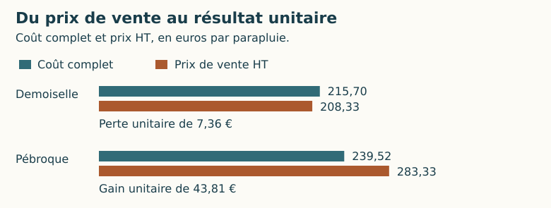

# ENS Paris-Saclay · Économie-gestion option 1 — Épreuve à option — dominante gestion 2026 · Corrigé guidé

*Corrigé rédigé par IA, non officiel. Signalez toute erreur.*

**Rédaction** · GPT-6.2 Astra Ultra · vitesse non renseignée

**Autocontrôle** · GPT-6.2 Astra Ultra · vitesse non renseignée

**Révision (tour 1)** · GPT-6.2 Astra Ultra · vitesse non renseignée

**Révision (tour 2)** · GPT-6.2 Astra Ultra · vitesse non renseignée · 26 novembre 2026

**Couverture vérifiée.** Les quinze réponses ont été rapprochées des huit annexes. Les imputations ABC, les cinq écritures de clôture et les ratios ont été recalculés. Les deux planches du bilan ont été lues directement, y compris la ligne des concours bancaires. Les réponses de management distinguent les faits propres à Pluvier des exemples de l’article sur les autres marques.

## Lire le cas Maison Pluvier

Commencer par trois feuilles de brouillon. Sur la première, séparer charges directes et activités et conserver tous les décimaux jusqu’aux coûts globaux. Sur la deuxième, disposer les cinq écritures d’inventaire du 31 décembre. Sur la troisième, reprendre les deux colonnes « net » du bilan et repérer les concours bancaires indiqués sous le passif. Le cas figure aux pages imprimées 1/10 à 10/10 après le feuillet de l’option économique.

Le contrôle le plus sensible porte sur la Demoiselle. Divisez le résultat global par les 18 000 unités avant d’arrondir. La différence entre les prix et coûts unitaires affichés comporte un écart d’arrondi de 0,01 euro.

**Vérifications numériques.** Les coûts des sept activités totalisent 2 014 000 €. Les deux chiffres d’affaires totalisent 7 150 000 € HT. Une bobine de 200 mètres permet de convertir les 270 centimètres de fil en 2,70 mètres. Une heure de service client ne se confond pas avec une heure de couture. Le budget de la campagne mixte est partagé en neuvièmes.

**Du résultat au choix.** La question 2 utilise le résultat rapporté au chiffre d’affaires. La question 4 demande une marge sur coût. Écrire les dénominateurs avant d’entrer les nombres dans la calculatrice. De même, les 360 000 € de dette nouvelle servent au calcul du projet seul et s’ajoutent aux 622 742 € existants pour le calcul concernant l’ensemble de l’entreprise.

**De la théorie au cas.** Pour chaque question de management, exposer le mécanisme, identifier la ressource rare de l’atelier puis proposer un indicateur qui pourrait infirmer le diagnostic. Garder distincts les exemples externes tirés de l’article et les pratiques attestées chez Maison Pluvier. La mention d’un objectif « fin 2019 » après une reprise en 2020 est incohérente dans la présentation, mais les ventes, le bilan et les écritures disposent chacun de leur propre exercice clairement daté.

Pour contrôler l’annexe 6, lisez ensemble les pages imprimées 7/10 et 8/10. Les 50 536 euros de concours bancaires de 2023 sont déjà compris dans les 272 076 euros de dettes auprès des établissements de crédit. Lorsqu’on cherche les dettes hors emprunts au passif, déduire les 272 076 euros une seule fois.

## Résolution des quinze questions

### Dossier 1. Gestion financière et comptable

**1. Coûts complets 2025.** Les stocks sont négligés dans le calcul analytique. Les quantités produites et vendues sont donc 18 000 Demoiselle et 12 000 Pébroque. Les coûts sont exprimés hors taxe. Pour la Demoiselle, les six matières par unité coûtent respectivement 10,80 € de tissu, 0,135 € de fil, 2,50 € de mât, 5,70 € de baleines, 4,00 € de poignée et 3,00 € de kit. Pour le Pébroque, les montants sont 13,80 €, 0,23 €, 3,00 €, 8,80 €, 3,20 € et 3,00 €. Le coût employeur est 22 + 26 = 48 € par heure. Avec 2,5 et 3 heures de couture, les coûts directs unitaires sont 146,135 € et 176,03 €. On conserve les valeurs non arrondies pour les multiplications.

| Activité | Inducteurs Demoiselle | Inducteurs Pébroque | Imputé Demoiselle (€) | Imputé Pébroque (€) |
|---|---:|---:|---:|---:|
| Achats | 23,5 références | 23,5 références | 151 000,00 | 151 000,00 |
| Fabrication | 54 000 h | 48 000 h | 188 470,59 | 167 529,41 |
| Qualité | 846 000 contrôles | 636 000 contrôles | 93 048,58 | 69 951,42 |
| Distribution | 1 124 livraisons | 876 livraisons | 182 650,00 | 142 350,00 |
| Service client | 4 500 h | 2 000 h | 145 384,62 | 64 615,38 |
| Marketing | 32/9 campagnes | 4/9 campagne | 371 555,56 | 46 444,44 |
| Formation | 3 salariés | 3 salariés | 120 000,00 | 120 000,00 |
| Total indirect, avant arrondi | | | 1 252 109,34 | 761 890,66 |

Le tissu, le fil et le kit représentent 41 références communes, chacune imputée par moitié. Chaque produit a en outre un mât, une taille de baleine et une poignée spécifiques. Les 1 200 livraisons mixtes sont partagées selon 52 % et 48 %. La campagne mixte est répartie selon 100 et 80 secondes sur 180. Chaque imputation est le coût de l’activité multiplié par la part des inducteurs consommés.

| Coûts et résultats | Demoiselle | Pébroque |
|---|---:|---:|
| Direct global (€) | 2 630 430,00 | 2 112 360,00 |
| Complet global (€) | **3 882 539,34** | **2 874 250,66** |
| Complet unitaire (€) | 215,70 | 239,52 |
| Chiffre d’affaires HT (€) | 3 750 000,00 | 3 400 000,00 |
| Résultat analytique (€) | **−132 539,34** | **525 749,34** |
| Résultat / chiffre d’affaires HT | **−3,53 %** | **15,46 %** |

**2. Résultat et profitabilité.** Le chiffre d’affaires HT est la quantité vendue multipliée par le prix TTC divisé par 1,20. Le résultat est la différence entre ce chiffre d’affaires et le coût complet. Les résultats du tableau totalisent 393 210,00 € pour les deux modèles. La Demoiselle absorbe près des neuf dixièmes du budget marketing, alors que le Pébroque dégage la totalité du bénéfice global et couvre la perte de l’autre gamme.

**3. Intérêt et limites d’ABC.** Une clé fondée seulement sur les heures de couture attribuerait les dépenses de campagnes et de personnalisation dans des proportions sans rapport avec les observations. ABC rattache les consommations de ressources aux activités puis les activités aux produits. Cela suggère de réexaminer le ciblage des campagnes de la Demoiselle et de tester un tarif de broderie. Les clés du kit, de la formation et des livraisons communes demeurent conventionnelles. Supprimer la Demoiselle ne ferait pas économiser immédiatement la moitié du coût de formation. Une décision d’abandon doit être fondée sur les charges évitables, les effets sur les autres ventes et la capacité libérée.

**4. Prix avec 16 % de marge sur coût.** Le prix cible HT est le coût complet unitaire multiplié par 1,16. On obtient respectivement **250,21 € HT, soit 300,25 € TTC**, et **277,84 € HT, soit 333,41 € TTC**. Les arrondis TTC sont calculés sur les valeurs exactes. Au prix actuel de 250 € TTC la Demoiselle est déficitaire. Tester l’acceptation d’une hausse ou une offre de base avec personnalisation payante. Le Pébroque, à 340 € TTC, dépasse déjà le seuil de marge sur coût. Une baisse n’est justifiée que si l’effet attendu sur les ventes ou le positionnement le motive. Un objectif de marge rapportée au chiffre d’affaires aurait pour dénominateur le prix et conduirait à diviser le coût par 0,84.

**5. Autres méthodes.** Étudier les consentements à payer et les élasticités par segment au moyen d’un test de prix. Se comparer à des concurrents haut de gamme réellement comparables, garantie et réparabilité comprises. On peut enfin partir du prix cible accepté puis retrancher la marge requise pour obtenir un coût cible à atteindre. Une commande additionnelle mobilisant une capacité inutilisée appelle un calcul séparé de contribution marginale.

**6. Principes d’inventaire.** L’indépendance des exercices rattache à 2025 la consommation de la machine et les risques nés avant la clôture. La prudence commande de tenir compte des pertes probables et de ne pas anticiper des gains non réalisés. La poursuite de l’activité justifie un plan d’amortissement sur la durée d’utilisation. La permanence des méthodes permet les comparaisons d’un exercice à l’autre. L’évaluation des postes à la clôture ajuste les inscriptions initiales au coût historique.

**7. Amortissement et dépréciation.** L’amortissement répartit de façon systématique le montant amortissable d’un actif à durée d’utilisation déterminable selon la consommation de ses avantages économiques. Une dépréciation constate que la valeur actuelle est inférieure à la valeur nette comptable. Elle peut également concerner des actifs non amortissables et, sous réserve des exceptions du PCG, être reprise lorsque ses causes disparaissent.

**8. Journal au 31 décembre 2025.** La surjeteuse entre pour 4 500 × 0,95 + 325 = 4 600 € HT. La TVA récupérable reste hors du coût. La valeur résiduelle de 1 000 € étant estimable et significative, l’annuité économique pleine vaut (4 600 − 1 000)/6 = 600 €. Avec l’année commerciale de 360 jours, la mise en service du 15 mars donne 285/360, soit **475,00 €**. Pour ce matériel de fabrication supposé acquis neuf et éligible, l’amortissement fiscal dégressif sur cinq ans est plus favorable. La première annuité vaut 4 600 × 20 % × 1,75 × 10/12 = **1 341,67 €**. L’écart est un amortissement dérogatoire de **866,67 €**.

| Opération | Débit | Crédit | Montant (€) |
|---|---|---|---:|
| Amortissement économique | 68112 Dotation, immobilisations corporelles | 28154 Amortissement du matériel industriel | 475,00 |
| Excédent fiscal | 68725 Dotation aux amortissements dérogatoires | 145 Amortissements dérogatoires | 866,67 |
| Ajustement des TIAP | 68662 Dotation aux dépréciations des immobilisations financières | 2973 Dépréciation des TIAP | 100,00 |
| Perte latente sur le client | 4761 Diminution des créances | 411 Client SWITH | 2 520,00 |
| Provision sur créance commerciale | 6815 Dotation aux provisions d’exploitation | 1515 Provision pour pertes de change | 2 520,00 |

La détention de longue durée sans intervention dans la gestion relève ici des titres immobilisés de l’activité de portefeuille. L’article 221-5 du PCG prend en considération les perspectives de l’émetteur et notamment la valeur de marché. En l’absence d’un ajustement documenté, on retient 7 000 €, soit une dépréciation requise de 500 €. Le compte 2973 présente déjà 400 € au crédit. Il faut compléter de 100 €. Pour l’exportation britannique, la créance en livres passe de 36 000 × 1,52 = 54 720 € à 36 000 × 1,45 = 52 200 €. L’encaissement est prévu en 2026. À la clôture on inscrit l’écart de conversion et la provision pour le risque non couvert. Les opérations d’achat et de vente initiales n’ont pas à être enregistrées une seconde fois.

**9. Équilibre financier.** L’annexe 6 donne 50 536 € de concours bancaires courants en 2023 et aucun en 2024. Ils constituent une ressource de trésorerie. Dans le calcul suivant, les autres dettes financières sont prises comme stables en l’absence d’autre ventilation et les immobilisations sont reprises en net. La même lecture fonctionnelle en brut réintégrerait les amortissements et dépréciations dans les ressources, en tenant aussi compte des dépréciations de l’actif circulant.

| Indicateur | 2023 | 2024 |
|---|---:|---:|
| Capitaux propres (€) | 928 498 | 1 005 974 |
| Dette financière hors concours courants (€) | 383 224 | 622 742 |
| Fonds de roulement sur valeurs nettes (€) | 239 561 | 489 310 |
| Trésorerie nette, disponible moins concours (€) | −44 023 | 243 960 |
| Besoin en fonds de roulement net, par différence (€) | 283 584 | 245 350 |
| Dette stable / capitaux propres | 41,27 % | 61,90 % |
| Dette stable / capacité d’autofinancement | 0,74 an | 1,01 an |
| Capitaux propres / total du bilan | 51,38 % | 48,09 % |

En 2024, 1 005 974 + 622 742 − 1 139 406 donnent 489 310 € de fonds de roulement. Le recul du besoin s’explique notamment par la baisse des créances clients et la montée des dettes fournisseurs, en dépit du stock accru de matières. La trésorerie redevient positive. L’endettement progresse plus vite que les capitaux propres et la CAF, même si une année environ de CAF égale encore la dette stable. L’affectation intégrale de la CAF au remboursement demeure une hypothèse de calcul.

Un second calcul isole le besoin financier dans les postes circulants, en euros. En 2023, l’actif circulant hors disponibilités vaut 735 075 − 6 513 = 728 562. Au passif, les dettes hors emprunts valent 878 738 − 272 076 − 161 684 = 444 978. Le besoin atteint donc 283 584. En 2024, les mêmes opérations donnent 952 567 − 243 960 = 708 607 et 1 086 000 − 463 399 − 159 343 = 463 258, soit un besoin de 245 349. L’écart d’un euro avec les 245 350 obtenus par le fonds de roulement et la trésorerie provient des totaux imprimés. À l’actif 2024, 1 139 406 + 952 567 donnent 2 091 973, alors que le total général publié est de 2 091 974. Les deux calculs confirment une diminution du besoin d’environ 38 235 euros.

**10. Tout financer par augmentation de capital.** Une souscription en numéraire apporte des ressources durables sans échéance d’intérêts ni remboursement contractuel, améliore la faculté d’emprunt ultérieure et partage le risque du lancement. La famille doit cependant mobiliser ses propres fonds ou accepter la dilution du contrôle et des dividendes futurs. Les délais, frais d’émission et exigences de rémunération des apporteurs doivent entrer dans la comparaison.

**11. Rentabilité financière.** Sur 600 000 €, l’emprunt apporte 360 000 € et les capitaux propres 240 000 €. En prolongeant, comme hypothèse, le rendement économique de 10 % et le coût de la dette de 3 %, les dettes financières totales deviennent 982 742 € et les capitaux propres 1 245 974 €. La rentabilité des fonds propres après IS vaut **[10 % + (10 % − 3 %) × 982 742/1 245 974] × (1 − 25 %) = 11,64 %**. Sur le seul projet, le résultat d’exploitation attendu serait de 60 000 €, les intérêts de 10 800 € et le résultat net de 36 900 €, soit **15,38 %** des seuls 240 000 € nouveaux. Les deux taux répondent à des périmètres différents.

**12. Conseil de financement.** Le financement mixte bénéficie d’un écart de rendement favorable et limite la dilution. Il porte la dette financière à 78,87 % environ des capitaux propres et, à CAF inchangée, à 1,59 année de CAF. Si la rentabilité marginale descend sous 3 % avant IS, le levier pénalise les associés. Tester le nombre d’ombrelles à vendre, les besoins de stock, la saisonnalité des encaissements et les échéances avant signature. Conserver une réserve de trésorerie et verser les fonds à mesure des besoins. Un lancement progressif ou un apport plus important peut être préférable si les distributeurs n’ont encore pris aucun engagement.

### Dossier 2. Management

**13. L’investissement améliore-t-il l’efficience interne ?** L’efficience rapporte un résultat obtenu aux ressources consommées. L’efficacité apprécierait d’abord si la percée sur le marché des ombrelles atteint son objectif. La nouvelle gamme peut réutiliser la coupe, la couture, le montage, les contrôles et le réseau des 90 points de vente français. C’est une économie de gamme si le coût commun de produire les deux familles est inférieur au coût de deux organisations séparées. Des commandes estivales peuvent aussi lisser l’utilisation des équipements. Mais dix coloris nouveaux multiplient les références et les changements de série. Une couturière affectée aux ombrelles peut retarder le Pébroque, qui dégage une contribution importante. La qualité solaire et les préférences des distributeurs asiatiques exigent des vérifications distinctes de la résistance au vent.

Un pilote dans quelques magasins du Sud permettrait de mesurer le temps par unité conforme, le taux de rebut, les retards sur les commandes existantes et la marge supplémentaire par heure du poste saturé. Le service commercial collecterait également les invendus et les retours. La diversification améliore l’efficience si la marge additionnelle couvre les ressources réellement consommées sans dégrader la qualité du cœur de gamme. Le montant investi et la seule croissance du chiffre d’affaires ne suffisent pas à trancher.

**14. Les défis des manufactures françaises.** Face aux produits importés à bas prix, l’atelier d’Annecy a peu de chances de gagner par la seule compression des coûts. Une stratégie de différenciation suppose que le client puisse éprouver la différence et accepte de la payer. Résistance documentée, remplacement d’une baleine, traçabilité des matériaux et personnalisation contribuent à cette preuve. La garantie à vie de H2O, présentée dans l’annexe 8, constitue un point de comparaison externe. Une garantie similaire chez Pluvier exigerait un stock de pièces et un provisionnement compatible avec la marge.

Un deuxième défi tient aux ressources. Il faut transmettre un savoir concentré chez une trentaine d’artisans, recruter des apprentis et sécuriser les approvisionnements sans renoncer au contrôle de la qualité. La proximité d’un fournisseur réduit certains délais mais peut accroître la dépendance si la pièce est spécifique. Tester deux sources ou une pièce réparable peut être plus robuste. Enfin, l’exportation et la vente en ligne élargissent le débouché, au prix d’adaptations de la distribution et du service après-vente. L’annexe évoque des modèles connectés dans le secteur. Une fonction électronique doit justifier son utilité et rester compatible avec la réparabilité, au risque de fragiliser le positionnement durable. La maison peut suivre la marge par canal, le délai de réparation et le taux de fidélisation pour arbitrer ces choix.

**15. Transmission à Victor Apache.** La succession familiale rend possible la continuité d’un savoir-faire et d’une réputation, mais ne transfère pas automatiquement l’autorité quotidienne du fondateur. L’élargissement du réseau, les collaborations et la future gamme déplacent les arbitrages entre atelier, vente et direction. Une organisation à supervision directe peut gagner en rapidité en déléguant des décisions aux responsables de production et de distribution. Elle s’expose aussi aux conflits sur les délais et au risque que des objectifs de volumes déplacent la norme de qualité. La résistance d’un artisan expérimenté peut signaler un problème réel de capacité ou de matière.

Victor peut organiser avec les chefs d’atelier un diagnostic des opérations critiques, puis confier un prototype d’ombrelle à une équipe réunissant fabrication et vente. Formaliser les critères de conformité, instaurer un tutorat en binôme et conserver des échantillons de référence rendent le savoir transmissible tout en laissant aux artisans la conduite du geste. Une réunion courte sur les retours de clients et les délais crée une possibilité de corriger le projet avant le déploiement. Définir qui valide un nouveau modèle, qui négocie avec un revendeur et qui peut interrompre une série non conforme réduit les ambiguïtés de pouvoir.

La direction peut ensuite étendre les essais qui réussissent et intégrer les nouvelles pratiques à la formation, aux objectifs et aux décisions de promotion. Suivre ensemble les défauts, les heures supplémentaires, les départs, la progression des apprentis et la marge permet de détecter une croissance obtenue au prix de l’épuisement du personnel. Le succès de la transmission se juge au maintien d’une capacité collective à bien produire et à décider après le départ du fondateur.

[Énoncé officiel](https://ens-paris-saclay.fr/sites/default/files/CONCOURS/ANNALES_1C/1C_D2_1/2026/2026_EG1_Option_gestion_ou_Eco.pdf#page=3)
