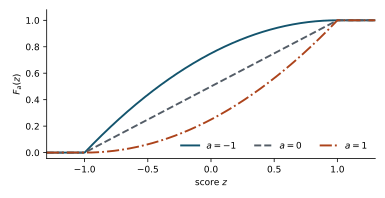
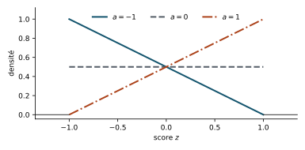
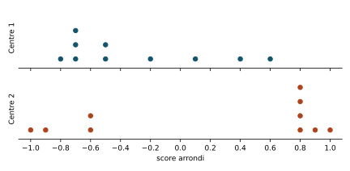
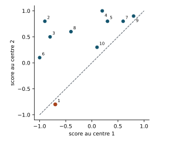

# ENS Paris-Saclay D2 option 1 — Mathématiques et statistiques 2026 · Corrigé brut

*Corrigé rédigé par IA, non officiel. Signalez toute erreur.*

**Rédaction** · GPT-6.2 Astra Ultra · vitesse non renseignée

**Révision (tour 1)** · GPT-6.2 Astra Ultra · vitesse non renseignée

## Problème 1 — Algèbre

### Question 1a

Avec les matrices de l’énoncé, les quatre coefficients de chaque produit donnent
$$A^2=\begin{pmatrix}1-2&-2+2\\1-1&-2+1\end{pmatrix},\quad
B^2=\begin{pmatrix}9-10&15-15\\-6+6&-10+9\end{pmatrix},\quad
C^2=\begin{pmatrix}-1&0\\0&-1\end{pmatrix}.$$
Les trois carrés valent $-I_2$.

### Question 1b

Écrivons $M=\left(\begin{smallmatrix}a&b\\c&d\end{smallmatrix}\right)$. Les équations $a^2+bc=-1$ et $b(a+d)=0$ imposent $bc=-1-a^2<0$, puis $d=-a$ puisque $b\ne0$. Parmi $b,c$, un coefficient est négatif. Sur la diagonale, $a$ et $-a$ comprennent également un coefficient négatif ou nul. Il est donc impossible d’avoir un seul coefficient inférieur ou égal à zéro.

### Question 2a

La matrice agit par
$$M(x,y,z,t)^T=(z,-y+2z-2t,-x,-x+y-z+t)^T.$$
En remplaçant $(x,y,z,t)$ par ces quatre coordonnées, on obtient $(-x,-y,-z,-t)^T$. Ainsi $M^2=-I_4$.

### Question 2b

Puisque $M(-M)=(-M)M=I_4$, la matrice $M$ est inversible et l’endomorphisme $u$ est bijectif, d’inverse $-u$.

### Question 2c

La matrice des colonnes est
$$P=\begin{pmatrix}-1&1&0&-1\\1&1&1&-1\\1&1&1&0\\0&1&0&0\end{pmatrix}.$$
Si $P(a,b,c,d)^T=0$, la dernière ligne donne $b=0$. La différence des troisième et deuxième donne $d=0$, puis la première donne $a=0$ et la troisième $c=0$. Les quatre vecteurs sont libres dans un espace de dimension quatre et forment une base.

### Question 2d

L’expression de l’action de $M$ en 2a donne $u(v_1)=v_2$, $u(v_2)=-v_1$, $u(v_3)=-v_4$ et $u(v_4)=v_3$. Par colonnes, on lit
$$[u]_{\mathcal F}=\begin{pmatrix}0&-1&0&0\\1&0&0&0\\0&0&0&1\\0&0&-1&0\end{pmatrix}.$$
Chaque bloc diagonal a bien pour carré $-I_2$.

### Question 3a

Pour tout vecteur $x$, $g(-g(x))=-g^2(x)=x$ et $(-g)(g(x))=x$. Ainsi $g$ est bijective et $g^{-1}=-g$.

### Question 3b

L’égalité $g(x_1)=\lambda x_1$ entraînerait $-x_1=g^2(x_1)=\lambda^2 x_1$. Comme $x_1\ne0$, cela imposerait $\lambda^2=-1$, impossible dans $\mathbb R$.

### Question 3c

Tout $v\in V_{x_1}$ s’écrit $a x_1+b g(x_1)$. Son image est $a g(x_1)-b x_1$, qui appartient encore à $V_{x_1}$. Ce sous-espace est stable par $g$.

### Question 3d

Si $a x_1+b g(x_1)=0$ et $b\ne0$, on aurait $g(x_1)=-(a/b)x_1$, impossible d’après 3b. Il reste $b=0$, puis $a=0$ car $x_1\ne0$. La famille est libre et $V_{x_1}$ est un plan.

### Question 3e

Notons $V=V_{x_1}$. Supposons $x_2\notin V$ et $g(x_2)=v+\lambda x_2$ avec $v\in V$ et $\lambda\in\mathbb R$. En appliquant $g$, on trouve
$$-x_2=g(v)+\lambda v+\lambda^2 x_2.$$
Par stabilité, $g(v)+\lambda v\in V$. Puisque $1+\lambda^2>0$, l’équation donnerait $x_2\in V$, contradiction. Donc $g(x_2)\notin\operatorname{Vect}(x_1,g(x_1),x_2)$.

### Question 3f

Partons du sous-espace stable $V=\{0\}$. Tant que $V\ne\mathbb R^n$, choisissons $x\notin V$. Le calcul de 3e, qui utilise seulement la stabilité, donne $g(x)\notin V+\mathbb Rx$. Ainsi $V+\operatorname{Vect}(x,g(x))$ a deux dimensions de plus et reste stable car $g^2(x)=-x$. La dimension augmente de deux à chaque étape jusqu’à $n$, donc $n$ est pair.

Un contrôle direct vient de $\det(g)^2=\det(-I_n)=(-1)^n$. Le membre de gauche est strictement positif car $g$ est inversible.

### Question 4

Une telle matrice réelle définirait sur $\mathbb R^3$ un endomorphisme dont le carré est $-\mathrm{Id}$. La question 3f impose une dimension paire. Il n’existe donc aucune matrice de ce type dans $\mathcal M_3(\mathbb R)$.

## Problème 2 — Analyse

### Question 1a

Sur $]-\infty,0[\cup]0,1[$, le dénominateur $(x-1)\ln(1-x)$ est non nul et la fonction est continue. En zéro, $\ln(1-x)\sim-x$, donc $(x-1)\ln(1-x)\sim x$ et $f(x)\to1=f(0)$. Ainsi $f$ est continue sur $U$.

### Question 1b

Hors de zéro, $f$ est dérivable comme quotient. Avec $h=1-x>0$, on a $f=(h-1)/(h\ln h)$ et, en tenant compte de $dh/dx=-1$,
$$f'(x)=\frac{h-1-\ln h}{(h\ln h)^2}\qquad(x\ne0).$$
En zéro, $(x-1)\ln(1-x)=x-x^2/2+o(x^2)$, donc $f(x)=1+x/2+o(x)$. Le taux d’accroissement tend vers $1/2$, d’où $f'(0)=1/2$.

### Question 1c

Quand $x\to-\infty$, $h\to+\infty$ et $f=(1-1/h)/\ln h\to0$. Quand $x\to1^-$, $h\to0^+$, $h\ln h\to0^-$ et $h-1\to-1$, d’où $f(x)\to+\infty$.

### Question 1d

Pour $h>0$, $h-1-\ln h\ge0$, avec égalité uniquement en $h=1$. La formule de 1b donne donc $f'(x)>0$ hors de zéro, et $f'(0)=1/2>0$. Le tableau se lit
$$\begin{array}{c|ccccc}
x&-\infty&&0&&1^-\\ \hline
f'(x)&&+&1/2&+&\\
f(x)&0&\nearrow&1&\nearrow&+\infty
\end{array}$$
La fonction est strictement croissante sur l’intervalle ouvert $U$ et n’y admet aucun extremum. Son infimum est zéro.

### Question 1e

La fonction est continue, strictement croissante, de limites zéro et $+\infty$. Elle prend donc la valeur $10$ exactement une fois. Comme $f(0)=1$, l’unique solution est dans $]0,1[$.

### Question 2a

Pour $0<x<1/2$, $f$ est un quotient de fonctions de classe $\mathcal C^\infty$ à dénominateur non nul. Le facteur $y^2(1-y^2)$ est polynomial. Leur produit $g$ est de classe $\mathcal C^\infty$ sur le carré ouvert, en particulier deux fois dérivable.

### Question 2b

Les dérivées partielles premières sont
$$\partial_xg(x,y)=y^2(1-y^2)f'(x),\qquad
\partial_yg(x,y)=2y(1-2y^2)f(x).$$
On peut y remplacer $f'$ par la formule de 1b.

### Question 2c

Dans le carré ouvert, $y^2(1-y^2)>0$ et $f'(x)>0$, donc $\partial_xg>0$. Il n’existe aucun point critique intérieur. On a également $\partial_yg>0$ car $y<1/2$ et $f(x)>0$.

### Question 2d

Sur le carré fermé, les deux facteurs $f(x)$ et $y^2(1-y^2)$ sont non négatifs. Le premier est strictement positif et croissant, le second strictement croissant pour $0\le y\le1/2$ et nul en zéro. Le minimum global est $0$, atteint exactement aux points $(x,0)$ avec $0\le x\le1/2$. Le maximum global est atteint uniquement en $(1/2,1/2)$ et vaut
$$g(1/2,1/2)=\frac14\left(1-\frac14\right)\frac1{\ln 2}=\frac{3}{16\ln2}.$$

## Problème 3 — Probabilités et statistiques

### Question 1a

Pour $t>0$, la positivité donne
$$\mathbb E(X)\ge\int_t^{+\infty}x f(x)\,dx\ge t\int_t^{+\infty}f(x)\,dx=t\mathbb P(X\ge t).$$
On divise par $t$ pour obtenir l’inégalité de Markov. Une variable à densité n’a pas d’atome en $t$, donc écrire $X>t$ donne la même probabilité. Le quotient suppose que le seuil est strictement positif. La forme avant division, $t\,\mathbb P(X\ge t)\le\mathbb E(X)$, reste vraie en $t=0$ et se réduit alors à $0\le\mathbb E(X)$.

### Question 1b

Pour $\varepsilon>0$, l’inégalité ponctuelle
$$\varepsilon^2\mathbf 1_{\{|Y-\mathbb E(Y)|\ge\varepsilon\}}\le (Y-\mathbb E(Y))^2$$
donne, après passage aux espérances,
$$\mathbb P(|Y-\mathbb E(Y)|\ge\varepsilon)\le\frac{\operatorname{Var}(Y)}{\varepsilon^2}.$$
Cette preuve de Bienaymé–Tchebychev s’applique à toute variable de variance finie, y compris quand l’écart au carré a des atomes.

### Question 2a

Sur $[-1,1]$, $f_a(z)=(1+az)/2$ s’intègre en un car le terme en $z$ est impair. Son minimum sur ce segment est $(1-|a|)/2$. Si ce nombre est négatif, la fonction est négative sur un intervalle de longueur positive. Les paramètres admissibles sont exactement $a\in[-1,1]$.

### Question 2b

Sur le segment, une primitive de $f_a$ est $z/2+az^2/4$. On obtient
$$F_a(z)=\begin{cases}0&z<-1,\\(1+z)/2+a(z^2-1)/4&-1\le z\le1,\\1&z>1.\end{cases}$$
La fonction est continue et croissante. Sur $]-1,1[$, $F_a''=a/2$. Pour $a<0$ la courbe est concave, pour $a=0$ rectiligne et pour $a>0$ convexe. À $z$ intérieur fixé, $F_a(z)$ décroît quand $a$ augmente.

### Question 2c

On calcule
$$\mathbb E(Z)=\frac12\int_{-1}^1(z+az^2)\,dz=\frac a3,\qquad
\mathbb E(Z^2)=\frac12\int_{-1}^1(z^2+az^3)\,dz=\frac13.$$
Ainsi $\operatorname{Var}(Z)=1/3-a^2/9=(3-a^2)/9$.

### Question 2d

La variable $U=1-Z$ est à valeurs dans $[0,2]$. Pour $0\le u\le2$, $\mathbb P(U\le u)=\mathbb P(Z\ge1-u)=1-F_a(1-u)$, par continuité de la loi. Sa répartition vaut zéro pour $u<0$, $(1+a)u/2-au^2/4$ sur $[0,2]$ et un pour $u>2$. Une densité est
$$f_U(u)=\frac{1+a-au}{2}\mathbf 1_{[0,2]}(u).$$

### Question 3a

Puisque $T=(3/n)\sum_{i=1}^n Z_i$ et que chaque score a pour espérance $a/3$, on a $\mathbb E_a(T)=(3/n)n(a/3)=a$.

### Question 3b

Par indépendance,
$$\operatorname{Var}_a(T)=\frac9{n^2}\sum_{i=1}^n\operatorname{Var}_a(Z_i)
=\frac9{n^2}\,n\frac{3-a^2}{9}=\frac{3-a^2}{n}.$$

### Question 3c

Le biais $\mathbb E_a(T)-a$ est nul pour chaque $a\in[-1,1]$. Ainsi $T$ est sans biais et son risque quadratique vaut
$$\mathbb E_a[(T-a)^2]=\operatorname{Var}_a(T)=\frac{3-a^2}{n}.$$

### Question 3d

La valeur observée est $t=3\times200/1000=0{,}6$. Sous $a=0$, $\mathbb E_0(T)=0$ et $\operatorname{Var}_0(T)=3/1000$. Par 1b,
$$\mathbb P_0(|T|\ge0{,}6)\le\frac{3/1000}{0{,}6^2}=\frac1{120}\simeq0{,}83\,\%.$$
Sous le modèle et l’indépendance du sujet, l’hypothèse nulle rend donc peu probable un écart au moins aussi grand. Elle serait rejetée par un test bilatéral au seuil de 1 % utilisant cette borne.

### Question 4a

Pour $a=-1,0,1$, les densités sur $[-1,1]$ sont respectivement $(1-z)/2$, $1/2$ et $(1+z)/2$. Elles sont nulles à l’extérieur de ce segment. Quand $a$ augmente, la moyenne $a/3$ augmente et $\mathbb P_a(Z>0)=1/2+a/4$ aussi. Un $a$ positif favorise les scores positifs, un $a$ négatif les scores négatifs. La loi est uniforme pour $a=0$.

### Question 4b

Le diagramme de points conserve les répétitions, avec la même échelle pour les deux centres.

On retient la moyenne, la médiane et le mode pour la position, l’étendue et l’écart type empirique pour la dispersion. L’écart type descriptif a ici pour diviseur $10$.

| Centre | Moyenne | Médiane | Mode | Étendue | Écart type |
|---|---:|---:|---:|---:|---:|
| 1 | −0,30 | −0,50 | −0,70 | 1,40 | 0,477 |
| 2 | 0,20 | 0,80 | 0,80 | 2,00 | 0,806 |

Les sommes sont $-3$ et $2$, et les sommes des carrés $3{,}18$ et $6{,}90$. Les variances descriptives sont donc $0{,}318-0{,}09=0{,}228$ et $0{,}690-0{,}04=0{,}650$. Pour chaque centre, les cinquième et sixième valeurs ordonnées coïncident et donnent la médiane indiquée.

### Question 4c

Pour les dix clients de chaque groupe, les estimateurs sont $\widehat a_1=3\overline V$ et $\widehat a_2=3\overline W$. Les deux valeurs observées, calculées sur les notes arrondies, sont $3(-0{,}30)=-0{,}90$ et $3(0{,}20)=0{,}60$. Dans la famille proposée, ces ajustements suggèrent une tendance vers les mauvaises notes au centre 1 et vers les bonnes notes au centre 2. La taille de chaque échantillon invite à examiner aussi la forme de la distribution.

### Question 4d

Le support $[-1,1]$ respecte l’échelle du questionnaire et le paramètre décrit un déplacement de la moyenne. En revanche, toute densité de la famille est affine sur le segment. Elle ne peut représenter deux groupes concentrés aux extrêmes avec peu de clients modérément satisfaits. C’est précisément l’allure des notes du centre 2.

On peut chiffrer ce défaut sans estimer $a$. Pour $0\le t\le1$, la symétrie donne $\mathbb P_a(|Z|\le t)=\int_{-t}^t(1+az)/2\,dz=t$. Les dix scores arrondis du centre 2 ont tous une valeur absolue d’au moins $0{,}6$. Avant arrondi, leurs valeurs absolues sont donc au moins $0{,}55$. Sous dix observations indépendantes du modèle, la probabilité que toutes franchissent ce seuil est $0{,}45^{10}\simeq0{,}00034$, quel que soit $a$. Ce calcul décrit l’écart observé pour ce seuil.

Au centre 1, l’asymétrie vers les notes basses est compatible avec le signe ajusté. Dix réponses permettent difficilement de justifier la forme affine exacte. L’arrondi crée des répétitions même avec un score latent continu. En pratique, le choix de remplir le questionnaire peut aussi dépendre de l’intensité de l’opinion, ce qui limiterait la généralisation aux autres clients.

### Question 5a

Prenons le score $R_i$ au centre 1 en abscisse et le score $S_i$ au centre 2 en ordonnée. La diagonale $s=r$ représente une égalité. Le point 1 est au-dessous, les neuf autres au-dessus.

### Question 5b

Posons $I_i=\mathbf 1_{\{R_i>S_i\}}$. Ces indicatrices ont pour espérance $p$. L’estimateur naturel est la fréquence $\widehat p=\frac1{10}\sum_{i=1}^{10}I_i$, sans biais sous l’échantillonnage du sujet. Seul le client 1 donne une note plus élevée au centre 1, avec $-0{,}7>-0{,}8$. L’estimation vaut $1/10=0{,}10$.

### Question 5c

Les dix paires de notes ne contiennent aucune égalité. Pour préciser le rôle des ex æquo éventuels dans la population, posons $\tau=\mathbb P(R_i=S_i)$. L’équilibre des préférences strictes signifie $\mathbb P(R_i>S_i)=\mathbb P(R_i<S_i)=(1-\tau)/2$. Conditionnellement à des notes distinctes, la probabilité de chaque signe est alors $1/2$. Sous l’hypothèse de symétrie des signes entre centres, chaque préférence stricte a une chance sur deux d’aller au centre 1. En supposant les choix des clients indépendants, le nombre $N$ de signes en faveur du centre 1, conditionnellement aux dix paires non ex æquo, suit $\mathcal B(10,1/2)$. On observe $N=1$. Dans la direction d’une préférence pour le centre 2,
$$\mathbb P(N\le1)=\frac{\binom{10}{0}+\binom{10}{1}}{2^{10}}=\frac{11}{1024}.$$
Pour détecter une préférence dans l’un ou l’autre sens, la probabilité exacte d’un résultat au moins aussi déséquilibré vaut $\mathbb P(N\le1)+\mathbb P(N\ge9)=22/1024\simeq2{,}15\,\%$. Au seuil bilatéral de 5 %, les données appuient une préférence pour le centre 2 chez les clients ayant fréquenté les deux. Au seuil de 1 %, le test bilatéral ne conclut pas.
