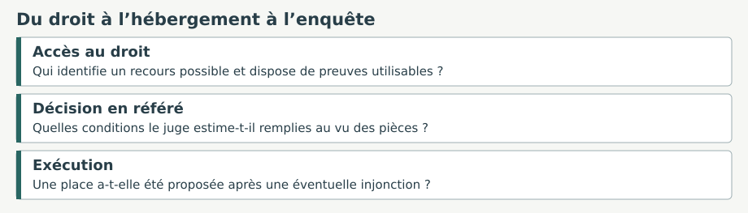

# ENS-PSL · CNEL Lettres · Parcours Droit 2026 · Corrigé guidé

*Corrigé rédigé par IA, non officiel. Signalez toute erreur.*

**Rédaction** · GPT-6.2 Astra Ultra · vitesse non renseignée

**Autocontrôle** · GPT-6.2 Astra Ultra · vitesse non renseignée

**Révision (tour 1)** · GPT-6.2 Astra Ultra · vitesse non renseignée

La feuille officielle demande de choisir un seul sujet, de l’indiquer et de rédiger une réponse structurée avec une introduction. Le plan est libre. Le rapport distingue deux formes de travail, le retour sur un projet de recherche et la réflexion sur une actualité juridique. La feuille numérote trois sujets puisqu’elle propose deux questions d’actualité. Les trois propositions ci-dessous peuvent se lire séparément.

## Sujet 1 · Critiquer le droit et reprendre un projet de recherche

*Le projet présenté ici est hypothétique. La première personne met en situation le retour sur un projet demandé par le sujet. Elle ne décrit ni une candidature réelle ni une enquête déjà réalisée.*

Une personne sans abri peut avoir un droit à l’hébergement d’urgence et perdre néanmoins son référé. Si je ramène cette situation à la question « le juge a-t-il bien appliqué la loi ? », je prends déjà parti sur ce que fait un juge et sur l’endroit où se loge l’injustice éventuelle. Mon projet initial aurait consisté à étudier l’effectivité de l’hébergement d’urgence en comptant les ordonnances favorables aux demandeurs. L’extrait d’A. Corre-Basset m’oblige à modifier ce projet. Comment la procédure du référé-liberté transforme-t-elle une situation sociale en atteinte juridiquement démontrable, et que deviennent les situations qui ne peuvent parvenir jusqu’au juge ? Maintenir cette question ouverte exige de distinguer la critique d’une décision, la critique d’une norme et celle des opérations qui rendent la décision possible.

### Du mauvais jugement à la question que pose le juge

Le premier mouvement du texte distingue plusieurs objets ordinairement réunis sous le mot critique. La satire des juges vénaux ou des procès interminables postule volontiers une justice convenablement administrée dont ces comportements seraient l’écart. Antigone va plus loin lorsqu’elle oppose à l’ordre de Créon une exigence jugée supérieure. Elle conteste le contenu et la légitimité de l’ordre donné. Mais dans la lecture proposée par Corre-Basset, elle maintient la possibilité de dire ce qui est véritablement juste ou juridiquement dû. Le tournant attribué au XIXe siècle concerne une autre question. Qu’est-ce qui autorise à croire que le texte contient toujours une solution déjà déterminée, que le juge n’aurait qu’à prononcer ?

Cette interrogation change le sens d’un résultat négatif dans mon projet. L’article L. 345-2-2 du code de l’action sociale et des familles reconnaît un accès à l’hébergement d’urgence à toute personne sans abri en situation de détresse médicale, psychique ou sociale. Dans le cadre du référé-liberté, le juge doit notamment apprécier l’urgence et l’atteinte grave et manifestement illégale à une liberté fondamentale pour ordonner la mesure nécessaire. L’ordonnance du Conseil d’État du 10 février 2012, n° 356456, admet qu’une carence caractérisée dans la mise en œuvre du droit puisse atteindre ce seuil lorsqu’elle a des conséquences graves. Le juge examine les diligences administratives, les moyens disponibles ainsi que l’âge, la santé et la situation familiale de l’intéressé. Le désaccord ne porte donc pas seulement sur une règle abstraite. Il concerne la façon de décrire une situation, de l’étayer dans un délai très court et de la rapprocher des catégories ouvertes par les textes.

### Construire une enquête qui permette à l’hypothèse de perdre

Je comparerais, pour deux tribunaux administratifs et une période arrêtée à l’avance, les ordonnances rendues sur des requêtes identifiées selon les mêmes critères, y compris les rejets. Pour chacune, je distinguerais la demande précise, la voie procédurale, les pièces mentionnées, la réponse de l’administration, la motivation et la mesure éventuellement ordonnée. Une ordonnance de tri rendue dans les conditions de l’article L. 522-3 du code de justice administrative, sans l’audience de la procédure ordinaire de référé, ne serait pas assimilée à une affaire débattue oralement. Le corpus devrait documenter ses lacunes de publication. Je ne présenterais pas comme exhaustif un ensemble obtenu par le seul moteur de recherche de décisions.

Considérons deux cas imaginaires. Une personne conserve la trace d’appels restés sans solution et bénéficie de l’intervention d’une association. Une autre change souvent de lieu, n’a pas gardé ces traces et saisit le tribunal sans accompagnement. La seconde peut être aussi gravement exposée. Son exposition sera-t-elle moins aisément établie ? C’est une hypothèse sur la production de la preuve. L’objection la plus sérieuse serait que la différence d’issue tienne à une différence réelle de santé, de situation familiale ou de réponse administrative. Il faudrait donc comparer des demandes proches sur ces dimensions et lire les motifs, sans considérer deux dossiers comme identiques au seul motif qu’ils emploient le même vocabulaire. Une enquête volontaire auprès d’associations pourrait en outre renseigner sur les demandes jamais introduites. Elle ne donnerait pas accès à toutes les personnes sans abri, en particulier à celles éloignées de tels relais. Enfin, une injonction prononcée n’est pas encore une place effectivement obtenue. Je distinguerais l’issue juridictionnelle de l’exécution attestée, et laisserais inconnue celle qui ne peut être documentée.

### Critiquer sans décider à l’avance de ce que vaut le droit

L’extrait invite à repérer une distribution de pouvoir là où le juriste pourrait croire n’exercer qu’une compétence technique. Mais considérer d’emblée toute différence comme une domination reproduirait le défaut que je veux examiner : supposer la bonne réponse déjà donnée. Des motifs publics, une voie d’urgence et la possibilité de contester l’administration sont aussi des ressources dont des associations ou des requérants peuvent se saisir. Une même institution peut rendre une situation justiciable et en laisser une autre dans l’ombre. Le chercheur doit pouvoir rendre compte des deux résultats.

Je discuterais enfin la séparation trop nette entre satire et critique structurelle. La répétition d’un travers présenté d’abord comme personnel peut conduire à interroger une règle de sélection ou une organisation entière. De même, opposer un principe au droit en vigueur peut en révéler les présupposés. La distinction proposée par Corre-Basset vaut comme question adressée au matériau, davantage que comme classement définitif des œuvres ou des doctrines. Mon projet abandonnerait ainsi le taux de succès comme verdict sur la justice du système. Il chercherait qui peut produire une demande intelligible, selon quelles normes le juge y répond et ce que cette réponse change. Là réside, pour une formation par la recherche, une conséquence précise de l’enseignement de la critique.

### Comment adapter cette copie à son propre projet

Partir d’une décision de recherche que la lecture fait changer. Dans cet exemple, l’indicateur initial était le taux de succès. En choisissant le seul tribunal comme observatoire, il laissait hors champ les demandes jamais introduites. Le nouveau protocole conserve les décisions de justice, mais précise les critères d’inclusion, recherche des dossiers comparables et ajoute un matériau sur le non-recours. On pourrait suivre la même démarche sur d’autres objets en explicitant quelle première hypothèse on réviserait et quelle observation conduirait à l’abandonner.

> [!INDICATION]
> Deux demandes proches aboutissent à deux décisions opposées. Que manque-t-il avant de conclure à un traitement inégal ?

Vérifier la voie procédurale, l’urgence à la date de l’audience, les moyens invoqués par l’administration, les particularités du dossier et l’existence de pièces auxquelles le chercheur n’aurait pas accès. Un écart non expliqué demeure une question. L’enquête serait précisément appauvrie si chaque résultat constituait d’avance une confirmation. La lecture du texte légal permet de distinguer les conditions d’accès à l’hébergement de celles qui permettent d’obtenir une mesure en référé. [Code de l’action sociale et des familles, art. L. 345-2-2](https://www.legifrance.gouv.fr/codes/article_lc/LEGIARTI000037670338) · [Conseil d’État, juge des référés, 10 février 2012](https://www.conseil-etat.fr/fr/arianeweb/CE/decision/2012-02-10/356456)

## Sujet 2 · L’efficacité des procédures et le respect des droits des parties

Une personne qui doit attendre plusieurs années pour être entendue subit un tort que la qualité de l’audience finale ne répare pas toujours. Mais celui qui obtient une décision en quelques semaines au prix d’un consentement mal éclairé n’a pas davantage reçu bonne justice. Le projet présenté dans le sujet propose de raccourcir le jugement de certains crimes reconnus. La défense de l’audience par le bâtonnier et la défense de la réforme par le procureur général recouvrent donc deux conceptions de ce que doit produire un procès. L’efficacité est conciliable avec les droits si elle se mesure à l’obtention, en temps utile, d’une décision juste, compréhensible et contestable. Elle compromet ces droits lorsqu’elle récompense la clôture du dossier indépendamment de la qualité du consentement, de l’examen des faits et de la place reconnue à la victime.

### Le délai raisonnable appartient aux garanties du procès

Le temps pèse sur les deux parties. La mémoire des témoins se dégrade, une victime reste sans décision sur les faits ou la réparation et un accusé vit durablement sous la menace d’une peine. Si une personne est en détention provisoire, l’attente engage directement sa liberté. L’article 6 de la Convention européenne des droits de l’homme associe délai raisonnable, équité et examen par un tribunal indépendant et impartial. Il ne fait pas de la lenteur la preuve de la rigueur. Éviter une audition répétitive, organiser les convocations et circonscrire les points réellement contestés peuvent donc renforcer les droits eux-mêmes.

Le projet de jugement des crimes reconnus, dans l’état décrit par l’énoncé, entend réserver du temps d’audience pour les affaires dont les faits sont disputés. La comparution sur reconnaissance préalable de culpabilité créée en 2004 fournit un précédent en matière délictuelle. Une personne reconnaît des faits, reçoit une proposition de peine du procureur et doit pouvoir l’examiner avec un avocat. La juridiction d’homologation a son rôle propre. La part des poursuites citée dans le sujet par le défenseur de la réforme renseigne sur la diffusion qu’il attribue à cette procédure. Elle ne suffit pas à prouver son équité ni la validité de son extension aux crimes. Les peines encourues, la place du récit des faits et les attentes de la victime changent d’échelle.

### Consentir au résultat ne dispense ni de rechercher les faits ni d’entendre la victime

Un accord peut donner à un accusé une réelle maîtrise du calendrier et l’inciter à reconnaître un dommage dont la victime attend la reconnaissance. Il peut aussi résulter d’une alternative si coûteuse qu’une acceptation formelle révèle peu de chose sur la vérité des faits. La perspective d’une longue attente, l’angoisse d’une audience ou le très grand écart entre peine proposée et peine redoutée pèsent différemment sur des personnes jugées pour des situations proches. Accès au dossier, assistance effective, temps de réflexion et faculté de refuser sans présomption de culpabilité constituent alors des conditions du choix. L’aveu doit rester confronté aux autres éléments du dossier, à la qualification envisagée et au rôle de chaque intéressé.

La Cour européenne, dans *Natsvlishvili et Togonidze c. Géorgie* du 29 avril 2014, n’écarte pas par principe une renonciation à certaines garanties du procès ordinaire. Elle exige notamment un accord véritablement volontaire, en connaissance des faits et de ses conséquences, et un contrôle juridictionnel suffisant de son contenu comme des conditions de sa formation. Ce raisonnement ne valide pas à l’avance le projet français. Il précise le test auquel le soumettre. Une audience de contrôle où la réponse a déjà été arrêtée par d’autres perdrait sa fonction. Le juge doit pouvoir demander une explication, vérifier les faits, entendre les intéressés et refuser l’issue proposée lorsque l’examen l’exige.

Le consentement de la personne poursuivie et la position de la partie civile répondent à des intérêts distincts. Une victime peut vouloir être entendue sans assumer politiquement ou affectivement le choix de la peine. Une autre peut souhaiter éviter de répéter un récit douloureux. Le sujet présente son accord comme une condition. Le rapport sénatorial sur le projet discute plus précisément son information et sa faculté d’opposition. Dans les deux hypothèses, l’accès à un conseil, à l’information sur les conséquences et à une possibilité de réparation importe davantage qu’une seule signature. La poursuite demeure au ministère public et une victime ne devrait pas se voir imputer la responsabilité d’un délai causé par les moyens insuffisants de la justice.

### Juger la réforme sur les affaires que le gain de temps rend réellement mieux traitées

Une politique cohérente devrait comparer le délai de bout en bout, le temps laissé à la défense, le sort des affaires refusées ou renvoyées et la qualité des décisions motivées. Une procédure peut raccourcir l’étape du jugement tout en allongeant l’instruction, ou déplacer le travail vers des services déjà saturés. Il faudrait aussi examiner, pour des situations comparables, les écarts de peines, l’accès à un avocat, les motifs de refus et la compréhension du jugement par les parties. Si le temps libéré permet enfin une audience complète dans un dossier disputé, le bénéfice porte aussi sur ceux qui n’ont jamais choisi le circuit abrégé. Si le succès administratif se mesure au seul taux d’accord, la direction de l’institution aura au contraire intérêt à faire passer les dossiers les plus discutables par ce circuit.

Je défendrais donc la compatibilité sous conditions et le maintien d’une limite. Ce qui peut être simplifié, ce sont des délais inutiles et des répétitions dont aucune partie n’a besoin. Ce qui exige des ressources, même lorsqu’un accord paraît probable, c’est la vérification indépendante de la responsabilité et la possibilité effective d’une audience ordinaire. La légitimité vient de cette possibilité crédible de dire non, pour l’accusé comme pour le juge, et de la faculté pour la victime de faire entendre sa position dans des conditions dignes.

### Vérifier la qualité de l’accord à chaque étape

Pour organiser une copie, suivre une même personne de la proposition de procédure à la décision. Peut-elle consulter le dossier, comprendre les conséquences et rencontrer son avocat ? Peut-elle refuser ? Que devient la dénonciation initiale de la victime ? À quel moment le juge peut-il écarter une solution insuffisamment fondée ? Cette succession permet de discuter les positions contradictoires du sujet en les appliquant aux mêmes faits.

> [!INDICATION]
> Un accusé assisté reconnaît les faits. La présence de son avocat suffit-elle à établir l’équité du jugement ?

Il faut encore examiner la réalité de la liberté de choix et la qualité du contrôle judiciaire. Le droit de refuser reste formel si la menace d’une attente excessive prive le justiciable d’une alternative crédible. En revanche, un examen abrégé peut éviter de faire subir aux parties une répétition éprouvante si les faits sont établis indépendamment et si le juge a le pouvoir et le temps de vérifier l’accord. La Cour de Strasbourg a examiné le déroulement concret de la procédure géorgienne aux paragraphes 90 à 98. Le rapport du Sénat permet de distinguer, dans le projet français, consentement de l’accusé et droit d’opposition de la partie civile. [Cour européenne des droits de l’homme, 29 avril 2014](https://hudoc.echr.coe.int/eng?i=001-142672) · [Rapport sénatorial sur l’article premier du projet](https://www.senat.fr/rap/l25-520/l25-5204.html)

**Repère postérieur à l’épreuve.** Le 9 juillet 2026, le Sénat a adopté les conclusions de la commission mixte paritaire après la suppression parlementaire du dispositif de jugement des crimes reconnus. La loi n° 2026-651 du 23 juillet 2026 n’a donc pas institué la procédure discutée dans l’énoncé. Cette chronologie permet de relire la copie sans transformer rétrospectivement le débat du printemps en commentaire d’une loi promulguée. [Dossier législatif du Sénat](https://www.senat.fr/dossier-legislatif/pjl25-456.html)

## Sujet 3 · Juger un ancien président, enquêter à l’Élysée, renforcer l’État de droit ?

Une démocratie peut mettre un ancien dirigeant en prison sans être pour autant un État de droit : une justice aux ordres le pourrait également. Elle peut à l’inverse reconnaître une protection au chef de l’État sans le placer personnellement au-dessus des lois. Les deux faits de l’énoncé doivent être qualifiés séparément. Le premier porte sur un jugement correctionnel de première instance concernant un ancien président. Le second concerne un acte d’instruction dans une affaire distincte, visant les conditions d’attribution de marchés publics. Ni la visibilité d’une sanction ni l’ouverture des portes d’un palais ne tranchent à elles seules la question. J’y vois un renforcement de l’État de droit dans la mesure où devient effective la possibilité d’un contrôle indépendant, organisé par une règle antérieure, délimité dans sa portée et contestable par les personnes concernées.

### Pouvoir juger le titulaire d’une haute fonction sans juger l’élection

Par État de droit, il faut entendre un ordre dans lequel l’exercice du pouvoir est soumis à des normes dont des institutions indépendantes peuvent assurer le respect, avec les garanties dues à toute personne. L’égalité devant la loi et la séparation des pouvoirs se soutiennent mutuellement sur ce point. Si la seule élection rendait impossible toute responsabilité ultérieure, la légitimité démocratique servirait de dispense permanente. Si le juge pouvait interrompre n’importe comment le mandat au gré d’une procédure, l’indépendance nécessaire à l’exercice de la fonction serait compromise.

L’article 67 de la Constitution distingue deux protections. Le président n’est pas responsable des actes accomplis en cette qualité, sous réserve des dispositions des articles 53-2 et 68. Il bénéficie en outre, pendant son mandat, d’une inviolabilité procédurale devant les juridictions et autorités administratives françaises, qui fait notamment obstacle aux actes de poursuite et d’instruction dirigés contre lui. Les délais de prescription et de forclusion sont suspendus. Les procédures auxquelles cette protection personnelle faisait obstacle peuvent être engagées ou reprises à l’expiration d’un mois suivant la cessation des fonctions. La fin du mandat ne transforme donc pas tout acte présidentiel en acte ordinaire ; elle met fin à l’obstacle temporaire pour des actes qui ne sont pas couverts par l’irresponsabilité fonctionnelle. L’article 68 organise quant à lui la destitution pour manquement aux devoirs manifestement incompatible avec l’exercice du mandat, qui obéit à une logique distincte d’une condamnation correctionnelle.

Dans l’affaire donnée, le tribunal correctionnel de Paris a condamné Nicolas Sarkozy le 25 septembre 2025 pour association de malfaiteurs dans le dossier relatif à la campagne de 2007. Le sujet mentionne cinq années d’emprisonnement et la période d’incarcération du 21 octobre au 10 novembre 2025. Le comportement reproché est lié à la préparation d’une campagne, et l’exercice ultérieur de la présidence ne suffit pas à en faire un acte accompli en cette qualité. Il importe également de respecter la qualification précise retenue : présenter comme judiciairement prouvée toute allégation relative à un versement ou à une corruption consommée dépasserait ce que dit ce jugement. La peine et son mode d’exécution appellent un contrôle propre de légalité, de nécessité et de motivation. L’appel exercé fait partie de l’État de droit. La décision décrite dans l’énoncé était une décision de première instance, et la privation de liberté qu’il rapporte ne la rendait pas définitive.

### Protéger la fonction ne crée pas une immunité générale de ses collaborateurs ni de ses locaux

La perquisition du 21 mai 2026 intervient, selon le fascicule, après un refus d’accès en avril. Dans un État de droit, la question n’est pas de savoir qui, du palais ou du tribunal, peut imposer sa volonté. Elle est de savoir quels faits peuvent être instruits, à l’égard de quelles personnes et sous quel contrôle. Un marché conclu pour organiser une cérémonie engage des fonds et des règles que l’administration ne peut rendre inapplicables simplement en travaillant pour la présidence. À l’inverse, un magistrat qui vise un tiers ne peut se servir du lieu pour contourner les garanties que la Constitution attache à la personne du président en exercice.

Dans l’affaire des sondages de l’Élysée, la chambre criminelle, le 19 décembre 2012 (n° 12-81.043), a refusé de faire bénéficier les membres du cabinet d’une immunité pénale qu’aucun texte ne leur accordait. Elle a cassé sans renvoi la décision de ne pas informer. Le juge d’instruction devait enquêter sur les faits relevant de sa saisine. Elle n’a ni déclaré les collaborateurs coupables, ni édicté une autorisation générale de perquisitionner tout espace présidentiel. Le rapprochement avec 2026 porte sur une limite de l’immunité personnelle. Les actes requis pour rechercher les preuves chez des tiers doivent encore respecter les règles de compétence, de procédure et les protections applicables à certaines informations. L’ouverture d’une enquête donne à l’instruction la possibilité d’établir les faits à charge comme à décharge. Elle ne permet pas d’affirmer que le marché était illégal ou qu’un président a commis une infraction.

### Le critère du renforcement doit valoir aussi pour une relaxe ou une nullité

Deux objections méritent d’être entendues. D’un côté, un traitement trop déférent des institutions politiques peut décourager les signalements et créer une immunité de fait. De l’autre, la mise en scène d’un affrontement entre un magistrat et un ancien élu peut faire de l’intensité de la sanction une récompense publique. Dans le premier cas, l’existence formelle d’une norme ne suffit plus ; dans le second, la présomption d’innocence et l’exigence de motivation deviennent des obstacles que l’on voudrait sacrifier à l’exemple. Ces deux dérives ont en commun de retirer au droit sa fonction de limite.

La possibilité de discuter la compétence, d’examiner les preuves, de faire appel et de faire sanctionner un acte irrégulier vaut pour la personne la plus puissante comme pour celle dont le procès n’attire aucune caméra. Une relaxe motivée ou l’annulation d’une mesure illégale pourraient, dans d’autres circonstances, manifester la même exigence que l’ouverture d’une enquête justifiée. Je conclus donc positivement quant à la possibilité effective du contrôle illustrée par ces événements, sans faire du sens d’un jugement particulier le certificat de bonne santé d’un régime. Le progrès durable serait que le même degré d’indépendance et de protection soit accessible dans les affaires ordinaires.

Soumettez le raisonnement à deux variations. Un ancien président peut encore se prévaloir de l’irresponsabilité attachée aux actes accomplis en sa qualité, sous les réserves constitutionnelles. Un collaborateur mis en cause pendant le mandat ne bénéficie pas personnellement de l’inviolabilité présidentielle. Il reste à vérifier la régularité de la mesure qui le vise.

### Délimiter exactement chaque contrôle

Commencer au brouillon par deux colonnes. Dans la première figurent des faits relatifs à la préparation d’une campagne, un ancien président, un jugement de première instance et un appel. Dans la seconde figurent des contrats concernant des cérémonies, des investigations dans des locaux présidentiels et la protection constitutionnelle du président en exercice. Le sujet demande de rapprocher ces situations à partir d’un principe. Les confondre introduirait un lien factuel entre deux affaires distinctes. Le parquet national financier a précisé l’étendue des appels après le jugement de septembre 2025. [Communiqué du parquet national financier, 3 octobre 2025](https://www.tribunal-de-paris.justice.fr/sites/default/files/2025-10/251003-CP%20APPEL%20PNF.pdf)

> [!INDICATION]
> Une annulation de procédure serait-elle nécessairement un recul de l’État de droit ?

Cela dépend de son motif. Une règle de compétence ou de protection des droits qui peut être opposée même aux enquêteurs est l’une des expressions de la soumission des pouvoirs au droit. En revanche, étendre à tous les collaborateurs, sans texte, une protection prévue pour la personne du président ferait obstacle à ce même principe. L’article 67 précise la temporalité des protections. L’arrêt de 2012 concerne l’obligation d’informer sur des faits de favoritisme présumé dans l’affaire des sondages. Il faut donc distinguer ses motifs, qui éclairent la question de 2026, et le dispositif effectivement prononcé dans ce litige antérieur. [Constitution du 4 octobre 1958, article 67](https://www.legifrance.gouv.fr/loda/article_lc/LEGIARTI000006527561/2026-05-09) · [Cour de cassation, chambre criminelle, 19 décembre 2012, n° 12-81.043](https://www.legifrance.gouv.fr/juri/id/JURITEXT000026813711/)

[Feuille officielle en quatre pages](https://www.ens.psl.eu/sites/default/files/sujets_cnel_droit_2026.pdf) · [Rapport du jury, notamment p. 2](https://www.ens.psl.eu/sites/default/files/rapport_du_concours_normaliennes_etudiantes_du_parcours_droit_de_lens-psl_-_2026.pdf)
