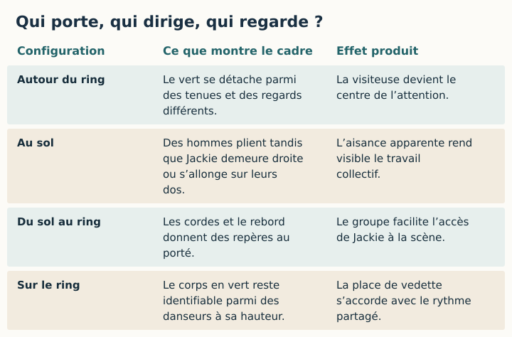

# ENS-PSL · CNEL Lettres — Études cinématographiques 2026 · Corrigé guidé

*Corrigé rédigé par IA, non officiel. Signalez toute erreur.*

**Rédaction** · GPT-6.2 Astra Ultra · vitesse non renseignée

[Sujet dans le rapport du jury, p. 3](https://www.ens.psl.eu/sites/default/files/rapport_du_jury_du_departement_arts_cnel_2026_ens-psl.pdf#page=3)

Stanley Donen et Gene Kelly, *Beau fixe sur New York* (*It’s Always Fair Weather*, 1955). Le jury demande de commenter le jeu entre masculinité et féminité dans le numéro dansé de Cyd Charisse chez Stillman.

## Préparer le commentaire

Lors d’une première vision, suivre une seule relation, celle de Jackie avec les hommes qui la regardent. À quel moment leur façon de disposer leur propre corps devient-elle une réponse au sien ? À la deuxième vision, dessiner un rectangle très allongé pour la salle et tracer les cordes. Placer la robe verte, les hommes à sa hauteur et ceux qui apparaissent derrière elle. On obtient deux cartes différentes selon que Jackie se tient au sol ou que le groupe la conduit sur le ring. Ce changement de niveau donne une articulation possible à la copie.

Choisir deux images que l’on pourrait confondre sous une formule comme « tout le monde admire la vedette ». Dans la pose allongée, les hommes ploient sous Jackie et elle garde la tête levée à une extrémité de la figure. Lorsqu’ils dansent debout près d’elle, leurs vêtements permettent encore de les différencier, mais ils partagent le rythme et la direction du mouvement. Chaque image distribue autrement le plaisir du regard et le travail des interprètes. Pour passer de l’observation au commentaire, expliquer ce que le format large permet de voir simultanément.

Au brouillon, réserver une colonne à la fiction (Jackie, chez Stillman), une à l’interprétation (la précision de Cyd Charisse et celle de ses partenaires) et une à la place du spectateur. Les trois colonnes se rejoignent dans le porté. Une femme franchit la limite du ring, une danseuse accomplit une figure avec plusieurs hommes et le public en découvre les appuis dans le même champ. Ce faisceau d’observations donne plus de prise sur le jeu des genres qu’un catalogue d’attributs réputés masculins ou féminins. Le schéma rassemble des configurations visibles dans le numéro. L’extrait de Warner Archive fait référence pour le film et la chanson. Le remontage partiel indiqué en fin de corrigé permet de revoir les gestes décrits avec une autre bande sonore.

## Commentaire de « Baby, You Knock Me Out »

Que devient une salle de boxe lorsque les hommes qui l’occupent portent une femme au milieu du ring et que le spectacle peut enfin y avoir lieu sans adversaire ? Dans *Beau fixe sur New York*, tourné en 1955 par Stanley Donen et Gene Kelly, Jackie Leighton, interprétée par Cyd Charisse, danse chez Stillman devant et avec les habitués du club. La chanson « Baby, You Knock Me Out » propose d’emblée deux manières de comprendre l’effet qu’une personne produit sur une autre. Un amateur de boxe entendra une allusion à la défaite. Une personne séduite y reconnaîtra son propre ravissement. L’image fait de cette double entente une expérience collective. Chacun peut occuper la position de celui qui impressionne et de celui qui se laisse impressionner. Comment le film peut-il faire circuler l’initiative de cette façon tout en maintenant aux yeux de tous la singularité féminine de sa vedette ?

### Une femme se détache dans la salle, puis la salle s’ordonne autour d’elle

La salle proposait déjà un dispositif de spectacle. Les cordes isolent une aire surélevée, les hommes y apparaissent de part et d’autre d’une limite qui sépare habituellement les acteurs d’une rencontre de ceux qui la suivent. Le cadre large conserve en même temps des corps au premier plan, des spectateurs installés plus loin et les lignes horizontales du ring. Un homme penche la tête ou tourne le buste vers Jackie et peut devenir à son tour l’objet de notre attention. Nous disposons ainsi d’une liberté que les spectateurs du club, tous occupés par l’apparition de la jeune femme, semblent momentanément perdre. Nous pouvons regarder ce que fait l’admiration à celui qui admire.

La couleur isole Charisse avant même qu’une figure ne soit achevée. Le vert soutenu de son vêtement dessine, du cou jusqu’au-dessous du genou, une forme continue. Autour d’elle, bras nus et manches longues, maillots clairs et débardeurs noirs, shorts et pantalons distinguent plusieurs hommes d’un seul coup d’œil. La tenue de Jackie l’identifie comme étrangère aux exercices habituels du club. Elle rend aussi lisible la moindre modification de l’axe de son corps. Lorsqu’elle ouvre les bras sur les côtés, l’inscription horizontale du geste accompagne la largeur de l’écran. Lorsque les hommes se baissent alors qu’elle se maintient debout, cette même tache verte dessine une verticale au milieu des dos inclinés. Une différence qui la désignait aux regards devient pour elle le moyen d’ordonner la figure.

Les hommes ne forment donc jamais un fond interchangeable. La variété de leurs silhouettes fait une partie du comique. Il est possible d’apercevoir en même temps celui qui reste en retrait, celui qui s’incline et celui qui attend d’entrer dans la figure. La coexistence de ces attitudes fait sentir la propagation du jeu. L’ensemble pourrait se refermer autour d’une intruse. Il se recompose selon les possibilités de mouvement qu’elle lui découvre.

### Du corps qu’on expose au corps qui donne la mesure

Une pose rassemble tout le paradoxe. Jackie repose en travers de plusieurs hommes penchés. Une main remonte auprès de sa tête, l’autre se pose sur sa hanche, une jambe s’allonge au-delà de ses appuis. Son visage reste dégagé. Prise séparément, la figure offrirait le portrait familier d’une femme allongée qui s’abandonne aux regards. Le décor visible sous elle en modifie le sens. Sous cette apparente aisance travaillent des dos, des bras, des jambes fléchies. Les hommes devenus support ont eux aussi composé une pose difficile, et son maintien à elle exige une coordination exacte avec eux. L’image nous invite à prendre du plaisir à l’élégance de la ligne puis à en découvrir la fabrication comique. Il y a quelque chose d’extravagant à mobiliser tant de force pour installer si confortablement une personne qui pourrait fort bien se tenir debout.

La présence de Charisse se mesure aussi lorsqu’elle descend vers le sol ou change brusquement de niveau. Le port de tête et la netteté de ses extensions survivent aux flexions. Les mouvements ramassés engagent le poids du corps, ceux qui prolongent la ligne des jambes déploient ce poids dans l’espace. Une même interprète sait passer de l’un à l’autre. En sens inverse, les boxeurs acquièrent une aptitude à l’ajustement, à la simultanéité et à l’ornement collectif que leur tenue ne promettait guère. Le spectateur reconnaît des qualités qu’il associait à l’un ou l’autre sexe et éprouve le plaisir de les voir redistribuées par le mouvement. Nul besoin que Jackie adopte une tenue sportive ou que ses partenaires quittent leurs vêtements d’entraînement. Leurs habits continuent de rappeler ce que le gymnase semblait prescrire à chacun.

Le titre trouve ici sa portée comique. Être mis « K.O. » désigne à la fois une perte de pouvoir et une admiration qui donne à celui qui l’éprouve l’envie de participer. Le mot tendre « Baby » lui-même laisse ouverte l’identité du destinataire lorsque plusieurs hommes se pressent autour d’une femme. Que chacun paraisse ravi du jeu compte autant que l’autorité de celle qui l’entraîne. La séduction s’exprime par des écarts de hauteur, la tenue d’une pose ou l’énergie avec laquelle un groupe se relève. À une déclaration entre deux personnes le numéro donne la dimension d’une salle entière.

### Le ring à plusieurs

Le passage du sol au ring fait de ce partage une action. Depuis l’extérieur des cordes, le groupe porte Jackie vers la surface surélevée. L’élévation de son corps se lit par rapport au rebord fixe, aux cordes, aux hommes postés à des hauteurs différentes. L’espace de la boxe fournit ainsi au cinéma ses propres repères pour mesurer l’envol de la danseuse. Au milieu du ring, la robe verte et les bras ouverts composent une figure immédiatement reconnaissable, mais Jackie a désormais des partenaires à sa hauteur, jusque sur les côtés. Leur alignement fait saillir la singularité de chacun en même temps qu’il manifeste une mesure commune. Le ring offre une scène à celle qui ne semblait pas destinée à y monter. Il offre aussi un autre emploi à ceux qui y avaient déjà toute leur place.

Il serait tentant de lire l’arrivée au centre comme le sacre d’une gagnante. Or le numéro échange la relation à deux du combat contre une organisation à plusieurs sans perdant. La même femme que les hommes ont matériellement portée jusqu’au ring y donne aux déplacements leur point de référence. Son pouvoir dépend des concours visibles que chacun lui prête. Réciproquement, le format large et les figures communes accordent aux hommes une présence de danseurs qu’ils n’auraient pas eue si la caméra avait réservé tout le champ au seul visage de la vedette. La fiction ménage bien le plaisir de la regarder. Elle donne aussi à contempler ce qui arrive à la masculinité sportive quand elle accepte de se donner en spectacle autour d’elle.

La force du numéro tient finalement à la distinction qu’il établit entre disposer d’un corps et disposer une figure. On peut soutenir Charisse, la soulever, lui donner une place matériellement déterminée. Il reste impossible d’achever la figure sans qu’elle en règle la ligne et en soutienne le regard. Dès lors que la danse commence, la force de ceux qui portent, le plaisir d’être portée et l’autorité de celle qui paraît commander peuvent devenir les trois aspects d’un même geste. Voilà comment un ring de boxe en vient à rendre sensible, jusque dans une jambe allongée et des dos courbés, le jeu entre masculinité et féminité.

[Numéro publié par Warner Archive](https://www.youtube.com/watch?v=h6SqoqS9Xrs) · [Notice TCM](https://www.tcm.com/watchtcm/titles/1568) · [Remontage partiel du numéro, témoin visuel](https://vimeo.com/287867070) · [Nathan James, thèse sur la comédie musicale MGM, p. 266](https://pure.roehampton.ac.uk/ws/files/1273433/Re_imagining_the_MGM_musical.pdf)
