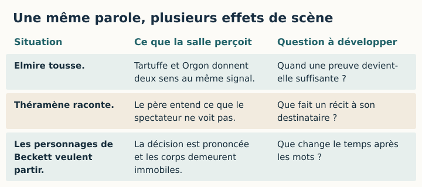

# ENS-PSL · CNEL Lettres — Études théâtrales 2026 · Corrigé guidé

*Corrigé rédigé par IA, non officiel. Signalez toute erreur.*

**Rédaction** · GPT-6.2 Astra Ultra · vitesse non renseignée

[Sujet dans le rapport du jury, p. 3](https://www.ens.psl.eu/sites/default/files/rapport_du_jury_du_departement_arts_cnel_2026_ens-psl.pdf#page=3)

Joël Pommerat, *Théâtres en présence*, Arles, Actes Sud-Papiers, 2007, p. 26. Le jury demande un commentaire argumenté de la priorité donnée au fait de montrer et de la place faite à la parole.

## Préparer le commentaire

**Lire les trois moments de la citation.** *Plus urgent* établit une priorité dans le travail de création. La reprise du verbe fait passer du principe aux deux décisions concrètes, l'objet et la manière. La dernière proposition inclut le texte et fait de l'acte de parler une chose perceptible. Dans une copie de trois heures, on peut partir de l'endroit précis où un corps ou un objet fait comprendre quelque chose qu'un résumé ne transmettrait pas.

**Éprouver l'idée sur une scène.** Dans *Tartuffe* IV, 5, la même toux atteint un séducteur, un mari caché et une salle informée. À la fin de *Phèdre*, identifier le destinataire présent avant de raconter l'événement absent. Chez Beckett, garder ensemble le dernier accord verbal et l'immobilité des deux personnages. Ces exemples mettent à l'épreuve trois rapports différents entre présence, parole et savoir.

**Situer un exemple contemporain.** Pour *Ça ira (1) Fin de Louis*, la notice de Nanterre-Amandiers et le dossier du spectacle attestent l'extension du jeu aux gradins. Le point à analyser est la différence entre entendre une voix dans les rangs et participer au vote d'une assemblée. En choisissant ses propres exemples, toujours désigner un objet de scène, une adresse ou une durée vérifiable.

## Commentaire de la proposition de Joël Pommerat

Un homme caché sous une table écoute sa femme tousser. La situation est comique parce que le public de *Tartuffe* sait à quoi sert cette toux, à qui elle s'adresse et pourquoi celui à qui elle devrait profiter tarde à en tirer la conclusion qui s'impose. Un exposé sur la crédulité d'Orgon dirait aisément ce que la scène prouve. Il nous priverait du temps qu'il faut à un homme pour consentir à une preuve. C'est ce temps que désigne peut-être l'urgence invoquée par Joël Pommerat dans *Théâtres en présence* (2007). Le metteur en scène donne la priorité à l'acte de montrer et précise aussitôt que le texte y a sa part, puisque la parole doit elle-même être montrée. L'insistance mérite examen. Une scène rend quelque chose présent sous les yeux du spectateur, mais elle peut aussi faire entendre un récit de ce qu'il est matériellement impossible de montrer. Que devient alors la distinction entre montrer et expliquer ? Si l'explication prétend livrer d'avance le sens de ce qui arrive, le plateau a tout intérêt à lui résister. Si expliquer est un acte qu'un personnage accomplit devant d'autres, ses raisons, ses silences et son pouvoir deviennent au contraire une matière proprement théâtrale.

Le premier déplacement opéré par la formule de Pommerat porte sur le travail. L'auteur ne promet pas au public une révélation spontanée du réel. Il décline une tâche qui oblige à décider de l'objet du spectacle, puis de sa manière d'apparaître. Dans l'acte IV du *Tartuffe* de Molière, Elmire obtient de son mari qu'il se cache pour entendre les propositions que lui fait Tartuffe. Quand elle exagère ses scrupules et tousse à plusieurs reprises, le même geste a deux destinations. Pour Tartuffe, cette femme peut souffrir d'un rhume. Pour Orgon, la toux devrait signifier que la démonstration a suffisamment duré. Le spectateur peut rire du délai parce qu'il connaît simultanément les deux scènes auxquelles les personnages n'accèdent que séparément. La table est indispensable à cette distribution. Elle permet de soustraire un témoin au regard de l'homme dont il doit découvrir la conduite. Le choix du meuble et de la place d'Orgon constitue déjà un raisonnement sur ce qu'il faut pour détromper un crédule.

Il y a pourtant bien une explication dans ce stratagème. Elmire veut faire comprendre à son mari ce que ses paroles antérieures n'ont pas réussi à lui faire admettre. Elle organise une épreuve. La différence tient à la situation faite à celui qui doit la comprendre. Il doit rester en place, écouter sa femme converser avec un autre et décider quand il est fondé à sortir. Son retard prolonge son expérience aux dépens d'Elmire. Une mise en scène qui allonge ce silence peut donner au rire une pointe d'inquiétude. Combien de temps cette femme est-elle contrainte d'endurer la conduite qu'elle dénonce pour que sa parole soit crue ? La question n'abolit pas la comédie. Elle se forme dans le léger écart entre l'instant où une partie de la salle juge la preuve acquise et celui où Orgon agit enfin. Montrer revient à ménager cet écart et à laisser le spectateur en éprouver le prix.

La scène classique oblige néanmoins à élargir ce que nous entendons par montrer. À la fin de *Phèdre* (1677), Théramène raconte à Thésée la mort d'Hippolyte. Le monstre, l'emballement et la course fatale ne passent pas sous les yeux de la salle. Est-ce renoncer au théâtre pour retrouver un art du récit ? Ce serait oublier le destinataire présent. Thésée a appelé sur son fils un châtiment dont il doit à présent apprendre les conséquences. Le gouverneur qui a accompagné le jeune homme parle à son père. Chaque détail qu'il rapporte arrive trop tard pour le sauver. Dans le même temps se constitue chez l'auditeur un savoir qui rend son erreur irrévocable. Un théâtre attaché à la bienséance et aux puissances du récit peut donc mettre la parole au premier plan sans déléguer à une voix extérieure le soin de commenter ce qui s'est produit. Il montre un homme obligé d'annoncer quelque chose à un autre, et le second contraint de l'écouter. Un acteur qui chercherait uniquement à bien peindre le monstre dans ce récit risquerait de perdre la violence de cette adresse.

La dernière proposition de Pommerat gagne ainsi en précision. Montrer la parole suppose de rendre perceptibles ses conditions et ses effets, parfois même son impuissance. À la fin d'*En attendant Godot*, créé en 1953, Vladimir et Estragon s'accordent verbalement pour partir. La didascalie les maintient immobiles. Nul besoin de faire dire à l'un que leur volonté est paralysée. Le public entend une décision commune et dispose du temps nécessaire pour constater qu'elle ne déplace aucun des deux corps. Selon la durée laissée entre les derniers mots et la fin de la représentation, il attend encore un mouvement ou comprend déjà que cette attente est la sienne. Là où la scène de Molière réalisait finalement ce que l'un des protagonistes tardait à comprendre, la pièce de Beckett peut se terminer en maintenant l'écart ouvert. Le silence après l'accord donne aux mots prononcés un sens qu'aucune définition d'*aller* ne pouvait fixer.

Pour autant, faire de toute parole explicative un échec de théâtre reviendrait à figer une règle de travail en interdit historique. Le théâtre épique de Brecht a précisément cherché à rendre intelligibles des mécanismes sociaux. Dans *Mère Courage et ses enfants*, la ville de Halle est menacée. Kattrin, qui est muette, monte sur un toit et bat le tambour pour réveiller les habitants. Il y aurait une façon paresseuse de transformer son geste en leçon de courage. On perdrait la singularité du moyen. Le bruit doit être assez fort pour atteindre ceux qui n'ont encore aucune connaissance du danger. Sur scène, les avertissements adressés à Kattrin demandent qu'elle se taise, tandis que la répétition qu'ils veulent interrompre est sa seule possibilité de prévenir la ville. À mesure que croît la menace, la signification du tambour se précise pour la salle. La suite de la scène donne un prix tragique à l'écart entre ceux qui veulent survivre en gardant le silence et celle qui choisit de se faire entendre. On comprend une distribution conflictuelle des intérêts en écoutant ce qui les oppose. La volonté d'expliquer et la décision de montrer peuvent donc travailler ensemble. Leur rencontre réussit quand la leçon demeure discutable à partir de ce qu'on a éprouvé, au lieu de transformer rétrospectivement chaque personnage en porte-parole d'une vérité toute faite.

Un spectacle de Pommerat permet de mettre cette hypothèse à l'épreuve de sa propre pratique. Dans *Ça ira (1) Fin de Louis*, présenté à Nanterre en 2015, les premières étapes de la Révolution française sont abordées à travers des débats, des prises de parole, des tentatives de former une assemblée. Des interprètes interviennent jusque dans les gradins. Une objection émise depuis la salle fait qu'un spectateur doit parfois se tourner pour localiser la voix qui interrompt celle qu'il regardait. L'information historique prend une autre forme lorsque l'on ne sait pas d'avance quelle proposition emportera la décision au cours d'une séance. On peut avoir appris l'issue du processus révolutionnaire et découvrir combien il est difficile, à un instant donné, de faire adopter une formule par des gens qui donnent aux mêmes mots des sens différents.

L'espace même précise ici une limite éthique du verbe *montrer*. L'implantation des acteurs dans les gradins prête à la salle la configuration d'une assemblée. Elle ne transforme pas les détenteurs d'un billet en représentants investis d'un mandat, capables de voter sur le sort des personnages. Cet écart compte. Le spectateur est assez proche pour sentir qu'une voix lui arrive de derrière et qu'une parole adverse occupe tout à coup de l'espace. Il reste assez libre pour se demander qui reçoit du temps, qui s'autorise à interrompre et quelle position le dispositif rend la plus aisément audible. La fidélité du spectacle à la complexité historique dépend dès lors d'un important travail de choix. Faut-il présenter le débat depuis la tribune, depuis les rangs ou depuis le lieu où les objections restent sans effet ? Ce sont des décisions de dramaturgie et, inséparablement, des propositions sur la façon dont nous pouvons comprendre une situation politique.

L'urgence dont parle Pommerat prend finalement un sens pratique. Au moment de la répétition, une explication de l'intention peut être exacte et laisser intacte la question décisive. Où placer l'acteur qui doit entendre ? À qui l'autre parle-t-il quand il semble s'adresser à tous ? Que voit-on encore après que la phrase a fini ? Ce que la scène fait éprouver au spectateur tient à la précision de ces réponses. Parfois elle lui fait constater un fait. Parfois elle lui donne à entendre un récit qu'il ne saurait remplacer par une image. Elle peut même lui montrer quelqu'un qui explique, se trompe ou convainc. Dans tous les cas, l'interprétation commence quand il est mis en mesure de comparer ce qu'il entend, ce qu'il voit et ce qu'il en avait conclu une seconde auparavant.

[Dossier du spectacle de Pommerat](https://www.odyssud.com/sites/default/files/dp-ca-ira-1-fin-de-louis_0.pdf) · [Notice de Nanterre-Amandiers](https://www.nanterre-amandiers.com/saison/saison-2015-2016/ca-ira-1-fin-de-louis-joel-pommerat-2015)
