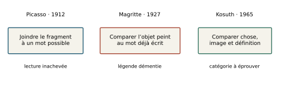
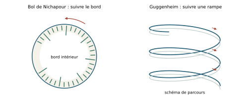

# ENS-PSL · CNEL Lettres · Histoire de l’art 2026 · Corrigé brut

*Corrigé rédigé par IA, non officiel. Signalez toute erreur.*

**Rédaction** · GPT-6.2 Astra Ultra · vitesse non renseignée · 24 novembre 2026

**Révision** · GPT-6.2 Astra Ultra · vitesse non renseignée · 26 novembre 2026

## Les mots dans les arts visuels

Deux hommes penchés sur un jeu, de part et d’autre d’une petite table. Sur une amphore attique d’Exékias, le spectateur qui reconnaît cette scène peut encore ignorer ce qui s’y passe. Il faut lire les mots peints devant la bouche des joueurs pour apprendre le résultat de leur coup. L’image acquiert alors une durée très brève, celle de deux voix qui annoncent leurs points. D’autres mots, sur ce même vase, donnent les noms des héros. Lire introduit donc au moins deux opérations dans l’acte de regarder, identifier quelqu’un et lui entendre dire quelque chose. [Musées du Vatican, amphore d’Exékias](https://www.museivaticani.va/content/museivaticani/en/collezioni/musei/museo-gregoriano-etrusco/sala-xix--emiciclo-inferiore--collezione-dei-vasi--ceramica-atti/anfora-attica-a-figure-nere-firmata-da-exekias.html)

Le mot possède un sens dans une langue et prend, dans une œuvre, une forme, une dimension et une place. Le terme « dans » invite à partir de cette inscription concrète. Une description rédigée après coup par un historien et trois lettres peintes par Picasso entretiennent avec le tableau des rapports différents. Il faut aussi faire une place aux œuvres dont les mots constituent presque tout le champ visuel et à celles qui intègrent à leur dispositif ce qui ressemble d’ordinaire à une légende extérieure. Comment la place faite aux mots par l’artiste transforme-t-elle ce qu’un spectateur peut reconnaître, puis mettre en doute, et finalement faire devant l’œuvre ?

### I. Donner voix, donner forme, prendre date

Sur l’amphore à figures noires d’Exékias, au VIe siècle avant notre ère, les noms d’Achille et d’Ajax permettent d’identifier deux héros dont les attitudes se répondent. D’autres inscriptions s’orientent depuis leurs bouches vers le milieu de la scène. Achille annonce quatre, Ajax trois. Les positions courbées prêtaient déjà au jeu toute l’intensité de leur attention. Les deux nombres y introduisent un écart, chaque joueur ayant désormais une parole et un résultat propres. La signature du potier et peintre ajoute encore un énonciateur. Entre le nom d’un personnage, sa réplique et la revendication d’un savoir-faire, c’est la disposition sur le vase qui guide l’attribution de la voix. [Musées du Vatican, notice de l’amphore](https://www.museivaticani.va/content/museivaticani/en/collezioni/musei/museo-gregoriano-etrusco/sala-xix--emiciclo-inferiore--collezione-dei-vasi--ceramica-atti/anfora-attica-a-figure-nere-firmata-da-exekias.html)

Un bol de Nichapour du Xe siècle, aujourd’hui au Metropolitan Museum, pose autrement la relation entre parole et objet. Sur l’engobe blanc de la céramique, les lettres arabes à l’engobe noir courent le long du bord sous une glaçure transparente. L’inscription recommande de réfléchir avant d’agir pour s’épargner le regret, puis exprime des souhaits de prospérité et de paix. Ce conseil arrive à son destinataire sur un objet susceptible de passer de main en main. Sa forme circulaire règle le parcours de lecture. Les hampes dressées scandent le bord et les lettres allongées ménagent la place nécessaire jusqu’à l’achèvement de la formule. Celui qui ne lit pas l’arabe perçoit ces intervalles et ce rythme. Une traduction lui ouvre l’accès à l’adresse morale, tout en laissant à observer ce que la traduction sur une ligne droite abandonne de la forme du bol. [Metropolitan Museum of Art, bol de Nichapour](https://www.metmuseum.org/art/collection/search/451802)

Une autre manière de s’adresser au regardeur consiste à inscrire dans le lieu figuré la trace de celui qui l’a peint. En 1434, Jan van Eyck dispose sur le mur du *Portrait dit des Arnolfini*, juste au-dessus du miroir convexe, une phrase latine signifiant que Jan van Eyck « fut ici ». On pourrait d’abord la lire comme une signature apposée à l’œuvre. Or le mot « ici » prend pour point de départ le mur de la chambre, alors que le spectateur sait avoir devant lui un panneau peint. Dans le miroir, deux autres figures se laissent apercevoir à l’entrée de la pièce. La formule incite à chercher la place d’un témoin, sans livrer l’identité certaine des silhouettes ni la preuve juridique d’une cérémonie. Par cette petite phrase, le peintre fait entrer la question de sa présence dans l’espace même qu’il a construit. Le langage qui paraissait venir garantir l’identité de ce que l’on voit vient aussi d’en compliquer le statut. [National Gallery, notice et catalogue du portrait](https://www.nationalgallery.org.uk/paintings/catalogues/campbell-1998/the-arnolfini-portrait)

### II. Faire hésiter entre lire et reconnaître

L’importance du collage cubiste tient à une expérience concrète de cette hésitation. Dans la *Nature morte à la chaise cannée* de Picasso, en 1912, trois lettres bien lisibles, « JOU », émergent parmi les objets fragmentés d’une table. Elles permettent au regard d’évoquer un journal au milieu de signes beaucoup plus difficiles à identifier. Mais elles s’arrêtent au moment précis où le lecteur serait tenté d’achever le mot. Le musée relève aussi la possibilité de « jouer ». Les lettres sont à la fois rapides à lire et ouvertes dans ce qu’elles désignent. En dessous, ce que l’on prendrait de loin pour un tressage est un motif de cannage imprimé sur de la toile cirée et collé sur la toile. Une corde véritable entoure l’ovale. Le tableau exige donc du spectateur qu’il distingue une chose matériellement présente, un matériau imprimé qui en imite un autre et une suite de lettres dont il complète lui-même le référent. Confondre la toile cirée avec du cannage ou les lettres avec une coupure de presse ferait perdre le ressort de l’œuvre. [Musée national Picasso-Paris, notice de collection](https://cep.museepicassoparis.fr/explorer/nature-morte-la-chaise-cannee-mp36) [Analyse du musée](https://www.museepicassoparis.fr/fr/chefs-d-oeuvre/nature-morte-a-la-chaise-cannee/)

La mise en page de *La clef des songes* de René Magritte semble, en revanche, garantir une correspondance réglée. Dans la version de 1927 conservée à Munich, des objets isolés sont disposés en cases avec des mots écrits à leur pied. L’arrangement rappelle la planche d’apprentissage sur laquelle un enfant doit pouvoir passer sans difficulté de la chose représentée à son nom. Or un sac se trouve associé au ciel, un couteau à l’oiseau. Le lecteur reconnaît assez bien le dessin et comprend assez bien le mot pour éprouver leur désaccord. La place de la légende a fait naître une promesse de désignation que les associations défont. Picasso laissait le lecteur compléter un fragment. Magritte rend le mot disponible en entier et déplace la difficulté vers la relation que nous attendions entre deux signes parfaitement reconnaissables. Le trouble repose sur cette attente apprise. [Pinakothek der Moderne, version de 1927](https://www.sammlung.pinakothek.de/de/artwork/jpxe1JnxJ7)

Le quatrième compartiment est décisif. Sous une feuille, on lit « la table », mais sous l’éponge on lit bien « l’éponge ». Si toutes les étiquettes avaient été déplacées, il suffirait de conclure que ce petit lexique a été mal rangé. Le seul accord oblige au contraire à reprendre l’examen case par case. Pourquoi avons-nous admis aussitôt que l’inscription inférieure devait nommer la chose supérieure ? Le cadre qui les réunit et l’habitude de l’imagier scolaire ont institué cette fonction avant même la lecture du premier mot. Magritte peut alors la suspendre trois fois et la satisfaire une fois. C’est en ménageant cet accord qu’il rend sensible la convention qui règle les quatre. [La version de 1927 reproduite, Musée Thyssen-Bornemisza, p. 11](https://www.museothyssen.org/sites/default/files/document/2024-03/03_Magritte_JL%20Calderon%20Aguirrezabala_OpenWindows_13.pdf#page=11)

En 1918, la page 62 de *Calligrammes* d’Apollinaire propose une expérience inverse. Dans *Il pleut*, cinq traînées de mots presque verticales descendent de gauche à droite, sous un titre composé horizontalement. De loin, l’œil saisit leur direction commune d’un coup. Pour comprendre une phrase, il faut revenir à son départ, descendre une seule ligne et laisser momentanément les quatre autres. Les premiers mots font entendre des « voix de femmes » : la pluie que l’on avait cru voir devient aussi une pluralité de voix et de souvenirs. Recopier le poème sur cinq lignes horizontales conserverait les mots et changerait le temps que nous mettons à passer de la pluie visible aux voix entendues. Cet exemple éclaire la place de la poésie dans une histoire des arts visuels. La page fournit ici une partie de la preuve, au même titre que la surface du tableau. [Fac-similé de la page 62, édition du Mercure de France](https://fr.wikisource.org/wiki/Page:Apollinaire_-_Calligrammes.djvu/62)

### III. Faire du lecteur un participant et lui assigner une place

Il suffit parfois d’exposer une définition à la place où l’on attendrait une explication pour que l’explication devienne un nouvel objet à examiner. Dans *One and Three Chairs* de Joseph Kosuth, en 1965, une chaise pliante en bois voisine avec une photographie de chaise et un agrandissement photographique d’une entrée de dictionnaire. Si l’on retire mentalement la définition, il reste une comparaison entre un objet singulier et son image. Quand on la rétablit, la classe entière des objets que l’on peut appeler *chair* entre dans le jeu. La photographie permet de reconnaître une apparence particulière, la définition peut convenir à des chaises qui auraient une tout autre apparence, et le meuble occupe devant nous un volume que les deux panneaux figurent ou décrivent. Le visiteur éprouve ces écarts en passant de l’un à l’autre. La définition exposée possède désormais un format et une place aussi déterminants que ses termes. [Museum of Modern Art, *One and Three Chairs*](https://www.moma.org/collection/works/81435)

Que se passe-t-il lorsque les mots ne disposent même plus d’une place stable devant nous ? Jenny Holzer fit d’abord circuler ses *Truisms* de 1977–1979 sous forme d’affiches anonymes à New York. En mars 1982, son intervention à Times Square utilise le panneau électronique Spectacolor, support familier de la publicité. Une phrase péremptoire qui s’y allume hérite momentanément de l’autorité des annonces. Faute de signature visible comme celle de Van Eyck, le passant doit décider à qui attribuer la proposition et s’il veut y souscrire, alors même que la suivante approche. Cette question de position devient physique dans *Light Line*, au Guggenheim en 2024. La nouvelle réalisation d’une installation de 1989 fait défiler des textes le long des six rampes de la rotonde. De loin apparaissent les lignes lumineuses qui dessinent la spirale. Pour lire une phrase, il faut lui accorder du temps, choisir un point de vue et laisser d’autres mots se dérober. L’architecture ménage à chacun une expérience partielle de ce discours pourtant public. [Guggenheim, *Truisms*](https://www.guggenheim.org/artwork/artist/jenny-holzer) [Public Art Fund, intervention de 1982](https://www.publicartfund.org/exhibitions/view/messages-to-the-public/messages-to-the-public-holzer/) [Guggenheim, *Light Line*](https://www.guggenheim.org/audio/track/introduction-to-jenny-holzer-light-line)

Le lecteur de l’amphore pouvait départager deux voix en se penchant sur deux nombres. Celui qui suit la spirale de Holzer guette une parole dont la source et le destinataire restent à déterminer. Dans les deux cas, la place des mots appartient à ce que l’œuvre nous fait comprendre. Elle peut fixer le sens d’une scène, introduire une incertitude jusque dans un nom familier, ou distribuer les conditions d’accès à une parole publique. L’histoire de ces opérations ne suit pas un progrès qui conduirait de l’inscription au concept. Une céramique de Nichapour associait déjà la beauté d’une ligne à l’adresse d’une maxime. La question qui se renouvelle avec chaque support est celle du lecteur que l’œuvre suppose et de la liberté qu’elle lui donne de répondre.

## Schéma de lecture

## Source du sujet

Le département Arts reproduit l’intitulé à la page 4 et indique les conditions de l’écrit à la page 2. Les candidats choisissaient leurs exemples à travers les époques et les médiums. [Rapport du jury ENS-PSL 2026](https://www.ens.psl.eu/sites/default/files/rapport_du_jury_du_departement_arts_cnel_2026_ens-psl.pdf)
