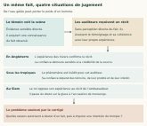

# ENS-PSL · CNEL Lettres — Philosophie 2026 · Corrigé brut

*Corrigé rédigé par IA, non officiel. Signalez toute erreur.*

**Rédaction** · GPT-6.2 Astra Ultra · vitesse non renseignée

**Retouches** · GPT-6.2 Astra Ultra · vitesse non renseignée

**Révision (tour 1)** · GPT-6.2 Astra Ultra · vitesse non renseignée

L’écrit d’admission demande d’exposer les articulations du passage et son problème en deux pages au plus, puis de développer une réflexion personnelle en quatre à cinq pages au plus. L’extrait vient de l’*Essai sur l’entendement humain*, IV, XV, § 5, dans la traduction de Pierre Coste.

## Consigne de l’écrit

Le rapport officiel reproduit l’écrit d’admission. La consigne figure page 2 et le texte de John Locke, *Essai sur l’entendement humain*, IV, XV, § 5 (trad. Pierre Coste), page 3. Le passage commence par « Comme la probabilité n’est pas accompagnée de cette évidence » et finit par « mais présentement je suis assuré que vous mentez. ». Ses deux paragraphes occupent les lignes 1 à 7 et 8 à 27.

Après avoir exposé les principales articulations du texte suivant, et formulé un problème philosophique qu’il soulève (max. 2 p. pour l’ensemble), vous développerez une réflexion sur ce problème (max. 4-5 pages).

## I. Articulations du texte et formulation du problème

Que l’eau se soit durcie au point de porter un homme, le témoin qui le voit en a connaissance. Celui qui l’apprend par ouï-dire doit juger s’il peut le croire. L’extrait s’ouvre sur la différence entre ces deux rapports au vrai. L’évidence qui « détermine l’entendement » emporte avec elle la certitude. Lorsque cette évidence manque, plusieurs raisons peuvent plaider en sens contraire. L’esprit dispose alors d’une règle pour « agir raisonnablement ». L’action visée ici est celle d’accorder ou de refuser son assentiment. Il faut examiner les raisons accessibles de part et d’autre, puis régler sur leur poids la fermeté de son consentement. Une proposition peut ainsi mériter une confiance forte, une créance hésitante ou un refus.

Les exemples du second paragraphe font varier ce dont dispose celui qui juge. Je vois un homme sur la glace. L’évidence sensible me détermine. On me rapporte la scène en Angleterre. L’expérience ordinaire d’un hiver rigoureux accrédite le récit, sous réserve d’une circonstance qui rendrait suspect ce témoignage particulier. L’auditeur né sous les tropiques, qui n’a jamais vu ni entendu dire une telle chose, tire ses raisons de croire des rapporteurs eux-mêmes. Leur nombre, leur probité et l’absence d’intérêt à tromper peuvent faire varier sa confiance. Enfin, chez le roi de Siam, l’expérience accumulée paraît entièrement contraire au récit. L’ambassadeur hollandais s’est jusque-là fait croire sur son honneur. L’image d’une eau assez ferme pour porter jusqu’à un éléphant suffit pourtant à le faire accuser de mensonge. Ce dernier jugement est faux et le texte permet néanmoins d’en comprendre la raison.

D’où le problème que soulève la dernière réplique. Comment une confiance réglée sur les raisons disponibles peut-elle conduire à méconnaître la vérité, et jusqu’où ces raisons autorisent-elles le roi à se dire « assuré » qu’on le trompe ?

## II. Réflexion sur le problème

L’ambassadeur dit vrai. De notre place, il semble facile de donner tort au roi. Cependant, nous reconnaissons le vrai grâce à une expérience ou à un enseignement qui lui manque. Si nous mesurions la rationalité de son jugement à sa seule conformité au fait, nous accorderions déjà au roi ce qu’il lui faudrait apprendre. On peut tomber juste en croyant sans examen une histoire invraisemblable. Si elle se trouve exacte, cette heureuse issue ne rend pas la crédulité judicieuse. Réciproquement, un récit trompeur, compatible avec des observations nombreuses et porté par un témoin habituellement scrupuleux, peut emporter une confiance légitime. Le rapport entre la vérité et les bonnes raisons se laisse donc éprouver précisément quand elles se séparent. La raison demeure tenue de chercher la vérité, mais on ne saurait exiger qu’elle la possède avant de juger.

Que peut alors valoir l’expérience du roi ? Il a pu voir de l’eau porter une embarcation et céder sous le pied d’un homme. Son savoir l’autorise à repousser le récit de quelqu’un qui prétendrait marcher sur un étang voisin dans les conditions qu’il connaît. Or la relation de l’ambassadeur comprend une précision décisive. Il parle de son propre pays, pendant la saison la plus froide. Le témoignage contredit ce que le roi a toujours vu si la proposition soumise au jugement est que l’eau peut partout se comporter ainsi. Il entre dans une autre relation avec son expérience si la proposition est qu’un froid qu’il n’a jamais éprouvé peut changer l’état de l’eau. Les observations royales ont toutes été recueillies dans un domaine où cette condition fait défaut. Mille expériences semblables augmentent la confiance avec laquelle on peut prévoir ce qui se passera dans des circonstances semblables. Elles laissent ouverte la question de ce qui arriverait dans des circonstances différentes. Le roi possède donc des raisons de tenir le fait pour extraordinaire. Le passage d’« extraordinaire pour moi » à « impossible là-bas » exige une raison supplémentaire.

Le témoignage offre justement un accès à ces conditions lointaines. Il étend l’expérience en permettant à un homme de tirer parti de ce qu’un autre a vu. Pourtant, ce passage de l’un à l’autre transforme la nature du titre à croire. Je peux savoir que l’ambassadeur est digne de confiance et ignorer s’il a lui-même vu la glace, s’il a bien compris une explication ou s’il rapporte un propos entendu au port. Sa bonne foi porte sur son intention. Sa compétence et sa position de témoin portent sur la qualité de son information. Le nombre des témoins prend à son tour un sens précis. Si trois voyageurs répètent le récit du même marin, l’accord des trois récits apprend peu de chose sur la solidité du sol. Si chacun a vu, à des dates et en des lieux différents, des hommes traverser des étendues gelées, la convergence apporte une raison nouvelle. La règle de Locke demande ainsi du discernement dans la pesée des raisons. Additionner les témoignages comme des suffrages laisserait échapper ce qu’ils prouvent effectivement.

Un conditionnel précise ce que rapporte l’ambassadeur. Pour les hommes, il décrit un usage hivernal qu’il connaît. Pour les éléphants, il avance ce que l’eau durcie porterait si ces animaux se trouvaient dans le pays. L’exemple le plus saisissant pour le roi est donc une conséquence supposée de la solidité de la glace. Le témoin ne prétend pas avoir vu le spectacle que son auditeur imagine. On dispose ainsi de trois questions distinctes. L’eau gèle-t-elle ? Quelle charge peut-elle alors porter ? L’ambassadeur nous trompe-t-il ? Rien n’oblige à donner aux trois réponses le même degré de confiance.

Revenons alors à l’accusation royale. Locke rend intelligible le moment où l’expérience contraire l’emporte sur la confiance accordée à l’ambassadeur. Sa croyance peut, en ce sens, être raisonnable tout en étant fausse. Mais la formule finale ajoute au refus du récit une affirmation sur celui qui parle. Supposons même qu’il soit raisonnable de croire que l’eau n’a pu porter cet éléphant. Il reste à établir que l’ambassadeur sait ce qu’il dit faux et veut tromper le roi. Une erreur de sa part, une amplification, ou le caractère hypothétique de l’exemple, demeurent concevables. L’ambassadeur a dit que la glace « porterait des éléphants s’il y en avait ». Il distingue lui-même ce que les hommes ont éprouvé et une conséquence qu’il estime pouvoir en tirer. Le roi a donc des raisons de demander comment cette conséquence a été établie. Sa déclaration de certitude réclame davantage de preuves que la simple décision de réserver son assentiment.

Cette distinction fait apparaître une dernière exigence de rationalité. Juger à partir de ce que l’on sait aujourd’hui laisse à décider ce qu’il serait raisonnable de chercher demain. Le roi pourrait demander au voyageur si une faible couche de glace porte déjà un homme, si cette couche s’épaissit à mesure que le froid dure et si d’autres voyageurs en ont éprouvé la résistance. Ces questions distingueraient le témoignage direct, l’inférence et l’exagération éventuelle. Elles donneraient au roi des raisons qu’il ne possède pas encore, sans l’obliger à croire d’avance ce qu’on lui dit. Le jugement raisonnable peut ainsi manquer son objet à un instant donné. Il conserve son orientation vers le vrai si sa fermeté traduit ce que les preuves permettent et si l’esprit sait reconnaître quelle observation pourrait lui donner lieu de réviser son jugement.

[Consigne et texte de Locke, pages 2 et 3](https://www.ens.psl.eu/sites/default/files/rapport_du_jury_philosophie_cnel_2026_ens-psl.pdf#page=2) · [Observations du jury, pages 3 et 4](https://www.ens.psl.eu/sites/default/files/rapport_du_jury_philosophie_cnel_2026_ens-psl.pdf#page=3)

## Schéma de lecture

