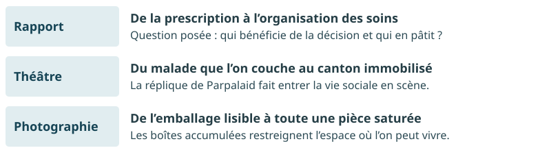

# La sobriété en médecine · ENS-PSL 2026 — corrigé guidé

*Corrigé rédigé par IA, non officiel. Signalez toute erreur.*

**Rédaction** · GPT-6.2 Astra Ultra · vitesse non renseignée · 25 novembre 2026

Programme Médecine-Humanités, épreuve écrite d’admission de trois heures. Le sujet demande une lecture croisée, organisée en paragraphes et conclue. La méthode est libre et les candidats peuvent privilégier certains documents ou mobiliser leurs connaissances.

## Construire une lecture croisée

Prenez pour point de départ la personne debout dans la photographie de la page 3. Masquez un instant le titre. Qu’est-ce qui permet de reconnaître chaque boîte ? À partir de quelle distance cesse-t-on de lire les inscriptions ? Comparez ensuite ce que l’on peut décrire — des emballages sur les parois, au plafond et sous les pieds — avec ce qu’on serait tenté de supposer sur la personne. L’image documente la place laissée au corps. Elle ne dit ni qui il est ni de quelle affection il souffre. Remettez le titre : le nom de la maison prend alors une valeur que n’aurait pas le simple titre *Médicaments*.

**Reprendre le dialogue comme une scène.** Donnez une fonction à chacun des interlocuteurs. Knock veut étendre à tous une catégorie qui fonde sa propre autorité. À deux reprises, Parpalaid modifie l’échelle en parlant du canton et de ses activités. Faites entendre le comique de l’euphémisme « ralentissement » et la brièveté de la dernière réplique. Le désaccord tient autant à leur manière de compter les conséquences qu’à leurs opinions sur la médecine.

**Distinguer deux mécanismes dans le rapport.** Une prescription devenue systématique et la traduction de toute difficulté sociale en demande de prescription n’engagent pas le même raisonnement. Dans un cas, on répète un type d’acte au-delà de son utilité. Dans l’autre, on étend le champ où cet acte passe pour une réponse. Pour chaque mécanisme, demandez quels intérêts, quelles habitudes ou quelles attentes peuvent le maintenir.

**Vérifier la thèse avec un contre-exemple.** Une baisse du nombre d’actes peut signifier qu’on a renoncé à des interventions inutiles. Elle peut aussi signifier que des personnes renoncent à demander les soins dont elles ont besoin. Il faudra donc préciser le critère de pertinence et le confronter à l’équité. Le rapport du jury invite à rendre compte de la forme de l’image et de la relation entre les documents. On peut, pour cela, faire apparaître la même question de responsabilité dans une enveloppe de médicament, une réplique et une décision administrative.

## Proposition de commentaire

Dans la photographie de *La Maison malade* de Jeanne Susplugas, ce qui s’offre d’abord à reconnaître est familier. Chaque petite boîte pourrait avoir sa place dans une armoire à pharmacie. Mais, du sol au plafond, leur prolifération rend presque méconnaissable la pièce où se tient une personne. Quelque chose de semblable arrive au canton du docteur Knock. On y connaît le geste qui consiste à mettre un malade au lit. Étendu à la population entière, il rendrait la vie commune impossible. Le rapport de l’Académie nationale de médecine de décembre 2025 donne le nom de sobriété à la recherche d’une mesure. Une difficulté subsiste pourtant. Le nombre d’objets, d’actes ou de patients qui paraît excessif ne nous dit pas encore combien de soins seraient justifiés, ni envers qui. Comment faire droit à l’exigence de mesure sans donner à une institution le pouvoir de décider une fois de plus, à la place des personnes, de ce qui doit compter dans leur vie ?

Une première réponse vient de la façon même dont chaque document fait apparaître l’excès. Les rapporteurs distinguent deux extensions du domaine médical. Dans la surmédicalisation, un geste se répète au-delà de son utilité. Un professionnel peut prescrire parce qu’il tient à rassurer, et son interlocuteur attendre précisément dans l’ordonnance le signe que sa plainte a été entendue. Chacun trouve une raison au geste de l’autre. L’extra-médicalisation relève d’un déplacement de frontière. Une aspiration au confort ou une difficulté d’origine sociale prennent la forme d’une demande de prescription. Dans le premier cas, la question porte sur la pertinence d’une réponse. Dans le second, elle porte aussi sur l’institution à laquelle on demande de répondre. La promotion commerciale, la fascination pour une technique nouvelle et les intérêts financiers peuvent entretenir les deux mouvements.

La comédie de Jules Romains fait entendre ce déplacement avant que personne ait demandé de soins. Les habitants sont aux yeux de Knock « neutres, indéterminés ». C’est un singulier reproche à adresser à des personnes qui peuvent avoir un métier, des attachements et des projets. Elles manquent de détermination sous le seul rapport qui l’intéresse. En les amenant à « l’existence médicale », il prétend leur conférer une réalité dont il a lui-même choisi le critère. L’échange inverse donc l’ordre attendu entre plainte et intervention. Knock commence par assigner une place aux habitants et se réserve d’observer ensuite ce qui en résultera. Parpalaid, qui lui a vendu sa patientèle, est un contradicteur particulièrement révélateur. Il découvre avec inquiétude les suites d’une entreprise dans laquelle la clientèle avait déjà pu faire l’objet d’une transaction. Le rapport éclaire cet aspect économique. La scène y ajoute une jouissance d’autorité qui ne se laisse pas réduire au calcul des recettes.

Susplugas change encore les conditions de l’enquête. Aucun personnage ne nous explique comment interpréter les boîtes. Au premier plan, quelques emballages laissent distinguer des lettres, des couleurs et des indications. Au fond de l’image, les mêmes unités produisent une trame dense qu’on ne peut plus déchiffrer. Les parois latérales et le plafond convergent autour d’une silhouette sombre, debout, vue presque de dos et tournée vers l’intérieur. Des emballages jonchent le sol sous ses pieds. La place est suffisante pour tenir, beaucoup moins pour se mouvoir librement. Le regard fait donc lui-même l’expérience du changement d’échelle. Il reconnaît un produit, puis ne sait plus comment appréhender l’ensemble qu’ont produit ces objets reconnaissables. Le titre attribue la maladie à la maison. Rien dans le cliché ne permet de diagnostiquer l’état de la personne. Ce déplacement de l’adjectif vers le milieu matériel met en question l’organisation ordinaire du soin, jusque dans l’intimité qu’évoque une maison.

L’excès pose alors une question de responsabilité que le nombre seul ne permet pas de résoudre. Parpalaid demande ce qu’il adviendra des autres activités sociales si la méthode de Knock se généralise. L’effet comique tient à la disproportion entre l’énormité du résultat imaginable et la modération presque polie du mot « ralentissement ». La réplique finale de Knock érige l’étroitesse de son point de vue en signe de conscience professionnelle. Plus il est entièrement médecin, moins il se juge comptable de ce qu’il adviendra hors du lit de ses patients. Or c’est à ces conséquences que les rapporteurs de 2025 demandent précisément de rendre la médecine attentive. Le risque iatrogène est celui d’un dommage produit par le soin lui-même. L’inégalité d’accès, les coûts collectifs et les effets environnementaux élargissent ensuite le cercle de ceux auxquels il faudra en répondre. Une ordonnance peut clore une consultation tout en ouvrant une suite de conséquences pour d’autres que ses deux protagonistes.

La photographie donne à cette responsabilité élargie une forme sensible. Une boîte sert normalement à présenter et à protéger un produit singulier. Ici, son enveloppe demeure et prend de la place. L’objet qui faisait disparaître une inquiétude au cours d’une consultation peut encore exister matériellement longtemps après elle. Ce rapprochement avec le rapport autorise une question sur les ressources et les déchets. Il laisserait échapper une partie de l’œuvre si l’on faisait de l’image une preuve statistique de gaspillage. La photographie ne nous dit ni qui a utilisé ces médicaments, ni avec quel bénéfice. Elle nous conduit plutôt à éprouver la différence entre le point de vue d’une personne qui ouvre une boîte et celui d’une personne qui doit habiter parmi toutes les boîtes. La scène de théâtre opérait déjà ce passage lorsqu’elle nous invitait à imaginer le canton tout entier.

Ce serait cependant manquer la portée du rapport que de substituer à l’ambition de mettre tous les habitants au lit un objectif uniforme de lits vides. Un établissement pourrait faire baisser le nombre de ses actes en décourageant des personnes qui peinent déjà à obtenir un rendez-vous. Le chiffre s’améliorerait, l’inéquité grandirait. Les rapporteurs visent donc aussi le fonctionnement en strates de la gestion administrative. Si l’on juge les professionnels uniquement à la baisse d’un indicateur, on leur demande un automatisme aussi peu sensible aux situations que celui de prescrire pour rassurer. La question pertinente serait de pouvoir expliquer pourquoi un geste rend un service dans une situation, pourquoi un autre fait courir un dommage, et qui supportera le coût ou le délai de la décision. Il devient alors possible de préserver des moyens pour des besoins qui demeuraient sans réponse.

Le dossier ménage enfin une place à celles et ceux qui demandent à être entendus. On peut discerner derrière une demande de prescription une difficulté sociale sans dénier la réalité de la souffrance qui s’y exprime. Chez Romains, les habitants manquent à la conversation où se joue pourtant leur sort. Sur la photographie de Susplugas, la silhouette à hauteur humaine interrompt la répétition des emballages. Sa présence nous oblige à mesurer l’espace à l’aune d’une liberté de mouvement. Le rapport traduit cette exigence dans la langue de la pertinence, de la responsabilité professionnelle et de l’équité. Une médecine sobre se reconnaîtrait alors à sa capacité de justifier aussi bien ce qu’elle entreprend que ce qu’elle s’abstient de faire, devant une personne dont la vie se poursuit au-delà de l’acte de soin. C’est en gardant cette vie dans le champ de son jugement qu’elle peut faire de la sobriété un principe de solidarité.

## Sources

Le sujet de trois pages réunit le rapport de l’Académie nationale de médecine de décembre 2025, Knock (acte III, scène 6, donné comme 1924) et la photographie de La Maison malade (1999). La vue reproduite sur la page 3 a été examinée directement. Le rapport de quatre pages confirme à la page 3 que les douze admissibles ont composé sur ce même dossier.

[Sujet de l’ENS-PSL](https://medecine-humanites.ens.psl.eu/wp-content/uploads/2026/09/sujet-sobriete-en-medecine-2026_mis_en_forme.pdf) · [Rapport du jury, p. 3](https://medecine-humanites.ens.psl.eu/wp-content/uploads/2026/09/CR-jury-2026-1-1.pdf#page=3) · [Annales du programme](https://medecine-humanites.ens.fr/sujets-et-rapports-du-concours-2018/)
