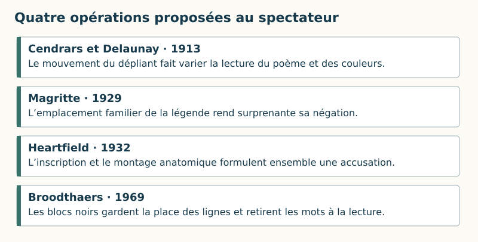

# ENS-PSL · Sélection internationale Lettres — Arts 2026 · Corrigé guidé

*Corrigé rédigé par IA, non officiel. Signalez toute erreur.*

**Lecture du rapport du jury** · GPT-6.2 Astra Ultra · vitesse non renseignée

**Rédaction** · GPT-6.2 Astra Ultra · vitesse non renseignée

**Autocontrôle** · GPT-6.2 Astra Ultra · vitesse non renseignée

**Révision (tour 1)** · GPT-6.2 Astra Ultra · vitesse non renseignée

## Commencer par le geste d’un spectateur

La question de l’épreuve écrite couvre les arts visuels en Europe au XXe siècle. Le dossier personnel du candidat n’est pas requis pour apprécier les exemples. Un corpus resserré permet d’examiner réellement ce qui arrive entre la lecture et le regard. Situer le lieu et la date de production ou de circulation. La localisation actuelle d’une œuvre dans une collection américaine ne suffit pas pour en faire un exemple américain.

Recommencez la comparaison à partir d’un seul geste, ouvrir le livre. Que révèle l’ouverture du dépliant de 1913 ? Que laisse-t-elle illisible dans la reprise de Mallarmé en 1969 ? Une description matérielle précise fait apparaître deux relations entre écriture et image.

Pour chaque œuvre, décrire la position matérielle des signes, puis indiquer l’opération qui en résulte. L’accordéon exige-t-il la même lecture une fois entièrement ouvert ? Le sens du montage de Heartfield se comprendrait-il de la même manière sans le jeu sur le mot *Blech* ? Le livre de Broodthaers garderait-il son sens sans le nom de Mallarmé ? Chacune de ces questions revient au même problème sans imposer la même réponse.

Les quatre notices permettent de contrôler les œuvres et, pour le livre de Broodthaers, d’en distinguer les différentes éditions et supports. [Centre Pompidou, Cendrars et Delaunay](https://www.centrepompidou.fr/fr/ressources/oeuvre/cX458y9) · [LACMA, Magritte](https://collections.lacma.org/object/31931) · [Akademie der Künste, Heartfield](https://www.heartfield.adk.de/node/3763) · [MoMA, Broodthaers](https://www.moma.org/collection/works/146983)

## Composition rédigée

Quand on déplie *La Prose du Transsibérien et de la petite Jehanne de France*, le geste nécessaire à la lecture fait progressivement apparaître la peinture. On pourrait choisir d’exposer le livre ouvert sur toute sa hauteur. Le texte offrirait alors une surface à parcourir du regard avant qu’une phrase ait été lue. Ce changement de posture pose une question plus précise que celle de la présence des lettres dans les tableaux. Comment, dans l’art en Europe au XXe siècle, les œuvres règlent-elles le passage entre voir et lire, et que devient par ce passage l’autorité de ce qui est montré ?

### Le livre et le tableau distribuent autrement l’attention

En 1913, à Paris, Blaise Cendrars et Sonia Delaunay associent un poème de voyage et une composition colorée dans un livre qui se déploie en accordéon. Le dépliant peut atteindre environ deux mètres. Le texte progresse le long d’une colonne, mais les variations typographiques donnent déjà à sa lecture des rythmes visuels. À côté, les couleurs ne se contentent pas de fournir l’image d’un train à chaque mention d’un lieu. Leurs retours, leurs contrastes et leurs mouvements offrent un autre parcours. Pour suivre une phrase il faut accepter sa succession ; pour comparer deux zones colorées éloignées il faut au contraire les saisir ensemble. La « simultanéité » annoncée par l’entreprise ne supprime pas le temps de la lecture. Elle le met en concurrence avec un autre mode de parcours. L’objet traite les deux collaborateurs comme des auteurs du sens produit par son déploiement.

Chez René Magritte, l’inscription emprunte une apparence presque inverse. Dans *La Trahison des images* (1929), une pipe isolée sur un fond uni domine une ligne d’écriture cursive. La relation spatiale évoque une image pédagogique dont la légende devrait en confirmer le nom. La phrase peinte, « Ceci n’est pas une pipe », contraint le regard à revenir sur l’objet qu’il croyait avoir aussitôt reconnu. On ne peut évidemment pas bourrer cette pipe peinte. Mais le mot « ceci » fait aussi hésiter entre le motif, la surface portant les mots et l’ensemble du tableau que l’on désigne. Ce qui dérange ne tient donc pas à une incapacité générale des mots à nommer des choses. Le tableau reproduit l’agencement concret par lequel une image et une légende se garantissent d’habitude mutuellement, puis interrompt cette garantie. Le lecteur devient l’observateur de sa propre habitude de reconnaissance.

### Une inscription peut faire de l’image une intervention publique

Dans le photomontage de John Heartfield publié en 1932 dans l’*Arbeiter-Illustrierte-Zeitung*, le torse de Hitler en train de parler est traité comme une radiographie. Des pièces d’or apparaissent à l’intérieur de son corps. Le titre associe le prétendu surhomme à un homme qui avale de l’or et débite des sornettes. Le mot allemand *Blech* fait entendre la tôle et, dans l’expression, les balivernes. Le montage traduit cette formule en anatomie imaginaire. De leur côté, les pièces donnent au texte une portée économique. La parole politique apparaît comme le produit d’intérêts financiers.

L’enjeu tient à la destination de l’œuvre. Dans un périodique illustré, le lecteur est habitué à trouver des visages d’hommes publics accompagnés de légendes informatives. Le photomonteur remploie des signes de preuve qui appartiennent à la photographie de presse et à l’imagerie scientifique. Leur assemblage manifestement construit prive le discours du chef de sa prétention à être sa propre origine. Ici la phrase guide très fermement l’interprétation que le montage sollicite. Cette efficacité polémique diffère de l’hésitation ménagée par Magritte. Des procédés matériels apparentés, juxtaposer une figure et des mots, peuvent donc augmenter ou diminuer l’indétermination d’une œuvre suivant le support et le public auxquels elle s’adresse.

### Que reste-t-il à lire lorsque les mots deviennent invisibles ?

Dans *Un coup de dés jamais n’abolira le hasard. Image* (1969), Marcel Broodthaers reprend la disposition du poème de Mallarmé publié en volume. Des blocs noirs occupent la place des lignes du poème. Il devient impossible de suivre la phrase dans les pages ainsi transformées et pourtant on peut comparer longueur des lignes, épaisseur des signes, interruptions et réserves blanches. Une opération de soustraction fait ressortir ce que la lecture de mots pouvait reléguer au second plan. La page mallarméenne avait déjà composé des relations dans l’espace. Le livre de Broodthaers donne à percevoir cette organisation en faisant éprouver ce que l’on perd quand on l’isole.

Le titre du poème et le nom de Mallarmé continuent cependant d’orienter l’expérience. Sans eux les rectangles pourraient n’être qu’une suite graphique abstraite. Le geste de Broodthaers engage donc aussi la mémoire d’un texte, le format éditorial qui le transmet et le pouvoir de celui qui le donne à revoir sous un autre nom de genre, « Image ». L’écriture peut ainsi agir dans l’œuvre à l’endroit même où les mots ont cessé d’être lisibles.

Ces quatre expériences se comprennent par les places qu’elles assignent aux regardeurs. Le lecteur de Cendrars et Delaunay oscille entre déploiement et progression. Celui de Magritte doit interroger la confiance accordée à une légende. Celui de Heartfield est placé devant une accusation politique. Avec Broodthaers, il doit faire de sa mémoire de la lecture un instrument du regard. L’écriture dans les arts visuels change donc davantage que la composition d’une surface. Elle peut organiser une épreuve du temps, faire ou défaire une croyance publique et exposer les conditions matérielles dans lesquelles un texte peut encore être reconnu.

[Énoncé officiel](https://www.ens.psl.eu/sites/default/files/sujet_arts_sil_2026_ens_psl.pdf) · [Rapport du jury](https://www.ens.psl.eu/sites/default/files/rapport_du_jury_sil_2026_arts_ens_psl.pdf)
