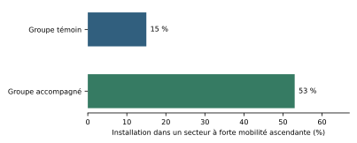

# ENS-PSL · Sélection internationale Lettres 2026 · Économie — choix résidentiels · Corrigé brut

*Corrigé rédigé par IA, non officiel. Signalez toute erreur.*

**Rédaction** · GPT-6.2 Astra Ultra · vitesse non renseignée · 24 novembre 2026

**Révision (tour 1)** · GPT-6.2 Astra Ultra · vitesse non renseignée · 26 novembre 2026

**Couverture vérifiée.** Le rapport du jury donne page 2 l’écrit individuel du candidat 1. Son oral distinct a pour intitulé « Environnement social et contraintes économiques dans les décisions et les résultats scolaires ». La dissertation et le guide confrontent le tri résidentiel aux effets d’exposition au quartier et à la réaction des loyers. Les effets de l’offre d’un bon et de son utilisation dans Moving to Opportunity sont distingués avec leurs montants et leur population. L’essai de Seattle est vérifié séparément sur la mobilité observée.

**Sujet individuel écrit.** Choix résidentiels et inégalités sociales et économiques.

## Introduction

Deux ménages ayant le même salaire peuvent difficilement enchérir sur le même appartement si l’un reçoit de sa famille le montant de l’apport et si l’autre doit conserver de l’épargne pour un mois sans travail. À l’inverse, deux familles vivant sur le même palier peuvent tirer des bénéfices différents de cette adresse selon le lieu de leur emploi ou la présence d’un grand-parent. Le choix résidentiel porte simultanément sur un logement, un statut d’occupation et une localisation. Les inégalités de revenu, de patrimoine et d’accès aux institutions déterminent l’ensemble des logements accessibles. Habiter quelque part peut ensuite modifier ces mêmes inégalités. Comment établir l’importance de cette seconde relation quand les ménages se répartissent eux-mêmes dans l’espace ? Le raisonnement doit passer du choix individuel au prix d’équilibre, puis identifier les effets de l’exposition à un lieu avant de comparer les politiques.

## I. Le prix d’une adresse sélectionne des ménages dont les possibilités de choix diffèrent

Considérons un ménage qui choisit dans le quartier $j$ une quantité de logement $h$, des autres biens $c$ et un temps de trajet. Une contrainte simple est $c+r_jh+T_j\le y$, où $r_j$ est le loyer unitaire et $T_j$ le coût monétaire du déplacement. À conditions de transport données, un ménage peut accepter de payer davantage pour la proximité d’un emploi. Mais un centre cher peut faire préférer à une famille un logement plus grand en périphérie. Les deux décisions sont rationnelles sous des contraintes différentes. La valeur du temps varie selon les horaires et la composition du ménage. Une même desserte ferroviaire ne donne pas le même accès à un salarié de bureau et à une aide-soignante en horaires décalés.

Un propriétaire qui peut acheter près d’une école demandée acquiert aussi un droit d’accès à un service local. Quand l’offre de logements y est rigide, la concurrence entre familles capitalise une partie de cet avantage dans les prix. L’amélioration de l’école peut alors bénéficier aux enfants des résidents et accroître la valeur du patrimoine des propriétaires. Les locataires entrants supportent un prix plus élevé. Si l’on constate que les ménages aisés habitent près d’écoles aux bons résultats, ce gradient peut mêler qualité de l’enseignement, composition sociale des élèves et demande pour d’autres services du quartier. Bayer, Ferreira et McMillan (2007) étudient ce tri résidentiel en combinant un modèle de demande et des comparaisons de part et d’autre de limites de secteurs scolaires. Une frontière rapproche certains attributs géographiques, mais les prix et la composition locale peuvent aussi s’y ajuster.

L’Insee observe, dans son étude de 2004 à 2019, que les disparités de revenu entre quartiers se sont accrues dans la plupart des grandes villes étudiées. Cette mesure de la ségrégation spatiale porte sur la répartition des ménages dans la ville. Deux agglomérations de même distribution de revenus peuvent présenter des niveaux de ségrégation différents.

À ces mécanismes de marché s’ajoutent le dépôt de garantie, la sélection des dossiers par les bailleurs, l’accès au crédit et la disponibilité des logements sociaux. Un lieu proche de la famille offre garde d’enfants et assurance informelle, qu’un déménagement peut détruire. Une faible mobilité observée peut ainsi exprimer un attachement ou une difficulté de recherche. Confondre les deux conduirait à déduire un goût pour un quartier d’une contrainte qui maintient sur place.

## II. La ségrégation résidentielle peut devenir une cause d’inégalités

Dans un quartier mal relié aux emplois, les occasions d’embauche décroissent avec la durée et le coût du trajet. La pollution, la sécurité des déplacements, les établissements scolaires et les réseaux qui renseignent sur une formation agissent aussi sur la santé et l’accumulation de capital humain. Une exposition pendant l’enfance peut modifier un revenu mesuré dix ans après le départ, alors qu’un déménagement tardif peut désorganiser la scolarité d’un adolescent. Ces mécanismes distincts interdisent de réduire le quartier à son revenu médian.

Pour une famille donnée, l’effet de lieu est l’écart entre deux trajectoires dans deux localisations possibles. On n’en observe qu’une. Comparer les salaires moyens des adultes issus de deux quartiers attribuerait aussi au quartier des différences familiales antérieures. L’expérience américaine *Moving to Opportunity* a offert par tirage au sort, à des familles volontaires issues de quartiers très pauvres, différentes aides au logement. L’attribution aléatoire identifie l’effet de l’offre du bon. Comme toutes les familles ne déménagent pas, passer de ce résultat à l’effet du déménagement demande des hypothèses supplémentaires et vise les ménages dont le comportement a été modifié par l’offre.

Chetty, Hendren et Katz (2016) distinguent deux effets pour les enfants âgés de moins de treize ans lors du tirage. Être affecté au groupe qui se voit offrir le bon expérimental relève de 1 624 dollars le revenu individuel annuel moyen mesuré vers le milieu de la vingtaine. Une partie des familles seulement ayant utilisé le bon, les auteurs estiment à 3 477 dollars le gain lié à son utilisation effective. Rapporté aux 11 270 dollars moyens du groupe témoin, ce second montant représente environ 31 %. Il est obtenu à partir du tirage initial et du recours au bon. Une comparaison directe des seules familles qui ont choisi de déménager réintroduirait une sélection. Les résultats plus mitigés chez les enfants plus âgés concordent avec des coûts de rupture et une durée d’exposition plus courte. L’expérience porte sur des familles et des villes américaines précises. Elle éclaire l’existence d’effets d’environnement, tout en laissant ouverte la part de l’école, de la sécurité et des réseaux dans le mécanisme.

## III. Une politique résidentielle doit ouvrir des choix et suivre les effets sur les résidents

Dans la région de Seattle, Bergman et ses coauteurs (2024) ont randomisé un accompagnement de ménages déjà bénéficiaires d’un bon de logement. Il associait aide à la recherche, contact avec les propriétaires et soutien financier. La part s’installant dans des secteurs à forte mobilité ascendante est passée d’environ 15 % dans le groupe témoin à 53 % dans le groupe accompagné. L’écart de 38 points établit ici qu’une intervention sur la recherche élargit effectivement les choix. Il mesure une nouvelle localisation. Le revenu futur des enfants reste une autre variable, observable à un autre horizon.

On peut aussi améliorer les quartiers d’origine en rapprochant les emplois, en renforçant les services ou en construisant des logements là où l’offre est insuffisante. Les deux orientations sont complémentaires si une famille peut rester, partir ou revenir. Une ligne de transport crée un gain de temps mais peut renchérir les loyers autour des stations et déplacer des ménages. Une aide à la demande seule peut aussi se capitaliser dans les loyers lorsque l’offre réagit peu. Il faut donc suivre les personnes qui habitaient le quartier avant l’intervention, y compris celles qui en sortent, et comparer leurs trajectoires à un groupe crédible. Une hausse du revenu médian du quartier, provoquée par l’arrivée de ménages plus aisés, n’établit aucune hausse de revenu chez les résidents initiaux.

## Conclusion

L’adresse est à la fois le produit de ressources inégales et une condition d’accès aux ressources de demain. En déterminer les effets exige d’observer qui peut chercher, qui déménage et combien de temps dure l’exposition. Une politique résidentielle se juge sur l’éventail des logements effectivement accessibles, sur les trajectoires des personnes concernées et sur la manière dont l’offre et les prix réagissent à son extension.

## Sources

[Rapport du jury ENS-PSL, sujet individuel écrit du candidat 1, p. 2](https://www.ens.psl.eu/sites/default/files/rapport_sil_economie_2026.pdf#page=2)

- [Insee, disparités entre quartiers de 2004 à 2019](https://www.insee.fr/fr/statistiques/6680439)
- [Bayer, Ferreira et McMillan (2007), préférences scolaires et tri résidentiel](https://doi.org/10.1086/522381)
- [Chetty, Hendren et Katz (2016), exposition pendant l’enfance](https://www.nber.org/papers/w21156)
- [Bergman et al. (2024), accompagnement résidentiel](https://doi.org/10.1257/aer.20200407)
- [Chetty, Hendren et Katz (2016), estimation par offre et par utilisation du bon](https://doi.org/10.1257/aer.20150572)
