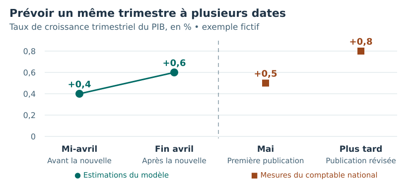

# ENS-PSL, sélection internationale Lettres 2026 — Économie · Oral · Corrigé guidé

*Corrigé rédigé par IA, non officiel. Signalez toute erreur.*

**Rédaction** · GPT-6.2 Astra Ultra · vitesse non renseignée

**Révision** · GPT-6.2 Astra Ultra · vitesse non renseignée

**Sujet.** Données et modèles en prévision économique.

Le rapport du jury attend un plan clairement annoncé, un cadrage empirique et des liens entre théorie et politique publique. Les pistes de préparation proposent un déroulé d’exposé et d’entretien.

## Introduction — Une prévision a une date

> [!INDICATION]
> Fixer une date de décision, une variable et son horizon avant de comparer deux modèles. L’estimation du présent reste un problème dès que la statistique officielle est publiée avec retard.

À la mi-avril, une banque centrale veut connaître la croissance du premier trimestre. Le trimestre est déjà terminé, mais le comptable national n’a pas publié son estimation. Des ventes de janvier et février sont disponibles, l’enquête de mars vient de sortir et les chiffres de production seront révisés. On **estime le présent**, ou *nowcasting*. Prévoir le trimestre suivant demande en plus de propager l’information dans le futur.

J’appelle donnée une mesure datée dont la définition, la population, le délai et la version sont connus. Un modèle est une règle, statistique ou économique, qui relie cette information à une cible. Je défendrai l’idée que leur qualité se juge ensemble, mais à trois étapes distinctes, la construction d’un ensemble d’information disponible à temps, la production d’une prévision adaptée à l’horizon et sa confrontation avec des observations qui peuvent changer.

## I — Construire le jeu de données réellement utilisable

> [!INDICATION]
> Distinguer date de l’activité, date de publication et date de révision. Une valeur observée aujourd’hui pouvait être absente à l’époque de la décision.

La consommation des ménages d’un trimestre agrège des dépenses de natures différentes. Des transactions par carte arrivent vite et couvrent une partie de cette dépense, mais la clientèle et la part de paiements électroniques peuvent évoluer. Une enquête de conjoncture offre un signal qualitatif plus précoce et peut réagir à un événement avant les quantités réalisées. La comptabilité nationale offre un cadre cohérent plus tardif. Il faut harmoniser unités et prix, saisonnalité, périmètre, fréquence et ruptures de collecte. Une série mensuelle d’indice ne s’additionne pas forcément comme des ventes mesurées en euros.

Le jeu d’information disponible à la date $t$ peut comporter des mois manquants en fin de série, car chaque indicateur a son calendrier. Il faut dater les **publications** et conserver leurs versions successives. Le jeu de données en temps réel de la Réserve fédérale de Philadelphie permet par exemple de reconstruire les valeurs américaines connues à une date passée. Employer aujourd’hui la valeur définitive de la production de mars pour simuler une prévision faite mi-avril ferait entrer dans le modèle une information future. La cible elle-même doit être définie : prévoir la première publication de croissance répond à un besoin de communication, prévoir la valeur jugée la plus fidèle après révisions répond à un autre besoin.

## II — Choisir un modèle pour l’horizon et pour l’usage

> [!INDICATION]
> Expliquer pourquoi une annonce conforme aux attentes change peu la prévision. Donner ensuite un exemple où changer la politique modifie la relation apprise.

À court terme, une persistance ou une moyenne historique donne un point de référence peu coûteux. Une équation-pont relie le PIB trimestriel à des indicateurs mensuels agrégés. Un modèle à facteurs extrait un petit nombre de composantes communes à de nombreuses séries, puis les relie à l’activité, en tenant compte du calendrier incomplet. Les travaux de Giannone, Reichlin et Small distinguent le contenu d’une publication de sa précocité. Une statistique très corrélée à la croissance peut apporter peu de nouvelles si d’autres informations l’avaient rendue largement prévisible.

Dans un exemple fictif, le suivi du trimestre donne +0,4 %. Une publication de production dépasse **sa propre prévision** d’un point. Si la sensibilité locale du modèle est de 0,2 point de croissance par point de surprise, la nouvelle estimation est +0,6 %, toutes choses égales par ailleurs. La révision ne vaut pas la variation brute de la série entre deux mois : la partie attendue était déjà incorporée. Une autre publication simultanée corrélée ne s’ajoute pas mécaniquement. GDPNow, suivi public de la Réserve fédérale d’Atlanta, illustre l’actualisation régulière d’une estimation du PIB américain à mesure des publications. Il constitue une prévision de modèle distincte d’une prise de position de ses responsables.

Fixons maintenant la prévision à +0,6 % et définissons l’erreur signée comme la prévision moins la croissance publiée. Si la première publication vaut +0,5 %, le modèle surestime la croissance de 0,1 point. Si la série est ensuite révisée à +0,8 %, la même prévision la sous-estime de 0,2 point. La décision du prévisionniste est identique dans les deux évaluations. C’est la mesure à laquelle on la compare qui a changé.

> [!INDICATION]
> Sur la figure, cacher les deux points de droite pour reconstituer ce que savait le prévisionniste fin avril. Puis choisir la première publication ou la valeur révisée pour calculer son erreur.

À horizon plus long, les relations comptables, la démographie, les comportements des ménages ou la transmission des taux peuvent structurer une projection. Une relation prédictive stable suffit parfois pour anticiper à politique inchangée. Simuler une hausse de taxe requiert en revanche des hypothèses de comportement et d’identification causale. Un modèle régularisé ou d’apprentissage peut capter des non-linéarités, mais l’échantillon de trimestres reste petit, les paramètres peuvent dériver et une validation chronologique demeure nécessaire. Combiner des modèles est intéressant lorsque leurs erreurs diffèrent suffisamment. Le gain doit être vérifié.

## III — Évaluer honnêtement l’erreur et son coût

> [!INDICATION]
> Calculer les deux erreurs à la main et faire varier la fonction de perte. Vérifier que la mesure retenue correspond au coût du décideur.

Simuler une suite de prévisions en pseudo-temps réel. À chaque origine, prendre les versions alors publiées, ne régler les paramètres que sur le passé, calculer le signal à horizon constant et avancer d’une période. Une fenêtre croissante exploite tout l’historique et une fenêtre glissante pondère davantage un régime récent. Réserver une période finale pour évaluer les choix de variables et de modèle. Une répartition aléatoire des mois en apprentissage et validation peut laisser le futur informer le passé. Comparer au même étalon et à la même version cible, en incluant des périodes ordinaires et des ruptures.

Pour trois dates fictives, les erreurs de A valent en points $0,1,2$ et celles de B valent $1,1,1$. Les deux erreurs absolues moyennes valent 1. La racine de l’erreur quadratique moyenne vaut $\sqrt{5/3}\simeq1{,}29$ pour A et 1 pour B. Un décideur qui pénalise fortement les grands écarts préférerait B selon ce critère. Avec des coûts asymétriques, un quantile peut être plus adapté que la moyenne. Si sous-estimer coûte trois fois plus, en valeur absolue, que surestimer, le quantile conditionnel de niveau $3/(3+1)=0{,}75$ minimise cette perte.

Une prévision probabiliste doit aussi être calibrée. Un intervalle annoncé à 80 % devrait contenir la cible dans environ 80 % des cas comparables. Vérifier simultanément sa largeur ou un score d’intervalle, car un intervalle arbitrairement large peut couvrir presque tout tout en restant inutile. Une crise sanitaire peut modifier soudain l’usage des cartes ou des transports. Comparer les scénarios de fermeture et de réouverture expose alors les hypothèses qui pèsent sur le résultat. Un scénario conditionnel n’indique pas, à lui seul, la probabilité de l’hypothèse retenue.

## Conclusion — Ce que je publierais

> [!INDICATION]
> Revenir au décideur et désigner ce qu’il pourra apprendre de la prochaine publication même si l’estimation centrale change peu.

Pour le suivi de mi-avril, je publierais une date d’arrêté, la cible et son horizon, l’estimation centrale, un intervalle, les contributions des surprises récentes et la performance historique face à une persistance simple. Je préciserais si je vise la première publication ou une mesure révisée. Pour un budget à plusieurs années, j’ajouterais des scénarios de comportement et des analyses de sensibilité. La qualité d’une prévision se voit lorsque l’on peut expliquer ce dont elle disposait, pourquoi elle a changé et dans quelles circonstances on s’attend à ce qu’elle échoue.

## Échange — Relances possibles et réponses

> [!INDICATION]
> Rattacher chaque relance au calendrier des données, au mécanisme du modèle ou au critère d’évaluation. Ces exemples de questions sont proposés pour l’entraînement.

**« Plus de données améliorent-elles toujours la prévision ? »** Un indicateur rapide peut réduire le retard d’information. Une source redondante ou dont la couverture change peut injecter du bruit et du surajustement. La tester par ajout successif à une prévision de référence, sur des origines et versions comparables.

**« Peut-on utiliser une prévision jugée mauvaise en 2020 ? »** Distinguer le choc imprévisible avant l’information de l’incapacité du modèle à exploiter les nouvelles une fois disponibles. Examiner le biais, le délai d’adaptation et la calibration avant, pendant et après la rupture. Un changement de modèle a aussi un coût en stabilité.

**« Une prévision peut-elle modifier le fait prévu ? »** Une banque centrale peut relever ses taux en réponse à une perspective d’inflation. L’inflation finalement plus basse peut être cohérente avec la projection conditionnelle à taux inchangés. Il faut conserver et comparer les hypothèses de politique suivie.

**« Pourquoi ne pas simplement retenir la meilleure prévision passée ? »** Un petit échantillon peut inverser le classement. Examiner l'incertitude de l'écart de perte et sa stabilité aux horizons. Une combinaison à poids fixés à l’avance peut réduire le risque de sélection d’un vainqueur temporaire.

## Sources

[Intitulé et rapport du jury, page 2](https://www.ens.psl.eu/sites/default/files/rapport_sil_economie_2026.pdf#page=2)

[Réserve fédérale de Philadelphie, jeux de données en temps réel](https://www.philadelphiafed.org/surveys-and-data/real-time-data-research/real-time-data-set-for-macroeconomists) · [Réserve fédérale d’Atlanta, GDPNow](https://www.atlantafed.org/cqer/research/gdpnow) · [Giannone, Reichlin et Small, contenu des publications en temps réel](https://doi.org/10.1016/j.jmoneco.2008.05.010)
