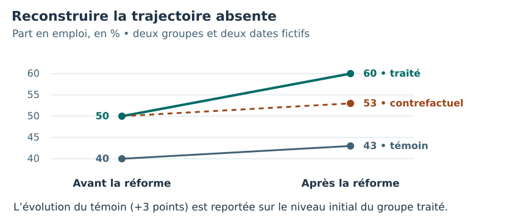

# ENS-PSL, sélection internationale Lettres 2026 — Économie · Oral · Corrigé guidé

*Corrigé rédigé par IA, non officiel. Signalez toute erreur.*

**Rédaction** · GPT-6.2 Astra Ultra · vitesse non renseignée

**Révision** · GPT-6.2 Astra Ultra · vitesse non renseignée

**Sujet.** Apports de la révolution de la crédibilité à l’évaluation des politiques publiques.

Le rapport du jury attend un plan clairement annoncé, un cadrage empirique et des liens entre théorie et politique publique. Les pistes de préparation proposent un déroulé d’exposé et d’entretien.

## Introduction — La question du contrefactuel

> [!INDICATION]
> Commencer par un résultat qui pourrait être trompeur. Identifier le groupe dont l’issue sans intervention manque au décideur.

Une ville finance une formation pour des chômeurs de longue durée. Six mois plus tard, les participants trouvent moins souvent un emploi que les autres demandeurs d’emploi. Doit-elle fermer le programme ? Les conseillers peuvent avoir orienté vers lui les personnes les plus éloignées du marché du travail. Le taux observé chez les non-participants est alors un mauvais contrefactuel.

Angrist et Pischke appellent « révolution de la crédibilité » le déplacement de l’attention vers le **dispositif d’identification**. Quel mécanisme d’assignation crée une comparaison défendable ? Pour un individu, $Y(1)$ désigne le résultat avec le programme et $Y(0)$ celui qu’il aurait eu sans lui. On observe un seul état. Je montrerai comment construire cette comparaison, comment en vérifier la portée et pourquoi l’arbitrage public demande ensuite des informations supplémentaires.

## I — Passer d’un écart observé à un effet défini

> [!INDICATION]
> Écrire les deux différences avant leur rapport. Désigner précisément les personnes et l’unité, puis vérifier quelle hypothèse serait fragile ici.

Pour les participants, l’effet moyen visé peut être $E[Y(1)-Y(0)\mid D=1]$. L’écart brut entre participants et non-participants y ajoute le biais de sélection $E[Y(0)\mid D=1]-E[Y(0)\mid D=0]$. Ajouter des variables à une régression ne fait disparaître ce terme que sous des hypothèses sur la sélection et le recouvrement des groupes. Il faut annoncer la population, le résultat (emploi stable ou simple reprise d’activité), l’horizon et la politique comparée.

Une loterie d’accès lorsque les places sont rares rend les groupes comparables en espérance. La différence de moyenne entre gagnants et perdants estime l’effet de **l’offre** en conservant les groupes tirés, y compris les gagnants absents. Si l’offre augmente la participation de 40 points et l’emploi de 4 points, le rapport vaut 0,10, soit 10 points d’emploi pour les personnes dont la participation dépend de l’offre dans cet exemple fictif. L’interprétation requiert un premier stade, une affectation indépendante, l’absence d’effet direct de l’offre, la monotonie et une définition appropriée des interférences. Si la lettre de convocation pousse seule les personnes à chercher du travail, l’effet de l’offre reste identifiable mais le rapport ne mesure plus ce seul effet de formation.

## II — Identifier et éprouver une variation quasi expérimentale

> [!INDICATION]
> Opposer les menaces propres aux deux méthodes. Pour une réforme locale, chercher un autre changement au même moment et au même endroit.

Un seuil de ressources peut donner accès à une prestation. Comparer les ménages juste de part et d’autre fournit un effet local si, sans la règle, leurs résultats potentiels auraient évolué continûment avec le revenu et si le seuil ne déclenche pas d’autres aides. On inspecte le tri de la variable au seuil, la continuité des caractéristiques initiales et la stabilité aux bandes passantes. Un déplacement quelques euros plus loin, dans un autre groupe, peut avoir un effet différent.

Quand des territoires adoptent une politique à des dates différentes, les doubles différences comparent l’évolution du groupe traité et celle d’un groupe adéquat. Leur hypothèse porte sur les **tendances en l’absence de traitement**. Les données avant réforme éclairent cette hypothèse, sans prouver l’absence d’un choc simultané. Une anticipation et les déplacements entre territoires peuvent aussi fausser la comparaison. Avec des effets hétérogènes dans le temps, employer des effets par groupe d’adoption et période, puis les agréger en explicitant les poids, comme le proposent Callaway et Sant’Anna. Des unités déjà traitées constituent un mauvais témoin pour certaines comparaisons.

Dans la figure, le taux d’emploi du groupe traité passe de 50 % à 60 %. Le comparer à sa valeur initiale donnerait un gain de 10 points. Or, dans le groupe témoin, le taux passe de 40 % à 43 %. Si le premier groupe aurait également gagné 3 points sans réforme, son taux contrefactuel est de 53 %. L’effet estimé est donc de 7 points. Une implantation industrielle simultanée dans la seule zone traitée remettrait en cause cette interprétation. Ce calcul porte sur des données fictives.

> [!INDICATION]
> Reconstruire la ligne pointillée avant de calculer l’écart vertical final. Quelle observation supplémentaire aiderait à juger plausible l’hypothèse de tendances parallèles ? Plusieurs années avant la réforme éclaireraient le diagnostic.

La crédibilité vient d’éléments concrets, par exemple le règlement du seuil, l’historique des groupes, la mesure des pertes de suivi, les erreurs types regroupées au niveau d’assignation et les résultats sensibles aux décisions de spécification. La préspécification des résultats principaux réduit la latitude d’interprétation. Un intervalle large signifie que plusieurs effets restent compatibles avec les données.

## III — Deux expériences éclairent les limites d’une décision

> [!INDICATION]
> Dire quel effet aurait été invisible avec une simple comparaison entre bénéficiaires et non-bénéficiaires dans la même zone.

**Assurance santé en Oregon.** En 2008, une loterie a permis à certains adultes modestes de demander une couverture Medicaid. Finkelstein et ses coauteurs exploitent cette offre. La couverture augmente, de même que le recours à plusieurs soins, tandis que l’exposition à certaines dépenses financières recule au cours de la première année. L’assignation concerne la possibilité de déposer une demande, ce qui explique la différence entre offre et couverture. Une hausse des consultations peut manifester un accès enfin possible. Elle implique aussi des dépenses et ne suffit pas à mesurer tous les gains de santé. La population qui s’était inscrite sur la liste et l’horizon court bornent l’extrapolation.

**Accompagnement de jeunes demandeurs d’emploi en France.** Crépon, Duflo, Gurgand, Rathelot et Zamora mettent en œuvre une randomisation à deux niveaux. La proportion de personnes auxquelles l’accompagnement est offert varie entre marchés du travail, puis certaines personnes reçoivent l’offre à l’intérieur de ces marchés. Au sein d’une zone, la comparaison entre personnes auxquelles l’accompagnement est offert par tirage au sort et personnes auxquelles il ne l’est pas mesure l’effet direct de l’offre au niveau d’intensité considéré. Entre zones, comparer les personnes sans offre selon la proportion tirée au sort pour la recevoir permet de détecter un effet indirect, dont une éviction possible. L’étude trouve des indices de déplacement, particulièrement dans les marchés moins dynamiques. Une place obtenue plus vite par un participant peut être perdue par un autre demandeur. Le nombre net d’emplois d’un marché ne se déduit donc pas mécaniquement de l’effet individuel.

La première expérience aide à interpréter le contenu du traitement, la seconde à choisir le bon périmètre d’évaluation. Généraliser une petite réforme peut changer les prix, les capacités des services, la composition des participants et le comportement des entreprises.

## Conclusion — De l’effet identifié à l’arbitrage public

> [!INDICATION]
> Revenir au cas de départ en ajoutant une mesure de coût, un tiers potentiellement affecté et un objectif social.

Je conseillerais à la ville de comparer l’offre de formation au service ordinaire, de suivre emploi durable, revenu et situation des non-bénéficiaires, puis de chiffrer le coût supplémentaire. Un gain net fictif de 20 emplois durables pour 200 000 euros donne 10 000 euros par emploi supplémentaire sur l’horizon étudié. Si les vingt emplois sont seulement déplacés entre personnes, ce dénominateur n’est plus un gain net. La collectivité peut néanmoins valoriser une redistribution vers les personnes les plus éloignées de l’emploi. Il faut rendre ce choix explicite. La révolution de la crédibilité permet de discuter un effet dont les hypothèses sont visibles. La décision ajoute les coûts, les objectifs distributifs et les conditions de généralisation.

## Échange — Relances possibles et réponses

> [!INDICATION]
> Préparer une limite de validité interne, une limite de validité externe et un critère de bien-être. Les relances sont des questions d’entraînement.

**« Si le tirage au sort est impossible ? »** Examiner d’abord la règle existante et la chronologie. Un seuil bien documenté ou un déploiement progressif peut fournir une comparaison. Si l’identification reste fragile, présenter analyses de sensibilité, données de suivi et bornes plausibles. Une réforme universelle soudaine aura parfois besoin d’un modèle explicite pour construire son contrefactuel.

**« Comment savoir si les tendances sont parallèles ? »** Examiner des trajectoires préalables avec leurs intervalles, la composition des groupes, l’existence d’anticipation et les chocs concurrents. Une pré-tendance plate calculée sur peu d’observations a peu de pouvoir pour détecter un écart.

**« Que vaut un effet moyen nul ? »** Regarder l’intervalle et la pertinence pratique des effets encore plausibles. Examiner ensuite une hétérogénéité justifiée avant l’analyse, par exemple selon la conjoncture locale. Multiplier après coup les sous-groupes produit des écarts fortuits.

**« Quel rôle pour la théorie ? »** Elle explicite la réaction d’un employeur, le déplacement d’un demandeur et les changements de prix en grande échelle. Le dispositif empirique teste certaines implications et discipline les paramètres. Une recommandation nationale précise quelles réactions restent extrapolées.

## Sources

[Intitulé et rapport du jury, page 2](https://www.ens.psl.eu/sites/default/files/rapport_sil_economie_2026.pdf#page=2)

[Angrist et Pischke, révolution de la crédibilité](https://www.aeaweb.org/articles?id=10.1257/jep.24.2.3) · [Finkelstein et al., expérience Medicaid en Oregon](https://www.nber.org/papers/w17190) · [Crépon et al., effets de déplacement](https://www.nber.org/papers/w18597) · [Callaway et Sant’Anna, doubles différences multipériodes](https://doi.org/10.1016/j.jeconom.2020.12.001)
