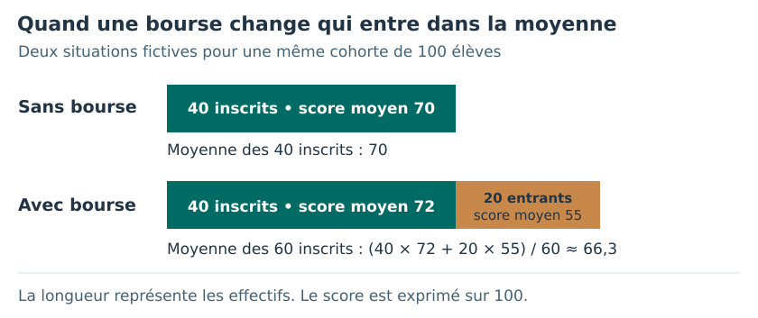

# ENS-PSL, sélection internationale Lettres 2026 — Économie · Oral · Corrigé guidé

*Corrigé rédigé par IA, non officiel. Signalez toute erreur.*

**Rédaction** · GPT-6.2 Astra Ultra · vitesse non renseignée

**Révision** · GPT-6.2 Astra Ultra · vitesse non renseignée

**Sujet.** Environnement social et contraintes économiques dans les décisions et les résultats scolaires.

Le rapport du jury attend un plan clairement annoncé, un cadrage empirique et des liens entre théorie et politique publique. Les pistes de préparation proposent un déroulé d’exposé et d’entretien.

## Introduction — Partir d’une décision observable

> [!INDICATION]
> Expliquer d’emblée ce que mesurerait une enquête. Un vœu, une inscription et un score à un test ne désignent pas le même résultat.

À la fin du collège, deux élèves aussi bien classés peuvent demander des orientations différentes. L’un connaît le coût d’un logement près du lycée, dispose d’une bourse et peut interroger un proche déjà passé par cette filière. L’autre doit contribuer au revenu familial et connaît mal les débouchés. L’exemple suggère trois objets distincts à expliquer, la décision demandée par l’élève, l’affectation qui lui est accordée et les apprentissages ultérieurs.

J’appelle **environnement social** les ressources, informations, normes et interactions qui entourent l’élève dans son foyer, son quartier, son groupe de pairs et son établissement. Les **contraintes économiques** comprennent les coûts monétaires, le manque de liquidités, le temps et le risque. Comment ces déterminants transforment-ils une origine sociale en écart de parcours, et comment savoir sur lequel agir ? Je partirai du choix de continuer les études, puis des conditions dans lesquelles ce choix produit des acquis, avant d’examiner trois manières de départager les mécanismes.

## I — Les choix répondent aux ressources et aux rendements perçus

> [!INDICATION]
> Dessiner deux colonnes « valeur actualisée » et « argent disponible aujourd’hui ». Montrer ensuite comment une information peut agir sur la première, une avance sur la seconde.

Dans un modèle simple d’investissement en capital humain, le jeune poursuit si le gain actualisé qu’il **anticipe** excède les frais et le revenu auquel il renonce. Avec une actualisation de 5 %, dix gains annuels futurs de 120 valent aujourd’hui environ $120[1-(1{,}05)^{-10}]/0{,}05=927$. Un coût immédiat de 900 rend l’investissement légèrement rentable dans cet exemple fictif. Encore faut-il pouvoir avancer les 900. Une famille disposant de 300 et privée de crédit peut renoncer à un choix pourtant rentable. Une bourse versée au début de l’année agit directement sur cette contrainte. Une promesse de remboursement à la fin a un effet différent.

L’école gratuite conserve un coût de trajet, de matériel et de travail domestique ou rémunéré sacrifié. L’incertitude porte aussi sur la réussite et le futur salaire. Les parents connaissent inégalement les filières sélectives et la procédure de candidature. Des expériences de proches, des attentes de genre ou une anticipation de discrimination peuvent orienter les vœux. La même information sur un salaire moyen a peu de prise sur une famille qui doute que la formation locale soit de qualité ou accessible. Le choix traduit alors une croyance, une préférence et un ensemble de possibilités concrètes. Les distinguer est décisif pour choisir un instrument public.

## II — Les conditions d’apprentissage modifient les résultats

> [!INDICATION]
> Préciser pour chaque mécanisme son moment dans le parcours. Une variable antérieure peut devenir un résultat intermédiaire à l’étape suivante.

Une fonction de production pédagogique relie un acquis actuel aux connaissances antérieures, au temps d’étude et aux ressources de la classe et du foyer. Le calme pour travailler, les livres, le retour d’un enseignant ou le temps de trajet agissent après l’inscription. Les difficultés s’accumulent lorsqu’un apprentissage initial facilite le suivant. Dans un système d’orientation, les notes influencent ensuite les décisions de filière, qui modifient à leur tour les enseignements reçus. Une différence de résultats peut ainsi précéder et suivre la décision.

Le tri résidentiel et le recrutement scolaire rassemblent souvent des élèves dont les ressources se ressemblent. Un écart de résultats entre deux établissements combine alors affectation, composition sociale et conditions d’enseignement. Une moyenne de classe élevée peut aider par l’entraide, changer les exigences du professeur ou simplement refléter le recrutement. Si les pairs s’influencent simultanément, il existe en plus un problème de réflexion. Comparer deux moyennes ne suffit pas à mesurer un effet propre des camarades. Conditionner l’analyse sur la note après l’orientation peut même effacer une partie de l’effet que l’on cherche à expliquer.

Un calcul fictif mesure l’ampleur du problème. Sans bourse, 40 élèves sur 100 s’inscrivent et obtiennent en moyenne 70 sur 100. Avec une bourse, ces mêmes 40 atteignent 72, tandis que 20 nouveaux inscrits obtiennent en moyenne 55. La moyenne des 60 inscrits est alors de 66,3. La baisse de cette moyenne est compatible avec un progrès des élèves qui se seraient inscrits dans les deux cas. Pour estimer l’effet de l’offre de bourse sur les apprentissages de toute la cohorte, il faudrait notamment pouvoir mesurer les acquis des élèves restés hors de la filière, quel que soit le groupe auquel la bourse a été offerte.

> [!INDICATION]
> Relire les deux situations en comptant qui figure au dénominateur. En pratique, on n’observe pas directement quels bénéficiaires se seraient aussi inscrits sans la bourse. Un tirage de l’offre et un test commun à toute la cohorte permettent d’étudier une autre quantité, l’effet moyen de l’offre.

## III — Trois variations permettent de départager les mécanismes

> [!INDICATION]
> Pour chaque étude, préciser qui se compare à qui, quelle ressource varie et quelle hypothèse permet l’interprétation. Citer le résultat avant sa limite.

**Le coût d’accès.** En Indonésie, Duflo étudie le programme de construction d’écoles primaires des années 1970. L’intensité de la construction diffère selon les districts. Elle compare des cohortes assez jeunes pour avoir bénéficié de ces écoles à des cohortes plus âgées, entre districts plus et moins exposés. La scolarité des jeunes garçons plus exposés augmente, et les données de salaires permettent d’étudier leurs trajectoires ultérieures. L’interprétation suppose notamment que les cohortes de ces districts auraient évolué parallèlement sans programme. L’expérience renseigne l’offre scolaire dans ce contexte historique, avec des équipements et des distances modifiés conjointement.

**L’information.** En République dominicaine, Jensen fait varier par assignation aléatoire l’information fournie à de jeunes garçons sur les rendements salariaux de l’éducation. Les élèves sous-estiment en moyenne ces rendements et le groupe informé poursuit davantage ses études. La comparaison établit un effet de l’offre d’information sur cette population. Elle laisse ouverte la question du jeune qui connaît ses perspectives mais ne peut financer le trajet ou abandonner son emploi.

**Le milieu de vie.** Dans le programme américain Moving to Opportunity, une loterie donne à des familles de quartiers défavorisés la possibilité de déménager. Chetty, Hendren et Katz constatent à long terme de meilleurs résultats à l’âge adulte chez les enfants exposés jeunes à un quartier moins pauvre. L’offre tirée au sort identifie d’abord l’effet d’une possibilité de déménagement. Le traitement regroupe logement, voisins, écoles et distance aux proches. L’âge à l’installation importe, et l’expérience ne mesure pas isolément un effet de pairs dans une classe donnée.

## Conclusion — Relier le diagnostic à l’instrument

> [!INDICATION]
> Reprendre le cas initial et annoncer quel résultat permettrait de réviser le diagnostic.

Pour un lycée éloigné, je commencerais par distinguer les admis qui ne s’inscrivent pas des élèves qui ne demandent même pas la filière. Aux premiers, une aide de transport versée avant la rentrée peut lever une contrainte immédiate. Aux seconds, une visite et une information fiable peuvent ouvrir une option jusque-là ignorée. Si les élèves inscrits échouent faute d’encadrement, une politique portant sur la classe ou le tutorat cible un autre mécanisme. On suivrait les vœux, l’inscription, l’assiduité, les acquis et le diplôme, y compris pour les élèves les plus contraints. Une hausse des inscriptions avec des apprentissages stagnants appelle une réponse pédagogique.

## Échange — Relances possibles et réponses

> [!INDICATION]
> Préparer à voix haute une réponse courte comprenant un dispositif, son résultat mesuré et une limite. Ces relances sont proposées pour l’entraînement.

**« Comment isoler les effets de quartier et d’école ? »** Une loterie d’accès à une école entre candidats du même quartier fait varier l’offre scolaire. Une loterie de logement modifie un ensemble plus large. Comparer les deux dispositifs éclaire les mécanismes, en vérifiant que les populations et résultats sont comparables. Le libre choix de la famille après le tirage oblige à distinguer offre et fréquentation effective.

**« Une bourse améliore-t-elle nécessairement les notes ? »** Elle peut augmenter l’assiduité et réduire le travail rémunéré, mais les nouveaux inscrits n’ont pas forcément le même niveau initial. Une moyenne parmi les inscrits peut baisser alors que des élèves ont gagné des compétences. Il faut suivre la cohorte de départ, tester les absents quand c’est possible et documenter l’attrition.

**« Faut-il cibler le revenu ou le quartier ? »** Le revenu cible mieux une contrainte privée, au prix de non-recours et d’erreurs de mesure. Cibler le quartier facilite l’administration et finance des ressources communes, mais inclut des ménages plus aisés et manque des élèves isolés. Le bon choix dépend de l’obstacle et du coût d’accès au dispositif.

**« Comment tester complémentarité entre bourse et information ? »** Tirer au sort, si cela est justifié et faisable, quatre groupes comparables, sans intervention, information, bourse et les deux. L’interaction est la différence entre l’effet de l’information avec et sans bourse. Prévoir une taille suffisante et surveiller les échanges d’information entre groupes.

## Sources

[Intitulé et rapport du jury, page 2](https://www.ens.psl.eu/sites/default/files/rapport_sil_economie_2026.pdf#page=2)

[Duflo, construction d’écoles en Indonésie](https://www.nber.org/papers/w7860) · [Jensen, rendements perçus de l’éducation](https://doi.org/10.1162/qjec.2010.125.2.515) · [Chetty, Hendren et Katz, Moving to Opportunity](https://www.nber.org/papers/w21156)
