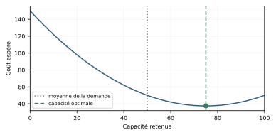

# ENS-PSL · Sélection internationale Lettres 2026 · Économie — prévisions économiques · Corrigé guidé

*Corrigé rédigé par IA, non officiel. Signalez toute erreur.*

**Rédaction** · GPT-6.2 Astra Ultra · vitesse non renseignée · 24 novembre 2026

**Révision (tour 1)** · GPT-6.2 Astra Ultra · vitesse non renseignée · 26 novembre 2026

**Couverture vérifiée.** Le rapport du jury donne page 2 l’écrit individuel du candidat 3. Son oral distinct a pour intitulé « Données et modèles en prévision économique ». Les deux copies distinguent prévision du présent, scénario de politique économique et décision sous risque. Le trimestre, le taux annualisé et la première publication du PIB visés par GDPNow sont précisés. Les coûts de deux décisions sont recalculés sous la même distribution pour vérifier le minimum de la figure.

**Sujet individuel écrit.** À quoi servent les prévisions économiques ?

## Préparer la composition

**Problème à construire.** Comment juger une information produite aujourd’hui quand la décision qu’elle suscite peut changer le résultat de demain ?

## Introduction

Un gouvernement prépare le budget de l’année prochaine alors que le PIB du trimestre en cours n’a pas encore été publié. Il doit pourtant prévoir des recettes, des dépenses et des besoins de financement. Une entreprise confrontée à la même conjoncture peut surtout vouloir savoir s’il lui faut commander une machine aujourd’hui ou attendre. Pour juger de l’utilité de la prévision, il faut donc préciser qui décide, à quelle date et avec quelle perte si le diagnostic s’avère erroné. Une prévision est un énoncé sur une variable future ou encore inobservée, construit à partir de l’information disponible. Elle peut prendre la forme d’un point, d’une distribution ou d’une trajectoire conditionnelle. Elle sert à mesurer l’état de l’économie, à arbitrer avant que l’incertitude ne soit levée et à rendre les décisions discutables. Son utilité dépend des limites publiquement reconnues de ces trois opérations.

## I. Estimer le présent pour pouvoir engager des ressources aujourd’hui

> **Indication.** Nommer un décideur, un horizon et une fonction de perte. Vérifier si une moyenne suffit à prendre la décision.

Les statistiques arrivent en ordre dispersé. Les ventes au détail, les enquêtes auprès des entreprises et les données d’emploi sont publiées avant les comptes nationaux complets. Le *nowcasting* combine ces signaux pour estimer une grandeur dont la période est parfois terminée, mais dont la mesure officielle manque encore. Le modèle GDPNow de la Réserve fédérale d’Atlanta révise ainsi son estimation du taux de croissance du PIB réel du trimestre courant, exprimé en rythme annualisé, à mesure que les données paraissent. Sa cible est la première estimation de ce taux publiée par le Bureau of Economic Analysis. L’institution distingue cette estimation mécanique de l’opinion de son président. Une surprise sur la dépense des ménages peut modifier le diagnostic avant qu’un compte complet soit disponible. Elle ne donne pas mécaniquement la dynamique des quatre trimestres suivants.

L’utilité économique vient de délais concrets. Recruter, investir, passer commande ou voter un budget prend du temps. Un fabricant qui prévoit une demande élevée augmente son stock, mais il supporte un coût si les produits restent invendus. Un service public qui prépare des capacités d’hébergement subit un dommage social plus élevé en cas de sous-capacité que le coût marginal d’une place inutilisée. Une prévision probabiliste identique conduit alors à des actions différentes suivant la décision. Si $Y$ est la demande, $q$ la capacité retenue, $c_u$ le coût unitaire du manque et $c_o$ celui de l’excédent, la minimisation de l’espérance de $c_u(Y-q)_++c_o(q-Y)_+$ conduit, pour une distribution continue, à choisir le quantile d’ordre $c_u/(c_u+c_o)$. Avec un manque trois fois plus coûteux que l’excédent, le bon dimensionnement correspond au 75e centile. Même une prévision moyenne exacte ne fournirait pas à elle seule cette capacité.

Dans la figure, la demande est uniforme entre 0 et 100, le coût d’une unité manquante vaut 3 et celui d’une unité excédentaire vaut 1. Pour une capacité $q$ comprise entre 0 et 100, le coût espéré est
$$C(q)=\frac{3(100-q)^2+q^2}{200}.$$
Les deux termes résultent des surfaces triangulaires correspondant respectivement à une demande supérieure et inférieure à $q$. À la capacité moyenne de 50, le coût espéré est 50. En portant la capacité à 75, il tombe à 37,5, soit un gain de 25 %. L’information sur la demande est la même dans les deux calculs. Le gain vient de l’usage fait de la prévision, compte tenu d’une pénurie plus coûteuse que la sous-utilisation.

## II. Comparer des trajectoires et rendre explicites les hypothèses de décision

> **Indication.** Dans un scénario, souligner les hypothèses de politique, puis dire lesquelles sont modifiées dans le scénario alternatif.

Une banque centrale agit avant que la variation des taux ne se transmette pleinement au crédit, à l’emploi et aux prix. Face à une inflation élevée, deux diagnostics appellent des décisions différentes. Un choc temporaire sur l’énergie peut se dissiper avant que le resserrement monétaire n’ait produit son plein effet. Une propagation durable aux salaires et aux anticipations justifie une autre trajectoire de taux. Les projections conditionnelles servent à examiner ces mécanismes. Il faut connaître les hypothèses sur l’énergie, les taux, les partenaires commerciaux et la réponse des agents. La différence entre deux scénarios mesure un effet de la politique seulement si le modèle identifie de manière crédible les réactions à cette politique. Un excellent modèle de prévision sous le régime passé peut échouer après une modification de la règle suivie par la banque.

Dans sa revue de 2024 pour la Banque d’Angleterre, Ben Bernanke examine notamment l’usage de scénarios alternatifs pour montrer comment des mécanismes ou des politiques différents modifient les résultats pertinents. Le scénario défavorable peut guider une action préventive. Si la crise annoncée ne survient pas après cette action, l’écart entre projection et réalisation ne suffit pas à juger le modèle. Il faut retrouver l’hypothèse sous laquelle le scénario a été construit, puis considérer ce qui serait arrivé sans réaction.

Les prévisions agrégées donnent également une information sur les croyances des autres agents. L’enquête de la Banque centrale européenne auprès des prévisionnistes professionnels recueille des prévisions d’inflation, de croissance réelle et de chômage à plusieurs horizons, dont des distributions de probabilités. La dispersion des réponses ponctuelles renseigne sur le désaccord entre répondants. Elle se distingue de l’incertitude que chacun exprime dans sa propre distribution. Tous peuvent donner 2 % comme point central et considérer néanmoins une inflation très variable comme plausible. Communiquer ces deux dimensions permet de débattre du risque au lieu de traiter la moyenne des réponses comme un engagement.

## III. Évaluer une prévision selon son horizon, les données disponibles et la décision qu’elle éclaire

> **Indication.** Choisir le millésime de la série à prévoir, la date de coupure et une règle simple à battre. Expliquer à quel usage correspond le score.

Le premier test met le prévisionniste dans les conditions historiques de sa décision. Une évaluation qui utilise aujourd’hui des séries révisées que personne ne connaissait à l’époque embellit souvent les performances. Les archives en temps réel de la Réserve fédérale de Philadelphie fournissent des millésimes de séries macroéconomiques. Elles permettent, par exemple, de reconstituer l’information disponible avant une première estimation du PIB. Il faut aussi fixer l’objet contre lequel on vérifie l’erreur. Prédire la première publication répond à une question de conjoncture immédiate. Prédire l’estimation révisée intéresse davantage celui qui cherche l’activité économique sous-jacente. Les classements de modèles peuvent changer avec cette convention.

Pour une série de dates, on compare l’erreur à celle d’une règle naïve, comme la dernière valeur disponible, en conservant le même horizon. L’erreur absolue moyenne récompense une médiane conditionnelle, l’erreur quadratique moyenne une moyenne conditionnelle. Pour un risque binaire, le score de Brier $(p-y)^2$ évalue les probabilités annoncées. Sur de nombreuses prévisions comparables à 30 %, un événement devrait se réaliser environ trois fois sur dix si cette probabilité est calibrée. On cherche en outre à distinguer les situations risquées des périodes ordinaires. Pour un budget d’urgence, il est encore plus pertinent d’estimer, avec ses coûts, quelles décisions auraient été prises avec et sans la prévision. Une faible amélioration moyenne peut compter beaucoup lorsqu’elle évite une seule pénurie grave.

Enfin, les crises changent les relations apprises. Une fermeture administrative, un choc pétrolier ou une réforme fiscale ne se réduisent pas toujours à un bruit du modèle. Des scénarios transparents, des analyses de sensibilité et des révisions datées permettent de savoir ce qui a changé. La recherche d’un chiffre unique sous une forte incertitude peut, elle, masquer le risque de modèle. À l’inverse, publier un intervalle si large qu’aucune action n’est jamais départagée lui enlève sa valeur décisionnelle.

## Conclusion

Les prévisions permettent de décider avant de savoir. Elles deviennent utiles lorsqu’elles relient une information datée à un choix, à des conséquences mesurables et à des conditions explicites de révision. L’évaluation porte à la fois sur la qualité statistique du signal et sur la décision qu’il a permis de prendre. Un chiffre juste par hasard et un scénario prudent qui aide à éviter une crise illustrent pourquoi ces deux critères peuvent diverger.

## Vérifier le raisonnement

Une institution qui annonce un risque de 20 % a-t-elle tort si l’événement se produit ? Un seul cas ne suffit pas à éprouver la calibration. Sur une série de prévisions comparables, on compare la fréquence aux probabilités annoncées, puis les pertes réellement encourues par les utilisateurs. Un scénario conditionnel exige en outre de vérifier si sa condition s’est réalisée.

**Vérifier une annonce de risque.** Si une récession survient trois fois sur dix dans dix observations illustratives où la probabilité annoncée était toujours 30 %, le score de Brier moyen vaut $[3(0{,}30-1)^2+7(0{,}30-0)^2]/10=0{,}21$. Une prévision constante de 50 % aurait donné 0,25. Le plus petit score récompense ici une meilleure prévision probabiliste. La décision de constituer une réserve exige en plus de comparer son coût au dommage économique qu’elle éviterait.

## Sources

[Rapport du jury ENS-PSL, sujet individuel écrit du candidat 3, p. 2](https://www.ens.psl.eu/sites/default/files/rapport_sil_economie_2026.pdf#page=2)

- [Réserve fédérale d’Atlanta, méthode de GDPNow](https://www.atlantafed.org/research-and-data/data/gdpnow)
- [Réserve fédérale de Philadelphie, séries par millésime](https://www.philadelphiafed.org/surveys-and-data/real-time-data-research/real-time-data-set-for-macroeconomists)
- [BCE, enquête auprès des prévisionnistes professionnels](https://www.ecb.europa.eu/stats/ecb_surveys/survey_of_professional_forecasters/html/index.en.html)
- [Bernanke (2024), revue pour la Banque d’Angleterre](https://www.bankofengland.co.uk/independent-evaluation-office/forecasting-for-monetary-policy-making-and-communication-at-the-bank-of-england-a-review)
