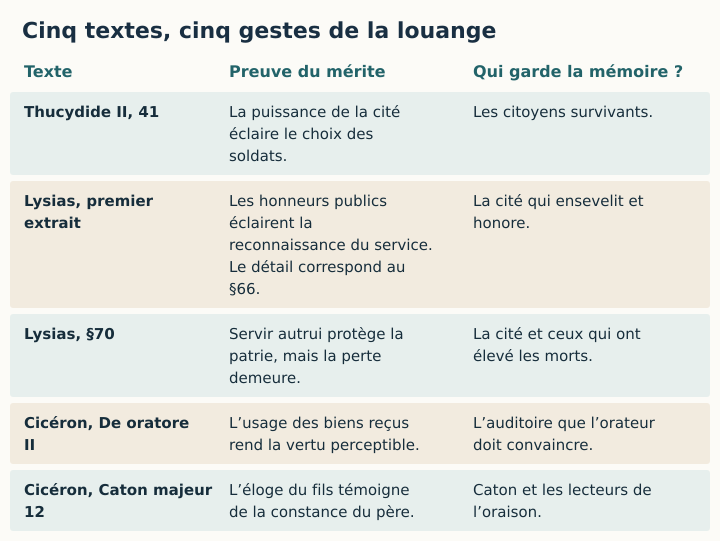

# ENS-PSL · Sélection internationale Lettres — Études classiques (oral) 2026 · Corrigé guidé

*Corrigé rédigé par IA, non officiel. Signalez toute erreur.*

**Rédaction** · GPT-6.2 Astra Ultra · vitesse non renseignée

[Sujet dans le rapport du jury 2026](https://www.ens.psl.eu/sites/default/files/rapport_oral_etudes_classiques_dsa_sil_2026.pdf#page=1)

Le jury a distribué cinq textes bilingues, en grec ou en latin avec une traduction française. Son rapport donne le titre de la comparaison et quatre références précises. Pour le premier passage de Lysias, deuxième document du dossier, il décrit le motif des honneurs publics sans indiquer les bornes. Ce motif se retrouve au paragraphe 66. Le paragraphe 67 introduit les Athéniens morts au secours des Corinthiens. Cette distinction entre deux groupes fonde la lecture proposée. La traduction française distribuée n’est pas reproduite dans le rapport.

## Préparer la comparaison

Inscrire le nom de celui qui parle, le destinataire de l’éloge et la situation dans laquelle le lecteur entend la parole. Chez Thucydide, un historien rapporte une oraison de Périclès. Chez Cicéron, un interlocuteur expose des règles de rhétorique, puis, dans un autre livre, Caton se souvient d’un père dont l’éloge de son fils circule. Cette distinction protège d’un contresens fréquent. Le traité n’est pas lui-même une oraison funèbre et nous ne lisons pas directement les mots de Fabius.

Pour Lysias, lire côte à côte les paragraphes 66, 67 et 70 d’une édition du grec. Au §66, le nom *xenoi* et le rapprochement final avec les citoyens identifient des étrangers honorés par Athènes. Au §67, une transition introduit ceux qu’on ensevelit maintenant. Au §70, observer à qui les soldats ont rendu quelque chose et à qui ils ont laissé du chagrin. Pour l’extrait 2, présenter le rapprochement avec le §66 et garder ouvertes ses limites matérielles sur la feuille originale.

Construire ensuite la comparaison à partir d’une question transversale, par exemple « Quel travail la parole accomplit-elle si les actes semblent parler d’eux-mêmes ? » Vérifier que chaque réponse comporte un détail du texte et un changement d’échelle. Pour le lien au projet personnel qu’invitait à faire le jury, partir d’une de ses propres sources et expliquer si elle permettrait d’étudier la cérémonie, le discours ou sa transmission. Ces trois objets appellent des preuves différentes.

## Pratique de l’éloge funèbre à Athènes et à Rome

Des soldats athéniens sont morts, un père romain perd son fils. On parle des uns comme de l’autre, mais qui la parole fait-elle vivre dans le souvenir public ? Les cinq textes bilingues réunis sous le titre « pratique de l’éloge funèbre à Athènes et à Rome, lecture comparative » conduisent moins à reconstituer le détail de deux cérémonies qu’à étudier le travail de la louange. Un historien rapporte la voix de Périclès. Un discours transmis sous le nom de Lysias rappelle plusieurs groupes de morts. Deux dialogues de Cicéron examinent successivement les règles de la louange et un homme qui a su parler après la mort de son fils. On loue partout des qualités dont les preuves devraient, semble-t-il, se passer de mots. Or on ne saurait qui doit en garder la mémoire, quelles actions méritent de rester et à qui elles profitent sans les choix de celui qui prend la parole.

### À qui appartient la gloire des soldats ?

Au livre II, chapitre 41 de la *Guerre du Péloponnèse*, nous sommes dans le discours prononcé pour les Athéniens morts durant la première année de la guerre, à l’hiver 431-430 avant notre ère. Sa situation est essentielle. Le discours public que Thucydide met dans la bouche de Périclès revient aux morts après avoir longuement détaillé ce qui vaut d’être défendu. Athènes peut se dire l’« école de la Grèce ». Ses membres pris individuellement seraient capables de faire face avec aisance à des tâches variées. La cité dans son ensemble présente une puissance dont la réputation resterait même en deçà de l’expérience. Le raisonnement englobe les adversaires, censés n’avoir pas à rougir de la qualité de ceux qui les ont vaincus, et les sujets, censés reconnaître le mérite de ceux qui les gouvernent. Ce sont des jugements que Périclès prête aux uns et aux autres. Il transforme en consentement universel à la grandeur d’Athènes des positions pourtant très inégales.

Dès lors, que peut ajouter l’orateur ? Périclès récuse le besoin d’un Homère. Le plaisir passager d’un récit flatteur résisterait mal à l’épreuve de la vérité, alors que les traces laissées partout par la puissance d’Athènes subsistent. Le mot de « traces » a ici un envers. Les peuples rencontrés sur mer ou sur terre ont fait l’expérience des biens mais aussi des maux que peut apporter la puissance athénienne. L’éloge inclut cette ambivalence dans le témoignage de la grandeur. Son dernier mouvement réintroduit les soldats. C’est « pour une telle cité » qu’ils ont combattu et sont morts. La grammaire de la conclusion condense le choix politique de l’oraison. La louange de la communauté fonde celle des hommes que voici, puis assigne aux survivants le devoir de poursuivre les efforts. Ces hommes demeurent anonymes comme individus. Ils reçoivent de la parole une place entre un passé de hauts faits et un avenir dont les auditeurs deviennent responsables.

Quelques décennies plus tard, l’*Oraison funèbre* transmise sous le nom de Lysias concerne des Athéniens morts en allant secourir les Corinthiens. La solidarité entre cités exige une justification particulière. Comment mourir chez d’autres peut-il servir sa propre patrie ? Le premier extrait de Lysias est décrit par le rapport à travers le deuil de la cité, les funérailles publiques et les honneurs durables. L’édition du discours permet de préciser un point crucial. Au §66, après une évocation des combats du Pirée liés au rétablissement de la démocratie, l’orateur distingue les étrangers ensevelis ici, venus au secours du peuple. Ils ont regardé la vertu comme leur patrie. En retour, Athènes les a pleurés, enterrés publiquement et leur a accordé pour toujours les mêmes honneurs qu’à ses citoyens. Le terme qui les désigne comme étrangers et la comparaison finale avec les citoyens ont tous deux leur importance. Le texte donne une mesure de la reconnaissance accordée aux morts. Il ne prononce pas une naturalisation générale.

Le §67 change de groupe en introduisant ceux que l’on ensevelit à présent, les hommes venus secourir Corinthe. La différence entre l’aide apportée par des étrangers à Athènes et l’aide portée par des Athéniens à d’autres permet de mieux entendre la symétrie morale du discours. Le nom de la cité de naissance ne suffit plus à fixer d’avance pour qui l’on agit, et l’ancienne inimitié avec les Corinthiens n’empêche pas de prendre en compte une amitié présente. Le rapprochement du §66 avec les indices rituels du rapport est précis. En l’absence de bornes pour le feuillet, il faut simplement éviter d’étendre aux mêmes hommes tous les détails de ces deux moments. Quelque chose d’essentiel se joue justement dans le passage d’un groupe à l’autre. Les Athéniens célèbrent les étrangers qui ont rendu un service décisif à leur communauté avant de louer les leurs qui, à leur tour, ont accepté d’aller aider ailleurs.

### Un même départ laisse une dette acquittée et une place vide

Le troisième document, le §70 de Lysias, porte sur ces derniers. Le discours peut faire tenir ensemble le service rendu à d’autres et le bénéfice procuré à l’Attique. En secourant ceux que le malheur avait atteints, les soldats ont tenu la guerre à distance de leur propre pays. L’action s’évalue à l’aune de deux espaces à la fois. Mais le paragraphe déplace bientôt l’attention vers deux destinataires de la mort. La patrie reçoit le prix des soins qu’elle avait donnés aux jeunes gens. Ceux qui les ont effectivement nourris et élevés reçoivent de la peine. Le texte grec rapproche les mots qui disent ce que l’on doit pour sa nourriture et ceux qui désignent les personnes qui vous ont nourri. Une seule expérience, celle d’avoir été élevé, se distribue entre une patrie qui reçoit son dû et des proches à qui manque désormais quelqu’un. La grandeur publique ne solde pas la dette affective.

Cette formule interdit de ramener l’oraison à une façon d’étouffer les larmes sous le langage héroïque. La mort est bien présentée comme l’achèvement qui convient aux hommes de bien. Ce jugement donne à la vie un sens rétrospectif, mais il nomme la douleur qu’aucun avantage civique ne saurait rendre à ceux qui survivent. Comparons avec Périclès. Chez ce dernier, l’évocation des morts appelait les survivants à supporter de nouvelles peines pour la cité. Chez Lysias, au §70, les proches ont déjà leur propre peine et elle vient précisément de ce qui fait la gloire de la patrie. Il existe ainsi, dans le récit d’une même action, deux vérités dont l’une n’annule pas l’autre.

### Les Romains choisissent ce qui, dans une vie, mérite d’être loué

Avec le livre II de *De l’orateur*, écrit par Cicéron en 55 avant notre ère, nous changeons à la fois de cité, de siècle et de niveau d’analyse. Dans ce dialogue, Antoine cherche aux §§342-348 les critères permettant de composer un éloge. Une belle naissance, une forte constitution, des biens ou du pouvoir comptent parmi les choses souhaitables. Pourtant leur simple possession ne constitue pas un mérite. Faut-il donc les éliminer de l’oraison ? Ce serait se priver du moyen de montrer ce que vaut la personne. C’est dans l’usage qu’elle fait d’une fortune favorable que la *moderatio* peut apparaître. Il faut avoir été en position de se montrer arrogant ou de tirer avantage de son pouvoir pour que le refus de le faire révèle une maîtrise de soi. La fortune fournit à la vertu sa matière. Dans l’adversité, la dignité conservée peut rendre le mérite plus manifeste encore.

L’art de louer oblige ensuite à relier des actes bien choisis à la qualité qu’ils manifestent. Déclarer un homme juste laisse à l’auditeur tout le travail de la preuve. Le discours doit indiquer comment il s’est acquitté d’une obligation et ce que d’autres ont reçu de sa conduite. Toutes les vertus ne produisent d’ailleurs pas le même effet chez ceux qui écoutent. Une faculté exceptionnelle peut appeler l’admiration. Un acte généreux accompli sans récompense et au prix d’une peine personnelle suscite aussi de la reconnaissance. Le style élevé de la louange retient l’exceptionnel et recourt à la comparaison avec d’autres hommes d’envergure. Nous pouvons maintenant relire les éloges athéniens à partir de ces catégories romaines. La défense d’une cité alliée se prête particulièrement bien au critère du service coûteux rendu à autrui. Mais faire de Périclès ou de Lysias de simples illustrations d’un manuel ultérieur manquerait l’opération propre à chaque genre. L’un d’eux devait convaincre des citoyens assemblés qu’un sacrifice concernait leur propre avenir. Antoine cherche à définir la compétence générale d’un orateur capable d’attribuer chaque louange à son juste objet.

Le dernier texte donne un cas qui éprouve cette compétence. Dans le *Caton majeur*, écrit en 44 avant notre ère, Caton se souvient de Quintus Fabius Maximus. De cet homme illustre, le trait qui le frappe le plus est sa manière de supporter la mort d’un fils, lui-même ancien consul. Fabius a prononcé un éloge du défunt. Ce discours, dit Caton, se trouve entre les mains des lecteurs. La scène de parole a donc changé de lieu et d’objet. Un père a loué son fils, le texte a circulé, puis Caton trouve dans sa lecture une raison de louer à son tour le père. Cicéron ne livre pas le discours de Fabius dans cet extrait. Il montre à travers l’effet exercé sur un autre homme ce que devient une parole funèbre après les funérailles.

La question provocante sur le philosophe qui pâlit à côté d’un tel discours ne donne pas simplement la préférence aux actes sur les paroles. Fabius a précisément accompli un acte de parole, et Caton le connaît aussi par la lecture. Ce que l’expérience du deuil donne aux mots, c’est la crédibilité difficile d’une consolation qui a dû être vécue. La suite restitue à Fabius le charme de la conversation privée, le savoir historique et juridique, la mémoire des affaires anciennes. La valeur d’un homme se reconnaît dans un deuil domestique et dans un entretien familier, aussi bien que dans les charges dont il a été investi. L’exemple donne ainsi une inflexion personnelle à la recherche de l’exceptionnel exposée dans *De l’orateur*. Une situation qui peut atteindre n’importe quelle famille révèle une manière singulière de se conduire.

D’Athènes à Rome, le dossier n’oppose donc pas deux civilisations dont l’une ne connaîtrait que le groupe et l’autre que les individus. La douleur des proches entre dans l’éloge grec, comme le service d’autrui demeure un critère de l’éloge romain. Ce qui se déplace est le lieu où l’on recueille les preuves du mérite. Chez Thucydide, la puissance de la cité rend intelligible la mort des soldats. Chez Lysias, la relation entre la cité et ceux qui l’ont servie se laisse lire à travers la réciprocité des secours, les honneurs publics et le chagrin des familles. Chez Cicéron, on peut réfléchir aux règles de ce jugement et suivre une parole personnelle jusque chez ses lecteurs. En recueillant les morts, le discours fait quelque chose que les faits, même les plus admirables, ne font pas seuls. Il choisit qui doit se souvenir, de quoi, et pour quelle raison.

## Échange possible avec le jury

**Quelle différence sépare une oraison et une réflexion sur la louange ?** Périclès et le locuteur de Lysias s’adressent à leur public dans une situation funéraire. Antoine expose ce que l’orateur doit savoir faire pour louer. Caton décrit l’effet produit sur les lecteurs par l’éloge qu’un autre homme a effectivement prononcé. Le discours de Fabius constitue un objet dans le dialogue.

**Que peut-on reconstituer du rituel ?** Chez Lysias le §66 mentionne un deuil pris en charge par la cité, un ensevelissement public et la continuité des honneurs. Ces renseignements n’établissent à eux seuls ni les étapes de la procession, ni le calendrier de répétition, ni les gestes de la cérémonie. Une enquête sur le rite demanderait de confronter le texte à d’autres témoignages ou à des traces matérielles.

**Comment faire le lien avec un projet personnel ?** Une personne travaillant sur la transmission de la mémoire pourrait comparer la publicité d’une inscription funéraire et la circulation du discours de Fabius évoquée par Caton. Une personne étudiant la citoyenneté pourrait partir de la distinction entre étrangers et citoyens chez Lysias. Dans les deux cas, il faudrait proposer un corpus concret et préciser où s’arrête l’analogie.

[Thucydide, II, 41](https://beta.perseus.tufts.edu/urn%3Acts%3AgreekLit%3Atlg0003.tlg001.perseus-eng6/chapter%3A2.41/) · [Lysias, texte grec de l’édition Lamb](https://github.com/PerseusDL/canonical-greekLit/blob/master/data/tlg0540/tlg002/tlg0540.tlg002.perseus-grc2.xml) · [Cicéron, De oratore, II](https://www.attalus.org/cicero/deoratore2E.html#342) · [Cicéron, Caton majeur, 12](https://penelope.uchicago.edu/Thayer/E/Roman/Texts/Cicero/Cato_Maior_de_Senectute/text%2A.html#12)
