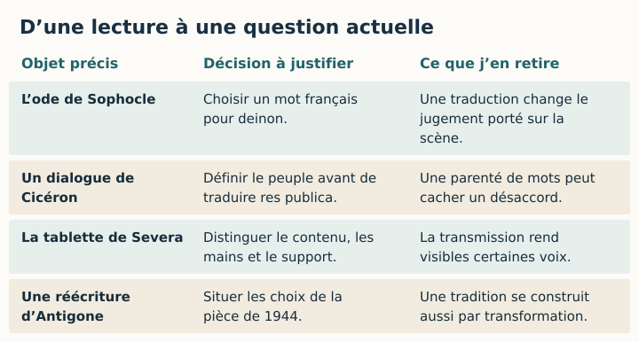

# ENS-PSL · Sélection internationale Lettres — Études classiques 2026 · Corrigé brut

*Corrigé rédigé par IA, non officiel. Signalez toute erreur.*

**Rédaction** · GPT-6.2 Astra Ultra · vitesse non renseignée

[Sujet dans le rapport du jury 2026](https://www.ens.psl.eu/sites/default/files/sil2026_rapport_ecrit_etudes_classiques.pdf#page=2)

Le jury demande une dissertation en français, en trois heures, sur ce que l’étude du grec et du latin apporte à la formation intellectuelle, à la culture générale et à la compréhension du monde de la personne qui compose. La première personne de cette proposition exprime une position argumentée qu’un candidat peut confronter à ses propres lectures.

## Ce que le grec et le latin changent à ma lecture du monde

Dans la première ode chorale de l’*Antigone* de Sophocle, un mot m’arrête plus longtemps que la scène qui le précède. Le chœur prononce *deina* et en vient à l’être humain comme à ce qui est le plus *deinon*. Dois-je entendre que l’homme est admirable, prodigieux, inquiétant, terrible ? Le choix modifie ce que j’attends du personnage qui a bravé l’interdit de Créon et ma façon de juger la puissance humaine dont le chant inventorie les conquêtes. Un dictionnaire m’offrira plusieurs mots français et aucun ne me dispensera de lire la suite. Voilà une première raison de consacrer du temps au grec et au latin. Ces langues me mettent en présence de questions dont une information exacte est la condition de départ et dont la réponse exige pourtant un jugement. Mais si j’en attendais seulement de devenir plus attentif, bien d’autres apprentissages me rendraient le même service. Ce qui leur est particulier tient à la durée et aux médiations qu’il faut traverser pour rencontrer un langage, un objet, parfois une manière d’agir dont les héritages me sont familiers. Comment cette distance, si coûteuse à parcourir, peut-elle modifier ce que je vois tout près de moi ?

### Apprendre à répondre d’une interprétation

Revenons au chant de Sophocle. La même inventivité permet à l’être humain de franchir la mer, de cultiver le sol, de se donner un langage et des règles. À la fin du chant, l’usage qu’il fait de ses ressources ouvre des possibilités contraires. Si j’adopte d’emblée « merveilleux » au sens d’un simple compliment, je vends la conclusion avant d’avoir lu le parcours de l’ode. Si j’écris « effrayant », je perds l’émerveillement que suscite cette puissance. Je pourrais conserver les deux mots au brouillon, choisir « prodigieux » pour la scène et exposer ce que le français risque d’y atténuer. J’apprends ainsi quelque chose de plus précis que la modestie. Je peux décider, dire sur quels indices je décide et signaler le prix de ce choix. Cette responsabilité m’importe lorsque je lis une traduction contemporaine ou un titre de presse qui a retenu un mot parmi plusieurs possibles. Je sais au moins quelle question adresser à son auteur.

Une formule de Cicéron me demande un autre effort. Dans *La République*, au livre I, Scipion définit la *res publica* comme *res populi*. Lire « la république est la chose du peuple » peut paraître une victoire immédiate du latin familier. Mais on n’a fait que déplacer le problème dans le mot *populus*. Le personnage continue en demandant ce qui fait d’une réunion de personnes un peuple. Il invoque un accord sur le droit et une communauté d’intérêt. Tout à coup, la phrase que mon oreille moderne croyait reconnaître comme une profession de foi républicaine devient le début d’un raisonnement sur ce qui constitue une collectivité politique. Il faut encore se demander qui parle dans le dialogue et ce que les interlocuteurs entendent par un régime juste. Le latin me force ici à me défier précisément des mots que je traduisais le plus vite. Dans une discussion actuelle, je ferai plus attention au moment où deux personnes emploient « peuple » sans être d’accord sur ceux que ce nom engage.

### Agrandir la culture que je croyais recevoir

Les grandes œuvres fournissent un terrain privilégié à cette attention. Elles pourraient aussi la limiter si je finissais par confondre tout un monde avec les voix qu’a retenues un programme. Sur une mince tablette de bois retrouvée à Vindolanda, près de la frontière septentrionale de la Bretagne romaine, Claudia Severa invite Sulpicia Lepidina à son anniversaire. L’invitation a été écrite vers l’an 100 de notre ère. L’édition distingue la main qui rédige le corps de la lettre et la salutation ajoutée par Severa elle-même. Je peux comprendre beaucoup de ses mots sans savoir déchiffrer d’emblée son écriture. Cette inégalité m’apprend à reconnaître le travail de ceux qui photographient, lisent, identifient et éditent. La culture générale cesse alors d’être la possession individuelle de beaux textes. Elle inclut la capacité à retrouver par quelles opérations un objet fragile est devenu lisible.

Que gagne-t-on à mettre cette invitation à côté d’une page de Cicéron ? Une connaissance plus juste des usages du latin. Une femme écrit affectueusement à une autre, un intermédiaire prête sa main, des liens familiaux et amicaux s’entretiennent dans le milieu d’officiers installés loin de Rome. J’aurais tort d’y voir soudain la parole de toutes les femmes de l’Empire. L’accès à un scribe et la conservation exceptionnelle du bois caractérisent précisément les conditions dans lesquelles celle-ci m’atteint. Il reste que des salutations auxquelles un manuel de grandes œuvres accorderait peu d’espace me font voir autre chose qu’un empire de lois et de discours. La culture s’élargit quand j’apprends à changer le format et le statut des pièces que je juge dignes d’attention.

Elle se transforme également quand une œuvre ancienne devient matière à de nouveaux choix. L’*Antigone* d’Anouilh est créée à Paris en 1944. On peut être tenté d’y reconnaître la tragédie originelle transposée dans le présent ou la simple illustration d’une position politique sous l’Occupation. La confrontation avec Sophocle révèle un travail plus intéressant. Le Créon moderne explique longuement les raisons et les accommodements du pouvoir, devant une jeune femme qui lui oppose aussi le refus d’une certaine idée du bonheur. Ces inflexions font entendre des préoccupations qui ne se laissent ramener ni à un vers grec ni à une formule politique. J’aime que la connaissance du grec puisse ainsi me rendre plus sensible à ce qu’un écrivain français a inventé. La tradition est alors une histoire de lectures qui sélectionnent, discutent et déplacent des problèmes. Une réécriture réussie peut à son tour me faire entendre dans son modèle des questions que j’avais négligées.

### Comprendre le présent sans en chercher la clé toute faite dans le passé

La tentation reste forte d’ériger cette familiarité en droit de préséance. Parce qu’Athènes donne un nom à la démocratie, je pourrais présenter notre organisation politique comme le développement presque naturel d’une invention grecque. Or la participation des citoyens à l’assemblée athénienne supposait une définition du corps civique qui en excluait les femmes, les esclaves et les étrangers installés dans la cité. Dans une démocratie représentative contemporaine, la définition de la citoyenneté, les mécanismes de représentation et les conditions d’accès au suffrage posent des questions différentes. Si je dois à l’étude du grec une meilleure compréhension du monde, c’est ici la possibilité de poser plus précisément la question « qui participe et à quel titre ? » dans chacun des deux cas. L’antécédent historique peut d’autant mieux servir à penser qu’on ne s’autorise pas de lui pour clore une discussion.

Cette précaution vaut aussi pour la place que j’accorde aux études anciennes elles-mêmes. Connaître les deux langues demande du temps, des enseignants et des institutions dont l’accès est inégal. Je comprends l’objection de celui qui voit dans leur prestige le moyen de distinguer des élèves déjà favorisés. J’en tirerais pourtant une conséquence bien différente d’un abandon. Si le passage par une langue ancienne donne des moyens de discuter une traduction, il faut que traductions bilingues, éditions commentées et documents matériels permettent aussi à d’autres d’entrer dans cette discussion. Qu’une seule personne sache expliquer une expression latine ne lui donne aucun privilège pour décider de la justice d’une loi actuelle. Cela lui donne une responsabilité particulière pour rendre son argument vérifiable par quelqu’un qui ignore le latin. C’est sous cette forme de partage que je souhaite pouvoir défendre mon choix d’études.

Le grec et le latin ont donc à mes yeux une valeur qui se mesure au moment où je ferme le livre. Je peux expliquer pourquoi une seule formulation rend imparfaitement justice à une ode, pourquoi la voix d’une femme sur une tablette change l’image d’une province et pourquoi deux institutions qui portent des noms apparentés doivent être comparées avec précision. J’y gagne un art de juger des mots, une culture plus hospitalière aux traces modestes et une manière d’interroger les usages publics du passé. La découverte la plus personnelle tient peut-être à ceci. Je croyais apprendre des langues pour atteindre des réponses dont j’étais trop éloigné. J’y trouve aussi le pouvoir de rendre à des mots trop proches de moi leur véritable difficulté.

[Édition de la tablette de Vindolanda 291](https://romaninscriptionsofbritain.org/inscriptions/TabVindol291)
