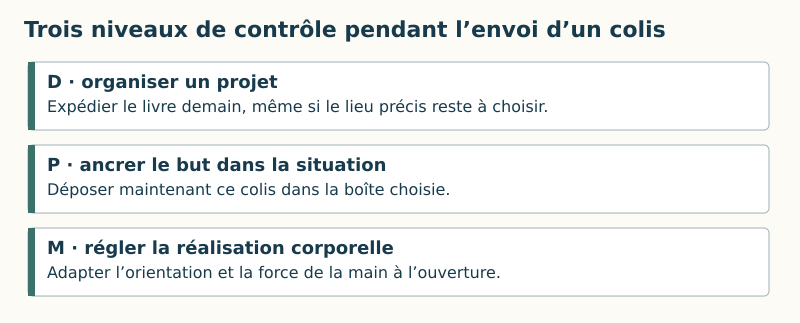

# ENS-PSL · Sélection internationale Lettres — Études cognitives 2026 · Corrigé guidé

*Corrigé rédigé par IA, non officiel. Signalez toute erreur.*

**Lecture du rapport du jury** · GPT-6.2 Astra Ultra · vitesse non renseignée

**Rédaction** · GPT-6.2 Astra Ultra · vitesse non renseignée

**Autocontrôle** · GPT-6.2 Astra Ultra · vitesse non renseignée

**Révision (tour 1)** · GPT-6.2 Astra Ultra · vitesse non renseignée

## Lire les consignes de la session

La sélection internationale de 2026 demande de lire les pages 180 à 190 de l’article de Pacherie et de répondre en français aux six questions. La version anglaise permet de contrôler le sens de la consigne. La ligne « Écrit 2025 » du fascicule diverge de son en-tête et du rapport de la session 2026, qui décrit l’article, les six questions et la durée de deux heures.

## Identifier ce que contrôle chaque intention

Faire varier seulement la taille du colis. Tant qu’une rotation suffit, le projet d’expédition et le lieu de dépôt peuvent rester les mêmes. Cette manipulation précise ce que le modèle attribue au contrôle moteur.

Pour la deuxième question, conserver le même exemple à travers les trois niveaux et montrer ce qui reste stable quand une circonstance change. Pour la troisième, distinguer le format de la représentation, ce qu’elle sélectionne et le temps sur lequel elle corrige. La proximité chronologique d’un geste ne suffit pas à en faire une intention P.

## Transformer un exemple en test

Les questions 4 à 6 doivent porter sur un seul cas, rendu progressivement testable. Dire d’abord quel sous-geste aurait été déclenché sans but proximal. Donner ensuite une explication rivale, ici une intention brève suivie d’un oubli. Enfin préciser la différence prévisible entre les conditions, une mesure sur la trajectoire, un contrôle positif où la règle est bien comprise et un contrôle négatif avec un objet inadéquat. Le résultat expérimental reste hypothétique.

Le cadre et l’exception des routines figurent dans la deuxième partie de l’article, particulièrement aux pages 188 à 190. [Élisabeth Pacherie, *The phenomenology of action*, DOI](https://doi.org/10.1016/j.cognition.2007.09.003)

## Réponses aux six questions

### 1. Le but de l’article

Élisabeth Pacherie cherche à rendre compte de la phénoménologie de l’action, autrement dit des différentes façons dont un sujet éprouve qu’il agit. L’expérience de décider, celle d’initier un geste, celle de le guider et celle d’en reconnaître l’effet comme le sien peuvent aller ensemble dans la vie ordinaire. Elles ne sont pas pour autant identiques. Expliquer leur articulation suppose de distinguer les processus qui préparent et contrôlent l’action et ce qui, de ces processus, est accessible à l’agent. Le cadre proposé doit permettre de formuler, à propos de ces expériences, des hypothèses que puissent examiner la philosophie et les sciences cognitives.

### 2. Un cadre dynamique à trois niveaux

Une intention distale (D) engage l’agent dans un projet et en organise rationnellement le cours. Je décide d’expédier demain un livre à une amie. Cette intention peut demeurer stable alors que le lieu exact du dépôt ou le moment de ma sortie restent ouverts. Une intention proximale (P) ancre un projet dans une situation perçue. Me voici devant deux boîtes. Je vais placer *ce* colis dans *celle-ci*, maintenant. Une intention motrice (M) spécifie de manière sensori-motrice ce qu’il faut faire, compte tenu de ma position, de l’ouverture et du poids du colis. Elle règle le geste, sa force et ses corrections en cours d’exécution.

Le modèle est dynamique en deux sens. Dans la cascade habituelle, un but se précise, du projet représenté de façon relativement abstraite à sa réalisation corporelle. Mais les intentions déjà formées continuent de contrôler l’action à leur échelle. Si l’ouverture est condamnée, je peux sélectionner une autre boîte ou revoir l’organisation de l’envoi. Le niveau D n’a pas disparu au premier geste. Inversement, toute action n’exige pas que les trois niveaux aient été explicitement formés. Une action peut être improvisée, et un geste déjà commencé peut être repris ou interrompu lorsqu’on en prend conscience.

### 3. Intention proximale et intention motrice

L’intention P fixe et contrôle ce qui est à faire dans une situation présente. Elle comporte une représentation située qui peut identifier un objet par sa place, par exemple « porter maintenant ce verre-ci à ma voisine ». Elle peut changer si j’apprends que le verre appartient à quelqu’un d’autre. L’intention M, pour sa part, spécifie le geste dans un format adapté au corps. L’écartement des doigts varie avec le diamètre du verre et la trajectoire de la main avec son déplacement. Je peux préserver l’intention P en réalisant des mouvements différents, même sans pouvoir décrire chacun de leurs ajustements.

Le contrôle moteur ne se réduit pas à la contraction d’un muscle. Il organise plusieurs mouvements en fonction d’une cible et les adapte aux écarts. Corriger rapidement la prise si le verre glisse est un exemple de guidage essentiellement moteur. L’action globale « donner ce verre » demeure, dans cet exemple, sous contrôle P. Conclure que toute l’action était gouvernée par M seule du fait qu’une correction était automatique confondrait le niveau auquel on analyse le geste avec celui de l’objectif global.

### 4. Un candidat au contrôle M seul

Une personne qui prend des notes a coutume de remettre son capuchon à son stylo à chaque pause. Lors d’une interruption imprévue, elle regarde ailleurs pour écouter quelqu’un et ses mains commencent à rapprocher le capuchon et le stylo. L’hypothèse est que, dans certains de ces essais, la configuration familière amorce et sélectionne une routine qui débute sans que le sujet se soit assigné le but actuel de reboucher le stylo. La cible pertinente reste présente. L’orientation de l’ouverture guide celle du stylo.

Il s’agit d’un candidat à l’hypothèse de la page 189. La personne peut ensuite remarquer ce qu’elle fait et décider de finir. Ce moment introduirait un contrôle P tardif, compatible avec un déclenchement M seul. Une autre explication est qu’elle a formé très vite une intention P sans en garder la mémoire. L’exemple ne suffit donc pas à décider entre les deux lectures.

### 5. Ce qui permettrait de départager les hypothèses

Il faut chercher deux types d’indices indépendants. Premièrement, le mouvement devrait manifester un contrôle orienté vers la cible. S’il varie selon la position du capuchon alors que le signal de pause reste le même, il s’agit de plus qu’une réponse musculaire fixe. Deuxièmement, il faut rechercher le choix d’un but actuel distinct de la simple présentation des indices habituels. Un changement de règle, compris et retenu, ou un conflit entre la cible habituelle et le but publiquement assigné permet d’examiner si le mouvement obéit immédiatement à ce choix.

Un compte rendu immédiat sur le but poursuivi complète l’observation sans constituer un test décisif. Une absence de rapport verbal peut traduire un oubli, une division de l’attention ou une mesure trop tardive. Une conclusion raisonnable comparera des profils de temps, d’erreurs, d’adaptation et de rapports entre conditions, en distinguant le déclenchement de la correction du mouvement.

### 6. Une expérience possible

Dans une première phase, des participants écrivent par séquences et replacent à chaque pause un capuchon facilement manipulable. Dans une seconde phase, les pauses sont de deux types, annoncés par deux symboles appris. L’un demande de reboucher le stylo, l’autre de le laisser ouvert pour reprendre aussitôt. On vérifie séparément la reconnaissance des symboles. Sur certains essais des deux types, la position du capuchon est légèrement déplacée avant que la main l’atteigne. Une caméra suit les trajectoires. Des essais de comparaison comportent un objet voisin de même taille qui ne convient pas au stylo. L’ordre des essais et le côté du capuchon sont contrebalancés.

On mesure le départ de la main, la direction initiale, l’ajustement vers la position réelle du capuchon, l’éventuel arrêt et le geste final. Après un sous-ensemble imprévisible d’essais, une question immédiate demande le but que le participant avait au départ. Dans les essais où il sait devoir laisser le stylo ouvert, un départ rapide vers le capuchon, spécifique à l’objet pertinent et corrigé vers sa position nouvelle, constituerait un indice de routine motrice orientée. Si le participant interrompt ensuite le geste conformément à la règle, l’ordre temporel serait compatible avec la prise de contrôle tardive décrite par Pacherie. Une dépendance immédiate et régulière du premier mouvement à la consigne, allant de pair avec un but situé rapportable, appuierait davantage l’hypothèse d’un contrôle P dès l’amorce.

Le taux d’erreurs sur les signaux, le caractère volontairement appris de la routine et la possibilité d’une intention proximale trop fugace pour être rapportée limitent l’inférence. L’expérience peut rendre l’explication par une seule intention M plus ou moins plausible pour une phase du mouvement. Elle ne transforme pas le silence des participants en preuve de l’absence de tout but.

[Énoncé officiel](https://www.ens.psl.eu/sites/default/files/cogsci_sujet-ecrit-sil-2026-1.pdf) · [Rapport du jury](https://www.ens.psl.eu/sites/default/files/rapport_etudes_cognitives_sil_2026.pdf)
