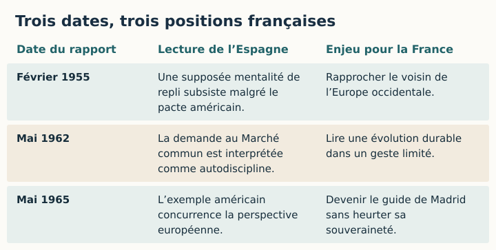

# ENS-PSL · Sélection internationale Lettres — Histoire (oral 2) 2026 · Corrigé brut

*Corrigé rédigé par IA, non officiel. Signalez toute erreur.*

**Rédaction** · GPT-6.2 Astra Ultra · vitesse non renseignée

[Document officiel](https://www.ens.psl.eu/sites/default/files/sujet_oral_2.pdf) · [Rapport du jury 2026](https://www.ens.psl.eu/sites/default/files/rapport_jury_sil_-_histoire_2026.pdf#page=2)

Le sujet réunit trois extraits de rapports du ministère français des Affaires étrangères, section Europe-Espagne. Le rapport du jury 2026 prévoit trente minutes de préparation, puis trente minutes de passage pour présenter la source et échanger sur le projet de recherche et son inscription possible dans un environnement de recherche local.

## La diplomatie française devant la place de l’Espagne en Europe

Qui décide que l’Europe est le « destin » de l’Espagne ? Cette certitude, exprimée dans un rapport français de 1965, est bien moins évidente quand on la rapproche des deux autres pièces. Le dossier réunit des extraits du ministère français des Affaires étrangères, section Europe-Espagne. Une note de 1955 décrit des Espagnols tournés vers eux-mêmes, un rapport de fin de mission de 1962 accueille leur démarche auprès du Marché commun, et le texte de 1965 s’inquiète de l’attraction américaine. Le feuillet nous donne ces extraits dans un autre ordre et ne nomme pas leurs auteurs individuels. Tous renseignent sur la manière dont des agents français définissent une politique envers un voisin autoritaire pendant la guerre froide. Il faut pourtant écouter des voix et des moments distincts. Une prétendue psychologie nationale leur permet successivement d’expliquer une distance, de célébrer une transformation et de légitimer la place que la France entend occuper.

En février 1955, l’auteur fait dériver l’isolement de l’Espagne de deux expériences qu’il dit insuffisamment partagées avec ses voisins. La première est l’industrialisation du XIXe siècle, la seconde le brassage provoqué par les deux guerres mondiales. À l’échelle d’un pays, parler de transformations économiques atténuées efface entre autres l’activité industrielle de la Catalogne et du Pays basque. À l’échelle des individus, le fait que l’Espagne ne soit pas entrée en guerre aux côtés des grands belligérants ne signifie en rien que les Espagnols aient vécu hors des circulations de ces décennies. La guerre civile de 1936-1939 a mobilisé des solidarités et des interventions étrangères. L’exil républicain a conduit nombre d’Espagnols en France et ailleurs. Leur existence suffit à compliquer une formule qui attribue à tout un peuple l’inexpérience de l’extérieur. Cette simplification a une fonction. Si l’obstacle principal se trouve dans une mentalité, un voisin qui se déclare plus expérimenté peut s’autoriser à agir sur elle.

Pourtant le texte de 1955 fournit lui-même une objection à son diagnostic. Il mentionne le pacte conclu avec les États-Unis. Il s’agit des accords de Madrid de 1953 entre le régime de Franco et Washington. Ils lient coopération stratégique et assistance américaine et contribuent à sortir le régime d’une partie de son isolement international. Le diplomate connaît cette ouverture, puisqu’il l’invoque expressément, mais la tient pour insuffisante à ses yeux. Être déjà associé à la défense de l’Occident ne ferait pas de l’Espagne un membre pleinement intégré de l’Europe occidentale. L’Europe dont il s’agit en 1955 ne peut d’ailleurs être confondue avec la Communauté économique européenne, dont le traité fondateur ne sera signé à Rome qu’en 1957. La formulation large laisse ainsi une question ouverte. Que faudrait-il partager au-delà d’intérêts militaires pour que la relation soit jugée satisfaisante ? Le pronom dans « notre politique espagnole » indique au moins qui entend en juger.

Le rapport de mai 1962 permet de reprendre la question à partir d’un acte venu de Madrid. L’Espagne a demandé en février l’ouverture de négociations avec la Communauté économique européenne. La présentation entre crochets du feuillet parle d’adhésion au Marché commun. La lettre de Castiella précise le chemin envisagé. Il s’agit d’une association qui pourrait conduire, le moment venu, à une intégration complète. La demande constitue donc une initiative diplomatique importante et expose une perspective, sans valoir admission ni même ouverture immédiate des négociations espérées. Ce degré de précision permet de mieux comprendre l’enthousiasme du rédacteur français. Il observe un geste limité dans ses effets institutionnels immédiats et lui prête une signification historique immense.

Deux images rythment son interprétation. L’Espagne sortirait d’un très long sommeil et se donnerait elle-même le coup d’éperon nécessaire. La contrainte change d’origine par rapport à 1955. Le pays qu’il fallait transformer depuis l’extérieur deviendrait capable de choisir lui-même une discipline extérieure, celle de la concurrence et de l’adaptation. L’étrange verbe « s’emprisonner » exprime cette liberté qui se donne une règle. La formule apporte au diplomate une solution intellectuelle à une difficulté politique. On peut célébrer la souveraineté d’un État en assurant que la voie qu’il prend est désormais « irréversible ». Or c’est bien l’auteur qui prête à la nation une volonté unifiée. Au pouvoir depuis la guerre civile, Franco gouverne toujours une dictature. Une lettre ministérielle n’enregistre ni une consultation de la population ni son accord sur les modalités de l’ouverture économique. Le plan de stabilisation de 1959 constitue un repère pour comprendre les transformations en cours. Il ne permet pas d’attribuer à tous les Espagnols le désir qu’exprime le rapport.

La note du 4 mai 1965 déplace une nouvelle fois le problème. L’Espagne pourrait se tourner vers l’exemple d’un pays « extra-européen ». Le terme dit à la fois la puissance d’attraction des États-Unis et le moyen choisi pour la disqualifier. L’alliance américaine, présentée comme un lien avec l’Occident en 1955, servirait désormais un modèle extérieur à l’Europe que la France souhaite construire. Ce n’est pas un simple changement d’avis entre deux dates. Les deux textes contribuent à distinguer des espaces qui se recoupent sans se confondre. Une Espagne ouverte à l’Atlantique peut encore échapper à une médiation française. Si le seul but était de rompre le repli espagnol, l’attrait de Washington pourrait satisfaire la note de 1965. Le fait qu’elle s’en inquiète donne la mesure de son autre ambition.

Les mots « guide », « parrain », « introducteur » déclinent cette ambition avec des nuances. Le guide connaît la voie à suivre, le parrain garantit l’entrée de quelqu’un dans un cercle, l’introducteur possède déjà les relations auxquelles l’autre aspire. Ces rôles supposent tous une avance française et le pouvoir d’en faire bénéficier Madrid. L’auteur prévoit cependant la résistance que rencontrerait cette hiérarchie. Il invoque une « fierté castillane », réduisant encore un pays diversement constitué à une qualité collective, et recommande du tact. Le « je considère » de la dernière phrase, après plusieurs « nous », expose une opinion et cherche à en faire une raison d’État. Le rayonnement de la France vient en tête, puis son action diplomatique, enfin sa sécurité. L’Espagne sert de révélateur à une politique française qui redoute autant la perte de rang auprès d’un allié américain que le maintien à sa frontière d’un voisin isolé.

L’ensemble apporte donc un témoignage sur une relation triangulaire et sur une difficulté de méthode. L’intégration européenne mobilise des échanges et des attentes qui dépassent le seul tête-à-tête franco-espagnol. Mais presque tout ce que nous apprenons ici de ce que veut l’Espagne passe par la plume de Français. Les textes décrivent tour à tour un peuple endormi, un pays qui se met en mouvement et un voisin qu’il convient de guider. Une continuité les relie. La décision espagnole n’est pleinement approuvée que lorsqu’elle semble rejoindre l’idée que le rédacteur se faisait de sa destination. La suite confirme l’intérêt de maintenir ouvertes les possibilités de l’époque. Un accord commercial préférentiel intervient en 1970. L’entrée dans les Communautés européennes a lieu en 1986, après la fin du franquisme et la transition démocratique. Cet intervalle de vingt-quatre ans depuis la démarche de 1962 suffit à mesurer la distance entre l’avenir que les diplomates annonçaient et la difficile histoire des institutions, des acteurs et des négociations qui l’ont rendu possible.

## Échange avec le jury

**Quel mot du dossier faudrait-il vérifier en priorité dans une source espagnole ?** La précision « adhésion », placée entre crochets dans le feuillet, porte sur la nature même de la demande de 1962. La lettre de Castiella demande des négociations pour une association susceptible de conduire plus tard à l’intégration. Cette distinction permet de comprendre aussi la relance de 1964.

**Comment montrer un enjeu transnational ?** Outre les notes des ministères, un projet pourrait suivre les prises de position d’une organisation patronale espagnole ou d’un réseau d’opposants en exil, de part et d’autre de la frontière. Il faudrait établir les lieux, les langues, les relais et l’échelle de ces échanges. Une juxtaposition de trois politiques nationales ne suffirait pas à documenter une circulation.

**Quel corpus serait réalisable depuis un établissement parisien ?** On peut proposer un échantillon limité de dossiers diplomatiques français sur la demande de 1962 et les confronter à la lettre espagnole, à sa relance et à des archives communautaires publiées. Le projet personnel préciserait la cote et les conditions de consultation du premier fonds ainsi que l’apport probable d’un séjour dans un second centre. Une limite demeure, celle des acteurs non administratifs dont ces pièces parlent rarement à la première personne.

[Lettre de Castiella du 9 février 1962](https://www.cvce.eu/content/publication/2007/5/10/8a95e26f-e911-42a0-b811-b623b84a93d9/publishable_es.pdf) · [Relance espagnole du 14 février 1964](https://www.cvce.eu/content/publication/2007/5/10/7db1935b-d8a9-4c13-8e56-3788d065c73c/publishable_fr.pdf)
