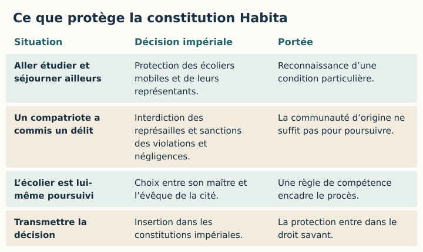

# ENS-PSL · Sélection internationale Lettres — Histoire (oral 3) 2026 · Corrigé guidé

*Corrigé rédigé par IA, non officiel. Signalez toute erreur.*

**Rédaction** · GPT-6.2 Astra Ultra · vitesse non renseignée

[Document officiel](https://www.ens.psl.eu/sites/default/files/sujet_oral_3.pdf) · [Rapport du jury 2026](https://www.ens.psl.eu/sites/default/files/rapport_jury_sil_-_histoire_2026.pdf#page=2)

Le sujet associe une notice moderne à une traduction de la constitution impériale dite *Habita*. La notice situe sa promulgation au 11 novembre 1158, après la diète de Roncaglia. Le rapport du jury prévoit trente minutes de préparation puis trente minutes de passage, partagées entre analyse de la source et échange sur le projet et son cadre de recherche.

## Préparer la lecture

Distinguer par un trait la notice moderne du texte traduit. La première identifie la diète, les juristes bolonais, le classement dans le Code et la transmission incomplète de l’acte. Dans la seconde, relever les verbes prononcés au nom de Frédéric. « Concédons », « décidons », « avons donné » et « avons ordonné » n’ont pas le même objet. Cette série permet de passer du préambule à des décisions exécutoires.

Dessiner deux cas. Dans le premier, un habitant prétend tenir un écolier pour responsable du délit d’un compatriote. Dans le second, un demandeur a une affaire avec l’écolier lui-même. Le privilège donne une réponse différente à chaque cas. Ajouter qui supporte la sanction, puis repérer une troisième personne visée dans le premier cas, le recteur local qui négligerait de rendre justice. La précision du vocabulaire compte davantage ici qu’une longue histoire générale des universités.

Dans la préparation de l’entretien, chercher quelle autre source permettrait de passer de la prescription à la pratique. Une copie savante renseignerait sur la circulation de la norme. Une affaire jugée en montrerait les usages et les difficultés d’application. On peut justifier les deux, à condition de poser une question différente à chacune.

## L’authentique Habita, le savoir sous protection impériale

Pourquoi l’empereur prend-il soin de la sécurité d’un étudiant qui se rend dans une autre ville et que gagne-t-il à décider devant quel juge cet étudiant pourra comparaître ? La constitution connue sous le nom d’*Habita* associe ces deux gestes. Frédéric Ier Barberousse accorde sa protection aux personnes qui se déplacent pour étudier. Il en fait en même temps l’occasion d’affirmer une autorité qui veut définir le droit au-delà des coutumes d’une localité. Le feuillet du concours distingue une notice d’historien, qui situe la promulgation au 11 novembre 1158, et la traduction d’un acte incomplet. La notice rattache le texte à la diète de Roncaglia, en Italie, où le souverain, ses conseillers et des docteurs bolonais travaillent à la définition des droits impériaux. La traduction nous fait ensuite entendre le « nous » de l’empereur. Cette différence de voix permet de poser deux questions solidaires. À quelle difficulté répond le privilège ? Quelle idée de l’Empire apparaît dans la manière de la résoudre ?

Le texte s’adresse à « tous les fidèles » mais désigne une catégorie particulière de bénéficiaires. Ce sont les écoliers qui voyagent « pour étudier », notamment ceux qui enseignent les lois. Les représentants des intéressés apparaissent dans la clause de sécurité. Il est question d’aller et de demeurer dans les lieux d’étude. Le passage d’un territoire à un autre et le séjour éloigné du lieu d’origine forment donc les deux dimensions de la protection. Il faut entendre « écolier » dans la langue des établissements de savoir du Moyen Âge. Le mot français peut aujourd’hui faire songer à un enfant soumis à une obligation scolaire. Ici, c’est le rapport à l’étude et au déplacement qui rend reconnaissable le groupe. La personne qui parcourt les routes pour rejoindre un enseignement et celle qui séjourne dans la ville où elle le reçoit sont confrontées à des autorités dont elles connaissent moins bien les usages et auprès desquelles leurs proches ne peuvent aisément intervenir.

Le préambule donne à cette condition une haute valeur. Le départ est qualifié d’exil pour l’amour de la science. À la possible richesse antérieure répond la pauvreté consentie, à l’utilité universelle des études répond l’exposition individuelle à la fatigue et aux injures corporelles. La lecture du texte comme description des conditions de vie doit s’arrêter un instant sur cette construction. L’empereur ne fournit ni une enquête sur les fortunes des écoliers ni le relevé des blessures qu’ils auraient subies. Il présente les traits capables d’émouvoir et de justifier une faveur. Le geste de « piété » se comprend particulièrement bien après la mise en rapport des deux services. Le savoir aide le monde à obéir à Dieu et règle la vie des sujets. Le prince, « ministre » de Dieu, peut donc en prendre soin au titre même de sa charge publique. La science est louée pour les fins qu’elle sert. Elle donne à l’autorité une raison d’entrer dans la vie des lieux d’étude.

L’insistance sur ceux qui enseignent les lois prend un relief particulier à Roncaglia. Le souverain a recours à des hommes instruits dans le droit pour préciser les *regalia*, les prérogatives qu’il entend faire reconnaître en Italie. La notice met ces docteurs dans son entourage aux côtés des conseillers impériaux. Le texte de l’acte n’en nomme personnellement aucun. Il invoque un conseil où figurent des dignitaires ecclésiastiques aussi bien que des juges et des grands du palais. La protection accordée aux gens d’étude et le concours des juristes au gouvernement apparaissent dès lors comme les deux versants d’une relation. En favorisant les conditions dans lesquelles la science du droit peut s’enseigner, le prince soutient également une compétence dont sa propre action a besoin.

Voyons maintenant le premier cas réglé par la constitution. Quelqu’un a commis un « délit ». Un autre homme, originaire du même pays, séjourne à portée d’une autorité locale. Peut-on faire payer au second le tort imputé au premier ? L’empereur stigmatise la coutume qui permettrait d’exercer ainsi des représailles sur un compatriote. Dans un espace de circulations entre collectivités, l’origine peut être la seule qualité que partagent le responsable et la personne que l’on saisit. L’écolier, reconnaissable comme étranger et privé des protections de son pays d’origine, risque d’en supporter le coût. L’expression « avons-nous appris » indique comment la chancellerie fait entrer l’usage réprouvé dans son argumentation. Que des cas aient été allégués rend le danger plausible. Leur nombre, leur lieu précis et l’efficacité du remède nous échappent dans cet extrait.

La sanction distingue les auteurs d’une violation consciente et les recteurs du lieu qui auraient négligé de rendre justice. « Recteurs » désigne ici les responsables du lieu dont la négligence laisserait la violation impunie. Y voir d’emblée le recteur d’une université constituée ferait entrer dans la disposition une institution qu’elle ne nomme pas. La restitution au quadruple concerne les biens dérobés. Elle va au-delà de la simple remise de la chose prise. L’infamie et la privation perpétuelle de dignité frappent aussi le statut de ceux qui encourent la sanction. Le souverain entend ainsi agir à la fois sur le profit retiré, sur la réputation juridique et sur la fonction. La protection serait peu opérante s’il suffisait à l’autorité locale de détourner les yeux. En visant la négligence de cette autorité, la loi ouvre une brèche plus profonde dans les habitudes locales que ne le ferait la seule proclamation d’un devoir d’hospitalité.

Le dernier cas est différent. Un demandeur peut avoir une affaire qui concerne véritablement l’écolier. L’action reste possible, mais le choix du juge revient à celui que l’on veut poursuivre. Le texte prévoit le maître et professeur ou l’évêque de la cité. La formule précise que l’empereur a donné cette juridiction. Il s’agit donc d’un for privilégié, c’est-à-dire d’une règle particulière de compétence judiciaire. Elle permet à l’écolier de choisir entre deux autorités désignées, sans lui accorder le pouvoir de récuser tout procès. La dernière proposition en fait mesurer la force. Un demandeur qui essaie d’entraîner l’écolier devant un autre juge perd son action, quand bien même sa cause serait juste. Pour préserver la possibilité effective de choisir son for, le prince accepte que le bien-fondé matériel d’une prétention ne sauve pas celui qui contrevient à la règle de procédure. La protection s’est déplacée. Du voyage sans atteinte physique, elle s’étend jusqu’aux conditions mêmes dans lesquelles un voyageur installé peut répondre en justice. Quant à l’autorité du maître, une part de sa compétence s’exerce désormais dans une matière qui excède la transmission d’un enseignement.

L’ordre d’insérer la loi dans les constitutions impériales achève le texte et lui assigne une postérité. La rubrique latine citée signifie qu’on ne doit pas poursuivre quelqu’un à la place d’un autre. Ce classement fait ressortir la règle contre les représailles. Il rattache aussi la décision contemporaine au recueil du droit romain de Justinien, le *Corpus juris civilis*, précisément étudié par les juristes. Les gens d’étude que la loi favorise sont ainsi parmi ceux qui pourront la lire, la commenter et la transmettre. L’« authentique » désigne ici cette insertion d’une constitution dans la tradition du Code. La notice avertit que l’acte nous est arrivé privé d’une partie de ses formes diplomatiques. Sa transmission par le droit savant aide à comprendre comment une norme qui vise certains abus locaux peut durer bien au-delà des circonstances de sa production.

Il serait séduisant de situer dans cet acte la naissance d’une université pleinement autonome. On perdrait alors la spécificité des libertés effectivement accordées. Le texte suit les individus mobiles, protège leurs biens et leur personne et définit leurs juges possibles. Il ne crée ni facultés, ni programme d’enseignement, ni corporation dotée d’un gouvernement complet. Il n’en est pas moins décisif pour l’histoire des privilèges des gens d’étude. Au moment même où les écoles rendent possibles des itinéraires plus longs, une autorité qui se veut supérieure aux usages locaux prend ces itinéraires pour objet de législation. L’empereur garantit qu’un écolier puisse être traité comme une personne, indépendamment des actes d’un compatriote. Il attache à la condition même de cet écolier une protection spéciale. C’est dans l’articulation de ces deux mouvements que le privilège prend toute sa portée.

## Échange avec le jury

**Que veut dire « authentique » dans le titre ?** La notice relie le terme à l’insertion de cette constitution impériale dans le Code. Il désigne un mode de transmission et de classement juridique. La même notice avertit que le texte transmis a perdu une partie de son apparat diplomatique. Les deux observations sont compatibles.

**Pourquoi l’évêque et le maître figurent-ils dans la même clause ?** Ce sont les deux instances entre lesquelles l’écolier poursuivi peut choisir. Le texte rattache leur compétence à la concession impériale. Il associe ainsi autorités savante et ecclésiastique dans le fonctionnement du privilège sans établir une juridiction unique où tout le monde devrait siéger ensemble.

**Comment construire à partir de là un projet de recherche faisable ?** Par exemple, retenir un espace et une période, comparer des témoins du Code pour suivre la réception de la clause ou chercher des litiges pour étudier ses usages. Une enquête sur les manuscrits et une enquête sur les procès impliqueraient des compétences, des instruments de recherche et des dépôts différents. Le projet personnel devrait identifier des témoins consultables, préciser les compétences en latin et en paléographie et expliquer l’appui attendu d’un séminaire ou d’un fonds accessible depuis Paris.

[Présentation et traduction italienne du privilège](https://www.rm.unina.it/didattica/fonti/frova/sez1/par9.htm) · [Étude historique de la constitution Habita](https://www.persee.fr/doc/jds_0021-8103_1993_num_3_1_1568)
