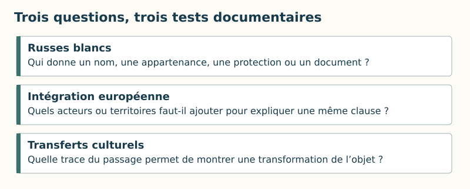

# ENS-PSL · Sélection internationale Lettres — Histoire 2026 · Corrigé guidé

*Corrigé rédigé par IA, non officiel. Signalez toute erreur.*

**Lecture du rapport du jury** · GPT-6.2 Astra Ultra · vitesse non renseignée

**Rédaction** · GPT-6.2 Astra Ultra · vitesse non renseignée

**Autocontrôle** · GPT-6.2 Astra Ultra · vitesse non renseignée

**Révision (tour 1)** · GPT-6.2 Astra Ultra · vitesse non renseignée

## Faire place au projet sans l’inventer

Chaque sujet est personnalisé. Le candidat ne devait en traiter qu’un. Le rapport du jury attend à la fois une connaissance du terrain choisi et la capacité à sortir de son seul cas. Les trois réponses sont donc trois copies possibles et distinctes. Pour adapter celle qui correspond au projet, remplacer un exemple par un document effectivement connu, identifié par sa date, sa langue, son producteur et son lieu de conservation. Justifier ce qu’il permet de conclure et le point sur lequel il reste muet.

Choisir la ligne de son propre sujet. Pour la source retenue, demander qui l’a produite, pour quel destinataire et ce qu’elle permet de comparer. À Paris, un livret traduit atteste un travail sur le texte ; une affirmation sur l’accueil de l’opéra réclame aussi des traces de réception.

## Trois façons de commencer

Pour les « Russes blancs », expliquer dès l’introduction pourquoi le nom du groupe, sa citoyenneté et sa trajectoire ne coïncident pas toujours. Pour l’intégration européenne, employer les trois adjectifs du sujet comme trois questions à poser à une même institution. Pour les transferts culturels, se donner des critères qui permettraient de distinguer circulation, traduction, appropriation et simple similitude.

Le fonds de l’Ofpra, le traité de Rome et les travaux fondateurs sur les transferts fournissent des matériaux de nature différente. [Archives de l’Ofpra](https://www.ofpra.gouv.fr/dossier/nos-fonds-darchives/archives-en-ligne) · [Traité de Rome, quatrième partie](https://eur-lex.europa.eu/legal-content/FR/TXT/?uri=CELEX:11957EN04) · [Espagne et Werner, 1987](https://www.persee.fr/doc/ahess_0395-2649_1987_num_42_4_283428) · [BnF, dossier de spectacle de *Tannhäuser*](https://catalogue.bnf.fr/ark:/12148/cb435327045)

## Trois compositions possibles

L’épreuve attribuait à chaque candidat un seul sujet à traiter en deux heures à partir de son projet. Les trois réponses suivantes emploient des exemples documentés qui peuvent servir de points de comparaison. On ignore les terrains, les langues d’archives et les hypothèses propres aux trois dossiers.

### Candidat 1 · L’histoire des « Russes blancs » est-elle nationale ?

À qui appartiendrait cette histoire nationale ? Le qualificatif « blanc » renvoie aux oppositions politiques et militaires formées pendant la révolution et la guerre civile dans l’ancien Empire russe. L’expression française « Russes blancs » a ensuite servi à désigner dans l’exil des personnes dont les engagements et même les origines étaient divers. Traiter l’expression comme un nom de nationalité naturel ferait disparaître le premier problème historique, la formation d’une catégorie. Il faut la rencontrer dans des sources datées et demander qui l’emploie, pour quels individus et dans quel pays.

Une histoire de Russie est indispensable. Sans le renversement du pouvoir en 1917, les conflits qui suivent, les recompositions de l’ancien espace impérial et le rapport au nouvel État soviétique, les départs perdent leur sens politique. Les représentations de la Russie continuent à organiser les publications, les associations et les institutions d’émigrés. Mais réclamer le rétablissement d’un ordre politique, entretenir une culture de langue russe et être inscrit comme ressortissant russe par une administration étrangère constituent trois rapports distincts à la nation. Une presse d’exil conservée à Paris peut revendiquer une continuité nationale précisément parce que la possibilité d’agir sur le territoire a été perdue.

L’histoire des sociétés d’accueil éclaire une autre partie de l’expérience. Les emplois ouverts, les règles de séjour et les formes d’assistance changent d’un pays à l’autre. Pour la France, on peut confronter les dossiers d’organismes de protection des réfugiés, aujourd’hui conservés notamment par l’Ofpra, aux annuaires associatifs et aux journaux de langue russe. Les premiers montrent comment on prouve une identité ou une situation familiale à une autorité française. Les seconds montrent à quels interlocuteurs, ici et ailleurs, les émigrés estiment s’adresser. Les dossiers administratifs sélectionnent ceux qui ont besoin de faire reconnaître des droits. Les journaux privilégient ceux qui possèdent les moyens de prendre publiquement la parole. Leur désaccord peut éclairer la variété des trajectoires.

Le certificat d’identité dit passeport Nansen, institué en 1922 pour les réfugiés russes, fait apparaître une troisième échelle. Il résulte d’une coopération internationale et peut rendre possible le franchissement de frontières à des personnes privées de protection consulaire, sans leur conférer une nouvelle nationalité. Pour mesurer ses effets, il faudrait suivre un même dossier entre une institution internationale, une administration nationale et une vie familiale, puis comparer le cas d’une personne qui a pu se déplacer et celui de quelqu’un dont la demande a échoué. Écrire une histoire transnationale n’implique donc pas de tenir les États pour négligeables. C’est en travaillant sur plusieurs d’entre eux que l’on voit quelles frontières, quels papiers et quelles protections ont effectivement compté. Cette histoire est nationale par plusieurs de ses causes et de ses catégories. L’assigner à une nation unique dissimulerait les conditions mêmes de l’exil.

### Candidat 2 · L’intégration européenne, histoire connectée, transnationale, globale ?

Le traité de Rome de 1957 présente un paradoxe de méthode. Pour comprendre la création d’un marché commun entre six pays, il faut bien suivre leurs gouvernements et leurs négociations. Mais la quatrième partie du traité institue aussi une association avec des pays et territoires d’outre-mer. Une histoire qui arrêterait d’avance son enquête aux frontières de l’Europe occidentale laisserait hors champ une partie de son propre document fondateur. Les trois qualificatifs du sujet peuvent désigner trois opérations d’enquête complémentaires.

Une démarche **connectée** commence par une relation effectivement attestée entre des scènes que des récits séparés risquent d’isoler. Lors de la préparation de la Communauté économique européenne, comment une revendication liée à l’outre-mer devient-elle un texte accepté par plusieurs négociateurs ? Une note de ministère, le procès-verbal d’une réunion et la rédaction successive d’un article peuvent établir qui introduit une proposition, qui la transforme et dans quelles circonstances elle est retenue. Ce suivi impose de ne pas attribuer une intention collective stable à « la France » ou à « l’Europe » à partir du seul résultat institutionnel.

Une histoire **transnationale** déplace l’attention vers les groupements, les carrières et les pratiques qui traversent des frontières. Dans le cas du charbon et de l’acier, les entreprises, syndicats, experts et administrations produisent des chiffres sur des activités dont les catégories techniques ou statistiques ne sont pas naturellement identiques. Comment les rendre comparables pour qu’une autorité commune puisse agir ? La circulation d’un même expert ou d’un même tableau chiffré peut relier des institutions différentes. Le *Journal officiel* et les textes de la Communauté du charbon et de l’acier en donnent les résultats publics. Les papiers professionnels et syndicaux peuvent montrer qui a participé à la traduction de ces intérêts, qui s’y est opposé ou qui en a été exclu. La démarche transnationale retrouve le pouvoir des États à l’étape de la validation sans leur réserver toute initiative.

Enfin, une histoire **globale** change l’espace des explications et des conséquences. L’ordre économique d’après-guerre, la puissance américaine et la décolonisation affectent ce que les négociateurs européens peuvent faire. L’association outre-mer engage des échanges et des intérêts extra-européens. Un État devenu indépendant peut renégocier sa place dans une relation organisée auparavant dans un cadre colonial. Pour en écrire l’histoire, il faut chercher aussi les prises de position des acteurs africains et leurs marges de choix, au lieu de prolonger au-delà des mers un récit construit exclusivement à Bruxelles ou à Paris. Employer le mot « global » sans changer les archives ni les acteurs laisserait la perspective inchangée.

Ces trois méthodes ne classent donc pas les événements selon leur taille. Une seule clause du traité se prête à une enquête connectée sur sa négociation, transnationale sur ses médiateurs et globale sur l’ordre commercial qu’elle contribue à établir. La question de recherche détermine la combinaison nécessaire. Une ouverture d’échelle réussie doit pouvoir indiquer quelle conclusion obtenue à l’échelle des gouvernements elle corrige ou complète.

### Candidat 3 · Les transferts culturels en histoire, méthodes, enjeux, limites

Une œuvre représentée à l’étranger n’y transporte pas tout son contexte dans ses bagages. Une traduction, une institution d’accueil, des habitudes de lecture ou de spectacle et l’intervention de quelques personnes en changent les possibilités de sens. La notion de transfert culturel, développée notamment par Michel Espagne et Michael Werner à propos des références allemandes en France, vise précisément à étudier cette construction de l’objet reçu. L’enjeu est de remplacer une ressemblance tenue pour une preuve d’influence par l’enquête sur les conditions d’un passage.

Une méthode possible consiste à choisir un objet identifiable avant et après le passage. Prenons *Tannhäuser*, créé à Dresde en 1845 puis repris à Paris en 1861. L’opéra parisien fait intervenir la traduction française du livret, les contraintes de l’Opéra et la place attendue de la danse dans la soirée. Les modifications et les affrontements autour de la représentation font partie de l’histoire de l’œuvre à Paris. Une bibliographie qui constaterait simplement « l’influence de Wagner en France » confondrait la présence matérielle de la partition, le succès auprès d’un public et les usages que des critiques français feront plus tard du nom de Wagner.

Pour distinguer ces résultats, confronter des documents produits à des étapes différentes. Deux éditions du livret fixent des choix de traduction et des modifications textuelles. Une affiche ou une notice de spectacle identifie la date, le théâtre, les intermédiaires. Les comptes rendus de presse disent quelles attentes ont été satisfaites ou heurtées, en privilégiant les voix des personnes capables d’accéder au journal. Une représentation contestée peut laisser plus de traces qu’une diffusion sans incident. Une réception conflictuelle constitue bien un fait de transfert, mais on ne saurait compter toutes les personnes présentes comme des adeptes. Dans un autre domaine, la traduction d’un ouvrage scientifique peut de même emprunter un vocabulaire qui le rapproche d’un débat propre au pays de réception. L’objet transféré agit parce qu’il a changé.

La méthode a enfin des limites. Traiter la France et l’Allemagne comme deux cultures closes recréerait les unités homogènes que l’analyse voulait mettre à l’épreuve. Les itinéraires passent aussi par des villes, des éditeurs, des scènes concurrentes et des langues intermédiaires. Les traces de circulation sont en outre inégalement conservées. Une traduction imprimée et reconnue par une institution laisse plus d’archives qu’une transmission orale ou domestique. Enfin, l’existence de ressemblances n’autorise pas à supposer un médiateur invisible. Des réponses semblables peuvent être inventées indépendamment. L’enquête doit donc pouvoir documenter un transfert, reconnaître une absence de preuve et expliquer aussi pourquoi certains objets se sont peu ou mal transmis. Sa fécondité tient à cette transformation d’une frontière supposée entre cultures en question sur des acteurs, des supports et des rapports de pouvoir historiquement vérifiables.

[Énoncé officiel](https://www.ens.psl.eu/sites/default/files/sujets_-_histoire_-_sil_2026.pdf) · [Rapport du jury](https://www.ens.psl.eu/sites/default/files/rapport_jury_sil_-_histoire_2026.pdf)
