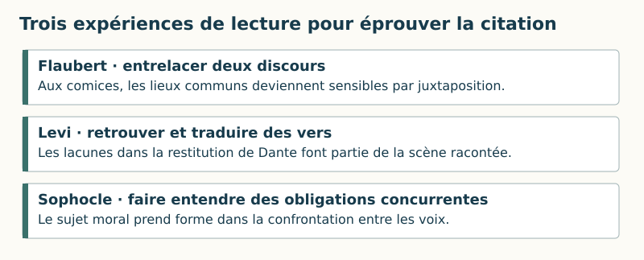

# ENS-PSL · Sélection internationale Lettres — Littérature 2026 · Corrigé guidé

*Corrigé rédigé par IA, non officiel. Signalez toute erreur.*

**Lecture du rapport du jury** · GPT-6.2 Astra Ultra · vitesse non renseignée

**Rédaction** · GPT-6.2 Astra Ultra · vitesse non renseignée

**Autocontrôle** · GPT-6.2 Astra Ultra · vitesse non renseignée

**Révision (tour 1)** · GPT-6.2 Astra Ultra · vitesse non renseignée

**Révision (tour 2)** · GPT-6.2 Astra Ultra · vitesse non renseignée

## Sujet de l’écrit

Vous analyserez et commenterez la citation ci-dessous sous la forme d’un écrit organisé. Vous pouvez éclairer ces propos par des éléments de contexte, par vos connaissances d’histoire de la littérature. Vous ferez appel à votre expérience de lectrice ou de lecteur, sans vous limiter au corpus de votre projet de recherche.

Tzvetan Todorov, *Critique de la critique* (1984). Le feuillet de l’écrit commun propose une seule citation. Elle commence par « [On nous a] répété à qui mieux mieux » et s’achève par « orienté vers la vérité et la morale. ». Durée de l’épreuve : deux heures.

## Partir d’un mot de la citation

**Pourquoi Todorov se reprend-il entre parenthèses ?** Remplacez « en revenir » par « tenir enfin pour certaine ». La nouvelle formule supprimerait l’idée d’un oubli historique. Remettez ensuite à l’épreuve le mot « évidences » devant une phrase de Flaubert où il est difficile de savoir qui parle. Qu’est-ce qui demeure évident dans le rapport à l’existence et qu’est-ce qui reste difficile à interpréter ?

Dans cette épreuve de deux heures, le sujet attend un écrit organisé qui engage une expérience de lecture et dépasse le corpus personnel de recherche. Le mot « orienté » permet d’interroger le lien entre vérité, morale et langage sans transformer Todorov en défenseur d’une morale imposée par chaque texte.

Pour le passage de Levi, nommer ce que fait le témoin au moment de la scène racontée, puis ce qu’il en restitue dans le témoignage. On peut discuter la thèse de Todorov en partant de ce double travail de la forme.

## Développer une preuve de lecture

Le premier exemple permet un exercice pratique. Si l’on écrit que Flaubert « critique la société », presque tous les romans pourraient convenir. Décrire la succession des discours amoureux et officiels aux comices oblige à préciser ce que la forme fait entendre de la société. L’argument devient alors propre à ce roman et répond à la citation.

Changer ensuite de genre pour mettre la thèse en difficulté. Le témoignage introduit une responsabilité différente envers les faits. La tragédie fait du conflit entre des paroles l’occasion d’un jugement qui peut demeurer inconfortable. Un exemple s’achève par l’indication de ce qu’il a fait changer dans la compréhension de « vérité » ou de « morale ».

## Commentaire rédigé

En reprochant aux critiques d’avoir défini la littérature comme un langage « qui trouvait sa fin en lui-même », Todorov oppose à une doctrine devenue commune une évidence qui, dit-il, aurait été oubliée. Une œuvre « a trait à l’existence humaine ». Pourtant son existence comme œuvre tient à la manière singulière dont elle agence des signes. Quelle vérité et quelle morale peut viser un discours dont rien ne garantit que les faits racontés aient eu lieu ? Le terme décisif de la citation est « orienté ». Une orientation peut guider une expérience sans lui assigner d’avance la proposition à laquelle elle devrait aboutir.

Une parenthèse donne pourtant à ce retour une allure singulière. Todorov écrit qu’il faut « en venir » aux évidences, puis « en revenir ». Le premier verbe indique un terme qu’il faudrait atteindre. Le second suppose un lieu déjà connu, que la critique aurait quitté. Il ne s’agit donc pas de découvrir hors de l’œuvre un supplément moral qu’on lui apporterait. Todorov invite à rendre à la lecture une question qu’elle savait autrefois poser. Mais qui décidera de ce qui est évident ? Le mouvement impatient de la phrase explique sa force polémique et justifie aussi qu’on l’éprouve sur des œuvres où la vérité est difficile à reconnaître.

L’argument de l’autonomie possède d’abord une force qu’il serait imprudent de sacrifier. Dans *Madame Bovary*, lorsque le récit semble faire sienne une rêverie amoureuse d’Emma, une liste d’objets désirables, un rythme exalté ou une formule empruntée aux romans peuvent faire hésiter le lecteur sur la voix qui parle. Est-ce le narrateur qui accrédite ce bonheur annoncé, ou Emma qui emprunte des mots tout faits pour l’imaginer ? Adresser d’abord son attention à l’organisation des voix permet de résister à une lecture qui tirerait simplement du destin d’Emma une maxime sur les dangers de la lecture ou de l’adultère. L’analyse des formes protège ici l’existence humaine représentée contre une interprétation morale trop rapide.

Mais cette attention change le sens de ce que l’on appelle la vérité du roman. Emma n’a pas à avoir existé pour que son histoire éclaire une manière réelle d’habiter le monde. Les mots disponibles dans une société viennent jusqu’à informer le désir que chacun croit éprouver pour son propre compte. Dans la scène des comices, le discours amoureux de Rodolphe et les formules solennelles de la distribution des prix se relaient à la lecture. Le rapprochement fait percevoir que deux paroles très différentes par leur objet mobilisent des conventions que leurs destinataires peuvent prendre pour des marques de sincérité. Résumer la scène par « les mots mentent » abolirait la découverte qu’elle offre. C’est en suivant simultanément les deux discours que l’on apprend à entendre comment ils agissent.

L’évidence défendue par Todorov prend une autre gravité dans *Si c’est un homme*. Primo Levi écrit en témoin d’une déportation dont la réalité historique oblige le lecteur. On ne pourrait pas y traiter l’agencement des phrases comme s’il pouvait se refermer sur sa seule perfection. Le chapitre consacré au chant d’Ulysse ramène pourtant le problème de la forme au cœur même du témoignage. Sur un trajet au camp, Levi tâche de restituer à Jean, dit Pikolo, des vers de Dante. Les lacunes de la mémoire, la nécessité de traduire et le temps compté du trajet appartiennent au sens de l’épisode. Le poème dont il cherche les mots permet aux deux hommes de s’adresser l’un à l’autre d’une manière que l’ordre du camp ne prévoyait pas. La vérité d’un témoignage comporte ainsi, avec la fidélité aux faits, une attention à ce qu’un moment a eu de fragile et d’incertain pour celui qui le vivait.

L’idée d’une orientation « vers […] la morale » demande enfin une distinction. Une fable peut formuler sa moralité. D’autres œuvres confient au lecteur la tâche de décider comment juger, et lui font ressentir le coût de sa décision. Dans *Antigone*, il est possible de prendre parti, mais les suites du décret de Créon obligent à écouter la langue de la parenté, du gouvernement et des devoirs envers les morts. L’action ne rend pas ces responsabilités interchangeables. Elle montre à quel point une conviction peut devenir destructrice lorsque celui qui s’y tient n’entend plus la parole qui lui résiste. Lire une telle pièce conduit moins à posséder une règle qu’à éprouver une difficulté de jugement. C’est une activité morale au sens où elle fait place à des existences autres que celle du lecteur, et non parce qu’elle lui épargnerait la peine de juger.

Le tour polémique de Todorov rend à la critique une responsabilité. Si elle oublie pour qui et sur quoi parlent les œuvres, leur analyse devient un exercice clos. Mais on manquerait son intuition en remplaçant l’examen du langage par une liste de leçons humaines. Le partage des voix chez Flaubert, la mémoire trouée d’un poème chez Levi, le conflit des paroles chez Sophocle donnent à la recherche de vérités et à l’exercice du jugement des formes différentes. La littérature peut se tourner vers l’existence précisément en inventant les médiations par lesquelles une existence devient sensible et discutable.

[Énoncé officiel](https://www.ens.psl.eu/sites/default/files/sil_2026_sujet_ecrit_spe_litteratures_.pdf) · [Rapport du jury](https://www.ens.psl.eu/sites/default/files/sil_rapport_jury_litterature_2026.pdf)
