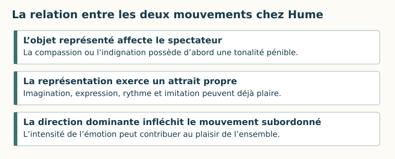

# ENS-PSL · Sélection internationale Lettres — Philosophie 2026 · Corrigé brut

*Corrigé rédigé par IA, non officiel. Signalez toute erreur.*

**Lecture du rapport du jury** · GPT-6.2 Astra Ultra · vitesse non renseignée

**Rédaction** · GPT-6.2 Astra Ultra · vitesse non renseignée

**Autocontrôle** · GPT-6.2 Astra Ultra · vitesse non renseignée

**Révision (tour 1)** · GPT-6.2 Astra Ultra · vitesse non renseignée

**Révision (tour 2)** · GPT-6.2 Astra Ultra · vitesse non renseignée

L’écrit de philosophie était commun aux quatre admissibles. Deux exercices se succèdent sur le même extrait de Hume. Les sujets liés aux projets de recherche relevaient des oraux.

## I. Expliquer le texte de Hume

Comment puis-je rechercher au théâtre une émotion que je voudrais éviter dans ma vie ? L’indignation, la compassion ou le tourment paraissent pénibles par leur nature même. Pourtant un spectateur peut tenir le récit qui les a fait naître pour une réussite et souhaiter le revoir. En 1757, au temps des Lumières écossaises, Hume publie « De la tragédie » dans ses *Four Dissertations*, aux côtés d’une étude des passions et d’un essai sur la règle du goût. Il cherche ici dans l’expérience du spectateur une régularité qui éclaire un effet apparemment exceptionnel. Au lieu de demander comment une passion peut être à la fois pénible et plaisante sous le même rapport, il considère la relation de plusieurs mouvements de l’esprit au sein d’une même expérience.

La première phrase nomme les poètes, les orateurs et les musiciens. Leur réunion élargit d’emblée le problème au-delà de la seule pièce tragique. L’attention que nous portons à une représentation dispose d’une source de plaisir propre. Imaginer vivement, entendre une expression énergique, suivre un rythme, goûter l’imitation fournissent des satisfactions différentes mais que Hume énumère comme autant d’évidences d’expérience. Les rythmes peuvent plaire avant que soit identifiée une histoire douloureuse. Le choix du mot « naturellement » est significatif. Il vaut ici pour le plaisir que procure l’exercice de nos facultés et vaudra, plus loin, pour la douleur de la passion. Il n’est donc pas nécessaire d’opposer une douleur qui serait réelle à un plaisir qui ne serait qu’une convention.

La difficulté revient avec les mots « quand l’objet représenté soulève aussi quelque affection ». Si deux sentiments demeuraient simplement côte à côte, on comprendrait qu’une belle interprétation consolât d’un sujet pénible. On ne comprendrait pas que la puissance même de la peine puisse accroître le plaisir. La proposition décisive est celle d’une « conversion ». Un mouvement est dit subordonné et un autre prédominant. Dans le cas décrit, le premier vient de ce qui est représenté et le second de la manière dont la représentation mobilise l’esprit. Parce que le mouvement dominant dispose déjà d’une direction plaisante, l’émotion que l’objet fait naître peut augmenter l’intensité de l’expérience dans cette direction. Il ne s’agit ni d’une addition comptable de doses de plaisir et de peine ni de l’extinction pure et simple de la compassion. Si l’on retirait toute charge affective, on retirerait aussi ce que l’art peut convertir.

La dernière phrase met en regard deux manières de rencontrer un même objet. À la simple vue d’un malheur réel, la souffrance d’autrui peut m’affliger. Quand les arts en font le sujet d’une représentation, la composition agit sur la manière dont je l’éprouve. Le mot « apparence » désigne ici l’aspect sous lequel l’objet réel se présente spontanément à moi. Une histoire vraie peut donc aussi se prêter à la conversion. Dans l’essai dont provient l’extrait, Hume évoque d’ailleurs Cicéron, qui émeut ses auditeurs par le récit de faits qu’ils tiennent pour réels. Que la même compassion puisse être « adoucie » et conduire au « plus grand plaisir » s’explique alors. Ce qui s’adoucit est le caractère pénible de la passion. La force avec laquelle le récit saisit l’auditeur peut, elle, s’accroître.

Les larmes peuvent ainsi rester celles de la compassion, tandis que la force de cette émotion nourrit le plaisir de suivre la représentation. Si le spectateur cessait entièrement de se soucier de l’événement, le plaisir à entendre de belles paroles ne suffirait plus à expliquer le plaisir propre à cette représentation tragique.

## II. Jusqu’où la conversion peut-elle aller ?

La proposition de Hume éclaire une expérience familière au théâtre. Dans *Œdipe roi* de Sophocle, le messager de Corinthe croit rassurer Œdipe en lui apprenant que Polybe ne l’avait pas engendré. Son récit conduit pourtant jusqu’au berger dont le témoignage achèvera de révéler à Œdipe qui il est. Le spectateur peut tout ensemble redouter la réponse et désirer que le récit atteigne ce moment. L’intensité de sa crainte nourrit l’attention portée à l’agencement des témoignages et aux changements de sens des mêmes mots. Si le destin du personnage nous devenait indifférent, la précision de la construction resterait perceptible, mais l’expérience perdrait de sa force. On reconnaît là une conversion plus convaincante que l’idée d’un simple dédommagement esthétique.

Ce succès n’est toutefois pas assuré par le seul fait qu’une représentation soit artistique. Imaginons le récit public d’une inondation. Sa construction me fait comprendre, rue après rue, comment le quartier s’est retrouvé isolé. Si un proche y vit encore et reste injoignable, la précision de la même description nourrit mon inquiétude. Chaque détail me donne une raison de plus de chercher de ses nouvelles. Dans ce dernier cas, le plaisir du travail de représentation cesse d’être le mouvement prédominant. Le mécanisme décrit par Hume fournit lui-même une façon de comprendre cet échec. La direction de l’émotion dépend de la relation entre les mouvements et de leur force relative. Il n’existe pas une propriété magique de l’art qui assurerait que toute peine se change en plaisir.

Reste une autre difficulté. Un spectateur peut admirer une œuvre précisément parce que la tristesse qu’il éprouve y demeure inconsolée. Son jugement « c’est une grande œuvre » n’est pas forcément la description d’un état global de plaisir. Il peut exprimer sa reconnaissance d’une justesse, d’une vérité dans la manière de faire entendre autrui. La réflexion personnelle trouve ici une limite du problème initial. Hume explique une possibilité psychologique réelle, celle de goûter plus intensément une œuvre parce qu’elle nous affecte. Il laisse ouverte la question de savoir si toute valeur esthétique doit se résoudre dans la qualité plaisante de l’expérience. Distinguer le plaisir qui peut naître d’une conversion et le jugement qui peut demeurer favorable dans la peine conserve à sa thèse sa force explicative sans en faire une définition exhaustive de l’art.

[Énoncé officiel](https://www.ens.psl.eu/sites/default/files/sujet_-_explication_de_texte_si_philosophie_sil_2026.pdf) · [Rapport du jury](https://www.ens.psl.eu/sites/default/files/rapport_du_jury_de_philosophie_sil2026.pdf) · [Hume, *Four Dissertations* (1757), « Of Tragedy »](https://davidhume.org/texts/fd/full)
