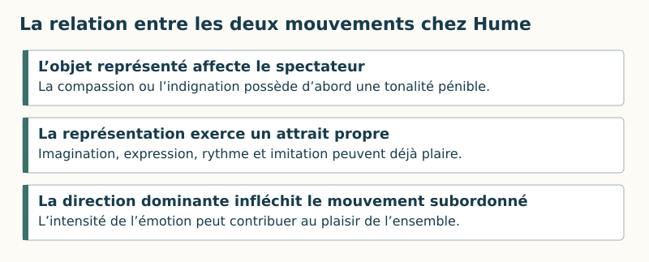

# ENS-PSL · Sélection internationale Lettres — Philosophie 2026 · Corrigé guidé

*Corrigé rédigé par IA, non officiel. Signalez toute erreur.*

**Lecture du rapport du jury** · GPT-6.2 Astra Ultra · vitesse non renseignée

**Rédaction** · GPT-6.2 Astra Ultra · vitesse non renseignée

**Autocontrôle** · GPT-6.2 Astra Ultra · vitesse non renseignée

**Révision (tour 1)** · GPT-6.2 Astra Ultra · vitesse non renseignée

**Révision (tour 2)** · GPT-6.2 Astra Ultra · vitesse non renseignée

L’écrit commun aux quatre admissibles comporte deux moments obligatoires sur un même texte. Le jury conseille de s’exercer à l’analyse interne en temps limité. Les sujets liés aux projets des candidats concernaient les oraux.

## I. Construire l’explication du texte de Hume

Hume écrit dans l’Écosse des Lumières. Son essai « De la tragédie » paraît en 1757 dans les *Four Dissertations*, qui réunissent notamment une étude des passions et un essai sur la règle du goût. Ce voisinage aide à formuler une question précise. Que devient une émotion ordinairement pénible lorsqu’elle entre dans l’expérience d’une œuvre que nous prenons plaisir à suivre ?

**Première phrase.** Les poètes, orateurs et musiciens nous plaisent en éveillant la peine. Le petit mot « en » fait la difficulté. Si le plaisir survenait seulement après les larmes, on pourrait supposer que le retour au calme nous soulage. Or le spectateur peut souhaiter que se prolonge la scène même qui le fait pleurer. Hume cherche comment cette émotion contribue au plaisir pendant la représentation.

**Deuxième phrase.** Imagination, expression, rythmes et imitation peuvent déjà plaire par leur exercice propre. Pensez à une inflexion de voix dont on goûte la justesse avant même de connaître le sort du personnage. Hume a ainsi établi qu’un mouvement agréable est possible, même avant de faire intervenir la compassion.

**Troisième phrase.** Le mot « aussi » ajoute l’effet du sujet représenté. Deux mouvements concernent désormais le même spectateur. Le malheur du personnage l’émeut et la manière dont on le représente le captive. Si la forme lui plaît davantage parce que le sujet le touche, l’émotion pénible a donné de sa force au plaisir qui prédomine. C’est le sens de « conversion ». Retirons toute raison de se soucier du personnage. Les vers gardent leur rythme, mais une part du plaisir d’entendre cette scène disparaît.

**Dernière phrase.** La simple vue d’un objet réel et sa représentation par l’art peuvent éveiller une même passion dans des conditions différentes. Un orateur peut parler de faits avérés et néanmoins émouvoir par le choix et l’ordre de ses mots. « Adoucie » qualifie alors la peine éprouvée. La formule « le plus grand plaisir » qualifie l’expérience à laquelle sa force contribue. La différence s’explique par le travail de l’expression, même si l’auditeur sait les faits réels.

## II. Éprouver personnellement la thèse

> [!METHODE]
> Choisissez un détail dont l’interprétation change au cours d’une scène. Décrivez ce que vous craignez pour le personnage et ce que vous souhaitez encore entendre. Faites ensuite varier la situation du spectateur.

Dans *Œdipe roi* de Sophocle, le messager de Corinthe veut défaire une crainte en révélant qu’Œdipe est un enfant recueilli. Cette nouvelle engage la recherche du témoin qui pourra dire de quelle famille il vient. Comme spectateur, je crains ce que son témoignage révélera, mais je reste suspendu à sa réponse. Ôter cette crainte laisserait subsister un enchaînement ingénieux dont la nécessité me toucherait moins. Je comprends ici pourquoi Hume fait entrer la peine elle-même dans l’explication de mon plaisir.

Changeons une seule condition. Une chronique de crue reconstitue la nuit où un quartier s’est trouvé coupé du reste de la ville. J’en goûte la progression jusqu’au moment où je reconnais la rue d’une amie dont j’attends des nouvelles. Chaque précision aiguise désormais mon inquiétude. L’art du récit est toujours perceptible, mais c’est une autre passion qui reçoit sa force. Un tel cas confirme le rôle que Hume fait jouer à l’émotion prédominante.

Reste un cas plus difficile. Je peux juger ce récit juste parce qu’il laisse entendre les hésitations d’un témoin et refuser de le réécouter, tant ce souvenir m’afflige. Le premier jugement porte sur ce que le récit rend intelligible, le second sur mon désir de renouveler l’expérience. À mes yeux, Hume explique comment des larmes peuvent intensifier le plaisir pris à une œuvre. Un jugement admiratif peut aussi avoir pour raison la fidélité avec laquelle cette œuvre donne à comprendre une peine qui demeure.

[Énoncé officiel](https://www.ens.psl.eu/sites/default/files/sujet_-_explication_de_texte_si_philosophie_sil_2026.pdf) · [Rapport du jury](https://www.ens.psl.eu/sites/default/files/rapport_du_jury_de_philosophie_sil2026.pdf) · [Hume, *Four Dissertations* (1757), « Of Tragedy »](https://davidhume.org/texts/fd/full)
