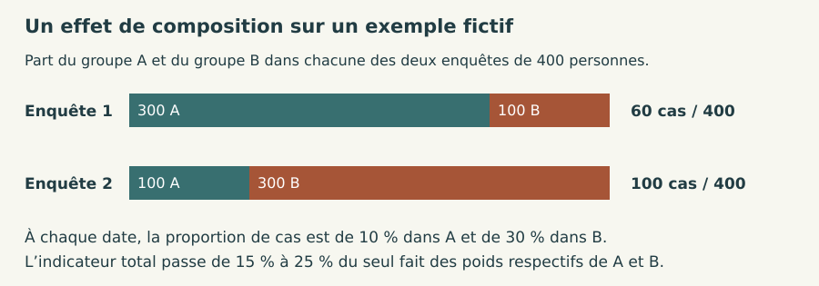

# ENS-PSL · Sélection internationale Lettres · Sciences sociales 2026 · Corrigé brut

*Corrigé rédigé par IA, non officiel. Signalez toute erreur.*

**Rédaction** · GPT-6.2 Astra Ultra · vitesse non renseignée

**Autocontrôle** · GPT-6.2 Astra Ultra · vitesse non renseignée

**Révision (tour 1)** · GPT-6.2 Astra Ultra · vitesse non renseignée

Le libellé de l’écrit est attesté par le rapport du jury, p. 4. Le jury présente l’épreuve comme une dissertation courte de deux heures et indique en p. 5 plusieurs angles de discussion. La proposition ci-dessous développe un raisonnement possible.

## Quelle place donner à l’historicisation de son objet dans une recherche en sciences sociales ?

Une personne privée de travail avant 1896 pouvait indiscutablement souffrir du manque de revenu. Aurait-elle néanmoins été identifiée comme chômeuse par un recenseur, par son entourage ou par elle-même ? Cette question oblige à distinguer une expérience, le nom qu’on lui donne et les institutions qui permettent de la compter. Historiciser son objet, c’est reconstituer les conditions dans lesquelles une relation sociale, une pratique ou une catégorie est devenue possible et a changé de sens. Une notice sur les origines peut rester sans effet sur le raisonnement du chercheur. À l’inverse, quelques années d’histoire suffisent parfois à modifier entièrement ce qu’une observation permet de conclure. Je donnerais donc à l’historicisation une place décisive dès la construction de l’objet, puis une profondeur variable, réglée par la preuve que l’on cherche à produire.

### Établir ce qui rend une catégorie possible

L’objet d’une recherche ne se confond pas avec le mot par lequel on a commencé à le désigner. Dans *L’Invention du chômage* (1986), Robert Salais, Nicolas Baverez et Bénédicte Reynaud suivent la transformation de cette catégorie en France. Le recensement de 1896 marque un seuil dans la distinction des salariés temporairement privés d’emploi. La question de savoir pour quel employeur on travaille habituellement contribue à différencier une interruption d’emploi salarié d’autres situations regroupées parmi les sans-profession. Les personnes engagées dans des activités discontinues ou exercées au domicile se laissent moins aisément classer. Une définition liée à l’organisation du travail en établissement ne découpe donc pas l’ensemble des manques de travail de façon neutre.

Qu’en conclure ? Il serait absurde de soutenir que personne ne manquait de travail avant que les statisticiens disposent d’une rubrique. Il serait tout aussi trompeur de transposer aux années 1880 la définition contemporaine du chômage en supposant qu’on n’aurait qu’à retrouver les bons chiffres. La genèse de la catégorie change la question. On peut étudier comment une interruption de travail devient un statut reconnaissable, quelles situations restent en marge et comment la reconnaissance ouvre des droits ou des moyens de mobilisation. Pour le montrer, les instructions de recensement éclairent ce que l’administration voulait saisir. Les archives d’un fonds de secours ou des correspondances peuvent montrer ce que la demande signifiait pour d’autres acteurs. Une catégorie existe sous plusieurs descriptions, qui peuvent être contemporaines et contradictoires.

### Retrouver les temporalités d’une scène observée au présent

Le temps passé sur un terrain ne se confond pas avec les temps sociaux qui le traversent. Johannes Fabian a nommé le paradoxe d’une anthropologie qui produit son savoir dans une relation contemporaine avec ses interlocuteurs, puis les décrit comme s’ils habitaient un autre âge. Une formule telle que « dans cette communauté, on fait ainsi » transforme facilement une pratique disputée ou récente en coutume intemporelle. Pour éviter cet effet, demander quand une manière de faire a commencé ne suffit pas. Qui peut se souvenir de quelle période ? Qui attribue à une tradition le maintien d’une règle ? Une réponse recueillie aujourd’hui témoigne à la fois du passé raconté et des usages actuels de ce récit.

Dans *Retour sur la condition ouvrière* (1999), Stéphane Beaud et Michel Pialoux mettent en relation l’usine Peugeot de Sochaux-Montbéliard, les familles et l’école. Une tension entre des ouvriers de générations différentes pourrait être interprétée comme un désaccord entre jeunes et vieux, appelé à se résoudre avec l’âge. Or les conditions d’entrée dans l’emploi industriel, les parcours scolaires et les perspectives de promotion se sont transformés. Les plus jeunes n’occupent donc pas simplement, à trente ans de distance, la position que leurs aînés occupaient au même âge. Quand changent les modalités du recrutement, la transmission familiale d’un métier ou d’une fierté de groupe peut devenir problématique. L’histoire agit dans l’atelier à travers des titres scolaires, des attentes et des expériences collectives déjà constituées.

Cette démarche exige une critique symétrique des matériaux. Un ancien ouvrier peut reconstruire l’unité de son équipe à partir de conflits actuels. Un registre du personnel rend visibles les embauches, avec les catégories de l’entreprise, mais ne conserve pas les discussions d’atelier ni tous les motifs d’un départ. Une observation contemporaine montre comment on travaille sous le regard des collègues et du chercheur. La mise en relation de ces sources peut invalider une hypothèse. Si des salariés entrés à la même époque, avec les mêmes titres, se différencient fortement selon leur atelier, l’organisation située du travail mérite une place que le seul récit d’une succession de générations lui refusait.

### Donner au détour historique la profondeur nécessaire à l’explication

Une série longue expose à un risque voisin. On croit gagner en solidité en ajoutant des années alors qu’on rapproche parfois des nombres établis différemment. Lors de la refonte de l’enquête Emploi de 2021, l’Insee a dû évaluer les effets du changement de questionnaire et de méthode sur les indicateurs d’activité. Un dispositif de comparaison avec l’ancienne enquête a servi à mesurer les ruptures ; des séries rétropolées permettent de raisonner à conventions rendues plus comparables. Pour le chercheur, cette histoire de la mesure se traduit en actes précis. Il faut documenter le champ et le dénominateur, rechercher les modifications des questions et, lorsque la correction reste incertaine, présenter séparément les périodes. On peut ainsi distinguer une modification des pratiques d’une modification de leur visibilité.

Même avec un instrument de mesure identique, la composition de la population peut changer. Supposons deux groupes dont les fréquences restent à 10 % et à 30 %. Avec 300 personnes dans le premier et 100 dans le second, on observe 60 cas sur 400. Si leurs effectifs s’inversent, le total monte à 100 cas sur 400. Pour interpréter historiquement cette hausse, il faut alors expliquer pourquoi le groupe le plus exposé a pris plus de poids.

Faut-il alors remonter toujours plus loin ? Si l’on étudie ce qui se joue dans un entretien d’embauche, le détail des prises de parole, l’ordre des questions et les contraintes de l’échange peuvent expliquer un résultat que la généalogie du recrutement laisse indéterminé. En revanche, si un diplôme est constamment invoqué comme seuil d’accès, la création du titre, les transformations de ceux qui le possèdent et les usages qu’en fait l’employeur deviennent décisifs. La borne pertinente est celle qui permet de comparer des situations, de repérer une bifurcation ou de départager deux mécanismes. Elle dépend du problème posé et de la disponibilité de traces. Le chercheur doit également dater sa propre présence. Les souvenirs qu’on lui confie et les archives qui lui sont ouvertes changent lorsqu’une usine ferme ou lorsqu’une profession se mobilise.

Historiciser suppose finalement de pouvoir dire ce que la connaissance du passé fait à une proposition sur le présent. Dans le cas du chômage, elle redéfinit l’unité observée. À Sochaux, elle transforme un contraste d’âges en question sur des trajectoires soumises à des conditions différentes. Dans l’enquête statistique, elle fixe les limites d’une comparaison. C’est à ces conséquences vérifiables, et à la possibilité de préciser ce que les sources laissent encore inconnu, que se mesure la place de l’histoire dans une recherche de sciences sociales.

[Rapport du jury de sciences sociales, pp. 3-5](https://www.ens.psl.eu/sites/default/files/rapport_de_jury_sil2026_departement_de_sciences_sociales.pdf)
