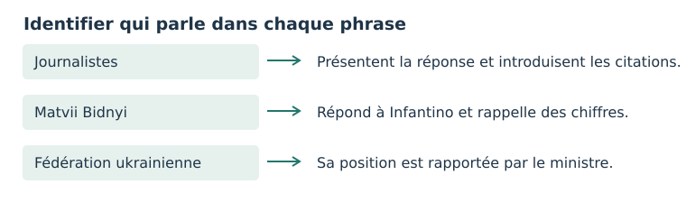

# ENS Rennes 2SEP — Anglais écrit 2026 · Corrigé brut

*Corrigé rédigé par IA, non officiel.*

**Rédaction** · modèle exact non renseigné (famille GPT-6) · effort non renseigné · vitesse non renseignée

**Révision** · GPT-6.2 Astra Ultra · vitesse non renseignée

**Révision (tour 2)** · GPT-6.2 Astra Ultra · vitesse non renseignée

L’épreuve d’admission dure deux heures trente, sans dictionnaire. La version compte pour le coefficient 0,5 et la production écrite pour 1,5. Les questions figurent sur la troisième page du PDF. Deux modèles de production sont proposés ici. Le candidat choisit **un seul** sujet et rédige de 180 à 220 mots en anglais.

## A · Version française

Le ministre ukrainien des Sports, Matvii Bidnyi, a toutefois adressé une réplique cinglante à Infantino en rappelant les conséquences bien réelles de l’agression russe pour les footballeurs et les autres sportifs.

« Les propos de Gianni Infantino me paraissent irresponsables, a-t-il déclaré. Ils coupent le football d’une réalité où l’on tue des enfants. Je vous rappelle que, depuis le début de l’agression russe à grande échelle, les Russes ont tué plus de 650 sportifs et entraîneurs ukrainiens. Cent d’entre eux étaient footballeurs. »

Bidnyi a ensuite cité les cas de jeunes joueurs tués par des frappes de missiles ou des tirs d’artillerie, avant d’exhorter les instances du football à ne pas réintégrer la Russie. « La guerre est un crime, elle ne relève pas de la politique, a-t-il déclaré. Je partage la position de l’Association ukrainienne de football, qui met elle aussi en garde contre le retour de la Russie dans les compétitions internationales.

« Tant que les Russes continueront de tuer des Ukrainiens et de politiser le sport, leur drapeau et leurs symboles nationaux n’auront pas leur place parmi ceux qui sont attachés à des valeurs telles que la justice, l’intégrité et le fair-play. »

## B · Question 1 — Le retour de la Russie dans les compétitions

**Question 1 · 216 words**

A place on a starting line is one thing. The right to raise a national flag over a stadium is another. I would keep Russia’s national teams out of international competition for now, while allowing individual athletes to qualify under neutral status.

Consider what an immediate return would ask of a Ukrainian footballer. He might walk past an empty locker each morning and then be expected to line up against a team representing the state responsible for his teammate’s death. A federation cannot make that encounter fair simply by asking both captains to shake hands. A national team enters as a representative body, and its admission has consequences beyond the result.

An individual runner, however, cannot change government policy. Exclusion by passport alone could also punish those who have opposed the war. Paris 2024 offers a practical precedent. Eligible individuals could compete without national symbols. Teams representing Russia or Belarus could not enter under that neutral designation. Federations should publish those requirements, give reasons for decisions and allow appeals.

I would therefore separate the two decisions. Individual eligibility can be assessed now. Restoring national teams should require a public review involving Ukrainian athletes, with clear conditions for return. Otherwise, officials risk calling an event neutral when only one side has been asked to bear its cost.

## B · Question 2 — Régime politique et accès aux compétitions

**Question 2 · 202 words**

Imagine a swimmer who has spent years challenging the authorities that run her national federation. A blanket ban on athletes from countries without democratic governments would silence her at the very moment an international audience might hear her. Yet allowing a government to stage a tournament while excluding some of its own citizens can also help it disguise discrimination.

I would start with what sporting authorities can actually establish. Can athletes qualify under published rules? Are women and minorities eligible? Can a competitor appeal an exclusion without risking retaliation? These questions produce evidence a federation can investigate. In contrast, deciding which countries count as democracies would invite powerful members to impose a test they might never accept for themselves.

Sanctions should follow the finding. If officials manipulate selection or threaten competitors, their federation can lose hosting rights or the right to enter a national team. Athletes who qualify independently should have access to a neutral route and an appeal. The same standards should apply to an influential host and a small delegation.

International sport cannot guarantee democracy. It can guarantee conditions for participation, provided it states those conditions in advance and enforces them even when doing so costs organisers money or prestige.

