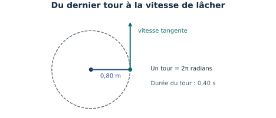
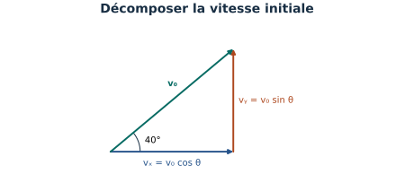
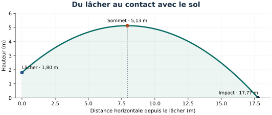
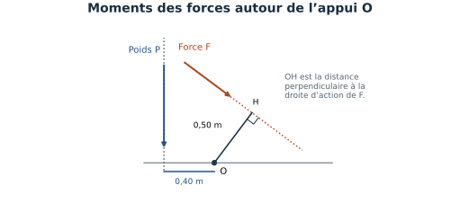
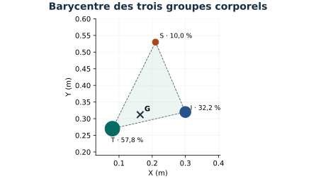

# ENS Rennes 2SEP — Biomécanique 2026 · Corrigé brut

*Corrigé rédigé par IA, non officiel. Signalez toute erreur.*

**Rédaction** · modèle exact non renseigné (famille GPT-6) · effort non renseigné · vitesse non renseignée

**Révision** · modèle exact non renseigné (famille GPT-6) · effort non renseigné · vitesse non renseignée

L’épreuve dure deux heures sans calculatrice. On prend $g=9{,}81\ \mathrm{m\,s^{-2}}$ et on arrondit les résultats numériques à la fin.

## Exercice 1 — Lancer du disque

### Question 1 — Du tour à la vitesse linéaire

Un tour correspond à $2\pi$ radians. Avec $r=0{,}80\ \mathrm m$ et une période de $0{,}40\ \mathrm s$,
$$
\omega=\frac{2\pi}{0{,}40}=5\pi\simeq15{,}7\ \mathrm{rad\,s^{-1}},\qquad
v_0=r\omega=4\pi\simeq12{,}6\ \mathrm{m\,s^{-1}}.
$$
La vitesse au lâcher est tangente à la trajectoire instantanée.

### Question 2 — Composantes de la vitesse

On oriente $Ox$ dans le sens du lancer et $Oy$ vers le haut. Pour $\theta=40^\circ$,
$$v_{x0}=4\pi\cos40^\circ\simeq9{,}63\ \mathrm{m\,s^{-1}},\qquad
v_{y0}=4\pi\sin40^\circ\simeq8{,}08\ \mathrm{m\,s^{-1}}.$$
Les deux composantes sont positives. La composante horizontale est la plus grande puisque $40^\circ<45^\circ$.

### Question 3 — Hauteur maximale et durée de vol

La seule force pendant le vol est le poids du disque. Avec $h_0=1{,}80\ \mathrm m$, on a $v_y(t)=v_{y0}-gt$ et $y(t)=h_0+v_{y0}t-gt^2/2$. Le sommet est atteint à $t_s=v_{y0}/g\simeq0{,}823\ \mathrm s$. L’altitude maximale est
$$h_{\max}=h_0+\frac{v_{y0}^2}{2g}\simeq1{,}80+3{,}33=\boxed{5{,}13\ \mathrm m}.$$
Depuis ce sommet, la vitesse verticale initiale de descente est nulle, d’où $t_d=\sqrt{2h_{\max}/g}\simeq1{,}02\ \mathrm s$. La **durée du vol est $T=t_s+t_d\simeq1{,}85\ \mathrm s$**. On retrouve cette valeur par la racine positive de $y(T)=0$, soit $(v_{y0}+\sqrt{v_{y0}^2+2gh_0})/g$. Le disque descend plus longtemps qu’il ne monte car le sol se situe sous son point de lâcher.

### Question 4 — Distance horizontale

L’accélération horizontale est nulle. La distance entre la verticale du lâcher et le premier contact avec le sol vaut
$$R=v_{x0}T\simeq9{,}626\times1{,}846\simeq\boxed{17{,}8\ \mathrm m}.$$
C’est la performance horizontale dans le modèle du sujet. La masse de $2\ \mathrm{kg}$ s’élimine dans la loi de chute libre.

## Exercice 2 — Équilibre autour de l’appui

### Question 1 — Moment de la réaction du sol

Le point $O$ du pied droit est à la fois le pivot choisi et le point d’application de la réaction $\mathbf R$. Son bras de levier est nul. Par conséquent **$\mathbf M_O(\mathbf R)=\mathbf 0$**, soit $0\ \mathrm{N\,m}$ pour sa composante normale au plan. La réaction elle-même peut être non nulle.

### Question 2 — Équilibre des moments

Pour la lutteuse bleue, $P=60g\simeq588{,}6\ \mathrm N$. Le bras de levier de son poids par rapport à $O$ est $0{,}40\ \mathrm m$. La distance de $O$ à la droite d’action de la force $F$ est déjà donnée perpendiculairement, $0{,}50\ \mathrm m$. En comptant les moments positifs dans le sens antihoraire, le poids donne $+0{,}40P$ et la force $-0{,}50F$. Au seuil de basculement, le bilan statique donne
$$0{,}40P-0{,}50F=0,\qquad F_{\mathrm{seuil}}=\frac{0{,}40}{0{,}50}\,60g\simeq\boxed{471\ \mathrm N}.$$
À ce seuil les deux moments sont égaux en valeur absolue, environ $235\ \mathrm{N\,m}$. Dans le modèle à un appui, une force de même droite d’action supérieure au seuil donne un moment résultant horaire. Avec $g$ arrondi à $10\ \mathrm{m\,s^{-2}}$ pour le calcul de tête, le seuil est $480\ \mathrm N$. La masse de $59\ \mathrm{kg}$ appartient à l’autre personne et ne figure pas dans ce bilan.

## Exercice 3 — Centre de masse du plongeur

Les coefficients de la main, de l’avant-bras et du bras correspondent chacun à un seul côté. Il en va de même pour la cuisse, la jambe et le pied. Les points $S$, $I$ et $T$ désignent déjà les centres des groupes bilatéraux et du groupe tronc-tête dans le repère du sujet.

| Groupe | Fraction de la masse totale | Masse | Coordonnées $(x,y)$ en m |
|---|---:|---:|---|
| Membres supérieurs $S$ | $2(0{,}006+0{,}028+0{,}016)=0{,}100$ | $6{,}00\ \mathrm{kg}$ | $(0{,}21\,;\,0{,}53)$ |
| Membres inférieurs $I$ | $2(0{,}100+0{,}0465+0{,}0145)=0{,}322$ | $19{,}32\ \mathrm{kg}$ | $(0{,}30\,;\,0{,}32)$ |
| Tronc-tête $T$ | $0{,}578$ | $34{,}68\ \mathrm{kg}$ | $(0{,}08\,;\,0{,}27)$ |

La somme des trois fractions vaut 1. Les coordonnées cherchées sont les barycentres des coordonnées des groupes. En mètres,
$$x_G=0{,}100(0{,}21)+0{,}322(0{,}30)+0{,}578(0{,}08)=0{,}16384,$$
$$y_G=0{,}100(0{,}53)+0{,}322(0{,}32)+0{,}578(0{,}27)=0{,}31210.$$
Le centre corporel est donc **à $16{,}4\ \mathrm{cm}$ suivant $OX$ et à $31{,}2\ \mathrm{cm}$ suivant $OY$** depuis l’origine de la figure. Le poids important du tronc rapproche $G$ de $T$.

